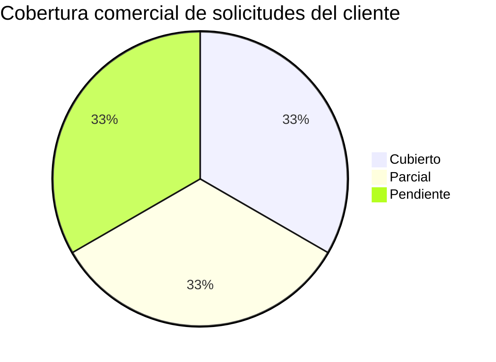

# Politica: Analisis de oportunidad y diseno de oferta comercial (commercial-opportunity-analysis)

Politica **permanente y reutilizable** de la organizacion. No es especifica de
ningun cliente ni de ninguna consultora concreta. Credi10 2.0 se cita solo como
*ejemplo de aplicacion*, nunca como el sujeto de la politica.

## 1. Principio (no negociable)

> Una oferta comercial gana cuando **demuestra** que entendio la necesidad del
> cliente y la **responde punto a punto**. El experto comercial analiza la
> oportunidad desde el corpus (la solicitud del cliente, tipicamente un RFP),
> levanta el **checklist de la informacion que el cliente pide**, desarrolla el
> **contenido de respuesta** dentro de la oferta y asegura la **correlacion**
> entre lo que el cliente pide, lo que la oferta responde y los outcomes del
> advisory que lo sustentan. Nunca se fabrica cobertura: si el corpus no permite
> responder una solicitud, se marca honestamente **Pendiente** con la etiqueta
> epistemica correspondiente.

## 2. Alcance del rol (experto en diseno de ofertas comerciales)

El rol gobernado por esta politica es un **experto en bid-management y diseno de
ofertas comerciales** cuyo mandato es:

- **(a) Analizar la oportunidad.** Entender el **contexto de la necesidad del
  cliente** a partir del corpus (RFP y documentos de soporte): que problema
  resuelve, que valor espera, que restricciones impone y que criterios de
  evaluacion usara.
- **(b) Checklist de informacion solicitada.** Producir un **checklist marcable**
  de **toda la informacion que el cliente solicita** (informes requeridos,
  secciones obligatorias, datos, formatos, criterios de evaluacion), derivado
  dinamicamente del corpus.
- **(c) Desarrollar el contenido de respuesta.** Para cada necesidad, desarrollar
  el **contenido** con el que la oferta responde (win themes, mensaje de valor,
  seccion de la propuesta donde se aborda, como se diferencia).
- **(d) Correlacion y gobierno de supuestos.** Producir el **checklist de items a
  desarrollar + consideraciones + supuestos** sobre la oferta y la **matriz de
  trazabilidad comercial** que correlaciona solicitud del cliente -> oferta ->
  outcome del advisory -> estado.

## 3. Relacion con politicas hermanas (COMPLEMENTA, no duplica)

Esta politica **complementa** y **NO duplica** a dos politicas hermanas:

- `commercial-proposal-report` **emite el documento de venta** (la propuesta con
  sus 11 secciones a-k). Esta politica **no reescribe** la propuesta: la **mapea**
  para demostrar que cada necesidad del cliente queda respondida en alguna de sus
  secciones (`1-propuesta-comercial.md`).
- `requirements-traceability` **deriva dinamicamente las solicitudes del cliente**
  desde el corpus y las responde punto a punto a nivel de **entregable tecnico**.
  Esta politica **REUSA** su salida (`extract_requirements`) como **fuente unica**
  de las solicitudes del cliente; **no reimplementa** la extraccion ni inventa una
  lista fija. La diferencia de foco:

| Politica | Foco | Direccion de lectura |
| --- | --- | --- |
| `requirements-traceability` | Cobertura **tecnica**: cada solicitud -> fase/entregable del advisory | cliente -> advisory |
| `commercial-opportunity-analysis` | Cobertura **comercial**: cada solicitud -> seccion de la **oferta** respaldada por el outcome del advisory | cliente -> oferta -> advisory |

Regla de reuso: las solicitudes del cliente (IDs `REQ-NNN`, cita a documento
fuente, estado de cobertura) provienen de `extract_requirements(documents)` y se
reutilizan tal cual; esta politica anade la capa **comercial** encima.

## 4. Dos outcomes SEPARADOS (direcciones/archivos distintos)

Esta politica gobierna **DOS outcomes independientes**, publicados en **rutas y
archivos SEPARADOS** (nunca juntos en una sola carpeta ni en un solo archivo):

### Outcome 1 - Analisis de la oportunidad y contenido de respuesta

Contiene, en su propia ruta:

- **Analisis de la oportunidad**: contexto de la necesidad del cliente derivado
  del corpus (problema, valor esperado, restricciones, criterios de evaluacion),
  con cita al documento fuente.
- **Checklist de la informacion que el cliente solicita** (marcable):
  - `- [x]` informacion disponible/cubierta en el corpus
  - `- [~]` parcialmente disponible
  - `- [ ]` solicitada pero no disponible en el corpus (`[EPISTEMIC-VOID]`)
- **Contenido desarrollado** para responder cada necesidad dentro de la oferta
  (win theme / mensaje de valor por solicitud y la seccion de la propuesta donde
  se materializa).

### Outcome 2 - Checklist de items, consideraciones, supuestos y correlacion

Contiene, en su **propia ruta distinta** de la del Outcome 1:

- **Checklist de items a desarrollar** para cerrar la oferta (marcable).
- **Consideraciones y supuestos** sobre la oferta comercial (cada supuesto
  etiquetado `[DOC-ASSUMPTION]`; cifras siempre como rangos `[DOC-ASSUMPTION]`).
- **Matriz de trazabilidad comercial** oferta<->advisory<->RFP (ver seccion 5),
  que demuestra **como el advisory responde a cada punto** que pide el cliente.

> Separacion obligatoria: el Outcome 1 y el Outcome 2 se escriben en **archivos y
> directorios distintos**. No se concatenan ni se mezclan en una sola salida.

## 5. Matriz de trazabilidad comercial (columnas EXACTAS)

El Outcome 2 incluye SIEMPRE una **matriz de trazabilidad comercial** con estas
columnas, en este orden exacto:

`Solicitud del cliente (cita RFP, con nombre de documento) | ¿La oferta la responde? (seccion de 1-propuesta-comercial.md) | Outcome del advisory que la sustenta (fase/entregable) | Estado (Cubierto/Parcial/Pendiente) | Consideracion/Supuesto`

Reglas de llenado:

1. **Solicitud del cliente**: cita literal/acotada de la solicitud y **nombre del
   documento fuente** (p. ej. `RFP_CREDI10_2_0`), reutilizando los `REQ-NNN` de
   `requirements-traceability`.
2. **¿La oferta la responde?**: la **seccion a-k** de `1-propuesta-comercial.md`
   (de `commercial-proposal-report`) donde la oferta aborda la solicitud; si
   ninguna seccion la aborda, se declara honestamente como **Pendiente**.
3. **Outcome del advisory que la sustenta**: la **fase/entregable** del advisory
   que respalda la respuesta (reutiliza el mapeo `palabra-clave -> punto de
   entrada` de `requirements-traceability`).
4. **Estado**: `Cubierto` / `Parcial` / `Pendiente`, derivado de las senales de
   texto util / flag epistemico del documento fuente (nunca optimista).
   `Pendiente` implica `[EPISTEMIC-VOID]`.
5. **Consideracion/Supuesto**: nota honesta; los supuestos se marcan
   `[DOC-ASSUMPTION]`; cuando el corpus no permite responder, `[EPISTEMIC-VOID]`.

Opcionalmente se incluye un resumen Mermaid de cobertura comercial por estado:



## 6. Honestidad epistemica (regla dura)

- Nunca se declara `Cubierto` sin seccion de oferta **y** respaldo de outcome del
  advisory **y** texto util real en la fuente.
- Las solicitudes que el corpus no permite responder se marcan **Pendiente** con
  `[EPISTEMIC-VOID]` y una nota; **no se fabrica cobertura**.
- El **contenido de respuesta** (win themes) es contenido comercial generico y
  recalibrable; cuando afirma un dato del cliente debe tener cita al corpus; de lo
  contrario es `[DOC-ASSUMPTION]`.

| Etiqueta | Significado |
| --- | --- |
| `[VERIFIED-FACT]` | La solicitud/dato proviene de capa de texto util verificada del corpus. |
| `[OCR-EXTRACTED]` | Proviene de texto recuperado via OCR. |
| `[DOC-ASSUMPTION]` | Supuesto comercial razonable (p. ej. cifras, win themes), a validar. |
| `[DOC-CONFLICT]` | Tension entre fuentes del corpus. |
| `[EPISTEMIC-VOID]` | El corpus no permite responder la solicitud (OCR/fuente pendiente). |

## 7. Determinismo y dinamismo (hard requirement)

Ambos outcomes los **genera el motor**, no se escriben a mano:

- **Dinamico**: las solicitudes del cliente se toman de `extract_requirements`
  sobre el corpus; si cambia el corpus/RFP, ambos outcomes se **recalculan** con
  las solicitudes del nuevo cliente.
- **Determinista**: sin red ni LLM, orden estable (IDs `REQ-NNN` en orden de
  documento), sin azar ni timestamps; una segunda corrida deja el arbol git
  byte-identico (sin drift).
- **Visible en el HTML**: ambos outcomes deben quedar embebidos y navegables en la
  pagina HTML descargable del engagement (el visor auto-contenido), ademas de
  enlazarse desde el indice maestro.

## 8. Checklist de aplicacion (declarativo, lo ejecuta el motor)

```checklist
- id: reuse-requirements
  check: Las solicitudes del cliente provienen de requirements-traceability (extract_requirements), no se hardcodean ni se duplica la extraccion.
- id: complements-not-duplicates
  check: La politica mapea la propuesta de commercial-proposal-report; no reescribe sus secciones ni el anexo tecnico.
- id: two-separate-outcomes
  check: Se publican DOS outcomes en rutas/archivos SEPARADOS (Outcome 1 analisis+checklist+contenido; Outcome 2 checklist+consideraciones+supuestos+matriz).
- id: exact-matrix-columns
  check: La matriz usa las columnas exactas Solicitud | ¿La oferta la responde? | Outcome del advisory | Estado | Consideracion/Supuesto.
- id: honest-status
  check: Estado Cubierto/Parcial/Pendiente con texto util real; Pendiente -> [EPISTEMIC-VOID]; supuestos/cifras -> [DOC-ASSUMPTION].
- id: deterministic
  check: Dos corridas producen ambos outcomes byte-identicos (sin azar ni timestamps).
- id: dynamic
  check: Con otro corpus/RFP ambos outcomes se regeneran con las solicitudes de ese cliente.
- id: visible-in-html
  check: Ambos outcomes quedan embebidos y navegables en la pagina HTML descargable.
```

## 9. Definicion de DONE

La aplicacion de esta politica esta DONE solo si:

- [ ] el **Outcome 1** (analisis de oportunidad + checklist de informacion
  solicitada + contenido de respuesta) existe en su propia ruta;
- [ ] el **Outcome 2** (checklist de items + consideraciones + supuestos + matriz
  de trazabilidad comercial) existe en una ruta **distinta**;
- [ ] la matriz usa las **columnas exactas** de la seccion 5;
- [ ] las solicitudes se **reutilizan** de `requirements-traceability` y la oferta
  se **mapea** desde `commercial-proposal-report` (sin duplicar ninguna);
- [ ] el estado es honesto (Cubierto/Parcial/Pendiente; Pendiente ->
  `[EPISTEMIC-VOID]`) y los supuestos van `[DOC-ASSUMPTION]`;
- [ ] ambos outcomes son deterministas, dinamicos y visibles en el **HTML**
  descargable y enlazados desde el indice maestro.

## 10. Implementacion de referencia

El motor stdlib (en `advisory-system/phases/`) implementara esta politica como un
generador determinista que: (1) obtiene las solicitudes del cliente desde
`requirements_traceability.extract_requirements(documents)` (reuso, no duplicado);
(2) mapea cada solicitud a la seccion a-k de la propuesta de `commercial_proposal`
y a la fase/entregable del advisory; (3) escribe el **Outcome 1** y el **Outcome 2**
en **rutas separadas** bajo el engagement; (4) construye la matriz con las columnas
exactas y el estado honesto; y (5) los expone en el indice maestro y en el visor
HTML (`phases/site.py`). Los roles productores naturales son el **Comite de
Gobierno** (Engagement Director y Engagement Manager), gobernados por este skill.
Para Credi10 2.0 ambos outcomes se publican bajo `advisory-credi10-2.0/` como
*ejemplo de aplicacion*.
