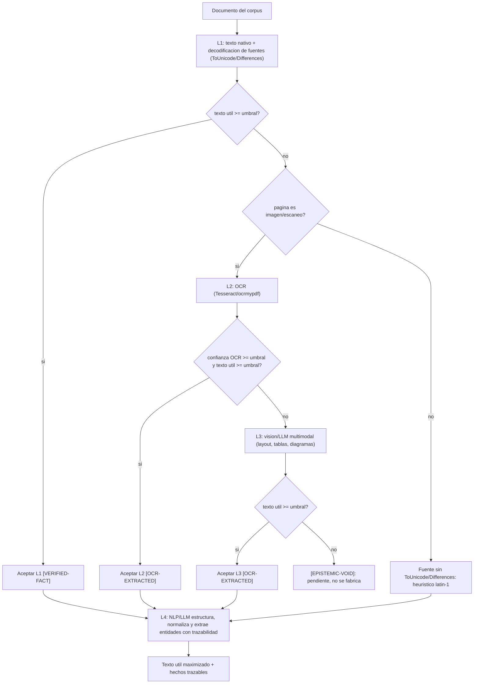

# Politica: Arquitectura de extraccion de documentos multicapa (document-extraction-architecture)

Politica **permanente y reutilizable** de la organizacion. No es especifica de
ningun cliente. Credi10 2.0 se cita solo como *ejemplo de aplicacion*, nunca
como el sujeto de la politica.

## 1. Principio (no negociable)

> El objetivo de la ingesta es **maximizar el texto util real** de CADA
> documento del corpus, aplicando la capa de extraccion **mas barata y mas
> fiel** que recupere el contenido, y **escalando** a capas mas potentes solo
> cuando la capa previa no alcanza el umbral de texto util. Ninguna capa
> fabrica contenido: lo que no se recupera se marca honestamente como vacio
> epistemico. La estrategia es **capa por capa con degradacion honesta**.

Esta politica es la **arquitectura paraguas** que integra y ordena a
`complete-corpus-ingestion` (ingerir TODO el corpus, sin muestreo),
`ocr-image-extraction` (como recuperar imagenes/escaneos con OCR) y
`token-budget-optimization` (como acotar el volumen sin excluir documentos). Las
tres politicas son tacticas dentro de esta estrategia de capas.

## 2. Estrategia: la escalera de capas (L1 -> L4)

La extraccion se organiza como una **escalera de cuatro capas**. Cada documento
sube de capa SOLO si la capa actual no supera el umbral de texto util
(`MIN_USEFUL_RATIO_FOR_TEXT`, p. ej. 3%). Se prefiere siempre la capa mas baja
disponible porque es la mas barata, la mas determinista y la mas fiel al
original.

| Capa | Que hace | Tecnologia tipica | Etiqueta epistemica | Costo relativo |
| --- | --- | --- | --- | --- |
| **L1** Texto nativo + decodificacion de fuentes | Lee la capa de texto del PDF y decodifica fuentes embebidas con codificacion personalizada (CMap `/ToUnicode`, `/Encoding /Differences`, `Type0`/`Identity-H`). | stdlib (`zlib`+`re`), sin red | `[VERIFIED-FACT]` (texto nativo) | Minimo |
| **L2** OCR de paginas imagen | Rasteriza y aplica OCR a paginas que son imagen/escaneo (sin capa de texto). | Tesseract / ocrmypdf / pdfimages+tesseract | `[OCR-EXTRACTED]` | Medio |
| **L3** Vision/LLM multimodal | Interpreta layout complejo, tablas, formularios y diagramas que el OCR plano no estructura bien. | Document AI / LLM multimodal (vision) | `[OCR-EXTRACTED]` (recuperado por modelo) | Alto |
| **L4** NLP/LLM de post-proceso | Estructura, normaliza y extrae entidades/hechos con trazabilidad desde el texto ya recuperado por L1-L3. | NLP clasico / LLM con citas a fuente | hereda la etiqueta de la capa origen | Alto |

> **Regla de oro:** L4 **no inventa** datos que L1-L3 no recuperaron; estructura
> y normaliza lo ya extraido, conservando la trazabilidad a la pagina/documento
> fuente. Si una entidad no esta en el texto recuperado, queda como
> `[EPISTEMIC-VOID]`, no se completa por inferencia del modelo.

## 3. Tactica: flujo de decision con fallback

Para cada documento se evalua el **texto util real**:

```
texto_util_real = caracteres_en_palabras_reales / caracteres_de_texto_extraido
```

donde "palabra real" es una secuencia de **>= 3 letras** (vocales acentuadas y
ñ incluidas). El flujo escala de capa en capa hasta cruzar el umbral o agotar
las capas disponibles en el entorno:



El flujo es **tolerante a fallos**: un error en una capa degrada a la siguiente
(o al estado honesto `[EPISTEMIC-VOID]`) sin abortar el pipeline, y el resultado
es **determinista** (re-ejecutar deja la salida byte-identica).

## 4. Umbrales de confianza y validacion de cobertura

- **Umbral de texto util** (`MIN_USEFUL_RATIO_FOR_TEXT`, p. ej. 3%): por debajo,
  el documento se considera sin capa de texto explotable y escala de capa.
- **Umbral de confianza OCR** (`OCR_CONFIDENCE_THRESHOLD`, 0..100, p. ej. 60):
  el texto por pagina con confianza inferior se descarta antes de aceptarlo.
- **Bandas de cobertura** (`USEFUL_TEXT_BANDS`): `alta` >= 40%, `media` >= 20%,
  `baja` >= 3%, `nula` por debajo. La banda se deriva del **texto util real**,
  no del tamano crudo del archivo.
- **Validacion de cobertura:** tras la ingesta se verifica que TODOS los
  documentos quedaron procesados (cobertura total, sin muestreo), con su banda,
  su metodo de ingesta y su etiqueta epistemica. Un documento en `nula` /
  `[EPISTEMIC-VOID]` es una senal de que falta una capa en el entorno, no de que
  el documento se abandone.

Todos los umbrales son **perillas declarativas recalibrables**, no constantes
magicas enterradas en el codigo.

## 5. Gobernanza epistemica (como se etiqueta cada fuente)

| Etiqueta | Significado | Capa origen tipica |
| --- | --- | --- |
| `[VERIFIED-FACT]` | Capa de texto **nativa** util (incluida la recuperada por decodificacion de fuentes) o transcripcion humana estatica. | L1 |
| `[OCR-EXTRACTED]` | Texto **recuperado por OCR o por modelo de vision**; recuperacion automatica, se cita como tal. | L2, L3 |
| `[EPISTEMIC-VOID]` | Contenido **no recuperable** en este entorno (capa necesaria no disponible). No se fabrica. | fallback final |
| `[DOC-ASSUMPTION]` | Supuesto razonable derivado del texto, marcado para validar con el cliente. | L4 |
| `[DOC-CONFLICT]` | Tension entre dos fuentes del corpus; se expone, no se resuelve en silencio. | L4 |

La **decodificacion de fuentes** (CMap `/ToUnicode`) de L1 es recuperacion de
texto **nativo**, no OCR: por eso conserva `[VERIFIED-FACT]`. Solo las capas que
reconstruyen texto desde pixeles (L2/L3) producen `[OCR-EXTRACTED]`.

## 6. Tactica por tipo de documento

| Tipo de documento | Capa recomendada | Fallback | Nota |
| --- | --- | --- | --- |
| PDF con capa de texto nativa limpia | L1 | - | Caso ideal, costo minimo. |
| PDF con fuentes embebidas de codificacion personalizada (`Type0`/`Identity-H`, `/ToUnicode`) | L1 (decodificacion de fuentes) | L2 si el mapeo no existe | El contenido SI existe; hay que decodificarlo, no escanearlo. |
| PDF escaneado / pagina imagen (`DCTDecode`, sin capa de texto) | L2 (OCR) | L3 | Requiere motor OCR en el entorno. |
| PDF con tablas/formularios/layout complejo | L3 (vision/LLM) | L2 | El OCR plano pierde la estructura; el modelo multimodal la conserva. |
| Diagrama/plano (PNG/JPG) de arquitectura | Transcripcion humana estatica `[VERIFIED-FACT]` o L3 | L2 | Un diagrama no es prosa; su valor esta en relaciones, no en texto corrido. |
| Documento ofimatico nativo (docx/xlsx/pptx) | L1 (parser nativo del formato) | L4 | Texto ya estructurado; L4 normaliza entidades. |
| Correo/HTML/export de wiki | L1 (parser) + L4 | - | L4 limpia boilerplate y extrae hechos. |

## 7. Que capa esta IMPLEMENTADA aqui vs. que requiere produccion

> **Marca explicita de alcance.** En este entorno (stdlib-only, sin red, sin
> motor OCR) **solo L1 esta implementada y en ejecucion**. L2, L3 y L4 estan
> **disenadas y listas por contrato** pero requieren el **entorno de
> produccion** (motores OCR, Document AI / LLM multimodal, servicios NLP/LLM).

| Capa | Estado en este sandbox | Requiere |
| --- | --- | --- |
| **L1** texto nativo + decodificacion de fuentes | **IMPLEMENTADA** (`advisory-system/engine/pdf_text.py`, stdlib `zlib`+`re`) | nada (stdlib) |
| **L2** OCR de paginas imagen | **No disponible** (degradacion honesta, ver `ocr-image-extraction`) | Tesseract/ocrmypdf en el entorno |
| **L3** vision/LLM multimodal | **No disponible** | Document AI / LLM multimodal con red |
| **L4** NLP/LLM de post-proceso | **No disponible** | servicio NLP/LLM con red |

Cuando el mismo corpus se procese en el entorno de produccion, las capas L2-L4
se activan **sin cambios en la estrategia**: el flujo de decision y las etiquetas
epistemicas ya estan definidos aqui.

## 8. Integracion con otras politicas

- **`complete-corpus-ingestion`:** esta arquitectura es el COMO de la obligacion
  de ingerir TODO el corpus. Cada documento pasa por la escalera de capas; la
  validacion de cobertura de la seccion 4 es la prueba de ingesta completa.
- **`ocr-image-extraction`:** es la **tactica L2** de esta estrategia. Define
  los motores OCR, su orden de preferencia, el umbral de confianza y la
  degradacion honesta sin motor. Aqui L2 se inserta en el flujo global.
- **`token-budget-optimization`:** gobierna L4 y el tamano de la salida. La
  priorizacion por presupuesto **cambia el orden/esfuerzo** de las capas, nunca
  excluye un documento; el corpus completo siempre pasa por L1.

## 9. Checklist de aplicacion (declarativo, lo ejecuta el motor)

```checklist
- id: layer-l1-native-font-decoding
  check: Se leyo la capa de texto nativa y se decodificaron las fuentes embebidas (ToUnicode/Differences) antes de escalar.
- id: layer-escalation-by-useful-text
  check: Cada documento solo escala de capa si su texto util real queda bajo el umbral.
- id: confidence-thresholds
  check: Se aplicaron el umbral de texto util y el de confianza OCR como perillas declarativas.
- id: coverage-validation
  check: Se valido que TODOS los documentos quedaron procesados, con banda, metodo y etiqueta epistemica.
- id: epistemic-governance
  check: Cada fuente quedo etiquetada [VERIFIED-FACT]/[OCR-EXTRACTED]/[EPISTEMIC-VOID]/[DOC-ASSUMPTION]/[DOC-CONFLICT].
- id: tactics-by-doc-type
  check: Se eligio la capa segun el tipo de documento (texto nativo, fuente personalizada, escaneo, layout complejo, diagrama).
- id: honest-degradation
  check: Las capas no disponibles en el entorno degradan honestamente sin fabricar texto; L4 no inventa entidades ausentes.
- id: determinism
  check: El resultado es determinista y byte-identico al re-ejecutar en el mismo entorno.
- id: scope-marking
  check: Se marco explicitamente que capa esta implementada (L1) vs cual requiere produccion (L2-L4).
```

## 10. Implementacion de referencia

La **capa L1** de esta politica esta implementada en
`advisory-system/engine/pdf_text.py` (`extract_pdf_text_font_aware`,
`parse_tounicode_cmap`, `parse_differences`): localiza objetos y streams,
descomprime `FlateDecode`, parsea el CMap `/ToUnicode` de cada fuente embebida
(`beginbfchar`/`beginbfrange` y la forma de arreglo `[<a><b>]`), detecta el
ancho de codigo desde el `codespacerange`, rastrea la fuente activa via `Tf`,
decodifica literales `( ... )` y cadenas hex `< ... >` en `Tj`/`TJ` leyendo solo
dentro de objetos `BT ... ET`, y degrada por fuente/stream al heuristico latin-1
ante cualquier error. La banda de cobertura y la etiqueta epistemica se derivan
del **texto util real** en `advisory-system/engine/knowledge.py`
(`count_useful_chars`, `useful_text_band`, `epistemic_flag`, `USEFUL_TEXT_BANDS`,
`MIN_USEFUL_RATIO_FOR_TEXT`). Las capas L2-L4 se contratan en
`advisory-system/engine/ocr.py` (adaptador OCR con degradacion honesta) y
quedan listas para activarse en el entorno de produccion. Todo es determinista,
sin red ni LLM en este entorno, y recalibrable via las perillas de politica.
