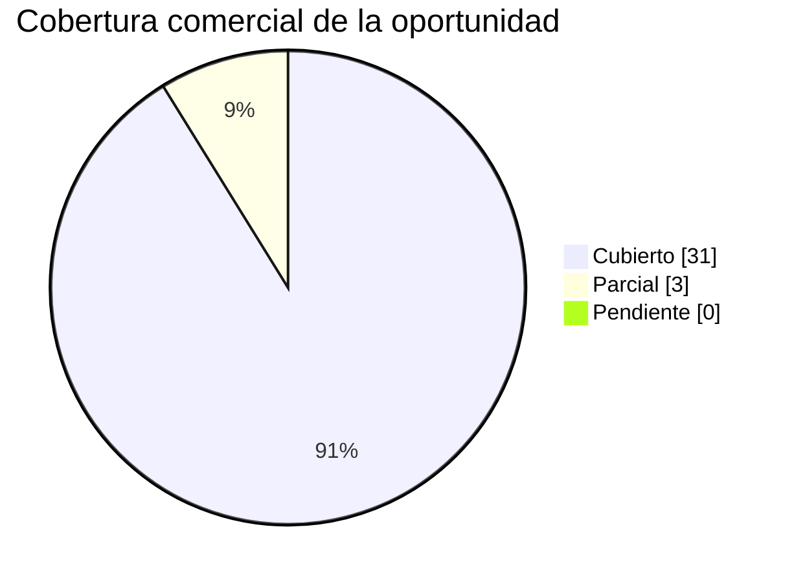

# Outcome 1 - Analisis de la oportunidad y contenido de respuesta

> Primer outcome comercial gobernado por el skill `commercial-opportunity-analysis`. Lo produce el **Comite de Gobierno** (Engagement Director + Engagement Manager) como experto en **diseno de ofertas comerciales**. Es documentacion **generada de forma determinista** por el motor (`advisory-system/phases/commercial_opportunity.py`) y **dinamica**: las solicitudes del cliente se **reutilizan** de `requirements-traceability` (`extract_requirements`), no se hardcodean. COMPLEMENTA (no duplica) a `commercial-proposal-report` y a `requirements-traceability`.

> **Separacion de outcomes:** este es el **Outcome 1**. El checklist de items + consideraciones + supuestos + la **matriz de correlacion** viven en un archivo **separado**, [`0b-checklist-oferta-y-correlacion.md`](0b-checklist-oferta-y-correlacion.md) (Outcome 2).

> **Etiquetas epistemicas:** **[VERIFIED-FACT]** solicitud/dato de capa de texto util verificada; **[OCR-EXTRACTED]** derivada de texto recuperado via OCR; **[DOC-ASSUMPTION]** supuesto comercial/cifra a validar; **[DOC-CONFLICT]** tension entre fuentes; **[EPISTEMIC-VOID]** el corpus no permite responder (OCR/fuente pendiente). No se fabrica cobertura.

> **Regenerar (parte de `--phase all`):**
>
> ```bash
> python3 advisory-system/quickstart.py --phase all
> ```

## 1. Analisis de la oportunidad

Se derivaron **34 solicitudes** del cliente sobre un corpus de **18** documentos: **31 Cubierto**, **3 Parcial**, **0 Pendiente**. La solicitud se analiza priorizando el documento tipo RFP **RFP_CREDI10_2_0.pdf** y complementando con el resto del corpus.

**Procedencia de las solicitudes:** **16** provienen del documento tipo **RFP** (`[RFP]`) y **18** se derivan de otros documentos de contexto/corpus (`[CONTEXTO]`: specs, diagramas, assessments). La validacion de cobertura del RFP debe priorizar las filas `[RFP]`; las filas `[CONTEXTO]` enriquecen el entendimiento pero no son solicitudes formales de la oferta.

**Estado comercial honesto:** el `Estado` **no** se copia del estado tecnico upstream; se recalcula verificando que la **seccion de la oferta** mapeada EXISTE y esta poblada en [`1-propuesta-comercial.md`](1-propuesta-comercial.md) y que aborda los terminos de la solicitud. Si la seccion falta o no la aborda, la fila se degrada a **Parcial**; las solicitudes de **indicadores** se declaran **Parcial** porque su respaldo son cifras ROI `[DOC-ASSUMPTION]`, no compromisos cerrados. Nunca se afirma `Cubierto` sin seccion de oferta real.

La **necesidad del cliente** (contexto, problema a resolver, valor esperado, restricciones y criterios de evaluacion) se **deriva del corpus**: cada solicitud conserva la **cita a su documento fuente**, de modo que la lectura de la oportunidad es trazable y no fabricada. Cuando el corpus no permite responder una solicitud, se declara honestamente **Pendiente** con `[EPISTEMIC-VOID]` en lugar de inventar cobertura.

La oportunidad se materializa en la **propuesta comercial** ([`1-propuesta-comercial.md`](1-propuesta-comercial.md)): este analisis **no reescribe** la propuesta ni sus cifras, la **mapea** para demostrar que cada necesidad queda respondida en alguna de sus secciones a-k.

### Distribucion de la oportunidad por tipo de solicitud

| Tipo de solicitud (kind) | # solicitudes | Seccion de la propuesta |
| --- | --- | --- |
| alcance | 4 | b. Alcance del servicio |
| arquitectura | 1 | e. Entregables |
| datos | 2 | e. Entregables |
| evaluacion | 1 | f. Estrategia de consultoria |
| funcional | 1 | e. Entregables |
| generico | 1 | b. Alcance del servicio |
| indicadores | 1 | j. Inversion |
| informes | 1 | e. Entregables |
| integraciones | 12 | e. Entregables |
| objetivos | 7 | c. Contexto de negocio |
| operacion | 1 | d. Metodologia de consultoria |
| tecnico | 1 | e. Entregables |
| tecnologia | 1 | c. Contexto de negocio |

### Cobertura de la oportunidad por estado




## 2. Checklist de la informacion que el cliente solicita

Checklist **marcable** derivado dinamicamente de `extract_requirements`. Leyenda: `- [x]` disponible/cubierta en el corpus - `- [~]` parcialmente disponible - `- [ ]` solicitada pero no disponible (`[EPISTEMIC-VOID]`).

- [x] **REQ-001** (Cubierto) [RFP] ALCANCE La propuesta presentada por el oferente debe contemplar el cumplimiento a cabalidad de los requerimientos solicitados por LA EMPRESA para “ PROYECTO CREDI10 2.0 ”. 1. 4 VISITA AL LUGAR DE PRESTACIÓN DE L SERVICIO... _[fuente: RFP_CREDI10_2_0.pdf - Alcance]_ [VERIFIED-FACT]
- [x] **REQ-002** (Cubierto) [RFP] Objetivo general Realizar el diagnóstico, diseñoy transformación progresiva de la arquitectura tecnológica de Credi10 hacia una arquitectura objetivo Credi10 2.0, que permita disponer de una plataforma robusta, escalable... _[fuente: RFP_CREDI10_2_0.pdf - Objetivo general]_ [VERIFIED-FACT]
- [x] **REQ-003** (Cubierto) [RFP] arquitectura objetivo Credi10 2.0, que permita disponer de una plataforma robusta, escalable, segura, mantenible, observable y sostenible tecnol ógicamente, alineada con las necesidades actuales y futuras del negocio. 2.... _[fuente: RFP_CREDI10_2_0.pdf - Arquitectura objetivo]_ [VERIFIED-FACT]
- [x] **REQ-004** (Cubierto) [RFP] Objetivos específicos • Realizar el levantamiento e inventario detallado de los componentes tecnológicos actuales. • Evaluar la arquitectura actual desde las perspectivas de aplicaciones, datos, infraestructura, integrac... _[fuente: RFP_CREDI10_2_0.pdf - Objetivos especificos]_ [VERIFIED-FACT]
- [x] **REQ-005** (Cubierto) [RFP] Alcance del proyecto El alcance comprende el diagnóstico integral, diseño de arquitectura objetivo, definición del roadmap y ejecución de las iniciativas de transformación tecnológica requeridas para Credi10 2.0. 1. Asse... _[fuente: RFP_CREDI10_2_0.pdf - Alcance del proyecto]_ [VERIFIED-FACT]
- [x] **REQ-006** (Cubierto) [RFP] Assessment de arquitectura actual El proveedor deberá realizar un assessment de: • Aplicaciones. • Servicios Windows. • APIs. • Integradores. • Bases de datos. • Componentes de procesamiento batch y/o programado. • Front... _[fuente: RFP_CREDI10_2_0.pdf - Assessment de arquitectura actual]_ [VERIFIED-FACT]
- [~] **REQ-007** (Parcial) [RFP] Evaluación tecnológica Para cada componente se deberá evaluar como mínimo los siguientes items : • Lenguaje de programación. • Framework y versión. • Librerías y dependencias. • Estado de soporte tecnológico. • Obsolesce... _[fuente: RFP_CREDI10_2_0.pdf - Evaluacion tecnologica]_ [VERIFIED-FACT]
- [x] **REQ-008** (Cubierto) [RFP] Evaluación de bases de datos Se deberá evaluar la arquitectura y estado de las bases de datos asociadas a Credi10, incluyendo: • Motor y versión. • Modelo de datos. • Volumen y crecimiento. • Performance. • Índices y con... _[fuente: RFP_CREDI10_2_0.pdf - Evaluacion de bases de datos]_ [VERIFIED-FACT]
- [x] **REQ-009** (Cubierto) [RFP] Evaluación de integraciones Se deberán identificar y evaluar las integraciones con sistemas internos, externos y proveedores, incluyendo, entre otros y documentar las dependencias, mecanismos de integración, criticidad,... _[fuente: RFP_CREDI10_2_0.pdf - Evaluacion de integraciones]_ [VERIFIED-FACT]
- [~] **REQ-010** (Parcial) [RFP] Indicadores de retorno # Indicador Porcentaje Actual Porcentaje esperado 1 Disponibilidad de aplicaci ones y servicios críticos 90% 99 % 2 Optimización y eficiencia de recursos tecnológicos 60% 80 % 3 Optimización del c... _[fuente: RFP_CREDI10_2_0.pdf - Indicadores de retorno]_ [VERIFIED-FACT]
- [x] **REQ-011** (Cubierto) [RFP] Requerimientos funcionales: Concepto Descripción Requerimientos funcionales y del proceso La transformación tecnológica deberá preservar las funcionalidades y reglas de negocio existentes en Credi10, incluyendo las perso... _[fuente: RFP_CREDI10_2_0.pdf - Requerimientos funcionales]_ [VERIFIED-FACT]
- [x] **REQ-012** (Cubierto) [RFP] Requerimientos de la operación El assesment y la arquitectura objetivo deberán contemplar como mínimo los siguientes aspectos : • Alta disponibilidad de los componentes críticos los cuales son: Carrera 34 No. 10 - 581 Te... _[fuente: RFP_CREDI10_2_0.pdf - Requerimientos de la operacion]_ [VERIFIED-FACT]
- [x] **REQ-013** (Cubierto) [RFP] Informes requeridos El proveedor deberá entregar como mínimo: 1. Assessment • Inventario tecnológico. • Inventario de aplicaciones y servicios. • Inventario de APIs. • Inventario de bases de datos. • Inventario de integr... _[fuente: RFP_CREDI10_2_0.pdf - Informes requeridos]_ [VERIFIED-FACT]
- [x] **REQ-014** (Cubierto) [RFP] Requerimientos técnicos : (Diligenciados por TI) Concepto Descripción Arquitectura de la solución La arquitectura objetivo deberá estar orientada a principios de: • A coplamiento. • Alta cohesión. • Escalabilidad. • Disp... _[fuente: RFP_CREDI10_2_0.pdf - Requerimientos tecnicos]_ [VERIFIED-FACT]
- [x] **REQ-015** (Cubierto) [RFP] Métodos de integración El proveedor deberá evaluar los mecanismos de integración actuales y definir los métodos recomendados para la arquitectura Credi10 2.0. Podrán contemplarse, según corresponda: • APIs REST. • APIs S... _[fuente: RFP_CREDI10_2_0.pdf - Metodos de integracion]_ [VERIFIED-FACT]
- [x] **REQ-016** (Cubierto) [RFP] EVALUACIÓN DE LAS PROPUESTAS Las ofertas serán evaluadas con base en los siguientes criterios y calificaciones, para obtener un puntaje máximo de 100 puntos . Aspecto a evaluar Puntaje Experiencia: años y certificaciones... _[fuente: RFP_CREDI10_2_0.pdf - Evaluacion de las propuestas]_ [VERIFIED-FACT]
- [x] **REQ-017** (Cubierto) [CONTEXTO] corre sobre .NET Framework 4.8 en IIS 10; integradores en .NET y Windows Services en .NET Core 8 y .NET 4.8. Bases de datos SQL Server 2019 Enterprise: C10_Credi10NET, C10_Inspektor, C10_Datacredito y C10_Database. El mo... _[fuente: Arquitectura_Aplicacion_Despliegue_Credi10.png - Numeral 10]_ [VERIFIED-FACT]
- [~] **REQ-018** (Parcial) [CONTEXTO] VPC 'STUDIO F' con WAF -> ALB -> instancias EC2 privadas, almacenamiento S3, monitoreo CloudWatch, NAT Gateway y Bastion host. Conectividad hibrida mediante VPN IPSec de Telmex hacia el centro de datos on-prem 'Cokioto'. _[fuente: Arquitectura_Infraestructura_AWS_Credi10.png - Numeral 2]_ [VERIFIED-FACT]
- [x] **REQ-019** (Cubierto) [CONTEXTO] de Credi10. Aplicacion web central CREDI10 en .NET integrada con UNOEE/Siesa (ERP), PENTAHO (BI/ETL), CROSSCORE -> INSPEKTOR -> DICTUM/Datacredito (originacion y riesgo), Numrot, Cobranza, B2C, Link de Recaudo -> PayU, V... _[fuente: Diagrama_Contexto_Credi10.png - Numeral 4]_ [VERIFIED-FACT]
- [x] **REQ-020** (Cubierto) [CONTEXTO] Assessment de Arquitectura Fecha: Mayo, 2026 Index 1. Objetivo del Documento 3 2. Contexto de Negócio 3 2.1. Puntos dolores principales 3 3. Arquitectura Actual 4 3.1. Diagrama General de Arquitectura 5 3.2. Arquitectura... _[fuente: WSO2 y Studio F - Assessment Mayo2026-Final.pdf - Assessment de arquitectura actual]_ [VERIFIED-FACT]
- [x] **REQ-021** (Cubierto) [CONTEXTO] 2 Versión:001 Fecha: 08/06/2021 FORMATO DE DESARROLLO E INTEGRACIONES API Integrador Atención Al Cliente STF GROUP S.A. INFORMATICA – Py. CREDI10 SOFTWARE PROPIO Cali , viernes 26 de diciembre del 202 5 Código:FT - DG -... _[fuente: Api Integrador Atencion al cliente.pdf - Numeral 00]_ [VERIFIED-FACT]
- [x] **REQ-022** (Cubierto) [CONTEXTO] 2 Versión:001 Fecha: 08/06/2021 FORMATO DE DESARROLLO E INTEGRACIONES FT - SL - 011 - APIs Portal clientes B2C STF GROUP S.A. INFORMATICA – Py. CREDI10 SOFTWARE PROPIO Cali , jueves 19 de febrero del 2024 Código:FT - DG... _[fuente: B2C.pdf - Numeral 00]_ [VERIFIED-FACT]
- [x] **REQ-023** (Cubierto) [CONTEXTO] 2 Versión:001 Fecha: 08/06/2021 FORMATO DE DESARROLLO E INTEGRACIONES FT - SL - 011 - APIs Botón Ecommerce Credi10 STF GROUP S.A. INFORMATICA – Py. CREDI10 SOFTWARE PROPIO Cali , jueves 19 de febrero del 2024 Código:FT -... _[fuente: BotonEcommerce.pdf - Numeral 00]_ [VERIFIED-FACT]
- [x] **REQ-024** (Cubierto) [CONTEXTO] 2 Versión:001 Fecha: 08/06/2021 FORMATO DE DESARROLLO E INTEGRACIONES CAPTURA FOTO STF GROUP S.A. INFORMATICA – Py. CREDI10 SOFTWARE PROPIO Cali , lunes , 29 de enero de 202 4 Código:FT - DG - 00 2 Versión:001 Fecha: 08/... _[fuente: Captura Foto.pdf - Numeral 00]_ [VERIFIED-FACT]
- [x] **REQ-025** (Cubierto) [CONTEXTO] SOFTWARE PROPIO Cali, viernes 28 de noviembre del 2025 DETALLE TECNICO 1.1 Descripción del Requerimiento: Un servicio que generé y envié recibos consolidados RCL (Recibos de caja payu) y RCR (recibos de consignaciones) a... _[fuente: Envio de RCL y RCR.pdf - Numeral 10]_ [VERIFIED-FACT]
- [x] **REQ-026** (Cubierto) [CONTEXTO] objet ivos específicos. 1. Realizar calculo a la fecha de los diferentes montos pendientes a pagar . 2. Registrar pagos, generando un comprobante. Ver el requerimiento en el link: FT - SL - 003 - Módulo_Pago - V5 1.1.2 F... _[fuente: GenerarPagos.pdf - Objetivos especificos]_ [VERIFIED-FACT]
- [x] **REQ-027** (Cubierto) [CONTEXTO] objetivo general es validar que el usuario que está intentando ingresar a una vista haya iniciado sesión anteriormente y si tiene los permisos neces arios para permitir ver la vista y devolver los recursos necesarios en... _[fuente: GenerarPagos.pdf - Objetivo general]_ [VERIFIED-FACT]
- [x] **REQ-028** (Cubierto) [CONTEXTO] 2 Versión:001 Fecha: 08/06/2021 FORMATO DE DESARROLLO E INTEGRACIONES FT - SL - 011 - APIs Link de recaudos Credi10 STF GROUP S.A. INFORMATICA – Py. CREDI10 SOFTWARE PROPIO Cali , jueves 16 de febrero del 2024 Código:FT... _[fuente: LinkDePagos.pdf - Numeral 00]_ [VERIFIED-FACT]
- [x] **REQ-029** (Cubierto) [CONTEXTO] SOFTWARE PROPIO Cali, martes 6 de enero del 202 6 I NTRODUCCION La integración de Llamada Predictiva es un Worker Service desarrollado en .NET 8 que funciona como servicio de Windows, diseñado para automatizar la gestión... _[fuente: Llamada predictiva.pdf - Numeral 10]_ [VERIFIED-FACT]
- [x] **REQ-030** (Cubierto) [CONTEXTO] 1 Versión:001 Fecha: 08/ 11 /202 3 FORMATO DE DESARROLLO E INTEGRACIONES API DATACREDITO STF GROUP S.A. INFORMATICA – Py. CREDI10 SOFTWARE PROPIO Cali , martes, 15 de septiembre de 2026 Código: ORI - API - 00 1 Versión:0... _[fuente: Originacion_API_Datacredito.pdf - Numeral 00]_ [VERIFIED-FACT]
- [x] **REQ-031** (Cubierto) [CONTEXTO] 1 Versión:001 Fecha: 08/ 11 /202 3 FORMATO DE DESARROLLO E INTEGRACIONES API IN SPEKTOR STF GROUP S.A. INFORMATICA – Py. CREDI10 SOFTWARE PROPIO Cali , martes, 15 de septiembre de 2026 Código: ORI - API - 00 1 Versión:00... _[fuente: Originacion_API_Inspektor.pdf - Numeral 00]_ [VERIFIED-FACT]
- [x] **REQ-032** (Cubierto) [CONTEXTO] 2 Versión:001 Fecha: 08/06/2021 FORMATO DE DESARROLLO E INTEGRACIONES Originacion Aplicación Admin STF GROUP S.A. INFORMATICA – Py. CREDI10 SOFTWARE PROPIO Cali , Viernes, 17 de noviembre de 2023 Código:FT - DG - 00 2 Ve... _[fuente: Originacion_Aplicacion_ADMIN.pdf - Numeral 00]_ [VERIFIED-FACT]
- [x] **REQ-033** (Cubierto) [CONTEXTO] 2 Versión:001 Fecha: 08/06/2021 FORMATO DE DESARROLLO E INTEGRACIONES ORIGINACION CROSSCORE STF GROUP S.A. INFORMATICA – Py. CREDI10 SOFTWARE PROPIO Cali , viernes , 16 de febrero de 202 4 Código:FT - DG - 00 2 Versión:0... _[fuente: Originacion_CrossCore.pdf - Numeral 00]_ [VERIFIED-FACT]
- [x] **REQ-034** (Cubierto) [CONTEXTO] 2 Versión:001 Fecha: 08/06/2021 FORMATO DE DESARROLLO E INTEGRACIONES FT - SL - 004 - Módulo_Cartera STF GROUP S.A. INFORMATICA – Py. CREDI10 SOFTWARE PROPIO C ali , lunes 12 de febrero del 2024 Código:FT - DG - 00 2 Ver... _[fuente: ProcesoCorteCartera.pdf - Numeral 00]_ [VERIFIED-FACT]

## 3. Contenido desarrollado para responder cada necesidad

Para cada solicitud se desarrolla el **contenido de respuesta** (win theme / mensaje de valor) y se indica la **seccion de la propuesta** ([`1-propuesta-comercial.md`](1-propuesta-comercial.md)) donde se materializa. El contenido comercial es generico y recalibrable; no restablece cifras de la propuesta para no contradecirla.

| ID | Solicitud del cliente | Seccion de la propuesta | Win theme / contenido de respuesta | Estado |
| --- | --- | --- | --- | --- |
| REQ-001 [RFP] | ALCANCE La propuesta presentada por el oferente debe contemplar el cumplimiento a cabalidad de los requerimientos solicitados por LA EMPRESA para “ PROYECTO CREDI10 2.0 ”. 1. 4 VISITA AL LUGAR DE PRESTACIÓN DE L SERVICIO... | b. Alcance del servicio | Cerramos el alcance de punta a punta (Discovery -> diseno TO-BE -> specs) dejando el proyecto listo para estimar y construir. | Cubierto |
| REQ-002 [RFP] | Objetivo general Realizar el diagnóstico, diseñoy transformación progresiva de la arquitectura tecnológica de Credi10 hacia una arquitectura objetivo Credi10 2.0, que permita disponer de una plataforma robusta, escalable... | c. Contexto de negocio | Alineamos cada objetivo del cliente con un outcome de negocio trazable por el Hilo Dorado (driver -> ROI), evitando scope drift. | Cubierto |
| REQ-003 [RFP] | arquitectura objetivo Credi10 2.0, que permita disponer de una plataforma robusta, escalable, segura, mantenible, observable y sostenible tecnol ógicamente, alineada con las necesidades actuales y futuras del negocio. 2.... | e. Entregables | Disenamos la arquitectura TO-BE (C4 + ADRs) con decisiones documentadas y verificables, no diapositivas. | Cubierto |
| REQ-004 [RFP] | Objetivos específicos • Realizar el levantamiento e inventario detallado de los componentes tecnológicos actuales. • Evaluar la arquitectura actual desde las perspectivas de aplicaciones, datos, infraestructura, integrac... | c. Contexto de negocio | Alineamos cada objetivo del cliente con un outcome de negocio trazable por el Hilo Dorado (driver -> ROI), evitando scope drift. | Cubierto |
| REQ-005 [RFP] | Alcance del proyecto El alcance comprende el diagnóstico integral, diseño de arquitectura objetivo, definición del roadmap y ejecución de las iniciativas de transformación tecnológica requeridas para Credi10 2.0. 1. Asse... | b. Alcance del servicio | Cerramos el alcance de punta a punta (Discovery -> diseno TO-BE -> specs) dejando el proyecto listo para estimar y construir. | Cubierto |
| REQ-006 [RFP] | Assessment de arquitectura actual El proveedor deberá realizar un assessment de: • Aplicaciones. • Servicios Windows. • APIs. • Integradores. • Bases de datos. • Componentes de procesamiento batch y/o programado. • Front... | b. Alcance del servicio | Cerramos el alcance de punta a punta (Discovery -> diseno TO-BE -> specs) dejando el proyecto listo para estimar y construir. | Cubierto |
| REQ-007 [RFP] | Evaluación tecnológica Para cada componente se deberá evaluar como mínimo los siguientes items : • Lenguaje de programación. • Framework y versión. • Librerías y dependencias. • Estado de soporte tecnológico. • Obsolesce... | c. Contexto de negocio | Diagnosticamos el ecosistema tecnologico AS-IS con evidencia del corpus antes de proponer el TO-BE, sin supuestos ciegos. | Parcial |
| REQ-008 [RFP] | Evaluación de bases de datos Se deberá evaluar la arquitectura y estado de las bases de datos asociadas a Credi10, incluyendo: • Motor y versión. • Modelo de datos. • Volumen y crecimiento. • Performance. • Índices y con... | e. Entregables | Entregamos modelo de datos y contratos trazables por bounded context, base de una integracion confiable. | Cubierto |
| REQ-009 [RFP] | Evaluación de integraciones Se deberán identificar y evaluar las integraciones con sistemas internos, externos y proveedores, incluyendo, entre otros y documentar las dependencias, mecanismos de integración, criticidad,... | e. Entregables | Especificamos contratos OpenAPI/AsyncAPI por integracion, reduciendo el riesgo de acoplamiento y retrabajo. | Cubierto |
| REQ-010 [RFP] | Indicadores de retorno # Indicador Porcentaje Actual Porcentaje esperado 1 Disponibilidad de aplicaci ones y servicios críticos 90% 99 % 2 Optimización y eficiencia de recursos tecnológicos 60% 80 % 3 Optimización del c... | j. Inversion | Cuantificamos el ROI contra los indicadores del cliente en un caso de negocio defendible (cifras [DOC-ASSUMPTION]). | Parcial |
| REQ-011 [RFP] | Requerimientos funcionales: Concepto Descripción Requerimientos funcionales y del proceso La transformación tecnológica deberá preservar las funcionalidades y reglas de negocio existentes en Credi10, incluyendo las perso... | e. Entregables | Especificamos historias de usuario + BDD/Gherkin trazables a gaps, listas para construir y probar. | Cubierto |
| REQ-012 [RFP] | Requerimientos de la operación El assesment y la arquitectura objetivo deberán contemplar como mínimo los siguientes aspectos : • Alta disponibilidad de los componentes críticos los cuales son: Carrera 34 No. 10 - 581 Te... | d. Metodologia de consultoria | Gobernamos el cambio y el modelo operativo para que la solucion sea adoptada, no solo entregada. | Cubierto |
| REQ-013 [RFP] | Informes requeridos El proveedor deberá entregar como mínimo: 1. Assessment • Inventario tecnológico. • Inventario de aplicaciones y servicios. • Inventario de APIs. • Inventario de bases de datos. • Inventario de integr... | e. Entregables | Entregamos exactamente los informes y artefactos que el cliente pide, versionables y reproducibles. | Cubierto |
| REQ-014 [RFP] | Requerimientos técnicos : (Diligenciados por TI) Concepto Descripción Arquitectura de la solución La arquitectura objetivo deberá estar orientada a principios de: • A coplamiento. • Alta cohesión. • Escalabilidad. • Disp... | e. Entregables | Resolvemos los requisitos tecnicos con diseno TO-BE y ADRs auditables bajo el marco AICV-E. | Cubierto |
| REQ-015 [RFP] | Métodos de integración El proveedor deberá evaluar los mecanismos de integración actuales y definir los métodos recomendados para la arquitectura Credi10 2.0. Podrán contemplarse, según corresponda: • APIs REST. • APIs S... | e. Entregables | Especificamos contratos OpenAPI/AsyncAPI por integracion, reduciendo el riesgo de acoplamiento y retrabajo. | Cubierto |
| REQ-016 [RFP] | EVALUACIÓN DE LAS PROPUESTAS Las ofertas serán evaluadas con base en los siguientes criterios y calificaciones, para obtener un puntaje máximo de 100 puntos . Aspecto a evaluar Puntaje Experiencia: años y certificaciones... | f. Estrategia de consultoria | Mostramos como superamos cada criterio de evaluacion con quality gates QG-0..QG-6 y separacion productor/verificador. | Cubierto |
| REQ-017 [CONTEXTO] | corre sobre .NET Framework 4.8 en IIS 10; integradores en .NET y Windows Services en .NET Core 8 y .NET 4.8. Bases de datos SQL Server 2019 Enterprise: C10_Credi10NET, C10_Inspektor, C10_Datacredito y C10_Database. El mo... | e. Entregables | Entregamos modelo de datos y contratos trazables por bounded context, base de una integracion confiable. | Cubierto |
| REQ-018 [CONTEXTO] | VPC 'STUDIO F' con WAF -> ALB -> instancias EC2 privadas, almacenamiento S3, monitoreo CloudWatch, NAT Gateway y Bastion host. Conectividad hibrida mediante VPN IPSec de Telmex hacia el centro de datos on-prem 'Cokioto'. | b. Alcance del servicio | Abordamos la solicitud dentro del alcance de advisory + specs, afinando el detalle al cerrar los deltas de elicitacion. | Parcial |
| REQ-019 [CONTEXTO] | de Credi10. Aplicacion web central CREDI10 en .NET integrada con UNOEE/Siesa (ERP), PENTAHO (BI/ETL), CROSSCORE -> INSPEKTOR -> DICTUM/Datacredito (originacion y riesgo), Numrot, Cobranza, B2C, Link de Recaudo -> PayU, V... | e. Entregables | Especificamos contratos OpenAPI/AsyncAPI por integracion, reduciendo el riesgo de acoplamiento y retrabajo. | Cubierto |
| REQ-020 [CONTEXTO] | Assessment de Arquitectura Fecha: Mayo, 2026 Index 1. Objetivo del Documento 3 2. Contexto de Negócio 3 2.1. Puntos dolores principales 3 3. Arquitectura Actual 4 3.1. Diagrama General de Arquitectura 5 3.2. Arquitectura... | b. Alcance del servicio | Cerramos el alcance de punta a punta (Discovery -> diseno TO-BE -> specs) dejando el proyecto listo para estimar y construir. | Cubierto |
| REQ-021 [CONTEXTO] | 2 Versión:001 Fecha: 08/06/2021 FORMATO DE DESARROLLO E INTEGRACIONES API Integrador Atención Al Cliente STF GROUP S.A. INFORMATICA – Py. CREDI10 SOFTWARE PROPIO Cali , viernes 26 de diciembre del 202 5 Código:FT - DG -... | e. Entregables | Especificamos contratos OpenAPI/AsyncAPI por integracion, reduciendo el riesgo de acoplamiento y retrabajo. | Cubierto |
| REQ-022 [CONTEXTO] | 2 Versión:001 Fecha: 08/06/2021 FORMATO DE DESARROLLO E INTEGRACIONES FT - SL - 011 - APIs Portal clientes B2C STF GROUP S.A. INFORMATICA – Py. CREDI10 SOFTWARE PROPIO Cali , jueves 19 de febrero del 2024 Código:FT - DG... | c. Contexto de negocio | Alineamos cada objetivo del cliente con un outcome de negocio trazable por el Hilo Dorado (driver -> ROI), evitando scope drift. | Cubierto |
| REQ-023 [CONTEXTO] | 2 Versión:001 Fecha: 08/06/2021 FORMATO DE DESARROLLO E INTEGRACIONES FT - SL - 011 - APIs Botón Ecommerce Credi10 STF GROUP S.A. INFORMATICA – Py. CREDI10 SOFTWARE PROPIO Cali , jueves 19 de febrero del 2024 Código:FT -... | c. Contexto de negocio | Alineamos cada objetivo del cliente con un outcome de negocio trazable por el Hilo Dorado (driver -> ROI), evitando scope drift. | Cubierto |
| REQ-024 [CONTEXTO] | 2 Versión:001 Fecha: 08/06/2021 FORMATO DE DESARROLLO E INTEGRACIONES CAPTURA FOTO STF GROUP S.A. INFORMATICA – Py. CREDI10 SOFTWARE PROPIO Cali , lunes , 29 de enero de 202 4 Código:FT - DG - 00 2 Versión:001 Fecha: 08/... | e. Entregables | Especificamos contratos OpenAPI/AsyncAPI por integracion, reduciendo el riesgo de acoplamiento y retrabajo. | Cubierto |
| REQ-025 [CONTEXTO] | SOFTWARE PROPIO Cali, viernes 28 de noviembre del 2025 DETALLE TECNICO 1.1 Descripción del Requerimiento: Un servicio que generé y envié recibos consolidados RCL (Recibos de caja payu) y RCR (recibos de consignaciones) a... | e. Entregables | Especificamos contratos OpenAPI/AsyncAPI por integracion, reduciendo el riesgo de acoplamiento y retrabajo. | Cubierto |
| REQ-026 [CONTEXTO] | objet ivos específicos. 1. Realizar calculo a la fecha de los diferentes montos pendientes a pagar . 2. Registrar pagos, generando un comprobante. Ver el requerimiento en el link: FT - SL - 003 - Módulo_Pago - V5 1.1.2 F... | c. Contexto de negocio | Alineamos cada objetivo del cliente con un outcome de negocio trazable por el Hilo Dorado (driver -> ROI), evitando scope drift. | Cubierto |
| REQ-027 [CONTEXTO] | objetivo general es validar que el usuario que está intentando ingresar a una vista haya iniciado sesión anteriormente y si tiene los permisos neces arios para permitir ver la vista y devolver los recursos necesarios en... | c. Contexto de negocio | Alineamos cada objetivo del cliente con un outcome de negocio trazable por el Hilo Dorado (driver -> ROI), evitando scope drift. | Cubierto |
| REQ-028 [CONTEXTO] | 2 Versión:001 Fecha: 08/06/2021 FORMATO DE DESARROLLO E INTEGRACIONES FT - SL - 011 - APIs Link de recaudos Credi10 STF GROUP S.A. INFORMATICA – Py. CREDI10 SOFTWARE PROPIO Cali , jueves 16 de febrero del 2024 Código:FT... | c. Contexto de negocio | Alineamos cada objetivo del cliente con un outcome de negocio trazable por el Hilo Dorado (driver -> ROI), evitando scope drift. | Cubierto |
| REQ-029 [CONTEXTO] | SOFTWARE PROPIO Cali, martes 6 de enero del 202 6 I NTRODUCCION La integración de Llamada Predictiva es un Worker Service desarrollado en .NET 8 que funciona como servicio de Windows, diseñado para automatizar la gestión... | e. Entregables | Especificamos contratos OpenAPI/AsyncAPI por integracion, reduciendo el riesgo de acoplamiento y retrabajo. | Cubierto |
| REQ-030 [CONTEXTO] | 1 Versión:001 Fecha: 08/ 11 /202 3 FORMATO DE DESARROLLO E INTEGRACIONES API DATACREDITO STF GROUP S.A. INFORMATICA – Py. CREDI10 SOFTWARE PROPIO Cali , martes, 15 de septiembre de 2026 Código: ORI - API - 00 1 Versión:0... | e. Entregables | Especificamos contratos OpenAPI/AsyncAPI por integracion, reduciendo el riesgo de acoplamiento y retrabajo. | Cubierto |
| REQ-031 [CONTEXTO] | 1 Versión:001 Fecha: 08/ 11 /202 3 FORMATO DE DESARROLLO E INTEGRACIONES API IN SPEKTOR STF GROUP S.A. INFORMATICA – Py. CREDI10 SOFTWARE PROPIO Cali , martes, 15 de septiembre de 2026 Código: ORI - API - 00 1 Versión:00... | e. Entregables | Especificamos contratos OpenAPI/AsyncAPI por integracion, reduciendo el riesgo de acoplamiento y retrabajo. | Cubierto |
| REQ-032 [CONTEXTO] | 2 Versión:001 Fecha: 08/06/2021 FORMATO DE DESARROLLO E INTEGRACIONES Originacion Aplicación Admin STF GROUP S.A. INFORMATICA – Py. CREDI10 SOFTWARE PROPIO Cali , Viernes, 17 de noviembre de 2023 Código:FT - DG - 00 2 Ve... | e. Entregables | Especificamos contratos OpenAPI/AsyncAPI por integracion, reduciendo el riesgo de acoplamiento y retrabajo. | Cubierto |
| REQ-033 [CONTEXTO] | 2 Versión:001 Fecha: 08/06/2021 FORMATO DE DESARROLLO E INTEGRACIONES ORIGINACION CROSSCORE STF GROUP S.A. INFORMATICA – Py. CREDI10 SOFTWARE PROPIO Cali , viernes , 16 de febrero de 202 4 Código:FT - DG - 00 2 Versión:0... | e. Entregables | Especificamos contratos OpenAPI/AsyncAPI por integracion, reduciendo el riesgo de acoplamiento y retrabajo. | Cubierto |
| REQ-034 [CONTEXTO] | 2 Versión:001 Fecha: 08/06/2021 FORMATO DE DESARROLLO E INTEGRACIONES FT - SL - 004 - Módulo_Cartera STF GROUP S.A. INFORMATICA – Py. CREDI10 SOFTWARE PROPIO C ali , lunes 12 de febrero del 2024 Código:FT - DG - 00 2 Ver... | e. Entregables | Especificamos contratos OpenAPI/AsyncAPI por integracion, reduciendo el riesgo de acoplamiento y retrabajo. | Cubierto |

> El **Outcome 2** ([`0b-checklist-oferta-y-correlacion.md`](0b-checklist-oferta-y-correlacion.md)) lleva este contenido a una **matriz de trazabilidad comercial** que correlaciona cada solicitud con la seccion de la oferta y el outcome del advisory que la sustenta.

