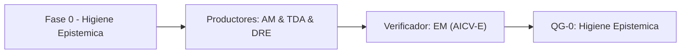

# Fase 0 - Higiene Epistemica

> *(Contenido placeholder generado por FEAT-001; el contenido fundamentado en el corpus llega en features posteriores.)*

Esta fase establece la higiene epistemica: inventario del corpus, trazabilidad de fuentes y registro de supuestos, conflictos y vacios ([VERIFIED-FACT] / [DOC-ASSUMPTION] / [DOC-CONFLICT] / [EPISTEMIC-VOID]).

## Liderazgo y RACI-V

Roles productores: AM (Advisory Manager), TDA (Technical Discovery Architect), DRE (Domain & Requirements Lead).
Verificador (V): **EM**. Accountable (A): **EM**.

| Dimension RACI-V | Roles |
| --- | --- |
| R - Responsible | AM, TDA, DRE |
| A - Accountable | EM |
| C - Consulted | ED |
| I - Informed | EA, BA |
| V - Verifier | EM |

## Diagrama de fase

## Entregables

| Codigo | Entregable |
| --- | --- |
| E0.1 | Entregable E0.1 (contenido en features posteriores) |
| E0.2 | Entregable E0.2 (contenido en features posteriores) |
| E0.3 | Entregable E0.3 (contenido en features posteriores) |

## Stage-Gate QG-0 - Higiene Epistemica

| Criterio de salida |
| --- |
| Corpus inventariado con trazabilidad (filename, sha256, rol). |
| Supuestos, conflictos y vacios epistemicos registrados y etiquetados. |
| Fuentes primarias (RFP, Assessment, 3 diagramas) validadas. |

**No-Go si:** Existen vacios epistemicos criticos sin registrar o fuentes primarias ilegibles.

> **Veredicto QG-0:** QG-0 :: GO - Criterios de salida satisfechos.

