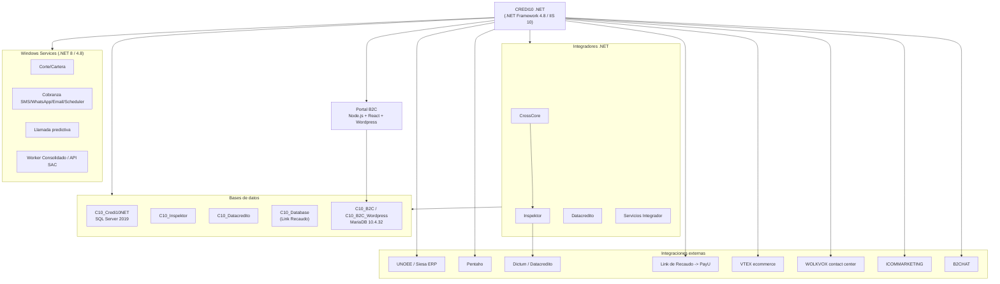

# Fase 0 - Higiene Epistemica

> Fase 0 del framework **Zero-Drift**. Objetivo: establecer la higiene epistemica del corpus Credi10 2.0 antes de cualquier analisis, separando hechos verificados de supuestos, conflictos y vacios.

**Liderazgo (RACI-V):** Productores (R): **AM, TDA, DRE** - Accountable (A): **EM** - Verificador (V): **EM** - Consultado (C): ED - Informado (I): EA, BA.

El corpus auditado contiene **15 PDFs** y **3 diagramas PNG** (5 artefactos primarios: RFP, Assessment WSO2/Studio F y los 3 diagramas de arquitectura).

## E0.1 - Reporte de Higiene Epistemica

### Inventario de evidencia (trazabilidad)

| # | Evidencia | Tipo | Rol | SHA-256 (abrev.) | Bytes |
| --- | --- | --- | --- | --- | --- |
| 1 | Arquitectura_Aplicacion_Despliegue_Credi10.png | PNG | primary | `825cd6260b5f...` | 1,562,032 |
| 2 | Arquitectura_Infraestructura_AWS_Credi10.png | PNG | primary | `f4491865fe1a...` | 120,983 |
| 3 | Diagrama_Contexto_Credi10.png | PNG | primary | `ee8676200cd6...` | 440,843 |
| 4 | RFP_CREDI10_2_0.pdf | PDF | primary | `9ea0d58a40e2...` | 398,028 |
| 5 | WSO2 y Studio F - Assessment Mayo2026-Final.pdf | PDF | primary | `a8f03b42fa08...` | 1,490,004 |
| 6 | Api Integrador Atencion al cliente.pdf | PDF | secondary | `230c3c9a38f8...` | 910,137 |
| 7 | B2C.pdf | PDF | secondary | `cde25f1342db...` | 2,256,650 |
| 8 | BotonEcommerce.pdf | PDF | secondary | `7022aa5fb6e8...` | 2,109,944 |
| 9 | Captura Foto.pdf | PDF | secondary | `694c1d200196...` | 846,421 |
| 10 | Envio de RCL y RCR.pdf | PDF | secondary | `8a5b0becf5b4...` | 330,050 |
| 11 | GenerarPagos.pdf | PDF | secondary | `77dac0283c54...` | 4,933,401 |
| 12 | LinkDePagos.pdf | PDF | secondary | `b7217bd96e21...` | 1,542,583 |
| 13 | Llamada predictiva.pdf | PDF | secondary | `75de074b46da...` | 180,654 |
| 14 | Originacion_API_Datacredito.pdf | PDF | secondary | `d3e307f9ec74...` | 1,070,575 |
| 15 | Originacion_API_Inspektor.pdf | PDF | secondary | `5699645db159...` | 831,033 |
| 16 | Originacion_Aplicacion_ADMIN.pdf | PDF | secondary | `1e1e01d8565d...` | 874,196 |
| 17 | Originacion_CrossCore.pdf | PDF | secondary | `44384189e295...` | 1,335,963 |
| 18 | ProcesoCorteCartera.pdf | PDF | secondary | `c5058d4fb7ba...` | 4,672,023 |

### Clasificacion epistemica de afirmaciones

Cada afirmacion relevante del corpus se etiqueta como [VERIFIED-FACT] (hecho verificable en fuente primaria), [DOC-ASSUMPTION] (supuesto razonable no probado), [DOC-CONFLICT] (tension/diferencia entre fuentes) o [EPISTEMIC-VOID] (vacio de informacion que impide concluir).

| ID | Afirmacion del corpus | Fuente primaria | Etiqueta |
| --- | --- | --- | --- |
| HE-01 | Credi10 corre sobre .NET Framework 4.8 en IIS 10; integradores (CrossCore, Inspektor, Datacredito, Servicios) en .NET y Windows Services en .NET Core 8 / .NET 4.8. | Diagrama de Despliegue (PNG) | [VERIFIED-FACT] |
| HE-02 | Bases de datos SQL Server 2019 Enterprise: C10_Credi10NET (principal), C10_Inspektor, C10_Datacredito, C10_Database (Link de Recaudo); UnoEE_studiof (principal + espejo), Siesa Unoee. | Diagrama de Despliegue (PNG) | [VERIFIED-FACT] |
| HE-03 | Portal B2C: API en Node.js + React y Wordpress sobre Apache (XAMPP) con BDs MariaDB 10.4.32 (C10_B2C_Wordpress, C10_B2C); Link de Recaudo en .NET Core 3.1. | Diagrama de Despliegue (PNG) | [VERIFIED-FACT] |
| HE-04 | Integraciones de contexto: UNOEE/Siesa (ERP), PENTAHO, CROSSCORE -> INSPEKTOR -> DICTUM/Datacredito, Numrot, Link de Recaudo -> PayU, VTEX, WOLKVOX, ICOMMARKETING, B2CHAT (mayoria JSON/HTTP). | Diagrama de Contexto C4 (PNG) | [VERIFIED-FACT] |
| HE-05 | Infraestructura AWS en us-east-2, VPC STUDIO F, flujo Internet Gateway -> WAF -> ALB -> EC2 privados (Coatlanta/Codallas/Comumbai), S3, CloudWatch, NAT, Bastion y VPN IPSec (Telmex) a on-prem Cokioto. | Diagrama de Infraestructura AWS (PNG) | [VERIFIED-FACT] |
| HE-06 | El RFP 'Proyecto Credi10 2.0' (STF Group S.A., Cali/Yumbo, emitido 20-ago-2026) fija indicadores de retorno: disponibilidad 90%->99%, eficiencia de recursos 60%->80%, costo infraestructura 80%->80%, evolucion/escalamiento 50%->100%, licenciamiento 70%->100%. | RFP_CREDI10_2_0.pdf | [VERIFIED-FACT] |
| HE-07 | El assessment WSO2/Studio F describe arquitectura fragmentada con +150 aplicaciones .NET y +200 bases de datos con informacion duplicada e inconsistente. | WSO2 y Studio F - Assessment Mayo2026 | [VERIFIED-FACT] |
| HE-08 | Pain de integracion con ERP Siesa: integraciones rigidas por archivos planos, un unico Web Service para todas las operaciones, mayoria batch, y lectura/escritura directa a la BD del ERP por lentitud del WS (practica de alto riesgo). | WSO2 y Studio F - Assessment | [VERIFIED-FACT] |
| HE-09 | El universo '+150 apps .NET / +200 BDs' del assessment es a nivel Studio F / grupo completo, mientras que los diagramas acotan Credi10 a ~20 componentes. Diferencia de ALCANCE que debe resolverse antes de dimensionar. | WSO2 Assessment vs. Diagramas Credi10 | [DOC-CONFLICT] |
| HE-10 | El numero objetivo de disponibilidad (99%) presupone un baseline del 90%, pero el corpus no aporta una medicion real (instrumentacion, ventana, SLA) que lo sustente. | RFP_CREDI10_2_0.pdf | [EPISTEMIC-VOID] |
| HE-11 | No hay cifras reales de costo de infraestructura ni de gasto de licenciamiento actual en el corpus; los indicadores 80%->80% y 70%->100% carecen de linea base cuantificada. | RFP_CREDI10_2_0.pdf | [EPISTEMIC-VOID] |
| HE-12 | La mayoria de las integraciones de contexto se marcan 'JSON/HTTP', pero el corpus no detalla contratos, versiones de API ni volumetria/transaccionalidad por integracion. | Diagrama de Contexto | [EPISTEMIC-VOID] |
| HE-13 | Se asume que las reglas de negocio existentes (originacion, corte de cartera, cobranza) deben preservarse 1:1 en Credi10 2.0, segun el requisito funcional del RFP, pero su especificacion detallada no esta en el corpus. | RFP_CREDI10_2_0.pdf | [DOC-ASSUMPTION] |
| HE-14 | Se asume que los 13 PDFs de proceso (Originacion, GenerarPagos FT-SL-003, ProcesoCorteCartera FT-SL-004, LinkDePagos FT-SL-011, B2C, etc.) reflejan el AS-IS vigente; son imagen-pesados y su texto es evidencia secundaria de soporte. | PDFs de proceso | [DOC-ASSUMPTION] |

> **Conflicto de alcance clave (HE-09 / [DOC-CONFLICT]):** el assessment WSO2/Studio F cuantifica **+150 aplicaciones .NET** y **+200 bases de datos** a nivel del **grupo Studio F**, mientras que los diagramas de contexto y despliegue acotan **Credi10** a ~20 componentes. No es una contradiccion de hecho sino una **diferencia de alcance** que debe resolverse (DEL-03) antes de dimensionar el TO-BE.

## E0.2 - Grafo Preliminar de Conceptos

Mapa inicial del ecosistema Credi10 (aplicacion nucleo, integradores, datos, workers e integraciones externas) construido a partir de los diagramas de contexto y despliegue:

### Agenda de Elicitacion por Deltas

Preguntas abiertas que cierran los vacios/conflictos registrados; son el insumo de la sesion de elicitacion con el cliente:

| ID | Pregunta abierta (delta) | Vacio/Conflicto que cierra | Responsable |
| --- | --- | --- | --- |
| DEL-01 | Cual es la medicion real de disponibilidad actual y bajo que SLA/ventana se calculo el 90%? | HE-10 [EPISTEMIC-VOID] | Cliente / EM |
| DEL-02 | Cuales son los costos reales de infraestructura AWS/on-prem y el gasto de licenciamiento vigente? | HE-11 [EPISTEMIC-VOID] | FIN / Cliente |
| DEL-03 | Que subconjunto exacto de los +150 apps y +200 BDs pertenece al perimetro Credi10 vs. al grupo Studio F? | HE-09 [DOC-CONFLICT] | EA / TDA |
| DEL-04 | Que contratos, versiones y volumetria tiene cada integracion JSON/HTTP de contexto? | HE-12 [EPISTEMIC-VOID] | DA / TDA |
| DEL-05 | Donde esta la especificacion detallada de las reglas de negocio a preservar (originacion, corte, cobranza)? | HE-13 [DOC-ASSUMPTION] | BA / DRE |
| DEL-06 | Que operaciones usan hoy lectura/escritura directa a la BD del ERP y cual es su criticidad? | HE-08 [VERIFIED-FACT] | DA / SEC |

## Stage-Gate QG-0 - Higiene Epistemica

| Criterio de salida QG-0 | Estado |
| --- | --- |
| Corpus inventariado con trazabilidad (filename, sha256, rol). | Satisfecho |
| Supuestos, conflictos y vacios epistemicos registrados y etiquetados. | Satisfecho |
| Fuentes primarias (RFP, Assessment, 3 diagramas) validadas. | Satisfecho |

**No-Go si:** Existen vacios epistemicos criticos sin registrar o fuentes primarias ilegibles.

> **Veredicto QG-0:** QG-0 :: GO - Criterios de salida satisfechos.

