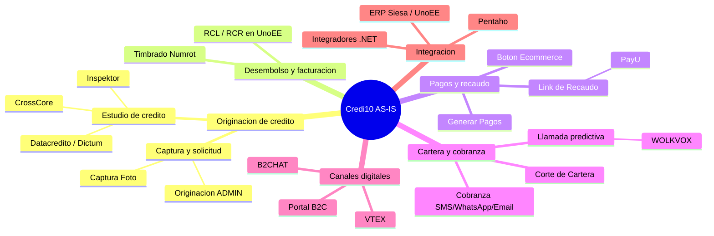
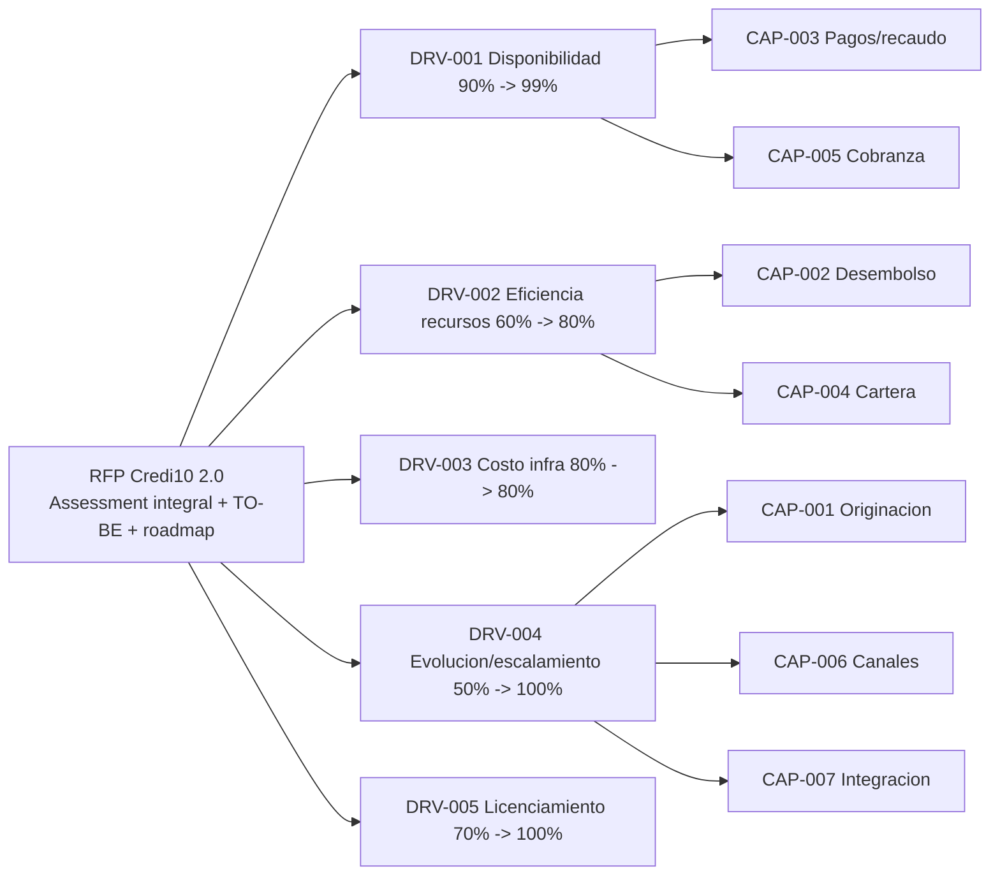
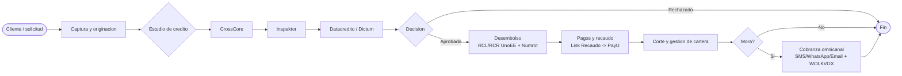

# Fase 1 - Contexto AS-IS

> Fase 1 del framework **Zero-Drift**. Consolida el contexto **AS-IS** de Credi10: capacidades de negocio, motivadores estrategicos, cadenas de valor/procesos e inventario tecnologico, de datos y deuda tecnica, todo trazable a evidencia primaria del corpus.

**Liderazgo (RACI-V):** Productores (R): **EA, BA, PIA, TDA** - Accountable (A): **EM** - Verificador (V): **AM** (guardian AICV-E / Hilo Dorado) - Consultado (C): SME, DRE - Informado (I): ED.

> **Hilo Dorado:** en esta fase se originan los identificadores de **Driver (DRV-xxx)** y **Capability (CAP-xxx)** que las fases 2-6 referenciaran (Benchmark -> Gap -> Reliever -> ABB -> SBB -> Wave -> ROI).

## E1.1 - Mapa de Capacidades As-Is (L1-L3) y Arbol de Motivadores

### Mapa de capacidades L1-L3

### Catalogo de capacidades (Hilo Dorado)

| Hilo Dorado | Capacidad L1 | Driver asociado | Descripcion |
| --- | --- | --- | --- |
| CAP-001 | Originacion de credito | DRV-004 | Captura, estudio de credito y aprobacion (CrossCore/Inspektor/Datacredito). |
| CAP-002 | Desembolso y facturacion electronica | DRV-002 | Generacion de RCL/RCR en UnoEE, timbrado con Numrot. |
| CAP-003 | Pagos y recaudo | DRV-001 | Link de Recaudo -> PayU, generacion de pagos, boton ecommerce. |
| CAP-004 | Corte y gestion de cartera | DRV-002 | Proceso de corte de cartera (FT-SL-004) y consolidacion. |
| CAP-005 | Cobranza omnicanal | DRV-001 | Scheduler + SMS/WhatsApp/Email + llamada predictiva (WOLKVOX). |
| CAP-006 | Canales digitales B2C/ecommerce | DRV-004 | Portal B2C (Node.js+React+Wordpress), VTEX, B2CHAT. |
| CAP-007 | Integracion e interoperabilidad | DRV-004 | Integradores .NET e integracion con ERP Siesa/UnoEE y Pentaho. |

### Arbol de Motivadores Estrategicos (indicadores del RFP)

Los cinco indicadores de retorno del RFP se traducen en drivers estrategicos que anclan todo el Hilo Dorado:

| Hilo Dorado | Indicador de retorno (RFP) | AS-IS -> TO-BE | Driver estrategico |
| --- | --- | --- | --- |
| DRV-001 | Disponibilidad de apps/servicios criticos | 90% -> 99% | Elevar la disponibilidad de la plataforma Credi10 y sus componentes criticos. |
| DRV-002 | Optimizacion/eficiencia de recursos | 60% -> 80% | Mejorar la eficiencia operativa reduciendo procesos manuales y batch. |
| DRV-003 | Optimizacion de costo de infraestructura | 80% -> 80% | Sostener el costo de infraestructura sin degradar servicio al escalar. |
| DRV-004 | Evolucion tecnologica y escalamiento | 50% -> 100% | Modernizar el stack obsoleto y habilitar escalamiento elastico. |
| DRV-005 | Cumplimiento de licenciamiento | 70% -> 100% | Cerrar brechas de licenciamiento del stack .NET/SQL Server/Wordpress. |

## E1.2 - Cadenas de Valor y Proceso BPMN As-Is

Flujo operativo real de extremo a extremo: originacion -> estudio de credito (CrossCore -> Inspektor -> Datacredito/Dictum) -> desembolso -> pagos/recaudo -> corte/cartera -> cobranza.

### Metricas baseline AS-IS

| Cadena de valor | Metrica baseline (AS-IS) | Fuente | Driver |
| --- | --- | --- | --- |
| Disponibilidad plataforma | 90% (objetivo RFP 99%) | RFP | DRV-001 |
| Eficiencia de recursos | 60% (objetivo 80%) | RFP | DRV-002 |
| Evolucion/escalamiento | 50% (objetivo 100%) | RFP | DRV-004 |
| Cumplimiento licenciamiento | 70% (objetivo 100%) | RFP | DRV-005 |
| Estudio de credito | Encadenado CrossCore->Inspektor->Dictum (latencia no instrumentada) [EPISTEMIC-VOID] | Diagrama Contexto | CAP-001 |
| Integracion ERP Siesa | Batch por archivos planos + WS unico; errores con intervencion manual | Assessment WSO2 | CAP-007 |

## E1.3 - Inventario del Ecosistema Tecnologico, Datos y Deuda Tecnica

### Inventario tecnologico [VERIFIED-FACT]

| Capa | Componente | Tecnologia (AS-IS) | Evidencia |
| --- | --- | --- | --- |
| Aplicacion | Plataforma Credi10 | .NET Framework 4.8 sobre IIS 10 | Despliegue |
| Aplicacion | Integradores (CrossCore, Inspektor, Datacredito, Servicios) | .NET | Despliegue |
| Aplicacion | Web Service UnoEE | .NET | Despliegue |
| Aplicacion | Link de Recaudo | .NET Core 3.1 | Despliegue |
| Workers | Llamada predictiva, Indicador Robot, API SAC, Worker Consolidado, Corte/Cartera, Cobranza SMS/WhatsApp/Email/Scheduler | .NET Core 8 y .NET Framework 4.8 | Despliegue |
| Canales | Portal B2C | API Node.js + React; Wordpress sobre Apache (XAMPP) | Despliegue |
| Infra | Servidores on-prem | Windows Server 2019 Datacenter (Coatlanta, Codallas, Comumbai) | Despliegue |
| Infra | Nube | AWS us-east-2, VPC STUDIO F, WAF->ALB->EC2, S3, CloudWatch, NAT, Bastion, VPN IPSec (Telmex) a on-prem Cokioto | Infra AWS |

### Inventario de datos [VERIFIED-FACT]

| Base de datos | Motor | Uso | Evidencia |
| --- | --- | --- | --- |
| C10_Credi10NET | SQL Server 2019 Enterprise | BD principal de Credi10 | Despliegue |
| C10_Inspektor | SQL Server 2019 Enterprise | Integrador Inspektor | Despliegue |
| C10_Datacredito | SQL Server 2019 Enterprise | Integrador Datacredito | Despliegue |
| C10_Database | SQL Server 2019 Enterprise | Link de Recaudo | Despliegue |
| UnoEE_studiof (principal + espejo), Siesa Unoee | SQL Server | ERP Siesa/UnoEE | Despliegue |
| C10_B2C_Wordpress, C10_B2C | MariaDB 10.4.32 | Portal B2C | Despliegue |

### Deuda tecnica y obsolescencia

La modernizacion del stack es el eje del driver **DRV-004** (evolucion/escalamiento) y **DRV-005** (licenciamiento):

| ID | Deuda / obsolescencia tecnica | Riesgo | Driver impactado |
| --- | --- | --- | --- |
| DT-01 | .NET Framework 4.8 en plataforma e integradores | Marco legado, sin evolucion de features; riesgo de soporte | DRV-004, DRV-005 |
| DT-02 | .NET Core 3.1 en Link de Recaudo | Fuera de soporte (end-of-life) | DRV-004, DRV-005 |
| DT-03 | Wordpress + XAMPP/Apache en produccion | Superficie de ataque y operacion fragil para un canal B2C | DRV-001, DRV-004 |
| DT-04 | Lectura/escritura directa a la BD del ERP Siesa | Acoplamiento fuerte y riesgo de integridad de datos | DRV-002 |
| DT-05 | Integraciones dispersas en Windows Services/cronjobs sin gestion centralizada ni trazabilidad de errores | Baja gobernanza, intervencion manual | DRV-002, DRV-004 |
| DT-06 | +200 bases de datos duplicadas con controles manuales en Excel (nivel grupo) | Inconsistencia de datos | DRV-002 |

> El ecosistema Credi10 se sostiene sobre marcos legados (**.NET Framework 4.8**, **.NET Core 3.1**) y practicas de alto riesgo (lectura directa a la BD del ERP Siesa, Wordpress/XAMPP en produccion), lo que fundamenta el caso de modernizacion de Credi10 2.0.

## Stage-Gate QG-1 - Contexto AS-IS

| Criterio de salida QG-1 | Estado |
| --- | --- |
| Mapa de capacidades y drivers de negocio establecidos. | Satisfecho |
| Arquitectura AS-IS (contexto, despliegue, AWS) consolidada. | Satisfecho |
| Procesos AS-IS mapeados con evidencia del corpus. | Satisfecho |

**No-Go si:** El AS-IS no es trazable a evidencia primaria del corpus.

> **Veredicto QG-1:** QG-1 :: GO - Criterios de salida satisfechos.

