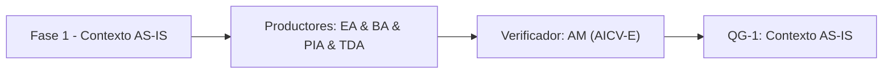

# Fase 1 - Contexto AS-IS

> *(Contenido placeholder generado por FEAT-001; el contenido fundamentado en el corpus llega en features posteriores.)*

Esta fase consolida el contexto AS-IS: capacidades de negocio, arquitectura de contexto/despliegue/AWS y procesos operativos.

## Liderazgo y RACI-V

Roles productores: EA (Lead Enterprise Architect), BA (Lead Business Architect), PIA (Process Intelligence Analyst), TDA (Technical Discovery Architect).
Verificador (V): **AM**. Accountable (A): **EM**.

| Dimension RACI-V | Roles |
| --- | --- |
| R - Responsible | EA, BA, PIA, TDA |
| A - Accountable | EM |
| C - Consulted | SME, DRE |
| I - Informed | ED |
| V - Verifier | AM |

## Diagrama de fase

## Entregables

| Codigo | Entregable |
| --- | --- |
| E1.1 | Entregable E1.1 (contenido en features posteriores) |
| E1.2 | Entregable E1.2 (contenido en features posteriores) |
| E1.3 | Entregable E1.3 (contenido en features posteriores) |

## Stage-Gate QG-1 - Contexto AS-IS

| Criterio de salida |
| --- |
| Mapa de capacidades y drivers de negocio establecidos. |
| Arquitectura AS-IS (contexto, despliegue, AWS) consolidada. |
| Procesos AS-IS mapeados con evidencia del corpus. |

**No-Go si:** El AS-IS no es trazable a evidencia primaria del corpus.

> **Veredicto QG-1:** QG-1 :: GO - Criterios de salida satisfechos.

