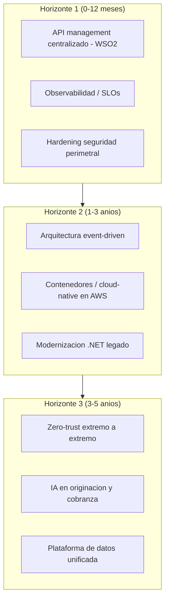
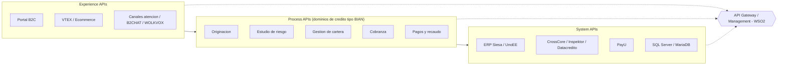

# Fase 2 - Estado del Arte

> Fase 2 del framework **Zero-Drift**. Documenta el **estado del arte** y los benchmarks de industria para originacion de credito retail/fintech, conectandolos con las capacidades y drivers del AS-IS (Hilo Dorado de la Fase 1).

**Liderazgo (RACI-V):** Productores (R): **EA, SME, BA** - Accountable (A): **EM** - Verificador (V): **AM** - Consultado (C): PIA - Informado (I): ED.

> **Hilo Dorado:** cada **Benchmark (BMK-xxx)** se ancla a una capacidad (CAP-xxx) y driver (DRV-xxx) de la Fase 1, para que la Fase 3 derive gaps trazables.

## E2.1 - Benchmarking Competitivo y Estado del Arte

Patrones de referencia del sector de credito de consumo/fintech, priorizando la recomendacion del assessment WSO2/Studio F de **estandarizar y centralizar las APIs**:

| Hilo Dorado | Benchmark / patron de industria | Capacidad / Driver | Relevancia para Credi10 |
| --- | --- | --- | --- |
| BMK-001 | Integracion API-led (API gateway + management) | CAP-007 / DRV-004 | Gestionar todas las APIs de forma centralizada (eco directo de la recomendacion 5.2 del assessment: WSO2 API Platform + Integration Platform) frente a integraciones dispersas en Windows Services. |
| BMK-002 | Arquitectura event-driven / mensajeria | CAP-002 / DRV-002 | Reemplazar batch por archivos planos del ERP Siesa con eventos/colas para sincronizacion casi en tiempo real. |
| BMK-003 | Cloud-native / contenedores y escalamiento elastico | CAP-006 / DRV-004 | Contenerizar workloads y escalar en AWS (us-east-2) con autoscaling en lugar de EC2 estaticos Coatlanta/Codallas/Comumbai. |
| BMK-004 | Observabilidad y alta disponibilidad (SRE) | CAP-003 / DRV-001 | Instrumentar disponibilidad y SLOs para sustentar el salto 90% -> 99%. |
| BMK-005 | Zero-trust y seguridad por diseno | CAP-007 / DRV-005 | Fortalecer WAF/ALB/VPN IPSec con identidad, segmentacion y cifrado extremo a extremo. |
| BMK-006 | Automatizacion / IA en originacion y cobranza | CAP-001 / DRV-002 | Scoring asistido y cobranza omnicanal inteligente sobre el flujo CrossCore/Inspektor/Datacredito y WOLKVOX. |

### Comparativo AS-IS vs. estado del arte

| Dimension | Credi10 AS-IS | Patron de industria (estado del arte) | Brecha |
| --- | --- | --- | --- |
| Integracion | WS unico + archivos planos + lectura directa a BD del ERP | API-led connectivity con API gateway/management (WSO2) | Alta |
| Datos | +200 BDs duplicadas, controles en Excel (nivel grupo) | Fuente unica de verdad, data products, CDC | Alta |
| Despliegue | .NET Framework 4.8 / .NET Core 3.1 sobre IIS y EC2 estaticos | Cloud-native, contenedores, autoscaling | Media-Alta |
| Disponibilidad | 90% sin instrumentacion formal | SRE con SLOs/error budgets (99%+) | Alta |
| Seguridad | WAF + ALB + VPN IPSec perimetral | Zero-trust, identidad y microsegmentacion | Media |
| Canales | Portal B2C Wordpress/XAMPP + VTEX + B2CHAT | Experiencia digital componible (MACH) | Media |

## E2.2 - Radar de Tendencias (horizontes 1 / 3 / 5 anios)

### Posicionamiento cualitativo (Gartner Hype Cycle)

La ubicacion de cada tendencia en el Hype Cycle es una lectura cualitativa del equipo; su posicion exacta se marca [DOC-ASSUMPTION] al no derivar de una medicion del corpus:

| Tendencia | Posicion cualitativa (Gartner Hype Cycle) | Adopcion sugerida | Nota |
| --- | --- | --- | --- |
| API management / API-led | Plateau of Productivity | Adoptar ya | [DOC-ASSUMPTION] |
| Event-driven architecture | Slope of Enlightenment | Adoptar 1-3 anios | [DOC-ASSUMPTION] |
| Cloud-native / contenedores | Slope of Enlightenment | Adoptar 1-3 anios | [DOC-ASSUMPTION] |
| Zero-trust | Trough / Slope | Pilotar | [DOC-ASSUMPTION] |
| IA generativa en credito/cobranza | Peak of Inflated Expectations | Experimentar con cautela | [DOC-ASSUMPTION] |

## E2.3 - Modelo de Referencia Sectorial

Se adopta un modelo de **API-led connectivity** (Experience / Process / System APIs) con **descomposicion de dominio estilo BIAN** para credito. Este modelo resuelve directamente los pains del assessment (integraciones rigidas, WS unico, lectura directa a BD) y materializa la recomendacion de un API management centralizado:

| Capa del modelo de referencia | Patron | Aplicacion a Credi10 | Hilo Dorado |
| --- | --- | --- | --- |
| Experience APIs | API-led (experiencia) | B2C, VTEX, B2CHAT, WOLKVOX | CAP-006 |
| Process APIs | Descomposicion de dominio estilo BIAN | Originacion, riesgo, cartera, cobranza, pagos | CAP-001, CAP-004, CAP-005 |
| System APIs | API-led (sistema) | ERP Siesa/UnoEE, buros, PayU, BDs | CAP-007 |
| Gobierno de APIs | API management centralizado | WSO2 API + Integration Platform (rec. 5.2 del assessment) | BMK-001 / DRV-004 |

> El modelo de referencia justifica el salto de Credi10: de integraciones dispersas (CrossCore/Inspektor/Datacredito acopladas, ERP Siesa por archivos planos) a un ecosistema de APIs gobernado centralmente, base del diseno TO-BE de la Fase 4.

## Stage-Gate QG-2 - Estado del Arte

| Criterio de salida QG-2 | Estado |
| --- | --- |
| Benchmarks de industria vinculados a capacidades del AS-IS. | Satisfecho |
| Estado del arte y patrones de referencia documentados. | Satisfecho |

**No-Go si:** Los benchmarks no se conectan con capacidades reales del negocio.

> **Veredicto QG-2:** QG-2 :: GO - Criterios de salida satisfechos.

