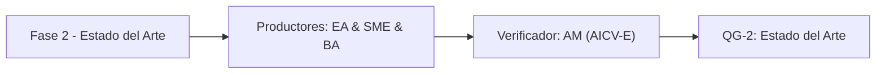

# Fase 2 - Estado del Arte

> *(Contenido placeholder generado por FEAT-001; el contenido fundamentado en el corpus llega en features posteriores.)*

Esta fase documenta el estado del arte y benchmarks de industria vinculados a las capacidades del AS-IS.

## Liderazgo y RACI-V

Roles productores: EA (Lead Enterprise Architect), SME (Industry & Reference SME), BA (Lead Business Architect).
Verificador (V): **AM**. Accountable (A): **EM**.

| Dimension RACI-V | Roles |
| --- | --- |
| R - Responsible | EA, SME, BA |
| A - Accountable | EM |
| C - Consulted | PIA |
| I - Informed | ED |
| V - Verifier | AM |

## Diagrama de fase

## Entregables

| Codigo | Entregable |
| --- | --- |
| E2.1 | Entregable E2.1 (contenido en features posteriores) |
| E2.2 | Entregable E2.2 (contenido en features posteriores) |

## Stage-Gate QG-2 - Estado del Arte

| Criterio de salida |
| --- |
| Benchmarks de industria vinculados a capacidades del AS-IS. |
| Estado del arte y patrones de referencia documentados. |

**No-Go si:** Los benchmarks no se conectan con capacidades reales del negocio.

> **Veredicto QG-2:** QG-2 :: GO - Criterios de salida satisfechos.

