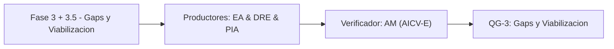

# Fase 3 + 3.5 - Gaps y Viabilizacion

> *(Contenido placeholder generado por FEAT-001; el contenido fundamentado en el corpus llega en features posteriores.)*

Esta fase identifica gaps/pains, define relievers y los ABBs/contexto de arquitectura (Fase 3.5), manteniendo el Hilo Dorado.

## Liderazgo y RACI-V

Roles productores: EA (Lead Enterprise Architect), DRE (Domain & Requirements Lead), PIA (Process Intelligence Analyst).
Verificador (V): **AM**. Accountable (A): **EM**.

| Dimension RACI-V | Roles |
| --- | --- |
| R - Responsible | EA, DRE, PIA |
| A - Accountable | EM |
| C - Consulted | SA, DA |
| I - Informed | ED, FIN |
| V - Verifier | AM |

## Diagrama de fase

## Entregables

| Codigo | Entregable |
| --- | --- |
| E3.1 | Entregable E3.1 (contenido en features posteriores) |
| E3.2 | Entregable E3.2 (contenido en features posteriores) |
| E3.5 | Entregable E3.5 (contenido en features posteriores) |

## Stage-Gate QG-3 - Gaps y Viabilizacion

| Criterio de salida |
| --- |
| Pains/gaps identificados y priorizados con relievers. |
| ABBs y contexto de arquitectura (Fase 3.5) definidos. |
| Hilo Dorado intacto desde driver hasta reliever. |

**No-Go si:** Hay gaps sin reliever o relievers sin trazabilidad a un driver.

> **Veredicto QG-3:** QG-3 :: GO - Criterios de salida satisfechos.

