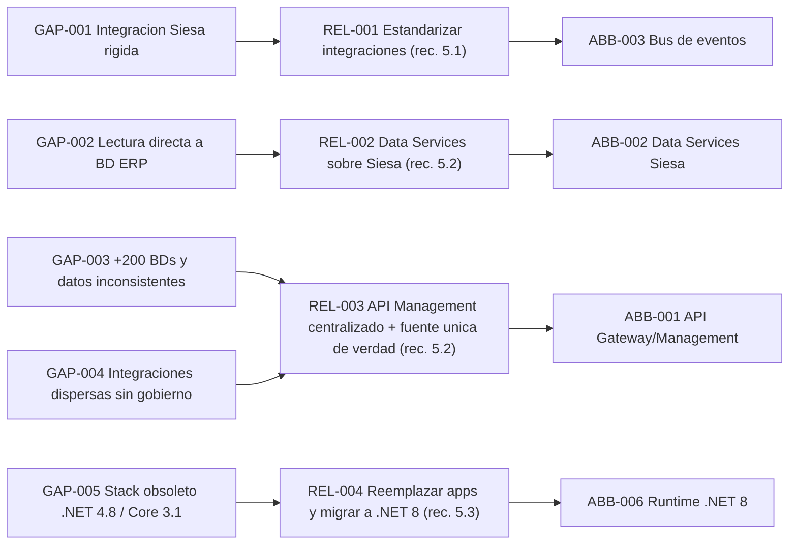
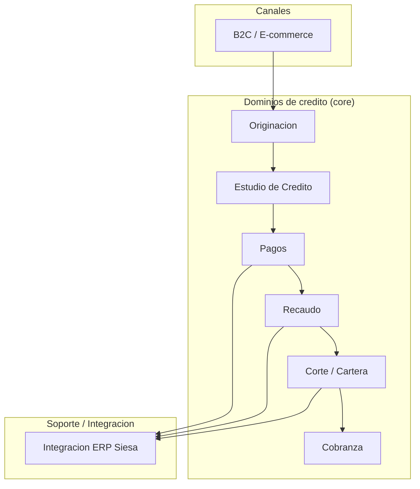

# Fase 3 + 3.5 - Gaps y Viabilizacion

> Fase 3 + 3.5 del framework **Zero-Drift**. Diagnostica los dolores reales del assessment WSO2/Studio F, deriva gaps multidominio trazables a los indicadores del RFP, define aliviadores y produce el dossier de viabilizacion (Bounded Contexts, ABBs, reglas, NFRs). Es el handoff critico de la **Celula 1 (Discovery)** a la **Celula 2 (Diseno)**.

**Liderazgo (RACI-V):** Productores (R): **EA, DRE, PIA** - Accountable (A): **EM** - Verificador (V): **AM** (guardian AICV-E / Hilo Dorado) - Consultado (C): SA, DA - Informado (I): ED, FIN.

> **Hilo Dorado:** esta fase origina **Gaps (GAP-xxx)**, **Aliviadores (REL-xxx)** y **ABBs (ABB-xxx)**, cada uno ligado a los Drivers (DRV) de la Fase 1 y los Benchmarks (BMK) de la Fase 2. La Fase 4 referenciara los ABBs al crear los SBBs.

## E3.1 - Matriz Cuantificada de Dolores, Causas Raiz y Costo de Inaccion

Los dolores provienen directamente del assessment WSO2/Studio F. Las cifras de Costo de Inaccion (COI) se marcan [DOC-ASSUMPTION] cuando no existe un numero real en el corpus:

| Hilo Dorado | Dolor (assessment WSO2/Studio F) | Causa raiz | Costo de Inaccion (COI) | Driver | Benchmark |
| --- | --- | --- | --- | --- | --- |
| GAP-001 | Integracion rigida con Siesa (archivos planos + WS unico, batch, errores con intervencion manual) | WS unico como cuello de botella; acoplamiento punto a punto | Sobrecosto operativo por reprocesos manuales y demoras batch [DOC-ASSUMPTION] | DRV-002 | BMK-001 |
| GAP-002 | Lectura/escritura directa a la BD del ERP Siesa (practica de ALTO RIESGO) | El WS unico no soporta la carga; se evade el contrato | Riesgo de corrupcion de datos del ERP e indisponibilidad [DOC-ASSUMPTION] | DRV-001 | BMK-002 |
| GAP-003 | +200 BDs duplicadas/inconsistentes, logica repetida y controles manuales en Excel | Ausencia de fuente unica de verdad y de dominios de datos | Horas-hombre en conciliacion manual y errores de datos [DOC-ASSUMPTION] | DRV-002 | BMK-002 |
| GAP-004 | Apps .NET desordenadas, integraciones dispersas en Windows Services/cronjobs sin gestion centralizada ni trazabilidad | Falta de plataforma de API Management y observabilidad | Incidentes sin trazabilidad y MTTR elevado [DOC-ASSUMPTION] | DRV-004 | BMK-001 |
| GAP-005 | Obsolescencia .NET Framework 4.8 / .NET Core 3.1 (EOL) y Wordpress/XAMPP en produccion | Falta de ciclo de modernizacion y de cumplimiento de licenciamiento | Riesgo de soporte, seguridad y multas de licenciamiento [DOC-ASSUMPTION] | DRV-005 | BMK-003 |

## E3.2 - Gap Analysis multidominio (TOGAF B / C / D)

Cada gap se liga a un indicador de retorno del RFP. Un requisito funcional del RFP es **preservar las reglas de negocio existentes**.

### Dominio B - Negocio

| Gap | Dominio B (Negocio) | AS-IS -> TO-BE | Indicador RFP |
| --- | --- | --- | --- |
| GAP-003 | Desconfianza del usuario y controles manuales en Excel | Procesos con fuente unica de verdad | DRV-002 (60% -> 80%) |
| GAP-001 | Procesos batch con intervencion manual (Siesa) | Procesos sincronizados y automatizados | DRV-002 (60% -> 80%) |
| GAP-004 | Reglas de negocio duplicadas y dispersas | Reglas centralizadas y preservadas (requisito RFP) | DRV-004 (50% -> 100%) |

### Dominio C - Datos

| Gap | Dominio C (Datos) | AS-IS -> TO-BE | Indicador RFP |
| --- | --- | --- | --- |
| GAP-003 | +200 BDs duplicadas/inconsistentes | Dominios de datos con fuente unica de verdad | DRV-002 (60% -> 80%) |
| GAP-002 | Acceso directo a la BD del ERP Siesa | Data Services gobernados sobre el ERP | DRV-001 (90% -> 99%) |

### Dominio C - Aplicacion

| Gap | Dominio C (Aplicacion) | AS-IS -> TO-BE | Indicador RFP |
| --- | --- | --- | --- |
| GAP-004 | Apps .NET desordenadas con funciones duplicadas | Servicios de dominio desacoplados tras un API Gateway | DRV-004 (50% -> 100%) |
| GAP-001 | WS unico monolitico para todas las operaciones | APIs estandarizadas por dominio + bus de eventos | DRV-002 (60% -> 80%) |

### Dominio D - Tecnologia

| Gap | Dominio D (Tecnologia) | AS-IS -> TO-BE | Indicador RFP |
| --- | --- | --- | --- |
| GAP-005 | .NET Framework 4.8 / .NET Core 3.1 (EOL) | Runtime .NET 8 contenerizado | DRV-005 (70% -> 100%) |
| GAP-005 | Wordpress/XAMPP en produccion | Canal B2C modernizado y hardenizado | DRV-004 (50% -> 100%) |
| GAP-002 | EC2 estaticos y WS lento | Cloud-native con escalamiento y costo controlado | DRV-003 (80% -> 80%) |

## E3.3 - Mapa de Aliviadores y Tesis Ejecutiva de Transformacion

Los aliviadores hacen eco directo de las recomendaciones del assessment: **5.1** estandarizar integraciones, **5.2** centralizar las APIs (WSO2 API Platform + Integration Platform) y exponer el ERP Siesa como **Data Services**, y **5.3** revisar/reemplazar aplicaciones candidatas.

| Hilo Dorado | Aliviador | Recomendacion (assessment) | Mitiga | Driver |
| --- | --- | --- | --- | --- |
| REL-001 | Simplificar y estandarizar las integraciones (patrones y contratos unicos) en lugar de archivos planos y un WS monolitico. | Rec. 5.1 del assessment | GAP-001 | DRV-002 |
| REL-002 | Exponer los datos del ERP Siesa como Data Services gobernados en lugar de lectura/escritura directa a la BD del ERP. | Rec. 5.2 del assessment | GAP-002 | DRV-001 |
| REL-003 | Gestionar todas las APIs de forma centralizada con una plataforma de API Management + Integration Platform (WSO2) y una fuente unica de verdad por dominio. | Rec. 5.2 del assessment | GAP-003, GAP-004 | DRV-004 |
| REL-004 | Revisar y reemplazar las aplicaciones candidatas y modernizar el stack legado (.NET Framework 4.8 / .NET Core 3.1 -> .NET 8; retirar Wordpress/XAMPP de produccion). | Rec. 5.3 del assessment | GAP-005 | DRV-005 |

> **Tesis ejecutiva:** Credi10 2.0 pasa de integraciones rigidas y datos dispersos a un ecosistema de **APIs gobernadas centralmente + Data Services sobre Siesa + eventos**, preservando las reglas de negocio y habilitando el salto de disponibilidad (DRV-001) y evolucion tecnologica (DRV-004).

## E3.5.1 - Mapa de Bounded Contexts, Lenguaje Ubicuo y Catalogo de ABBs

### Mapa de Bounded Contexts (DDD)

| Bounded Context | Componentes reales | 
| --- | --- |
| Originacion | Captura de solicitud, Originacion ADMIN, Captura Foto. |
| Estudio de Credito | CrossCore -> Inspektor -> Datacredito / Dictum. |
| Pagos | GenerarPagos (FT-SL-003), Boton Ecommerce. |
| Recaudo | LinkDePagos (FT-SL-011) -> PayU. |
| Corte / Cartera | ProcesoCorteCartera (FT-SL-004) y consolidacion. |
| Cobranza | Scheduler + SMS/WhatsApp/Email + Llamada predictiva (WOLKVOX). |
| B2C / E-commerce | Portal B2C (Node.js+React+Wordpress), VTEX, BotonEcommerce, B2CHAT. |
| Integracion ERP | Siesa/UnoEE, RCL/RCR, Pentaho, timbrado Numrot. |

### Diccionario de Lenguaje Ubicuo

| Termino (Lenguaje Ubicuo) | Definicion |
| --- | --- |
| Solicitud | Peticion de credito originada por un cliente en Originacion. |
| Estudio de Credito | Evaluacion de riesgo encadenada CrossCore -> Inspektor -> Datacredito/Dictum que decide aprobacion. |
| RCL / RCR | Documentos de facturacion electronica generados en UnoEE (timbrados con Numrot) tras el desembolso. |
| Link de Recaudo | Enlace de pago (FT-SL-011) que redirige a PayU para recaudo. |
| Corte de Cartera | Proceso periodico (FT-SL-004) que consolida saldos y mora de la cartera. |
| Obligacion | Credito desembolsado sujeto a corte, recaudo y, si aplica, cobranza. |

### Catalogo de ABBs (Hilo Dorado)

| Hilo Dorado | ABB (Architecture Building Block) | Reliever origen | Bounded Context |
| --- | --- | --- | --- |
| ABB-001 | API Gateway y plataforma de API Management centralizada | REL-003 | Integracion ERP / transversal |
| ABB-002 | Capa de Data Services sobre el ERP Siesa (reemplaza lectura directa a BD) | REL-002 | Integracion ERP |
| ABB-003 | Bus de eventos / mensajeria para sincronizacion casi en tiempo real | REL-001 | Integracion ERP / Pagos / Recaudo |
| ABB-004 | Servicios de dominio desacoplados (Originacion, Estudio de Credito, Pagos, Recaudo, Cartera, Cobranza) | REL-003 | Multidominio |
| ABB-005 | Plano de observabilidad y trazabilidad de errores (logging, metricas, SLOs) | REL-003 | Transversal |
| ABB-006 | Runtime modernizado .NET 8 contenerizado | REL-004 | Transversal / Despliegue |

## E3.5.2 - Epicas, Reglas de Negocio y Matriz de Excepciones

### Catalogo de epicas

| Epica | Bounded Context | Descripcion | ABB |
| --- | --- | --- | --- |
| EP-01 Estudio de credito automatizado | Estudio de Credito | Orquestar CrossCore -> Inspektor -> Datacredito/Dictum con contrato de API unico | ABB-001, ABB-004 |
| EP-02 Integracion gobernada con Siesa | Integracion ERP | Reemplazar archivos planos y lectura directa por Data Services + eventos | ABB-002, ABB-003 |
| EP-03 Recaudo por link | Recaudo | Generar Link de Recaudo (FT-SL-011) y conciliar el pago de PayU | ABB-001, ABB-003 |

### Reglas de negocio (a preservar)

| Regla | Descripcion | Preservacion (requisito RFP) |
| --- | --- | --- |
| RN-01 | El estudio de credito encadena CrossCore, luego Inspektor y finalmente Datacredito/Dictum antes de decidir | Preservar regla existente [VERIFIED-FACT] |
| RN-02 | Una solicitud rechazada en cualquier buro detiene el flujo | Preservar regla existente |
| RN-03 | El desembolso genera RCL/RCR en UnoEE y se timbra con Numrot | Preservar regla existente |
| RN-04 | El recaudo solo se marca aplicado tras confirmacion de PayU | Preservar regla existente |

### Matriz de Excepciones / Casos Borde (Exception Storming) - flujo de estudio de credito

| ID | Evento / caso borde (flujo estudio de credito) | Causa | Respuesta esperada TO-BE |
| --- | --- | --- | --- |
| EX-01 | CrossCore no responde o agota timeout | Indisponibilidad del buro | Reintento con backoff; si persiste, encolar y notificar sin perder la solicitud |
| EX-02 | Inspektor devuelve datos incompletos | Respuesta parcial del servicio | Marcar estudio como pendiente de revision manual, no aprobar |
| EX-03 | Datacredito/Dictum reporta no-hit | Cliente sin historial | Aplicar regla de negocio alterna de scoring, registrar [DOC-ASSUMPTION] |
| EX-04 | Escritura a Siesa falla (WS lento o caido) | Limite del WS unico | Publicar evento y reintentar via Data Services; nunca escribir directo a la BD del ERP |
| EX-05 | Solicitud duplicada del mismo cliente | Reenvio o doble clic | Idempotencia por clave de solicitud; rechazar duplicado |

## E3.5.3 - Perfil Base de NFRs (ISO 25010) y Limites de Integracion Legacy

### NFRs base (ISO 25010)

| Caracteristica ISO 25010 | NFR base | Objetivo | Driver |
| --- | --- | --- | --- |
| Fiabilidad (disponibilidad) | Disponibilidad de servicios criticos | 90% -> 99% | DRV-001 |
| Eficiencia de desempenio | Latencia del estudio de credito y recaudo | Instrumentar SLOs (hoy sin medicion) [EPISTEMIC-VOID] | DRV-002 |
| Mantenibilidad | Reglas de negocio centralizadas y sin duplicar | Reducir logica duplicada | DRV-004 |
| Seguridad | Zero-trust, cifrado y trazabilidad de errores | Cerrar brechas de gobernanza | DRV-005 |
| Portabilidad | Runtime contenerizado .NET 8 | Cloud-native | DRV-004 |
| Compatibilidad | Integracion estandarizada (APIs + eventos) | Retirar archivos planos y WS unico | DRV-002 |

### Limites de integracion legacy

| Sistema legado | Limite de integracion | Impacto | Gap |
| --- | --- | --- | --- |
| ERP Siesa/UnoEE | Un UNICO Web Service para todas las operaciones | Cuello de botella y punto unico de falla | GAP-001 |
| ERP Siesa/UnoEE | Integraciones por archivos planos en modo batch | Falta de sincronizacion, latencia alta | GAP-001 |
| ERP Siesa/UnoEE | Lectura/escritura directa a la BD por lentitud del WS | Riesgo de integridad; acoplamiento a esquema | GAP-002 |
| Integraciones Windows/cronjobs | Sin gestion centralizada ni trazabilidad de errores | Incidentes opacos, MTTR alto | GAP-004 |
| Portal B2C | Wordpress/XAMPP en produccion | Superficie de ataque y operacion fragil | GAP-005 |

## Reverse Briefing (handoff Celula 1 -> Celula 2)

Paquete de traspaso que la Celula 1 (Discovery) entrega a la Celula 2 (Diseno) para iniciar la Fase 4:

| Elemento del handoff | Entregado a Celula 2 (Diseno) |
| --- | --- |
| Gaps priorizados | GAP-001..GAP-005 con causa raiz y driver |
| Aliviadores | REL-001..REL-004 (eco de recs. 5.1/5.2/5.3) |
| ABBs | ABB-001..ABB-006 listos para mapear a SBBs en Fase 4 |
| Reglas a preservar | RN-01..RN-04 (requisito RFP de preservar reglas) |
| Limites legacy | WS unico, batch/archivos planos y BD directa de Siesa |
| NFRs base | ISO 25010 ligados a DRV-001..DRV-005 |

## Stage-Gate QG-3 - Gaps y Viabilizacion

| Criterio de salida QG-3 | Estado |
| --- | --- |
| Pains/gaps identificados y priorizados con relievers. | Satisfecho |
| ABBs y contexto de arquitectura (Fase 3.5) definidos. | Satisfecho |
| Hilo Dorado intacto desde driver hasta reliever. | Satisfecho |

**No-Go si:** Hay gaps sin reliever o relievers sin trazabilidad a un driver.

> **Veredicto QG-3:** QG-3 :: GO - Criterios de salida satisfechos.

