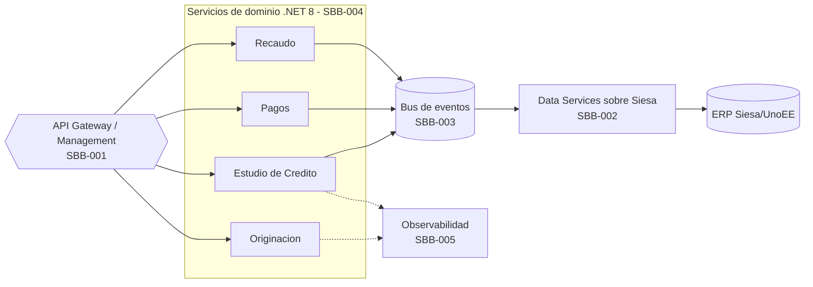
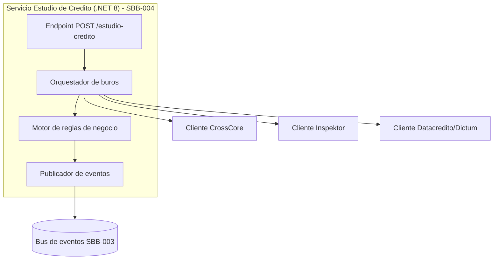
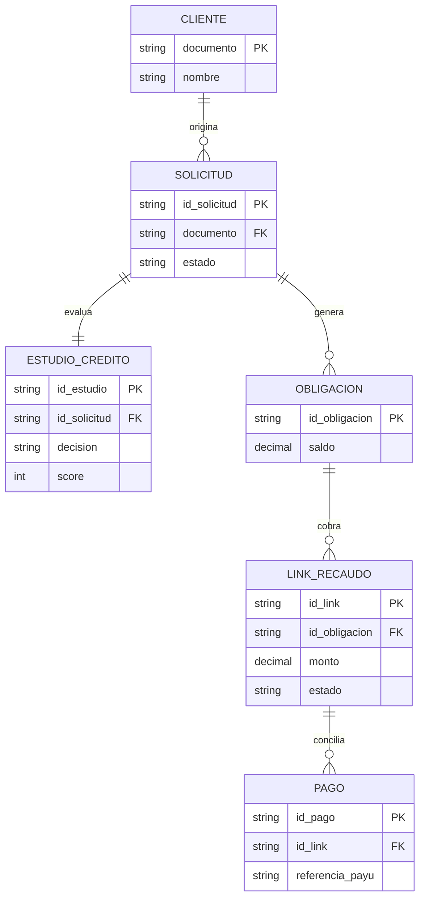
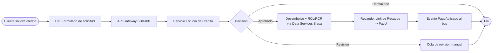

# Fase 4 - Diseno TO-BE

> Fase 4 del framework **Zero-Drift**. Disena el **TO-BE** de Credi10 2.0: mapea los ABBs a SBBs concretos, define la arquitectura C4, las decisiones (ADRs), el modelo de datos, los contratos, el proceso BPMN y el paquete Spec-Driven (Gherkin), todo certificado por un **Dry-Run / Tabletop** del AM antes de construir.

**Liderazgo (RACI-V):** Productores (R): **SA, DA, PM, UX** - Accountable (A): **EM** - Verificador / Dry-Run (V): **AM** - Consultado (C): AIA, SEC - Informado (I): ED.

> **Hilo Dorado:** esta fase origina **SBBs (SBB-xxx)**, cada uno referenciando un **ABB (ABB-xxx)** de la Fase 3.5 y ligado a un Driver (DRV) del RFP.

## E4.1 - Mapeo ABB -> SBB, Arquitectura C4, ADRs y NFRs

### Mapeo ABB -> SBB (Hilo Dorado)

| Hilo Dorado | SBB (Solution Building Block) | ABB origen | Stack TO-BE |
| --- | --- | --- | --- |
| SBB-001 | API Gateway + plataforma de API Management (WSO2 API Platform + Integration Platform) | ABB-001 | WSO2 API Manager / Integration |
| SBB-002 | Data Services sobre el ERP Siesa (reemplazan la lectura directa a la BD) | ABB-002 | .NET 8 Data Services + WSO2 Data Services |
| SBB-003 | Bus de eventos / mensajeria para sincronizacion con Siesa | ABB-003 | Broker de eventos (AsyncAPI) |
| SBB-004 | Microservicios de dominio (.NET 8) por bounded context | ABB-004 | .NET 8 contenerizado |
| SBB-005 | Observabilidad y trazabilidad (logging/metricas/SLOs) | ABB-005 | CloudWatch + stack de observabilidad |
| SBB-006 | Migracion de runtime .NET Framework 4.8 / .NET Core 3.1 -> .NET 8 | ABB-006 | .NET 8 / contenedores |

### C4 Nivel 1 - Contexto


### C4 Nivel 2 - Contenedores




### C4 Nivel 3 - Componentes (Estudio de Credito)




### Architecture Decision Records (ADRs)

### ADR-001: Adoptar una plataforma de API Management centralizada

- **Estado:** Aceptada.
- **Contexto:** Las integraciones viven dispersas en servicios de Windows y cronjobs sin gestion centralizada ni trazabilidad (GAP-004).
- **Decision:** Adoptar WSO2 API Platform + Integration Platform como capa unica de gestion de APIs (SBB-001), eco de la recomendacion 5.2 del assessment.
- **Consecuencias:** Gobernanza, trazabilidad y seguridad centralizadas; introduce una dependencia de plataforma a operar. Liga a DRV-004.

### ADR-002: Reemplazar la integracion de archivos planos / WS unico de Siesa por Data Services + eventos

- **Estado:** Aceptada.
- **Contexto:** Siesa se integra por archivos planos batch y un unico Web Service, con la practica de ALTO RIESGO de leer/escribir directo a la BD del ERP (GAP-001, GAP-002).
- **Decision:** Exponer el ERP Siesa como **Data Services** gobernados (SBB-002) y sincronizar via un **bus de eventos** (SBB-003); prohibir el acceso directo a la BD del ERP.
- **Consecuencias:** Elimina el cuello de botella y el riesgo de integridad; requiere definir contratos AsyncAPI. Liga a DRV-001/DRV-002.

### ADR-003: Migrar el runtime .NET Framework 4.8 / .NET Core 3.1 a .NET 8

- **Estado:** Aceptada.
- **Contexto:** Componentes criticos corren sobre .NET Framework 4.8 y .NET Core 3.1 (fuera de soporte), con Wordpress/XAMPP en produccion (GAP-005).
- **Decision:** Migrar los servicios a **.NET 8** contenerizado (SBB-006) y retirar Wordpress/XAMPP del canal B2C.
- **Consecuencias:** Cierra brechas de soporte y licenciamiento; implica esfuerzo de migracion por ola. Liga a DRV-005/DRV-004.


### NFRs TO-BE

| NFR TO-BE | Objetivo | SBB que lo habilita | Driver |
| --- | --- | --- | --- |
| Disponibilidad | 90% -> 99% | SBB-001, SBB-005 | DRV-001 |
| Eficiencia de recursos | 60% -> 80% (latencia base sin instrumentar hoy [EPISTEMIC-VOID]) | SBB-002, SBB-003 | DRV-002 |
| Costo de infraestructura | 80% -> 80% (sin degradar) | SBB-004 | DRV-003 |
| Evolucion/escalamiento | 50% -> 100% | SBB-004, SBB-006 | DRV-004 |
| Licenciamiento | 70% -> 100% | SBB-006 | DRV-005 |

## E4.2 - Modelo de Datos (ERD/DDD), Contratos y Migracion

### Modelo de datos - contexto Recaudo/Pagos




### Contrato OpenAPI - POST /estudio-credito

```yaml
openapi: 3.0.3
info:
  title: Credi10 2.0 - Estudio de Credito
  version: 1.0.0
paths:
  /estudio-credito:
    post:
      summary: Inicia el estudio de credito (CrossCore -> Inspektor -> Datacredito)
      requestBody:
        required: true
        content:
          application/json:
            schema:
              type: object
              required: [documento, idSolicitud]
              properties:
                documento: { type: string }
                idSolicitud: { type: string }
      responses:
        '200':
          description: Decision del estudio
          content:
            application/json:
              schema:
                type: object
                properties:
                  idEstudio: { type: string }
                  decision: { type: string, enum: [APROBADO, RECHAZADO, REVISION] }
                  score: { type: integer }
        '424':
          description: Buro no disponible (CrossCore/Inspektor/Datacredito)
```


### Contrato AsyncAPI - evento de recaudo

```yaml
asyncapi: 2.6.0
info:
  title: Credi10 2.0 - Eventos de integracion Siesa
  version: 1.0.0
channels:
  recaudo/pago-aplicado:
    subscribe:
      message:
        name: PagoAplicado
        payload:
          type: object
          properties:
            idPago: { type: string }
            idObligacion: { type: string }
            referenciaPayU: { type: string }
            monto: { type: number }
```


### Estrategia de migracion

| Elemento legado | Estrategia de migracion | SBB destino |
| --- | --- | --- |
| WS unico + archivos planos de Siesa | Strangler Fig: desviar por Data Services + eventos de forma incremental | SBB-002, SBB-003 |
| Lectura directa a la BD del ERP Siesa | Prohibir y reemplazar por Data Services; CDC donde aplique | SBB-002 |
| .NET Framework 4.8 / .NET Core 3.1 | Migracion por dominio a .NET 8 contenerizado | SBB-006, SBB-004 |
| Integraciones Windows/cronjobs | Reencaminar por API Gateway + bus de eventos | SBB-001, SBB-003 |

## E4.3 - Proceso BPMN To-Be, Service Blueprint y UX

### BPMN To-Be (estudio de credito -> recaudo)




### Service Blueprint

| Capa del Service Blueprint | Actividad (flujo estudio -> recaudo) |
| --- | --- |
| Evidencia fisica | Formulario web, confirmacion de aprobacion, link de pago |
| Acciones del cliente | Enviar solicitud, aceptar oferta, pagar en PayU |
| Frontstage (UX) | Pantalla de solicitud, pantalla de decision, pantalla de pago |
| Backstage | Orquestacion de buros, motor de reglas, generacion de RCL/RCR |
| Procesos de soporte | Data Services Siesa, bus de eventos, observabilidad |

> **Prototipos UX/UI:** pantalla de solicitud (captura de documento), pantalla de decision (APROBADO/RECHAZADO/REVISION con score) y pantalla de pago (redireccion a PayU). Disenadas por UX para minimizar pasos manuales (DRV-002).

## E4.4 - Paquete Spec-Driven (Historias BDD / Gherkin)

Historias en Gherkin espanol (Dado/Cuando/Entonces) que cubren el happy path y los casos borde del Exception Storming (EX-01, EX-04):

```gherkin
# language: es
Caracteristica: Estudio de credito en Credi10 2.0

  Escenario: Aprobacion con buros disponibles (happy path)
    Dado un cliente con documento "CC123" y una solicitud "SOL-1"
    Cuando se invoca POST /estudio-credito con el documento y la solicitud
    Y CrossCore, Inspektor y Datacredito responden correctamente
    Entonces la decision es "APROBADO"
    Y se publica el evento de estudio en el bus

  Escenario: Buro no disponible (caso borde EX-01)
    Dado un cliente con documento "CC124" y una solicitud "SOL-2"
    Cuando se invoca POST /estudio-credito
    Y CrossCore agota el tiempo de espera
    Entonces el servicio responde con estado 424
    Y la solicitud queda encolada sin perderse

  Escenario: Escritura a Siesa falla (caso borde EX-04)
    Dado una solicitud "SOL-3" aprobada
    Cuando falla la escritura al ERP Siesa
    Entonces nunca se escribe directo a la base de datos del ERP
    Y se publica un evento para reintentar via Data Services
```


## E4.5 - Acta de Certificacion Dry-Run y Threat Modeling

### Cadena de validacion (Dry-Run / Tabletop del AM)

El AM recorre la cadena completa Evento -> Pantalla UX -> Regla Gherkin -> Contrato API (payload JSON) -> Componente C4 -> Tabla/Entidad BD -> Respuesta al usuario:

| Eslabon de la cadena de validacion | Artefacto concreto |
| --- | --- |
| Evento | Cliente envia solicitud de credito |
| Pantalla UX | Formulario de solicitud -> pantalla de decision |
| Regla Gherkin | Escenario "Aprobacion con buros disponibles" (Dado/Cuando/Entonces) |
| Contrato API (payload JSON) | `POST /estudio-credito` `{ "documento": "CC123", "idSolicitud": "SOL-1" }` |
| Componente C4 | Servicio Estudio de Credito (.NET 8, SBB-004) + API Gateway (SBB-001) |
| Tabla/Entidad BD | ESTUDIO_CREDITO (id_estudio, id_solicitud, decision, score) |
| Respuesta al usuario | Decision APROBADO/RECHAZADO/REVISION con score (umbral de score [DOC-ASSUMPTION], a confirmar con negocio) |

### Matriz de Threat Modeling (SEC, STRIDE)

| Amenaza (STRIDE) | Vector | Mitigacion | SBB |
| --- | --- | --- | --- |
| Spoofing | Suplantacion de cliente o asesor | Autenticacion fuerte en el API Gateway | SBB-001 |
| Tampering | Manipulacion directa de la BD del ERP Siesa | Prohibir acceso directo; solo Data Services | SBB-002 |
| Repudiation | Falta de trazabilidad de operaciones | Logging y auditoria centralizada | SBB-005 |
| Information disclosure | Fuga de datos de buros | Cifrado extremo a extremo y minimizacion | SBB-001 |
| Denial of service | Saturacion del WS unico de Siesa | Bus de eventos + rate limiting en el gateway | SBB-003, SBB-001 |
| Elevation of privilege | Escalamiento via integraciones dispersas | Zero-trust y segmentacion por dominio | SBB-004 |

### Acta de certificacion

| Criterio de Dry-Run / Tabletop (AM) | Resultado |
| --- | --- |
| Cada SBB mapea a un ABB trazable | OK |
| Cada historia Gherkin cubre happy path + casos borde | OK |
| Contratos API/eventos definidos (OpenAPI/AsyncAPI) | OK |
| Cadena Evento -> UX -> Gherkin -> API -> C4 -> BD -> respuesta completa | OK |
| Reglas de negocio preservadas (requisito RFP) | OK |

> El Dry-Run certifica que cada SBB es trazable a un ABB y que la cadena Evento -> respuesta esta completa, preservando las reglas de negocio; se habilita el build.

## Stage-Gate QG-4 - Diseno TO-BE (Dry-Run)

| Criterio de salida QG-4 | Estado |
| --- | --- |
| Arquitectura TO-BE y SBBs definidos. | Satisfecho |
| Specs e historias trazables a gaps. | Satisfecho |
| Dry-Run / Tabletop ejecutado por AM antes del build. | Satisfecho |

**No-Go si:** El Dry-Run revela SBBs sin spec o specs sin historia trazable.

> **Veredicto QG-4:** QG-4 :: GO - Criterios de salida satisfechos.

