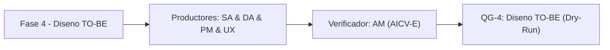

# Fase 4 - Diseno TO-BE

> *(Contenido placeholder generado por FEAT-001; el contenido fundamentado en el corpus llega en features posteriores.)*

Esta fase disena el TO-BE: arquitectura objetivo, SBBs, specs e historias, validadas por el Dry-Run/Tabletop del AM.

## Liderazgo y RACI-V

Roles productores: SA (Lead Solution Architect), DA (Data & Integration Architect), PM (Product Manager / Spec BA), UX (Lead Product Designer).
Verificador (V): **AM**. Accountable (A): **EM**.

| Dimension RACI-V | Roles |
| --- | --- |
| R - Responsible | SA, DA, PM, UX |
| A - Accountable | EM |
| C - Consulted | AIA, SEC |
| I - Informed | ED |
| V - Verifier | AM |

## Diagrama de fase

## Entregables

| Codigo | Entregable |
| --- | --- |
| E4.1 | Entregable E4.1 (contenido en features posteriores) |
| E4.2 | Entregable E4.2 (contenido en features posteriores) |
| E4.3 | Entregable E4.3 (contenido en features posteriores) |

## Stage-Gate QG-4 - Diseno TO-BE (Dry-Run)

| Criterio de salida |
| --- |
| Arquitectura TO-BE y SBBs definidos. |
| Specs e historias trazables a gaps. |
| Dry-Run / Tabletop ejecutado por AM antes del build. |

**No-Go si:** El Dry-Run revela SBBs sin spec o specs sin historia trazable.

> **Veredicto QG-4:** QG-4 :: GO - Criterios de salida satisfechos.

