# Catalogo Exhaustivo de Historias de Usuario y Specs BDD/Gherkin

> Complemento de la **Fase 4 (Diseno TO-BE)** del framework **Zero-Drift**. Cataloga, **sin muestreo**, TODO el universo de modulos de Credi10 2.0. Cada modulo aporta al menos una **Historia de Usuario** con criterios de aceptacion **BDD/Gherkin** en espanol (Dado/Cuando/Entonces) que cubren el **happy path** y al menos un **caso borde/excepcion** (Exception Storming), cada una con un id trazable del **Hilo Dorado**. Es documentacion (spec para la siguiente etapa), generada por el motor del advisory. La ingesta de la Base de Conocimiento cubre **18** documentos (sin muestreo), lo que sustenta la trazabilidad de cada historia a su documento fuente.

> **Fuente unica de verdad:** el listado de modulos es el dato declarativo `advisory-system/phases/modules.py` (`MODULES`), reutilizado por este catalogo y por la **estimacion por modulo** de la Fase 5. La completitud es testeable: numero de modulos renderizados == `len(MODULES)`.

> Las viabilidades/umbrales que no estan explicitos en el corpus se marcan [DOC-ASSUMPTION]; cuando no hay base documental se marca [EPISTEMIC-VOID]. Nunca se fabrica evidencia [VERIFIED-FACT].

## Cobertura del catalogo

| Metrica de cobertura | Valor |
| --- | ---: |
| Modulos declarados (fuente unica `phases/modules.py`) | 17 |
| Historias de usuario (HU) | 17 |
| Escenarios Gherkin (happy + borde) | 34 |

## Mapa de cobertura por Bounded Context

```mermaid
flowchart TB
    subgraph C1["Atencion al Cliente"]
        MOD_12["MOD-12 API Integrador Atencion al Cliente"]
    end
    subgraph C2["B2C / E-commerce"]
        MOD_09["MOD-09 B2C / Portal de clientes"]
        MOD_10["MOD-10 Boton E-commerce"]
    end
    subgraph C3["Cartera"]
        MOD_17["MOD-17 Fidelizacion / Pentaho (BI)"]
    end
    subgraph C4["Cobranza"]
        MOD_13["MOD-13 Llamada Predictiva"]
        MOD_14["MOD-14 Cobranza (SMS / WhatsApp / Email / Scheduler)"]
    end
    subgraph C5["Corte / Cartera"]
        MOD_07["MOD-07 Corte de Cartera"]
    end
    subgraph C6["Estudio de Credito"]
        MOD_02["MOD-02 Originacion - CrossCore"]
        MOD_03["MOD-03 Originacion - Inspektor"]
        MOD_04["MOD-04 Originacion - Datacredito"]
    end
    subgraph C7["Integracion ERP"]
        MOD_15["MOD-15 Envio RCL y RCR"]
        MOD_16["MOD-16 Integracion UnoEE / Siesa"]
    end
    subgraph C8["Originacion"]
        MOD_05["MOD-05 Originacion - Aplicacion ADMIN"]
        MOD_11["MOD-11 Captura Foto"]
    end
    subgraph C9["Pagos"]
        MOD_06["MOD-06 Pagos / GenerarPagos"]
    end
    subgraph C10["Plataforma / Core"]
        MOD_01["MOD-01 Plataforma Credi10 / Administracion de creditos"]
    end
    subgraph C11["Recaudo"]
        MOD_08["MOD-08 Link de Recaudo / APIs de recaudo"]
    end
```



## Indice de modulos del universo Credi10

| Modulo | Nombre | Bounded Context | ABBs | Historias | Fuente (KB) |
| --- | --- | --- | --- | --- | --- |
| MOD-01 | Plataforma Credi10 / Administracion de creditos | Plataforma / Core | ABB-004, ABB-005 | HU-01 | RFP_CREDI10_2_0.pdf |
| MOD-02 | Originacion - CrossCore | Estudio de Credito | ABB-001, ABB-004 | HU-02 | Originacion_CrossCore.pdf |
| MOD-03 | Originacion - Inspektor | Estudio de Credito | ABB-001, ABB-004 | HU-03 | Originacion_API_Inspektor.pdf |
| MOD-04 | Originacion - Datacredito | Estudio de Credito | ABB-001, ABB-004 | HU-04 | Originacion_API_Datacredito.pdf |
| MOD-05 | Originacion - Aplicacion ADMIN | Originacion | ABB-004, ABB-005 | HU-05 | Originacion_Aplicacion_ADMIN.pdf |
| MOD-06 | Pagos / GenerarPagos | Pagos | ABB-001, ABB-003 | HU-06 | GenerarPagos.pdf |
| MOD-07 | Corte de Cartera | Corte / Cartera | ABB-004, ABB-005 | HU-07 | ProcesoCorteCartera.pdf |
| MOD-08 | Link de Recaudo / APIs de recaudo | Recaudo | ABB-001, ABB-003 | HU-08 | LinkDePagos.pdf |
| MOD-09 | B2C / Portal de clientes | B2C / E-commerce | ABB-001, ABB-006 | HU-09 | B2C.pdf |
| MOD-10 | Boton E-commerce | B2C / E-commerce | ABB-001, ABB-003 | HU-10 | BotonEcommerce.pdf |
| MOD-11 | Captura Foto | Originacion | ABB-004 | HU-11 | Captura_Foto.pdf |
| MOD-12 | API Integrador Atencion al Cliente | Atencion al Cliente | ABB-001, ABB-004 | HU-12 | Api_Integrador_Atencion_al_cliente.pdf |
| MOD-13 | Llamada Predictiva | Cobranza | ABB-001, ABB-004 | HU-13 | Llamada_predictiva.pdf |
| MOD-14 | Cobranza (SMS / WhatsApp / Email / Scheduler) | Cobranza | ABB-003, ABB-004 | HU-14 | RFP_CREDI10_2_0.pdf |
| MOD-15 | Envio RCL y RCR | Integracion ERP | ABB-002, ABB-003 | HU-15 | Envio_de_RCL_y_RCR.pdf |
| MOD-16 | Integracion UnoEE / Siesa | Integracion ERP | ABB-002, ABB-003 | HU-16 | WSO2 y Studio F - Assessment Mayo2026-Final.pdf |
| MOD-17 | Fidelizacion / Pentaho (BI) | Cartera | ABB-004, ABB-005 | HU-17 | RFP_CREDI10_2_0.pdf |

## Historias de usuario + Gherkin por modulo

### MOD-01 - Plataforma Credi10 / Administracion de creditos

- **Bounded Context:** Plataforma / Core
- **Componentes:** Aplicacion central Credi10 (.NET), administracion de obligaciones y parametrizacion de productos de credito.
- **ABBs (Hilo Dorado):** ABB-004, ABB-005
- **Fuente (Base de Conocimiento):** `RFP_CREDI10_2_0.pdf`

**HU-01 - Historia de usuario**

> Como **administrador de creditos** quiero **parametrizar y administrar los productos de credito y sus obligaciones desde una plataforma central** para **operar la cartera con reglas de negocio preservadas y trazables**.

```gherkin
# language: es
Caracteristica: Plataforma Credi10 / Administracion de creditos (HU-01)

  Escenario: Alta de un producto de credito (happy path)
    Dado un administrador autenticado en la plataforma Credi10
    Cuando registra un producto de credito con sus parametros
    Y guarda la configuracion
    Entonces el producto queda disponible para originacion
    Y la operacion queda auditada y trazable

  Escenario: Parametros invalidos (caso borde)
    Dado un administrador autenticado
    Cuando intenta guardar un producto con una tasa fuera de rango
    Entonces la plataforma rechaza el cambio con un mensaje claro
    Y no se altera ninguna obligacion existente
```

### MOD-02 - Originacion - CrossCore

- **Bounded Context:** Estudio de Credito
- **Componentes:** Orquestacion de buros CrossCore dentro del estudio de credito (CrossCore -> Inspektor -> Datacredito).
- **ABBs (Hilo Dorado):** ABB-001, ABB-004
- **Fuente (Base de Conocimiento):** `Originacion_CrossCore.pdf`

**HU-02 - Historia de usuario**

> Como **motor de originacion** quiero **consultar CrossCore como primer eslabon del estudio de credito** para **validar identidad y riesgo antes de continuar con los demas buros**.

```gherkin
# language: es
Caracteristica: Originacion - CrossCore (HU-02)

  Escenario: CrossCore responde correctamente (happy path)
    Dado una solicitud en estudio de credito
    Cuando se invoca CrossCore con el documento del cliente
    Entonces se obtiene la respuesta de CrossCore
    Y el flujo continua hacia Inspektor

  Escenario: CrossCore agota el timeout (caso borde, EX-01)
    Dado una solicitud en estudio de credito
    Cuando CrossCore no responde dentro del tiempo limite
    Entonces se aplica reintento con backoff
    Y si persiste, la solicitud se encola sin perderse
```

### MOD-03 - Originacion - Inspektor

- **Bounded Context:** Estudio de Credito
- **Componentes:** Consulta al servicio Inspektor como segundo eslabon del estudio de credito.
- **ABBs (Hilo Dorado):** ABB-001, ABB-004
- **Fuente (Base de Conocimiento):** `Originacion_API_Inspektor.pdf`

**HU-03 - Historia de usuario**

> Como **motor de originacion** quiero **consultar Inspektor tras CrossCore** para **enriquecer el estudio de credito con senales adicionales**.

```gherkin
# language: es
Caracteristica: Originacion - Inspektor (HU-03)

  Escenario: Inspektor entrega datos completos (happy path)
    Dado una solicitud con CrossCore ya resuelto
    Cuando se invoca Inspektor
    Entonces se reciben los datos de Inspektor
    Y el flujo continua hacia Datacredito

  Escenario: Inspektor devuelve datos incompletos (caso borde, EX-02)
    Dado una solicitud con CrossCore ya resuelto
    Cuando Inspektor devuelve una respuesta parcial
    Entonces el estudio se marca pendiente de revision manual
    Y no se aprueba automaticamente
```

### MOD-04 - Originacion - Datacredito

- **Bounded Context:** Estudio de Credito
- **Componentes:** Consulta al bureau Datacredito/Dictum como eslabon final del estudio de credito.
- **ABBs (Hilo Dorado):** ABB-001, ABB-004
- **Fuente (Base de Conocimiento):** `Originacion_API_Datacredito.pdf`

**HU-04 - Historia de usuario**

> Como **motor de originacion** quiero **consultar Datacredito/Dictum al cierre del estudio** para **decidir la aprobacion con el historial crediticio del cliente**.

```gherkin
# language: es
Caracteristica: Originacion - Datacredito (HU-04)

  Escenario: Datacredito devuelve historial (happy path)
    Dado una solicitud con CrossCore e Inspektor resueltos
    Cuando se invoca Datacredito/Dictum
    Entonces se obtiene el score/historial
    Y se produce la decision APROBADO/RECHAZADO/REVISION

  Escenario: Cliente sin historial (no-hit) (caso borde, EX-03)
    Dado un cliente sin historial en el bureau
    Cuando Datacredito/Dictum reporta no-hit
    Entonces se aplica una regla de scoring alterna
    Y la decision queda registrada como [DOC-ASSUMPTION]
```

### MOD-05 - Originacion - Aplicacion ADMIN

- **Bounded Context:** Originacion
- **Componentes:** Aplicacion ADMIN de originacion para gestion y revision de solicitudes.
- **ABBs (Hilo Dorado):** ABB-004, ABB-005
- **Fuente (Base de Conocimiento):** `Originacion_Aplicacion_ADMIN.pdf`

**HU-05 - Historia de usuario**

> Como **analista de originacion** quiero **revisar y resolver manualmente las solicitudes en cola de revision** para **decidir casos que el motor dejo en REVISION sin perder trazabilidad**.

```gherkin
# language: es
Caracteristica: Originacion - Aplicacion ADMIN (HU-05)

  Escenario: Resolucion manual de una solicitud (happy path)
    Dado una solicitud en estado REVISION
    Cuando el analista la aprueba o rechaza con justificacion
    Entonces la solicitud cambia de estado
    Y la decision queda auditada con el usuario y motivo

  Escenario: Solicitud ya resuelta por otro analista (caso borde)
    Dado dos analistas abren la misma solicitud
    Cuando el segundo intenta resolverla ya resuelta
    Entonces se bloquea la doble resolucion (idempotencia)
    Y se informa el estado actual
```

### MOD-06 - Pagos / GenerarPagos

- **Bounded Context:** Pagos
- **Componentes:** Generacion de pagos (FT-SL-003) y su registro.
- **ABBs (Hilo Dorado):** ABB-001, ABB-003
- **Fuente (Base de Conocimiento):** `GenerarPagos.pdf`

**HU-06 - Historia de usuario**

> Como **sistema de pagos** quiero **generar la orden de pago de una obligacion** para **habilitar el recaudo del cliente**.

```gherkin
# language: es
Caracteristica: Pagos / GenerarPagos (HU-06)

  Escenario: Generacion de pago (happy path)
    Dado una obligacion con saldo pendiente
    Cuando se solicita generar el pago
    Entonces se crea la orden de pago
    Y queda lista para el link de recaudo

  Escenario: Obligacion sin saldo (caso borde)
    Dado una obligacion con saldo cero
    Cuando se solicita generar el pago
    Entonces se rechaza la generacion
    Y se informa que no hay saldo por cobrar
```

### MOD-07 - Corte de Cartera

- **Bounded Context:** Corte / Cartera
- **Componentes:** Proceso de corte de cartera (FT-SL-004) y consolidacion de saldos/mora.
- **ABBs (Hilo Dorado):** ABB-004, ABB-005
- **Fuente (Base de Conocimiento):** `ProcesoCorteCartera.pdf`

**HU-07 - Historia de usuario**

> Como **sistema de cartera** quiero **ejecutar el corte de cartera periodico** para **consolidar saldos y mora para cobranza y reporteria**.

```gherkin
# language: es
Caracteristica: Corte de Cartera (HU-07)

  Escenario: Corte periodico exitoso (happy path)
    Dado la cartera al cierre del periodo
    Cuando se ejecuta el proceso de corte
    Entonces se consolidan saldos y estados de mora
    Y se publican los resultados para cobranza

  Escenario: Corte interrumpido a mitad de proceso (caso borde)
    Dado un corte en ejecucion
    Cuando el proceso falla antes de terminar
    Entonces el corte es idempotente y reanudable
    Y no se duplican ni pierden obligaciones
```

### MOD-08 - Link de Recaudo / APIs de recaudo

- **Bounded Context:** Recaudo
- **Componentes:** Link de Recaudo (FT-SL-011) hacia PayU y conciliacion del pago.
- **ABBs (Hilo Dorado):** ABB-001, ABB-003
- **Fuente (Base de Conocimiento):** `LinkDePagos.pdf`

**HU-08 - Historia de usuario**

> Como **cliente** quiero **pagar mi obligacion mediante un link de recaudo** para **saldar mi credito de forma simple y segura**.

```gherkin
# language: es
Caracteristica: Link de Recaudo / APIs de recaudo (HU-08)

  Escenario: Pago por link conciliado (happy path)
    Dado un link de recaudo generado para una obligacion
    Cuando el cliente paga en PayU
    Entonces PayU confirma el pago
    Y se publica el evento PagoAplicado y se concilia

  Escenario: PayU no confirma el pago (caso borde, EX-04)
    Dado un link de recaudo generado
    Cuando PayU no entrega confirmacion
    Entonces el pago NO se marca aplicado (RN-04)
    Y se reintenta la conciliacion via eventos
```

### MOD-09 - B2C / Portal de clientes

- **Bounded Context:** B2C / E-commerce
- **Componentes:** Portal B2C (Node.js + React + Wordpress), autoservicio del cliente.
- **ABBs (Hilo Dorado):** ABB-001, ABB-006
- **Fuente (Base de Conocimiento):** `B2C.pdf`

**HU-09 - Historia de usuario**

> Como **cliente** quiero **consultar mis obligaciones y pagar desde el portal B2C** para **autogestionar mi credito sin llamar a un asesor**.

```gherkin
# language: es
Caracteristica: B2C / Portal de clientes (HU-09)

  Escenario: Autoconsulta y pago en el portal (happy path)
    Dado un cliente autenticado en el portal B2C
    Cuando consulta sus obligaciones y elige pagar
    Entonces ve su saldo actualizado
    Y es redirigido al link de recaudo (PayU)

  Escenario: Portal sobre Wordpress/XAMPP degradado (caso borde)
    Dado el canal B2C legado (Wordpress/XAMPP, GAP-005)
    Cuando el componente legado falla
    Entonces el portal degrada sin exponer datos sensibles
    Y se prioriza la migracion a .NET 8 (SBB-006)
```

### MOD-10 - Boton E-commerce

- **Bounded Context:** B2C / E-commerce
- **Componentes:** Boton de pago e-commerce (integracion VTEX / comercio).
- **ABBs (Hilo Dorado):** ABB-001, ABB-003
- **Fuente (Base de Conocimiento):** `BotonEcommerce.pdf`

**HU-10 - Historia de usuario**

> Como **comercio aliado** quiero **ofrecer el boton de pago e-commerce de Credi10** para **permitir compras financiadas en linea**.

```gherkin
# language: es
Caracteristica: Boton E-commerce (HU-10)

  Escenario: Compra financiada con boton (happy path)
    Dado un carrito de compra en el comercio aliado
    Cuando el cliente paga con el boton e-commerce
    Entonces se registra la transaccion
    Y se concilia el recaudo con la obligacion

  Escenario: Transaccion rechazada por el medio de pago (caso borde)
    Dado un carrito de compra
    Cuando el medio de pago rechaza la transaccion
    Entonces no se genera obligacion
    Y el cliente recibe un mensaje de rechazo claro
```

### MOD-11 - Captura Foto

- **Bounded Context:** Originacion
- **Componentes:** Captura fotografica de documentos y soportes en la originacion.
- **ABBs (Hilo Dorado):** ABB-004
- **Fuente (Base de Conocimiento):** `Captura_Foto.pdf`

**HU-11 - Historia de usuario**

> Como **asesor de originacion** quiero **capturar la foto del documento del cliente** para **adjuntar soporte valido a la solicitud**.

```gherkin
# language: es
Caracteristica: Captura Foto (HU-11)

  Escenario: Captura y validacion de foto (happy path)
    Dado una solicitud en curso
    Cuando el asesor captura la foto del documento
    Entonces la imagen se adjunta a la solicitud
    Y queda disponible como soporte trazable

  Escenario: Foto ilegible o de baja calidad (caso borde)
    Dado una solicitud en curso
    Cuando la foto capturada es ilegible
    Entonces el sistema solicita recaptura
    Y la solicitud no avanza sin soporte valido
```

### MOD-12 - API Integrador Atencion al Cliente

- **Bounded Context:** Atencion al Cliente
- **Componentes:** API integrador de atencion al cliente (omnicanal Wolkvox / B2Chat).
- **ABBs (Hilo Dorado):** ABB-001, ABB-004
- **Fuente (Base de Conocimiento):** `Api_Integrador_Atencion_al_cliente.pdf`

**HU-12 - Historia de usuario**

> Como **agente de atencion al cliente** quiero **consultar el estado del cliente desde una API integradora omnicanal** para **atender consultas con informacion unificada**.

```gherkin
# language: es
Caracteristica: API Integrador Atencion al Cliente (HU-12)

  Escenario: Consulta omnicanal unificada (happy path)
    Dado un agente en el canal de atencion
    Cuando consulta al cliente via el API integrador
    Entonces recibe el estado consolidado del cliente
    Y atiende sin cambiar de sistema

  Escenario: Fuente de datos no disponible (caso borde)
    Dado un agente en el canal de atencion
    Cuando una fuente del integrador no responde
    Entonces se devuelve la informacion parcial disponible
    Y se informa que el dato esta temporalmente incompleto
```

### MOD-13 - Llamada Predictiva

- **Bounded Context:** Cobranza
- **Componentes:** Marcacion predictiva de cobranza (WOLKVOX).
- **ABBs (Hilo Dorado):** ABB-001, ABB-004
- **Fuente (Base de Conocimiento):** `Llamada_predictiva.pdf`

**HU-13 - Historia de usuario**

> Como **operacion de cobranza** quiero **ejecutar campanas de llamada predictiva** para **contactar deudores de forma eficiente para recaudo**.

```gherkin
# language: es
Caracteristica: Llamada Predictiva (HU-13)

  Escenario: Campana predictiva conecta al deudor (happy path)
    Dado una lista priorizada de deudores
    Cuando el marcador predictivo (WOLKVOX) lanza las llamadas
    Entonces se conecta al agente con el deudor
    Y se registra el resultado de contacto

  Escenario: Sin agentes disponibles (caso borde)
    Dado una campana predictiva en curso
    Cuando no hay agentes libres al conectar la llamada
    Entonces se evita la llamada abandonada
    Y se reprograma el contacto
```

### MOD-14 - Cobranza (SMS / WhatsApp / Email / Scheduler)

- **Bounded Context:** Cobranza
- **Componentes:** Scheduler de cobranza multicanal (SMS, WhatsApp, Email).
- **ABBs (Hilo Dorado):** ABB-003, ABB-004
- **Fuente (Base de Conocimiento):** `RFP_CREDI10_2_0.pdf`

**HU-14 - Historia de usuario**

> Como **operacion de cobranza** quiero **programar envios de cobranza por SMS/WhatsApp/Email con un scheduler** para **recordar y gestionar el pago de forma automatica y multicanal**.

```gherkin
# language: es
Caracteristica: Cobranza (SMS / WhatsApp / Email / Scheduler) (HU-14)

  Escenario: Envio multicanal programado (happy path)
    Dado una cartera en mora segmentada
    Cuando el scheduler dispara los mensajes por canal
    Entonces se envian SMS/WhatsApp/Email segun la segmentacion
    Y se registra el acuse de cada canal

  Escenario: Canal caido en el envio (caso borde)
    Dado un envio multicanal programado
    Cuando un canal (p. ej. WhatsApp) no esta disponible
    Entonces se reintenta o se usa un canal alterno
    Y no se duplican mensajes al mismo deudor
```

### MOD-15 - Envio RCL y RCR

- **Bounded Context:** Integracion ERP
- **Componentes:** Generacion y envio de RCL/RCR (facturacion electronica en UnoEE, timbrado Numrot).
- **ABBs (Hilo Dorado):** ABB-002, ABB-003
- **Fuente (Base de Conocimiento):** `Envio_de_RCL_y_RCR.pdf`

**HU-15 - Historia de usuario**

> Como **sistema de facturacion** quiero **generar y enviar los documentos RCL/RCR tras el desembolso** para **cumplir la facturacion electronica (timbrado Numrot)**.

```gherkin
# language: es
Caracteristica: Envio RCL y RCR (HU-15)

  Escenario: RCL/RCR timbrado y enviado (happy path)
    Dado un desembolso confirmado (RN-03)
    Cuando se generan RCL/RCR en UnoEE
    Entonces se timbran con Numrot
    Y se envian al cliente y a la DIAN

  Escenario: Fallo de timbrado (caso borde)
    Dado un desembolso confirmado
    Cuando el timbrado con Numrot falla
    Entonces se reintenta el timbrado via eventos
    Y nunca se escribe directo a la BD del ERP (ADR-002)
```

### MOD-16 - Integracion UnoEE / Siesa

- **Bounded Context:** Integracion ERP
- **Componentes:** Integracion con el ERP Siesa/UnoEE (hoy archivos planos + WS unico; TO-BE Data Services + eventos).
- **ABBs (Hilo Dorado):** ABB-002, ABB-003
- **Fuente (Base de Conocimiento):** `WSO2 y Studio F - Assessment Mayo2026-Final.pdf`

**HU-16 - Historia de usuario**

> Como **plataforma de integracion** quiero **sincronizar con el ERP Siesa/UnoEE via Data Services y eventos** para **eliminar los archivos planos batch y el WS unico como cuello de botella (GAP-001)**.

```gherkin
# language: es
Caracteristica: Integracion UnoEE / Siesa (HU-16)

  Escenario: Sincronizacion gobernada con Siesa (happy path)
    Dado un evento de negocio (p. ej. PagoAplicado)
    Cuando se publica al bus y lo consumen los Data Services
    Entonces Siesa se actualiza via Data Services gobernados
    Y no se accede directo a la BD del ERP (ADR-002)

  Escenario: Data Service de Siesa no disponible (caso borde, EX-04)
    Dado un evento pendiente de sincronizar
    Cuando el Data Service de Siesa esta caido
    Entonces el evento se retiene y se reintenta
    Y jamas se evade el contrato escribiendo a la BD
```

### MOD-17 - Fidelizacion / Pentaho (BI)

- **Bounded Context:** Cartera
- **Componentes:** Fidelizacion y analitica/BI con Pentaho sobre datos de cartera.
- **ABBs (Hilo Dorado):** ABB-004, ABB-005
- **Fuente (Base de Conocimiento):** `RFP_CREDI10_2_0.pdf`

**HU-17 - Historia de usuario**

> Como **analista de negocio** quiero **disponer de tableros de fidelizacion y BI (Pentaho)** para **tomar decisiones sobre cartera y campanas de fidelizacion**.

```gherkin
# language: es
Caracteristica: Fidelizacion / Pentaho (BI) (HU-17)

  Escenario: Tablero de fidelizacion actualizado (happy path)
    Dado datos de cartera consolidados por el corte
    Cuando Pentaho procesa y publica los tableros
    Entonces el analista ve indicadores de fidelizacion
    Y las cifras trazan al corte de cartera (MOD-07)

  Escenario: Datos de origen incompletos (caso borde)
    Dado un corte de cartera parcial
    Cuando Pentaho detecta datos faltantes
    Entonces el tablero marca el dato como incompleto
    Y no se publican indicadores enganiosos
```

## Veredicto de cobertura

| Criterio de cobertura del catalogo | Estado |
| --- | --- |
| Todos los modulos declarados tienen >= 1 historia | Satisfecho |
| Cada historia cubre happy path + caso borde (Exception Storming) | Satisfecho |
| El listado de modulos es la unica fuente de verdad (phases/modules.py) | Satisfecho |

> **Veredicto QG-4b:** GO - cobertura 17/17 modulos con happy path + caso borde.

