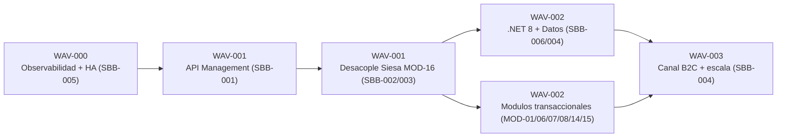
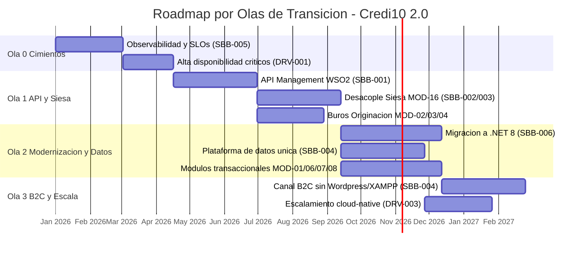

# Fase 5 - Roadmap, Estimacion y RAID

> Fase 5 del framework **Zero-Drift**. Convierte el diseno TO-BE (SBBs de la Fase 4) en un **plan ejecutable**: estimacion calibrada de tallas, **estimacion detallada por modulo** con un modelo parametrico recalibrable, dimensionamiento de squads con Team Topologies, priorizacion WSJF, un roadmap por **olas de transicion** con dependencias tecnicas explicitas y ruta critica, una matriz **RAID** anclada a las restricciones reales del RFP, la **evaluacion del dueno de negocio** sobre la suficiencia para arrancar y un **analisis de riesgo de desfase de tiempos** con veredicto Go/No-Go.

**Liderazgo (RACI-V):** Productores (R): **EM, SA, PM, ORG** - Accountable (A): **EM** - Verificador (V): **AM** (guardian AICV-E / Hilo Dorado) - Consultado (C): FIN, SEC - Informado (I): ED.

> **Hilo Dorado:** esta fase origina las **Olas (WAV-xxx)**, cada una referenciando los **SBBs (SBB-xxx)** de la Fase 4 y sus Relievers (REL-xxx), ligados a los Drivers (DRV) del RFP. La Fase 6 referenciara estas olas al cuantificar el ROI.

> **Nota de alcance.** Este informe es **documentacion de advisory**. Las tablas de estimacion, el roadmap, la evaluacion del dueno de negocio y el analisis de riesgo son artefactos para la **siguiente etapa**; no constituyen codigo de la solucion ni una oferta economica.

## E5.1 - Estimacion de Tallas Calibrada y Dimensionamiento de Squads

### Estimacion de Tallas (T-Shirt S/M/L/XL)

> **Metodo de estimacion.** La talla T-Shirt (S/M/L/XL) se calibra contra una medicion funcional **COSMIC** (CFP) y, de forma complementaria, **IFPUG** (Function Points) para los modulos transaccionales. Como el corpus **no** aporta lineas de codigo ni un conteo funcional historico, las cifras de CFP son una **banda de calibracion ilustrativa** [DOC-ASSUMPTION] (S<=30, M 30-60, L 60-120, XL>120 CFP), a reconciliar en un taller de estimacion con el equipo tecnico antes de comprometer el roadmap.

| Epica / Componente | Bounded Context | SBB | Talla T-Shirt | Tamanio funcional (CFP COSMIC aprox.) [DOC-ASSUMPTION] |
| --- | --- | --- | --- | --- |
| EP-01 Estudio de credito automatizado | Estudio de Credito | SBB-001, SBB-004 | L | ~90 CFP |
| EP-02 Integracion gobernada con Siesa (Data Services + eventos) | Integracion ERP | SBB-002, SBB-003 | XL | ~140 CFP |
| EP-03 Recaudo por Link (PayU) | Recaudo | SBB-001, SBB-003 | M | ~55 CFP |
| API Management centralizado (WSO2) | Transversal | SBB-001 | L | ~80 CFP |
| Observabilidad y alta disponibilidad de componentes criticos | Transversal | SBB-005 | M | ~50 CFP |
| Migracion runtime .NET 4.8 / Core 3.1 -> .NET 8 | Transversal | SBB-006 | XL | ~150 CFP |
| Modernizacion canal B2C (salir de Wordpress/XAMPP) | B2C / E-commerce | SBB-004, SBB-006 | L | ~85 CFP |

### Dimensionamiento de Squads (Team Topologies)

Se organiza el delivery en equipos **stream-aligned** por bounded context, un **platform team** para la gestion de APIs e integracion, y un **enabling team** que acelera la modernizacion y las practicas transversales:

| Tipo de equipo (Team Topologies) | Squad | Responsabilidad | Bounded Context / Plataforma |
| --- | --- | --- | --- |
| Stream-aligned | Squad Originacion & Estudio | Originacion, Captura Foto y orquestacion de buros (CrossCore/Inspektor/Datacredito) | Originacion + Estudio de Credito |
| Stream-aligned | Squad Pagos & Recaudo | GenerarPagos, LinkDePagos (PayU), BotonEcommerce | Pagos + Recaudo |
| Stream-aligned | Squad Cartera & Cobranza | Corte de cartera, scheduler SMS/WhatsApp/Email y llamada predictiva (WOLKVOX) | Corte / Cartera + Cobranza |
| Stream-aligned | Squad Canal B2C | Portal B2C, VTEX, B2CHAT | B2C / E-commerce |
| Platform | Squad Plataforma de Integracion & APIs | API Management (WSO2), Data Services sobre Siesa y bus de eventos | SBB-001, SBB-002, SBB-003 |
| Enabling | Squad Habilitacion & Modernizacion | Coaching de .NET 8, observabilidad, DevSecOps y buenas practicas transversales | SBB-005, SBB-006 |

## E5.2 - Estimacion Detallada por Modulo (fuente unica de verdad)

La estimacion por modulo reutiliza la **unica fuente de verdad** `advisory-system/phases/modules.py` (`MODULES`), por lo que la cobertura es COMPLETA: **17** modulos estimados, sin muestreo. Todas las cifras de esfuerzo son **[DOC-ASSUMPTION]** (esfuerzo relativo) y derivan de una tabla parametrica recalibrable.

### Tabla parametrica recalibrable

| Parametro | Simbolo | Valor asumido [DOC-ASSUMPTION] | Que recalibra |
| --- | --- | --- | --- |
| Productividad (velocidad del squad) | v | 20 SP / person-month | Convierte story points en person-months |
| Factor de complejidad tecnica | fc | 1.15 | Sube/baja el esfuerzo por complejidad intrinseca |
| Factor de acople con legado | fl | 1.20 | Penaliza el acople con Siesa/.NET 4.8/Wordpress |
| Factor de riesgo de integracion | fi | 1.25 | Penaliza integracion con terceros (buros, PayU, WOLKVOX, VTEX) |

### Story points base por talla

| Talla T-Shirt | Story points base (SP_base) [DOC-ASSUMPTION] |
| --- | --- |
| XS | 5 |
| S | 13 |
| M | 21 |
| L | 40 |
| XL | 80 |

> **Como se derivan las cifras (recalibrable).** Para cada modulo:
>
> `SP_ajustado = round(SP_base x fc x fl x fi)`
>
> `person_months = SP_ajustado / v`
>
> Con los valores asumidos [DOC-ASSUMPTION] el multiplicador compuesto es `fc x fl x fi = 1.15 x 1.20 x 1.25 = 1.725` y la velocidad `v = 20 SP/person-month`. Cambiar cualquier celda de la tabla parametrica o de los story points base recalcula TODA la estimacion por modulo de forma determinista. Las cifras son esfuerzo **relativo** [DOC-ASSUMPTION], no una oferta ni un compromiso de fechas absolutas.

### Estimacion por modulo (T-Shirt + SP + person-months + WSJF)

| Modulo | Nombre | Bounded Context | Talla | SP base | SP ajustado [DOC-ASSUMPTION] | Person-months [DOC-ASSUMPTION] | CoD | Job Size | WSJF |
| --- | --- | --- | --- | ---: | ---: | ---: | ---: | ---: | ---: |
| MOD-01 | Plataforma Credi10 / Administracion de creditos | Plataforma / Core | L | 40 | 69 | 3,45 | 23 | 8 | 2.88 |
| MOD-02 | Originacion - CrossCore | Estudio de Credito | M | 21 | 36 | 1,80 | 24 | 5 | 4.8 |
| MOD-03 | Originacion - Inspektor | Estudio de Credito | M | 21 | 36 | 1,80 | 21 | 5 | 4.2 |
| MOD-04 | Originacion - Datacredito | Estudio de Credito | M | 21 | 36 | 1,80 | 24 | 5 | 4.8 |
| MOD-05 | Originacion - Aplicacion ADMIN | Originacion | M | 21 | 36 | 1,80 | 17 | 5 | 3.4 |
| MOD-06 | Pagos / GenerarPagos | Pagos | S | 13 | 22 | 1,10 | 19 | 3 | 6.33 |
| MOD-07 | Corte de Cartera | Corte / Cartera | M | 21 | 36 | 1,80 | 20 | 5 | 4.0 |
| MOD-08 | Link de Recaudo / APIs de recaudo | Recaudo | M | 21 | 36 | 1,80 | 25 | 5 | 5.0 |
| MOD-09 | B2C / Portal de clientes | B2C / E-commerce | L | 40 | 69 | 3,45 | 19 | 8 | 2.38 |
| MOD-10 | Boton E-commerce | B2C / E-commerce | S | 13 | 22 | 1,10 | 16 | 3 | 5.33 |
| MOD-11 | Captura Foto | Originacion | S | 13 | 22 | 1,10 | 14 | 3 | 4.67 |
| MOD-12 | API Integrador Atencion al Cliente | Atencion al Cliente | M | 21 | 36 | 1,80 | 19 | 5 | 3.8 |
| MOD-13 | Llamada Predictiva | Cobranza | S | 13 | 22 | 1,10 | 17 | 3 | 5.67 |
| MOD-14 | Cobranza (SMS / WhatsApp / Email / Scheduler) | Cobranza | M | 21 | 36 | 1,80 | 20 | 5 | 4.0 |
| MOD-15 | Envio RCL y RCR | Integracion ERP | M | 21 | 36 | 1,80 | 21 | 5 | 4.2 |
| MOD-16 | Integracion UnoEE / Siesa | Integracion ERP | XL | 80 | 138 | 6,90 | 29 | 13 | 2.23 |
| MOD-17 | Fidelizacion / Pentaho (BI) | Cartera | S | 13 | 22 | 1,10 | 13 | 3 | 4.33 |

> **Totales agregados [DOC-ASSUMPTION].** Sumando los **17** modulos (cobertura COMPLETA, sin muestreo): **710 story points ajustados** y **~35,50 person-months**. Es esfuerzo relativo para dimensionar olas y squads, no un compromiso de fechas: debe reconciliarse en taller antes de comprometer el cronograma.

### Priorizacion WSJF por modulo (orden de atencion)

| Orden | Modulo | Nombre | WSJF | Ola sugerida |
| --- | --- | --- | ---: | --- |
| 1 | MOD-06 | Pagos / GenerarPagos | 6.33 | WAV-002 |
| 2 | MOD-13 | Llamada Predictiva | 5.67 | WAV-003 |
| 3 | MOD-10 | Boton E-commerce | 5.33 | WAV-003 |
| 4 | MOD-08 | Link de Recaudo / APIs de recaudo | 5.0 | WAV-002 |
| 5 | MOD-02 | Originacion - CrossCore | 4.8 | WAV-001 |
| 6 | MOD-04 | Originacion - Datacredito | 4.8 | WAV-001 |
| 7 | MOD-11 | Captura Foto | 4.67 | WAV-002 |
| 8 | MOD-17 | Fidelizacion / Pentaho (BI) | 4.33 | WAV-003 |
| 9 | MOD-03 | Originacion - Inspektor | 4.2 | WAV-001 |
| 10 | MOD-15 | Envio RCL y RCR | 4.2 | WAV-002 |
| 11 | MOD-07 | Corte de Cartera | 4.0 | WAV-002 |
| 12 | MOD-14 | Cobranza (SMS / WhatsApp / Email / Scheduler) | 4.0 | WAV-002 |
| 13 | MOD-12 | API Integrador Atencion al Cliente | 3.8 | WAV-002 |
| 14 | MOD-05 | Originacion - Aplicacion ADMIN | 3.4 | WAV-002 |
| 15 | MOD-01 | Plataforma Credi10 / Administracion de creditos | 2.88 | WAV-002 |
| 16 | MOD-09 | B2C / Portal de clientes | 2.38 | WAV-003 |
| 17 | MOD-16 | Integracion UnoEE / Siesa | 2.23 | WAV-001 |

### Descomposicion del esfuerzo por frente

> **Descomposicion por frente [DOC-ASSUMPTION].** Cada modulo reparte sus person-months segun un perfil fijo recalibrable: Dev 40%, Data 15%, Integracion 20%, QA 12%, DevOps 8%, Gestion del cambio 5% (suma 100%). El perfil representa el mix tipico de un equipo stream-aligned con soporte de la plataforma de integracion; se ajusta en el taller de estimacion por modulo.

| Modulo | Person-months | Dev | Data | Integracion | QA | DevOps | Gestion del cambio |
| --- | ---: | ---: | ---: | ---: | ---: | ---: | ---: |
| MOD-01 | 3,45 | 1,38 | 0,52 | 0,69 | 0,41 | 0,28 | 0,17 |
| MOD-02 | 1,80 | 0,72 | 0,27 | 0,36 | 0,22 | 0,14 | 0,09 |
| MOD-03 | 1,80 | 0,72 | 0,27 | 0,36 | 0,22 | 0,14 | 0,09 |
| MOD-04 | 1,80 | 0,72 | 0,27 | 0,36 | 0,22 | 0,14 | 0,09 |
| MOD-05 | 1,80 | 0,72 | 0,27 | 0,36 | 0,22 | 0,14 | 0,09 |
| MOD-06 | 1,10 | 0,44 | 0,17 | 0,22 | 0,13 | 0,09 | 0,06 |
| MOD-07 | 1,80 | 0,72 | 0,27 | 0,36 | 0,22 | 0,14 | 0,09 |
| MOD-08 | 1,80 | 0,72 | 0,27 | 0,36 | 0,22 | 0,14 | 0,09 |
| MOD-09 | 3,45 | 1,38 | 0,52 | 0,69 | 0,41 | 0,28 | 0,17 |
| MOD-10 | 1,10 | 0,44 | 0,17 | 0,22 | 0,13 | 0,09 | 0,06 |
| MOD-11 | 1,10 | 0,44 | 0,17 | 0,22 | 0,13 | 0,09 | 0,06 |
| MOD-12 | 1,80 | 0,72 | 0,27 | 0,36 | 0,22 | 0,14 | 0,09 |
| MOD-13 | 1,10 | 0,44 | 0,17 | 0,22 | 0,13 | 0,09 | 0,06 |
| MOD-14 | 1,80 | 0,72 | 0,27 | 0,36 | 0,22 | 0,14 | 0,09 |
| MOD-15 | 1,80 | 0,72 | 0,27 | 0,36 | 0,22 | 0,14 | 0,09 |
| MOD-16 | 6,90 | 2,76 | 1,03 | 1,38 | 0,83 | 0,55 | 0,34 |
| MOD-17 | 1,10 | 0,44 | 0,17 | 0,22 | 0,13 | 0,09 | 0,06 |
| **Total [DOC-ASSUMPTION]** | **35,50** | **14,20** | **5,33** | **7,10** | **4,26** | **2,84** | **1,77** |

## E5.3 - Priorizacion WSJF y Roadmap por Olas de Transicion

### Priorizacion WSJF (Weighted Shortest Job First)

WSJF = Cost of Delay (Valor de negocio + Criticidad temporal + Reduccion de riesgo/habilitacion) / Job Size. Ordena las iniciativas de transformacion (eco de las recomendaciones del assessment WSO2):

| Iniciativa | Valor de negocio | Criticidad temporal | Reduccion de riesgo / habilitacion | Cost of Delay (CoD) | Job Size | WSJF | Orden |
| --- | --- | --- | --- | --- | --- | --- | --- |
| Observabilidad + alta disponibilidad de componentes criticos (SBB-005) | 8 | 9 | 10 | 27 | 5 | 5.4 | 1 |
| Centralizar / gobernar APIs - API Management WSO2 (SBB-001) | 10 | 8 | 9 | 27 | 8 | 3.4 | 2 |
| Desacoplar integracion con Siesa - Data Services + eventos (SBB-002, SBB-003) | 10 | 9 | 10 | 29 | 13 | 2.2 | 3 |
| Modernizar .NET 4.8 / Core 3.1 -> .NET 8 (SBB-006) | 7 | 6 | 8 | 21 | 13 | 1.6 | 4 |
| Modernizar canal B2C - salir de Wordpress/XAMPP (SBB-004) | 6 | 5 | 6 | 17 | 8 | 2.1 | 5 |

> Los pesos del Cost of Delay (escala relativa 1-10) y el Job Size son una priorizacion **relativa** [DOC-ASSUMPTION]; el corpus no fija unidades de esfuerzo absolutas. El orden respeta la logica de secuenciacion: primero **cimientos** (observabilidad y HA), luego la **capa de integracion gobernada** (prerequisito del desacople de Siesa), y por ultimo la **modernizacion** de runtime y canal.

### Dependencias tecnicas explicitas y ruta critica

Los **enablers fundacionales** (observabilidad, API Management y el desacople de Siesa - MOD-16) preceden a los modulos dependientes. El grafo de dependencias es **aciclico**:

> **Ruta critica (critical path).** La cadena mas larga sin holgura es: **WAV-000 Observabilidad/HA -> WAV-001 API Management (SBB-001) -> WAV-001 Data Services + eventos sobre Siesa (SBB-002/003, MOD-16) -> WAV-002 Migracion .NET 8 + plataforma de datos (SBB-006/004) -> WAV-003 Canal B2C (SBB-004)**. Los enablers fundacionales (observabilidad, API Management y el **desacople de Siesa - MOD-16**) estan al inicio porque habilitan a los modulos dependientes; cualquier retraso en ellos desplaza todo el roadmap. Los modulos de bajo acople (p. ej. Captura Foto, Boton e-commerce, Fidelizacion) corren en paralelo fuera de la ruta critica.

### Roadmap por Olas de Transicion

| Hilo Dorado | Ola | Foco | SBB / Reliever origen | Drivers |
| --- | --- | --- | --- | --- |
| WAV-000 | Ola 0 - Cimientos, Observabilidad y Alta Disponibilidad | Instrumentar observabilidad (logging/metricas/SLOs) y alta disponibilidad de los componentes criticos del RFP antes de modernizar. | SBB-005 (REL-003) | DRV-001, DRV-002 |
| WAV-001 | Ola 1 - API Management y Desacople de Siesa | Centralizar y gobernar las APIs (WSO2 API + Integration Platform) y reemplazar archivos planos / WS unico / lectura directa a BD por Data Services + eventos. | SBB-001 (REL-003), SBB-002 (REL-002), SBB-003 (REL-001) | DRV-004, DRV-001, DRV-002 |
| WAV-002 | Ola 2 - Modernizacion .NET y Plataforma de Datos | Migrar el runtime .NET Framework 4.8 / .NET Core 3.1 a .NET 8 contenerizado y consolidar una plataforma de datos unica (fuente unica de verdad por dominio). | SBB-006 (REL-004), SBB-004 (REL-003) | DRV-005, DRV-004 |
| WAV-003 | Ola 3 - Canal B2C y Escalamiento | Modernizar el canal B2C (salir de Wordpress/XAMPP) y habilitar el escalamiento cloud-native de los dominios. | SBB-004 (REL-004), SBB-006 (REL-004) | DRV-004, DRV-003 |

### Agenda por modulo (en que ola entra cada modulo)

| Modulo | Nombre | Ola | Depende de (enabler) |
| --- | --- | --- | --- |
| MOD-01 | Plataforma Credi10 / Administracion de creditos | WAV-002 | WAV-001 (desacople Siesa MOD-16, API Management) |
| MOD-02 | Originacion - CrossCore | WAV-001 | WAV-000 (observabilidad), API Management (SBB-001) |
| MOD-03 | Originacion - Inspektor | WAV-001 | WAV-000 (observabilidad), API Management (SBB-001) |
| MOD-04 | Originacion - Datacredito | WAV-001 | WAV-000 (observabilidad), API Management (SBB-001) |
| MOD-05 | Originacion - Aplicacion ADMIN | WAV-002 | WAV-001 (desacople Siesa MOD-16, API Management) |
| MOD-06 | Pagos / GenerarPagos | WAV-002 | WAV-001 (desacople Siesa MOD-16, API Management) |
| MOD-07 | Corte de Cartera | WAV-002 | WAV-001 (desacople Siesa MOD-16, API Management) |
| MOD-08 | Link de Recaudo / APIs de recaudo | WAV-002 | WAV-001 (desacople Siesa MOD-16, API Management) |
| MOD-09 | B2C / Portal de clientes | WAV-003 | WAV-002 (.NET 8 + plataforma de datos) |
| MOD-10 | Boton E-commerce | WAV-003 | WAV-002 (.NET 8 + plataforma de datos) |
| MOD-11 | Captura Foto | WAV-002 | WAV-001 (desacople Siesa MOD-16, API Management) |
| MOD-12 | API Integrador Atencion al Cliente | WAV-002 | WAV-001 (desacople Siesa MOD-16, API Management) |
| MOD-13 | Llamada Predictiva | WAV-003 | WAV-002 (.NET 8 + plataforma de datos) |
| MOD-14 | Cobranza (SMS / WhatsApp / Email / Scheduler) | WAV-002 | WAV-001 (desacople Siesa MOD-16, API Management) |
| MOD-15 | Envio RCL y RCR | WAV-002 | WAV-001 (desacople Siesa MOD-16, API Management) |
| MOD-16 | Integracion UnoEE / Siesa | WAV-001 | WAV-000 (observabilidad), WAV-001 (API Management) |
| MOD-17 | Fidelizacion / Pentaho (BI) | WAV-003 | WAV-002 (.NET 8 + plataforma de datos) |

## E5.4 - Matriz RAID (Supuestos, Restricciones, Dependencias, Prerrequisitos)

La matriz RAID consolida los Supuestos, Restricciones (fuente RFP), Dependencias y Prerrequisitos. Las dependencias son estrictamente **aciclicas** (Ola 0 -> Ola 1 -> Ola 2 -> Ola 3): ninguna ola depende de una posterior.

### Supuestos (Assumptions)

| ID | Supuesto (Assumption) | Impacto si no se cumple | Dueno |
| --- | --- | --- | --- |
| A-01 | El equipo actual preserva el conocimiento de las reglas de negocio existentes | Reprocesos y regresiones funcionales | ORG |
| A-02 | Las cifras de tamanio (CFP/SP) se reconcilian en taller antes de comprometer olas [DOC-ASSUMPTION] | Desviacion de cronograma y costo | PM |
| A-03 | Los proveedores actuales (Siesa/UnoEE, PayU, buros) exponen contratos estables durante la transicion | Bloqueo del desacople | SA |

### Restricciones (Constraints) - fuente RFP

| ID | Restriccion (Constraint) - fuente RFP | Implicacion en el roadmap |
| --- | --- | --- |
| R-01 | **Preservar las reglas de negocio existentes** (requisito RFP) | Toda ola migra comportamiento 1:1 antes de optimizar; se prohibe reescribir reglas sin equivalencia verificada |
| R-02 | **Flexibilidad / compatibilidad con los proveedores actuales** (RFP) | Los contratos de integracion deben convivir con Siesa/UnoEE, PayU y los buros durante la transicion |
| R-03 | **Garantizar continuidad funcional y operativa durante la transicion** (RFP) | Se adopta Strangler Fig por ola; sin big-bang; rollback por ola |
| R-04 | **Dependencia fuerte del ERP Siesa/UnoEE** | Ola 1 debe entregar Data Services + eventos antes de retirar el WS unico / la lectura directa a BD |
| R-05 | **Facturacion por entregables y pago a 60 dias** (RFP) | El flujo de caja del proveedor condiciona el tamanio de cada ola/entregable |

### Dependencias (Dependencies) - sin ciclos

| ID | Dependencia (Dependency) | Depende de | Habilita | Ola |
| --- | --- | --- | --- | --- |
| D-01 | Observabilidad y HA (SBB-005) | - (base) | Medicion de SLOs para el resto de olas | WAV-000 |
| D-02 | API Management (SBB-001) | WAV-000 | Exposicion gobernada de Data Services y dominios | WAV-001 |
| D-03 | Data Services + eventos sobre Siesa (SBB-002, SBB-003, MOD-16) | WAV-001 (API Management) | Retiro del WS unico y de la lectura directa a BD; habilita los modulos transaccionales | WAV-001 |
| D-04 | Migracion a .NET 8 y plataforma de datos (SBB-006, SBB-004) | WAV-001 (integracion gobernada) | Escalamiento y canal B2C | WAV-002 |
| D-05 | Canal B2C y escalamiento (SBB-004) | WAV-002 | Cierre del alcance | WAV-003 |

### Prerrequisitos (Issues / Prerequisites)

| ID | Prerrequisito (Issue / Prerequisite) | Estado | Ola que lo exige |
| --- | --- | --- | --- |
| P-01 | Inventario funcional de reglas de negocio a preservar | Pendiente [DOC-ASSUMPTION] | WAV-000 |
| P-02 | Linea base de disponibilidad medida (hoy sin instrumentar) [EPISTEMIC-VOID] | Pendiente | WAV-000 |
| P-03 | Catalogo de contratos de Siesa/UnoEE, PayU y buros | Pendiente | WAV-001 |
| P-04 | Pipeline CI/CD y contenedores para .NET 8 | Pendiente | WAV-002 |

> **Continuidad operativa (requisito RFP):** cada ola se entrega con patron **Strangler Fig** y rollback, preservando las reglas de negocio existentes y la compatibilidad con los proveedores actuales (Siesa/UnoEE, PayU, buros) durante toda la transicion.

## E5.5 - Evaluacion critica del Dueno de Negocio (suficiencia para arrancar)

Evaluacion, **en rol de dueno de negocio**, de si el detalle alcanzado (arquitectura + HU/specs + estimacion) basta para crear el proyecto con confianza:

| Dimension de suficiencia | Evidencia en el advisory | Veredicto |
| --- | --- | --- |
| Arquitectura de solucion (vistas) | C4 N1-3, ADR-001..006, 5 ERD, OpenAPI/AsyncAPI y BPMN en la Fase 4 | Suficiente para arrancar |
| Alcance funcional (HU/specs) | HU + BDD/Gherkin exhaustivos para los **17** modulos (cobertura COMPLETA, sin muestreo) | Suficiente para arrancar |
| Estimacion | Estimacion por modulo (T-Shirt + SP + person-months) con tabla parametrica recalibrable, toda [DOC-ASSUMPTION] | Suficiente para planear OLAS; insuficiente para comprometer FECHAS absolutas |
| Priorizacion y secuencia | WSJF global y por modulo + roadmap por olas con dependencias aciclicas y ruta critica | Suficiente para arrancar |
| Oportunidades de IA | Catalogo de IA como skills declarativos (no hardcodeado) consumido por la Fase 4 | Suficiente para explorar en spikes |
| Linea base economica | Modelo financiero estructurado pero SIN linea base real de costos ([EPISTEMIC-VOID] en Fase 6) | Insuficiente para comprometer presupuesto cerrado |

> **Evaluacion del dueno de negocio.** Como dueno de negocio, el nivel de detalle alcanzado (arquitectura TO-BE trazable + HU/specs de los **17** modulos + estimacion por modulo con modelo parametrico) es **suficiente para CREAR y ARRANCAR el proyecto** en modo iterativo por olas, empezando por los enablers fundacionales (observabilidad, API Management y el desacople de Siesa - MOD-16). **No** es suficiente, en cambio, para **fijar fechas absolutas ni un presupuesto cerrado**: las cifras de esfuerzo son relativas [DOC-ASSUMPTION] y falta linea base real de disponibilidad, costos y conteo funcional. El arranque debe condicionarse a un **sprint 0 / fase de descubrimiento** que resuelva los vacios epistemicos antes de comprometer el cronograma de las olas 2 y 3.

## E5.6 - Analisis de Riesgo de Desfase de Tiempos (schedule-slip)

Analisis explicito del **riesgo de desfase de tiempos**: supuestos fragiles, dependencias criticas y vacios epistemicos aun abiertos que bloquean una estimacion confiable. La incertidumbre de cada modulo se ata a la **cobertura del knowledge base** (FEAT-001): los modulos con cobertura baja/nula o marcados [EPISTEMIC-VOID] cargan mayor incertidumbre.

### Incertidumbre de estimacion por cobertura del corpus

| Modulo | Documento fuente | Banda de cobertura | Flag epistemico | Incertidumbre de estimacion |
| --- | --- | --- | --- | --- |
| MOD-01 | RFP_CREDI10_2_0.pdf | baja | [VERIFIED-FACT] | ALTA |
| MOD-02 | Originacion_CrossCore.pdf | baja | [VERIFIED-FACT] | ALTA |
| MOD-03 | Originacion_API_Inspektor.pdf | nula | [EPISTEMIC-VOID] | ALTA |
| MOD-04 | Originacion_API_Datacredito.pdf | baja | [VERIFIED-FACT] | ALTA |
| MOD-05 | Originacion_Aplicacion_ADMIN.pdf | baja | [VERIFIED-FACT] | ALTA |
| MOD-06 | GenerarPagos.pdf | baja | [VERIFIED-FACT] | ALTA |
| MOD-07 | ProcesoCorteCartera.pdf | nula | [EPISTEMIC-VOID] | ALTA |
| MOD-08 | LinkDePagos.pdf | baja | [VERIFIED-FACT] | ALTA |
| MOD-09 | B2C.pdf | nula | [EPISTEMIC-VOID] | ALTA |
| MOD-10 | BotonEcommerce.pdf | baja | [VERIFIED-FACT] | ALTA |
| MOD-11 | Captura_Foto.pdf | baja | [VERIFIED-FACT] | ALTA |
| MOD-12 | Api_Integrador_Atencion_al_cliente.pdf | nula | [EPISTEMIC-VOID] | ALTA |
| MOD-13 | Llamada_predictiva.pdf | baja | [VERIFIED-FACT] | ALTA |
| MOD-14 | RFP_CREDI10_2_0.pdf | baja | [VERIFIED-FACT] | ALTA |
| MOD-15 | Envio_de_RCL_y_RCR.pdf | baja | [VERIFIED-FACT] | ALTA |
| MOD-16 | WSO2 y Studio F - Assessment Mayo2026-Final.pdf | nula | [EPISTEMIC-VOID] | ALTA |
| MOD-17 | RFP_CREDI10_2_0.pdf | baja | [VERIFIED-FACT] | ALTA |

> **Modulos de mayor incertidumbre [EPISTEMIC-VOID].** Los modulos cuyo documento fuente tiene cobertura textual baja/nula o esta marcado [EPISTEMIC-VOID] son: **MOD-01, MOD-02, MOD-03, MOD-04, MOD-05, MOD-06, MOD-07, MOD-08, MOD-09, MOD-10, MOD-11, MOD-12, MOD-13, MOD-14, MOD-15, MOD-16, MOD-17**. Su estimacion es la mas fragil: la evidencia proviene mayormente de diagramas/PDF escaneados sin capa de texto util, por lo que el SP ajustado debe tratarse como una banda amplia y confirmarse con un spike/PoC antes de comprometer su ola.

### Matriz de riesgo de desfase (probabilidad / impacto)

| ID | Riesgo de desfase (schedule-slip) | Probabilidad | Impacto | Exposicion | Mitigacion |
| --- | --- | --- | --- | --- | --- |
| RS-01 | Supuestos de esfuerzo [DOC-ASSUMPTION] mal calibrados (sin conteo funcional historico) | Alta | Alto | Alta | Taller de estimacion + recalibrar tabla parametrica en sprint 0 |
| RS-02 | Desacople de Siesa/UnoEE (MOD-16) mas complejo de lo asumido (enabler de la ruta critica) | Alta | Alto | Alta | PoC de Data Services + eventos antes de WAV-001; contrato de integracion versionado |
| RS-03 | Modulos con evidencia solo en imagen [EPISTEMIC-VOID] (cobertura baja/nula) subestimados | Media | Alto | Alta | Spikes de descubrimiento por modulo; resolver deltas del knowledge base |
| RS-04 | Contratos de terceros (PayU, buros, WOLKVOX, VTEX) cambian durante la transicion | Media | Medio | Media | Catalogo de contratos (P-03) y pruebas de contrato automatizadas |
| RS-05 | Preservacion de reglas de negocio sin inventario (P-01) | Media | Alto | Alta | Inventario funcional + pruebas de equivalencia 1:1 antes de migrar |
| RS-06 | Pago a 60 dias / facturacion por entregables tensiona el flujo de caja y el tamanio de ola | Media | Medio | Media | Olas cortas con entregables verificables; evitar big-bang |

> **Veredicto Go/No-Go para iniciar construccion.** **GO CONDICIONADO.** El advisory alcanza el detalle necesario para **arrancar** por olas (empezando por los enablers WAV-000 y WAV-001), pero el inicio de la construccion comprometida se **condiciona** a un **sprint 0 / descubrimiento** que: (1) recalibre la tabla parametrica con conteo funcional real; (2) ejecute un **PoC del desacople de Siesa (MOD-16)**, que esta en la ruta critica; (3) levante la **linea base de disponibilidad y costos** hoy ausente [EPISTEMIC-VOID]; y (4) resuelva los **deltas de los modulos de mayor incertidumbre** via spikes. Sin esos cuatro cierres, comprometer fechas absolutas de las olas 2 y 3 incurre en **alto riesgo de desfase de tiempos**. Este veredicto es coherente con los stage-gates: QG-5 habilita planear; el compromiso de fechas se ratifica al cerrar el sprint 0.

## Stage-Gate QG-5 - Roadmap, Estimacion y RAID

| Criterio de salida QG-5 | Estado |
| --- | --- |
| Olas de entrega y estimacion de tamano definidas. | Satisfecho |
| RAID (Risks, Assumptions, Issues, Dependencies) consolidado. | Satisfecho |
| Modelo operativo y habilitacion del cambio definidos. | Satisfecho |

**No-Go si:** El roadmap carece de estimacion o el RAID omite riesgos criticos.

> **Veredicto QG-5:** QG-5 :: GO - Criterios de salida satisfechos.

