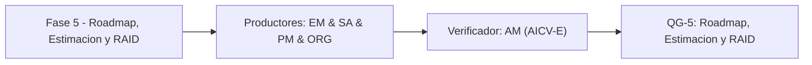

# Fase 5 - Roadmap, Estimacion y RAID

> *(Contenido placeholder generado por FEAT-001; el contenido fundamentado en el corpus llega en features posteriores.)*

Esta fase define el roadmap por olas, la estimacion de tamano, el RAID y el modelo operativo de habilitacion.

## Liderazgo y RACI-V

Roles productores: EM (Engagement Manager), SA (Lead Solution Architect), PM (Product Manager / Spec BA), ORG (Operating Model Specialist).
Verificador (V): **AM**. Accountable (A): **EM**.

| Dimension RACI-V | Roles |
| --- | --- |
| R - Responsible | EM, SA, PM, ORG |
| A - Accountable | EM |
| C - Consulted | FIN, SEC |
| I - Informed | ED |
| V - Verifier | AM |

## Diagrama de fase

## Entregables

| Codigo | Entregable |
| --- | --- |
| E5.1 | Entregable E5.1 (contenido en features posteriores) |
| E5.2 | Entregable E5.2 (contenido en features posteriores) |
| E5.3 | Entregable E5.3 (contenido en features posteriores) |

## Stage-Gate QG-5 - Roadmap, Estimacion y RAID

| Criterio de salida |
| --- |
| Olas de entrega y estimacion de tamano definidas. |
| RAID (Risks, Assumptions, Issues, Dependencies) consolidado. |
| Modelo operativo y habilitacion del cambio definidos. |

**No-Go si:** El roadmap carece de estimacion o el RAID omite riesgos criticos.

> **Veredicto QG-5:** QG-5 :: GO - Criterios de salida satisfechos.

