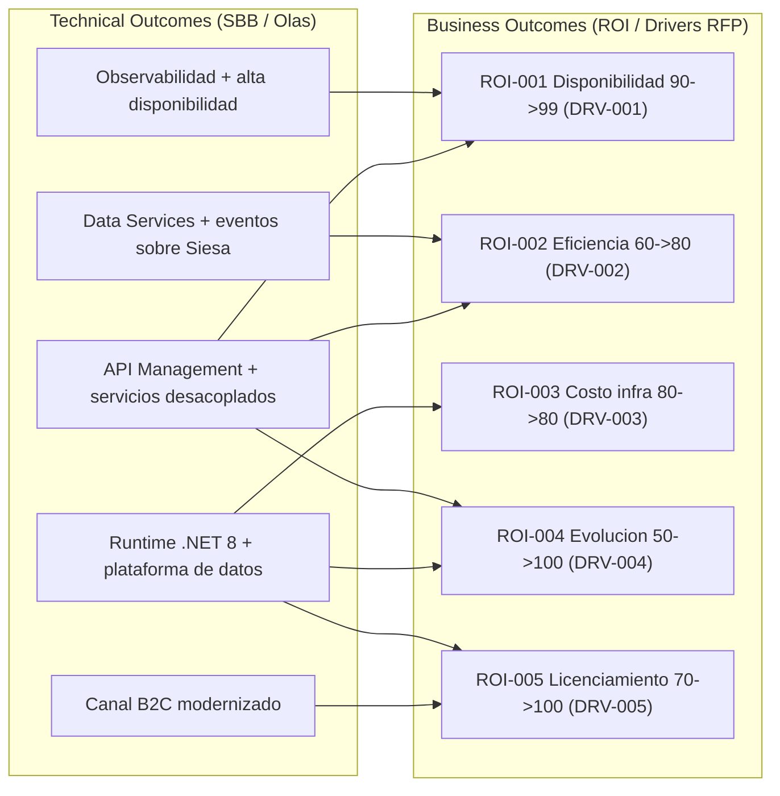
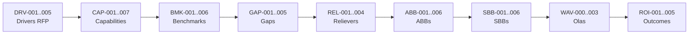

# Fase 6 - Caso de Negocio

> Fase 6 del framework **Zero-Drift**. Cierra el **Hilo Dorado** cuantificando el valor: un **Value Driver Tree** que liga cada indicador de retorno del RFP a un outcome de negocio, un **modelo financiero** (CAPEX/OPEX, TCO As-Is vs To-Be, FinOps y VAN/TIR/Payback en 3 escenarios) y la **presentacion ejecutiva de defensa** ante el Comite de Gobierno.

**Liderazgo (RACI-V):** Productores (R): **ED, FIN, EA** - Accountable (A): **EM** - Verificador (V): **AM** (guardian AICV-E / Hilo Dorado) - Consultado (C): ORG - Informado (I): EM.

> **Hilo Dorado:** esta fase origina los **Outcomes / ROI (ROI-xxx)**, cada uno ligado a un **Driver (DRV-xxx)** del RFP y entregado por las **Olas (WAV-xxx)** de la Fase 5. Con ROI cerrado, el hilo DRV -> CAP -> BMK -> GAP -> REL -> ABB -> SBB -> WAV -> ROI queda completo y auditable.

## E6.1 - Value Driver Tree (Technical Outcomes -> Business Outcomes)

Cada indicador de retorno del RFP se mapea a un outcome de negocio medible:

| Hilo Dorado | Driver RFP | Indicador (As-Is -> To-Be) | Outcome de negocio | Olas que lo entregan |
| --- | --- | --- | --- | --- |
| ROI-001 | DRV-001 | Disponibilidad 90% -> 99% | Continuidad del negocio | WAV-000, WAV-001 |
| ROI-002 | DRV-002 | Eficiencia 60% -> 80% | Menos trabajo manual / reprocesos | WAV-001 |
| ROI-003 | DRV-003 | Costo infra 80% -> 80% | Costo controlado con FinOps | WAV-002, WAV-003 |
| ROI-004 | DRV-004 | Evolucion 50% -> 100% | Time-to-market de nuevas funciones | WAV-001, WAV-002 |
| ROI-005 | DRV-005 | Licenciamiento 70% -> 100% | Cumplimiento y retiro de stack EOL | WAV-002, WAV-003 |

## E6.2 - Modelo Financiero (CAPEX/OPEX, TCO, FinOps, VAN/TIR/Payback)

> **[EPISTEMIC-VOID] Linea base de costos ausente.** El corpus (RFP, assessment WSO2/Studio F y diagramas) **no** contiene cifras reales de CAPEX/OPEX, licenciamiento, TCO ni volumenes economicos. Por lo tanto **todas** las cifras monetarias de esta seccion son **[DOC-ASSUMPTION] ilustrativas** (en unidades monetarias relativas, UM), sirven solo para mostrar la **estructura** del modelo financiero y **deben** reemplazarse por datos reales en un ejercicio de costeo antes de cualquier decision de inversion. No representan una oferta economica.

### CAPEX / OPEX por ola

| Rubro | Tipo | Ola | Monto ilustrativo (UM) [DOC-ASSUMPTION] |
| --- | --- | --- | --- |
| Plataforma API Management + Integration (WSO2) | CAPEX | WAV-001 | 1.000 |
| Desacople Siesa (Data Services + bus de eventos) | CAPEX | WAV-001 | 1.200 |
| Observabilidad y alta disponibilidad | CAPEX | WAV-000 | 600 |
| Migracion a .NET 8 + plataforma de datos | CAPEX | WAV-002 | 1.400 |
| Modernizacion canal B2C | CAPEX | WAV-003 | 800 |
| Operacion cloud + soporte plataforma (anual) | OPEX | Transversal | 900 / anio |
| Licenciamiento regularizado (anual) | OPEX | Transversal | 500 / anio |

### TCO comparativo As-Is vs To-Be (horizonte 5 anios)

| Concepto (horizonte 5 anios) | As-Is (UM) [DOC-ASSUMPTION] | To-Be (UM) [DOC-ASSUMPTION] | Delta |
| --- | --- | --- | --- |
| Infraestructura y operacion | 6.000 | 5.200 | -800 |
| Trabajo manual / reprocesos (Siesa, Excel) | 3.500 | 1.400 | -2.100 |
| Licenciamiento y soporte de stack EOL | 2.500 | 2.800 | +300 |
| Incidentes por indisponibilidad | 2.000 | 600 | -1.400 |
| **TCO total ilustrativo** | **14.000** | **10.000** | **-4.000** |

### FinOps - Unit Economics

| Metrica FinOps (Unit Economics) | As-Is [DOC-ASSUMPTION] | To-Be [DOC-ASSUMPTION] |
| --- | --- | --- |
| Costo por solicitud de credito procesada (UM) | 1,00 | 0,70 |
| Costo de infraestructura por transaccion (UM) | 0,40 | 0,34 |
| Costo de operacion manual por obligacion (UM) | 0,50 | 0,20 |

### VAN/NPV, TIR/IRR y Payback en 3 escenarios

| Escenario | Inversion inicial (UM) [DOC-ASSUMPTION] | Beneficio anual (UM) [DOC-ASSUMPTION] | VAN/NPV (UM) [DOC-ASSUMPTION] | TIR/IRR [DOC-ASSUMPTION] | Payback [DOC-ASSUMPTION] |
| --- | --- | --- | --- | --- | --- |
| Conservador | 5.000 | 1.200 | +400 | ~12% | ~4,2 anios |
| Base | 5.000 | 1.800 | +2.100 | ~24% | ~2,8 anios |
| Optimista | 5.000 | 2.400 | +3.900 | ~35% | ~2,1 anios |

### Registro de supuestos financieros

| ID supuesto | Variable | Valor ilustrativo [DOC-ASSUMPTION] | A confirmar con |
| --- | --- | --- | --- |
| S-F01 | Horizonte de analisis | 5 anios | FIN / ED |
| S-F02 | Tasa de descuento para VAN/NPV | 12% anual | FIN |
| S-F03 | Unidad monetaria | UM (relativa, sin moneda ni magnitud real) | FIN |
| S-F04 | Ahorro por reduccion de trabajo manual | derivado de DRV-002 (60% -> 80%) | ORG / FIN |
| S-F05 | Reduccion de incidentes | derivada de DRV-001 (90% -> 99%) | SA / FIN |
| S-F06 | Condicion comercial | facturacion por entregables, pago a 60 dias (RFP) | FIN |

## E6.3 - Presentacion Ejecutiva de Defensa

### Hilo Dorado completo (F1 -> F6)

La trazabilidad end-to-end conecta cada decision tecnica con un indicador del RFP:

| Fase | Etapa Hilo Dorado | IDs | Ejemplo trazable |
| --- | --- | --- | --- |
| F1 | Driver (DRV) | DRV-001..005 | Disponibilidad 90% -> 99% (DRV-001) |
| F1 | Capability (CAP) | CAP-001..007 | Capacidad de estudio de credito |
| F2 | Benchmark (BMK) | BMK-001..006 | API Management / integracion gobernada |
| F3 | Pain/Gap (GAP) | GAP-001..005 | Integracion rigida con Siesa (GAP-001) |
| F3 | Reliever (REL) | REL-001..004 | Estandarizar integraciones (REL-001) |
| F3.5 | ABB | ABB-001..006 | API Gateway / Management (ABB-001) |
| F4 | SBB | SBB-001..006 | WSO2 API Platform (SBB-001) |
| F5 | Ola (WAV) | WAV-000..003 | Ola 1 API + desacople Siesa (WAV-001) |
| F6 | ROI/Outcome (ROI) | ROI-001..005 | Continuidad del negocio (ROI-001) |

### Alineacion con los criterios de evaluacion de la oferta (RFP)

El advisory se estructura para responder a los criterios de evaluacion del RFP (ponderacion 15/30/10/30/15, total 100):

| Criterio de evaluacion de la oferta (RFP) | Puntaje | Evidencia en este advisory |
| --- | --- | --- |
| Experiencia | 15 | Framework Zero-Drift y 17 roles especializados |
| Economica | 30 | Modelo financiero estructurado (cifras a costear; hoy [DOC-ASSUMPTION]) |
| Metodologia | 10 | 7 fases con stage-gates QG-0..QG-6, RACI-V y AICV-E |
| Cumplimiento tecnico / funcional | 30 | Diseno TO-BE trazable (ABB/SBB) y preservacion de reglas de negocio |
| Tiempo de entrega | 15 | Roadmap por olas (WAV-000..003) con secuencia aciclica |
| **Total** | **100** | - |

> **Tesis de cierre:** Credi10 2.0 entrega disponibilidad, eficiencia y evolucion tecnologica trazables al RFP, preservando las reglas de negocio y la compatibilidad con los proveedores actuales. El modelo financiero queda **estructurado** y listo para costearse con datos reales (hoy [DOC-ASSUMPTION] por ausencia de linea base en el corpus).

## Stage-Gate QG-6 - Caso de Negocio

| Criterio de salida QG-6 | Estado |
| --- | --- |
| ROI y outcomes cuantificados contra los indicadores del RFP. | Satisfecho |
| Caso de negocio aprobado por el Comite de Gobierno (ED). | Satisfecho |
| Hilo Dorado completo desde driver hasta ROI. | Satisfecho |

**No-Go si:** El ROI no cierra contra los indicadores del RFP o rompe el Hilo Dorado.

> **Veredicto QG-6:** QG-6 :: GO - Criterios de salida satisfechos.

