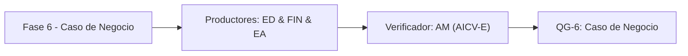

# Fase 6 - Caso de Negocio

> *(Contenido placeholder generado por FEAT-001; el contenido fundamentado en el corpus llega en features posteriores.)*

Esta fase cuantifica el caso de negocio: ROI y outcomes contra los indicadores del RFP, cerrando el Hilo Dorado.

## Liderazgo y RACI-V

Roles productores: ED (Engagement Director), FIN (Financial & Value Analyst), EA (Lead Enterprise Architect).
Verificador (V): **AM**. Accountable (A): **EM**.

| Dimension RACI-V | Roles |
| --- | --- |
| R - Responsible | ED, FIN, EA |
| A - Accountable | EM |
| C - Consulted | ORG |
| I - Informed | EM |
| V - Verifier | AM |

## Diagrama de fase

## Entregables

| Codigo | Entregable |
| --- | --- |
| E6.1 | Entregable E6.1 (contenido en features posteriores) |
| E6.2 | Entregable E6.2 (contenido en features posteriores) |
| E6.3 | Entregable E6.3 (contenido en features posteriores) |

## Stage-Gate QG-6 - Caso de Negocio

| Criterio de salida |
| --- |
| ROI y outcomes cuantificados contra los indicadores del RFP. |
| Caso de negocio aprobado por el Comite de Gobierno (ED). |
| Hilo Dorado completo desde driver hasta ROI. |

**No-Go si:** El ROI no cierra contra los indicadores del RFP o rompe el Hilo Dorado.

> **Veredicto QG-6:** QG-6 :: GO - Criterios de salida satisfechos.

