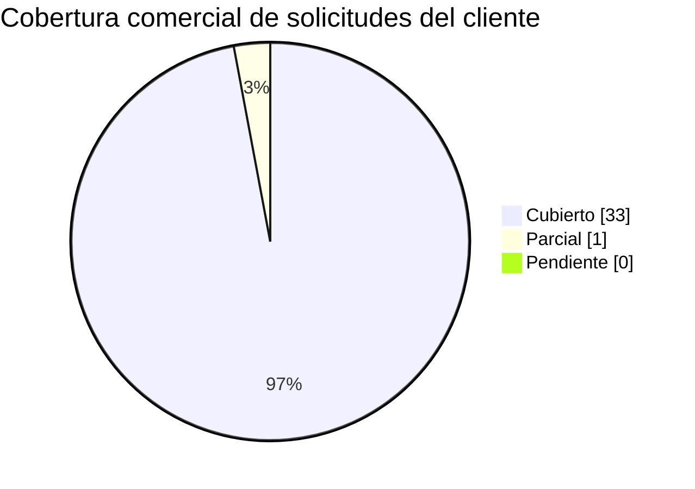

# Outcome 2 - Checklist de oferta, consideraciones, supuestos y correlacion

> Segundo outcome comercial gobernado por el skill `commercial-opportunity-analysis`, en **ruta/archivo separado** del Outcome 1 ([`0-analisis-oportunidad-comercial.md`](0-analisis-oportunidad-comercial.md)). Contiene el **checklist de items a desarrollar** en la oferta, las **consideraciones** y **supuestos**, y la **matriz de trazabilidad comercial** que demuestra **como el advisory responde a cada punto** que pide el cliente. Generado de forma **determinista** y **dinamica** desde `extract_requirements` (sin hardcodeo).

> **Etiquetas epistemicas:** **[VERIFIED-FACT]** solicitud/dato de capa de texto util verificada; **[OCR-EXTRACTED]** derivada de texto recuperado via OCR; **[DOC-ASSUMPTION]** supuesto comercial/cifra a validar; **[DOC-CONFLICT]** tension entre fuentes; **[EPISTEMIC-VOID]** el corpus no permite responder (OCR/fuente pendiente). No se fabrica cobertura.

> **Regenerar (parte de `--phase all`):**
>
> ```bash
> python3 advisory-system/quickstart.py --phase all
> ```

## 1. Checklist de items a desarrollar en la oferta

Items marcables que cierran la oferta comercial. El estado de cada item se deriva de la cobertura real de las solicitudes de ese tipo en el corpus (no es optimista). Leyenda: `- [x]` listo/cubierto - `- [~]` parcial - `- [ ]` pendiente.

- [~] Desarrollar/validar seccion **b. Alcance del servicio** de la oferta (Parcial)

## 2. Consideraciones y supuestos de la oferta

Supuestos comerciales recalibrables; cada supuesto se marca `[DOC-ASSUMPTION]` y toda cifra se expresa como rango `[DOC-ASSUMPTION]`. Las consideraciones de honestidad epistemica aplican a las solicitudes `Pendiente` (`[EPISTEMIC-VOID]`).

| Tipo | Enunciado | Etiqueta |
| --- | --- | --- |
| Supuesto | El perfil corporativo de la consultora y las cifras de inversion son de referencia recalibrable, no compromisos | [DOC-ASSUMPTION] |
| Supuesto | El cliente facilita el corpus completo y acceso a SME para cerrar los vacios epistemicos | [DOC-ASSUMPTION] |
| Supuesto | Los win themes son contenido comercial generico a afinar con el cliente | [DOC-ASSUMPTION] |
| Consideracion | **0** solicitudes estan **Pendiente** por falta de texto util en la fuente (OCR/fuente pendiente); no se promete cobertura sobre ellas | [EPISTEMIC-VOID] |
| Consideracion | **1** solicitudes son **Parcial**: abordables por el advisory con mapeo a afinar al cerrar la elicitacion | [DOC-ASSUMPTION] |
| Restriccion | La etapa ofertada es advisory + specs; no incluye construccion ni despliegue | [VERIFIED-FACT] |

## 3. Matriz de trazabilidad comercial (oferta <-> advisory <-> RFP)

Una fila por solicitud extraida (**34** en total). Demuestra que cada punto del cliente queda respondido por una **seccion de la oferta** y **sustentado por un outcome del advisory**, con **estado honesto**. Las solicitudes se **reutilizan** de `requirements-traceability`; la columna de la oferta mapea a [`1-propuesta-comercial.md`](1-propuesta-comercial.md).

| Solicitud del cliente (cita RFP, con nombre de documento) | ¿La oferta la responde? (seccion de 1-propuesta-comercial.md) | Outcome del advisory que la sustenta (fase/entregable) | Estado (Cubierto/Parcial/Pendiente) | Consideracion/Supuesto |
| --- | --- | --- | --- | --- |
| REQ-001: ALCANCE La propuesta presentada por el oferente debe contemplar el cumplimiento a cabalidad de los requerimientos solicitados por LA EMPRESA para “ PROYECTO CREDI10 2.0 ”. 1. 4 VISITA AL LUGAR DE PRESTACIÓN DE L SERVICIO... [fuente: RFP_CREDI10_2_0.pdf - Alcance] | Si - b. Alcance del servicio | Fase 0 higiene epistemica + Fase 1 AS-IS (00-higiene-epistemica.md, 01-contexto-as-is.md) | Cubierto | [VERIFIED-FACT] Respondida por Fase 0 higiene epistemica + Fase 1 AS-IS (00-higiene-epistemica.md, 01-contexto-as-is.md). |
| REQ-002: Objetivo general Realizar el diagnóstico, diseñoy transformación progresiva de la arquitectura tecnológica de Credi10 hacia una arquitectura objetivo Credi10 2.0, que permita disponer de una plataforma robusta, escalable... [fuente: RFP_CREDI10_2_0.pdf - Objetivo general] | Si - c. Contexto de negocio | Fase 1 contexto-negocio + Fase 6 caso de negocio (01-contexto-as-is.md, 06-caso-de-negocio.md) | Cubierto | [VERIFIED-FACT] Respondida por Fase 1 contexto-negocio + Fase 6 caso de negocio (01-contexto-as-is.md, 06-caso-de-negocio.md). |
| REQ-003: arquitectura objetivo Credi10 2.0, que permita disponer de una plataforma robusta, escalable, segura, mantenible, observable y sostenible tecnol ógicamente, alineada con las necesidades actuales y futuras del negocio. 2.... [fuente: RFP_CREDI10_2_0.pdf - Arquitectura objetivo] | Si - e. Entregables | Fase 4 diseno TO-BE: C4 + ADRs (04-diseno-to-be.md, to-be/) | Cubierto | [VERIFIED-FACT] Respondida por Fase 4 diseno TO-BE: C4 + ADRs (04-diseno-to-be.md, to-be/). |
| REQ-004: Objetivos específicos • Realizar el levantamiento e inventario detallado de los componentes tecnológicos actuales. • Evaluar la arquitectura actual desde las perspectivas de aplicaciones, datos, infraestructura, integrac... [fuente: RFP_CREDI10_2_0.pdf - Objetivos especificos] | Si - c. Contexto de negocio | Fase 1 contexto-negocio + Fase 6 caso de negocio (01-contexto-as-is.md, 06-caso-de-negocio.md) | Cubierto | [VERIFIED-FACT] Respondida por Fase 1 contexto-negocio + Fase 6 caso de negocio (01-contexto-as-is.md, 06-caso-de-negocio.md). |
| REQ-005: Alcance del proyecto El alcance comprende el diagnóstico integral, diseño de arquitectura objetivo, definición del roadmap y ejecución de las iniciativas de transformación tecnológica requeridas para Credi10 2.0. 1. Asse... [fuente: RFP_CREDI10_2_0.pdf - Alcance del proyecto] | Si - b. Alcance del servicio | Fase 0 higiene epistemica + Fase 1 AS-IS (00-higiene-epistemica.md, 01-contexto-as-is.md) | Cubierto | [VERIFIED-FACT] Respondida por Fase 0 higiene epistemica + Fase 1 AS-IS (00-higiene-epistemica.md, 01-contexto-as-is.md). |
| REQ-006: Assessment de arquitectura actual El proveedor deberá realizar un assessment de: • Aplicaciones. • Servicios Windows. • APIs. • Integradores. • Bases de datos. • Componentes de procesamiento batch y/o programado. • Front... [fuente: RFP_CREDI10_2_0.pdf - Assessment de arquitectura actual] | Si - b. Alcance del servicio | Fase 0 higiene epistemica + Fase 1 AS-IS (00-higiene-epistemica.md, 01-contexto-as-is.md) | Cubierto | [VERIFIED-FACT] Respondida por Fase 0 higiene epistemica + Fase 1 AS-IS (00-higiene-epistemica.md, 01-contexto-as-is.md). |
| REQ-007: Evaluación tecnológica Para cada componente se deberá evaluar como mínimo los siguientes items : • Lenguaje de programación. • Framework y versión. • Librerías y dependencias. • Estado de soporte tecnológico. • Obsolesce... [fuente: RFP_CREDI10_2_0.pdf - Evaluacion tecnologica] | Si - c. Contexto de negocio | Fase 1 deuda tecnica + Fase 2 estado del arte (01-contexto-as-is.md, 02-estado-del-arte.md) | Cubierto | [VERIFIED-FACT] Respondida por Fase 1 deuda tecnica + Fase 2 estado del arte (01-contexto-as-is.md, 02-estado-del-arte.md). |
| REQ-008: Evaluación de bases de datos Se deberá evaluar la arquitectura y estado de las bases de datos asociadas a Credi10, incluyendo: • Motor y versión. • Modelo de datos. • Volumen y crecimiento. • Performance. • Índices y con... [fuente: RFP_CREDI10_2_0.pdf - Evaluacion de bases de datos] | Si - e. Entregables | Fase 1 ecosistema (datos) + Fase 4 modelo de datos y contratos (01-contexto-as-is.md, 04-diseno-to-be.md) | Cubierto | [VERIFIED-FACT] Respondida por Fase 1 ecosistema (datos) + Fase 4 modelo de datos y contratos (01-contexto-as-is.md, 04-diseno-to-be.md). |
| REQ-009: Evaluación de integraciones Se deberán identificar y evaluar las integraciones con sistemas internos, externos y proveedores, incluyendo, entre otros y documentar las dependencias, mecanismos de integración, criticidad,... [fuente: RFP_CREDI10_2_0.pdf - Evaluacion de integraciones] | Si - e. Entregables | Fase 1 ecosistema + Fase 4 contratos (OpenAPI/AsyncAPI) (01-contexto-as-is.md, 04-diseno-to-be.md) | Cubierto | [VERIFIED-FACT] Respondida por Fase 1 ecosistema + Fase 4 contratos (OpenAPI/AsyncAPI) (01-contexto-as-is.md, 04-diseno-to-be.md). |
| REQ-010: Indicadores de retorno # Indicador Porcentaje Actual Porcentaje esperado 1 Disponibilidad de aplicaci ones y servicios críticos 90% 99 % 2 Optimización y eficiencia de recursos tecnológicos 60% 80 % 3 Optimización del c... [fuente: RFP_CREDI10_2_0.pdf - Indicadores de retorno] | Si - j. Inversion | Fase 6 value-driver-tree + modelo financiero (06-caso-de-negocio.md) | Cubierto | [VERIFIED-FACT] Respondida por Fase 6 value-driver-tree + modelo financiero (06-caso-de-negocio.md). |
| REQ-011: Requerimientos funcionales: Concepto Descripción Requerimientos funcionales y del proceso La transformación tecnológica deberá preservar las funcionalidades y reglas de negocio existentes en Credi10, incluyendo las perso... [fuente: RFP_CREDI10_2_0.pdf - Requerimientos funcionales] | Si - e. Entregables | Fase 4 catalogo de historias + modelo de datos (04b-catalogo-historias.md, 04-diseno-to-be.md) | Cubierto | [VERIFIED-FACT] Respondida por Fase 4 catalogo de historias + modelo de datos (04b-catalogo-historias.md, 04-diseno-to-be.md). |
| REQ-012: Requerimientos de la operación El assesment y la arquitectura objetivo deberán contemplar como mínimo los siguientes aspectos : • Alta disponibilidad de los componentes críticos los cuales son: Carrera 34 No. 10 - 581 Te... [fuente: RFP_CREDI10_2_0.pdf - Requerimientos de la operacion] | Si - d. Metodologia de consultoria | Fase 4 UX y pruebas + Fase 5 RAID (04-diseno-to-be.md, 05-roadmap-estimacion-raid.md) | Cubierto | [VERIFIED-FACT] Respondida por Fase 4 UX y pruebas + Fase 5 RAID (04-diseno-to-be.md, 05-roadmap-estimacion-raid.md). |
| REQ-013: Informes requeridos El proveedor deberá entregar como mínimo: 1. Assessment • Inventario tecnológico. • Inventario de aplicaciones y servicios. • Inventario de APIs. • Inventario de bases de datos. • Inventario de integr... [fuente: RFP_CREDI10_2_0.pdf - Informes requeridos] | Si - e. Entregables | Los 3 informes del engagement + dossier TO-BE (1-propuesta-comercial.md, 2-reporte-gerencial.md, 3-informe-tecnico/, to-be/) | Cubierto | [VERIFIED-FACT] Respondida por Los 3 informes del engagement + dossier TO-BE (1-propuesta-comercial.md, 2-reporte-gerencial.md, 3-informe-tecnico/, to-be/). |
| REQ-014: Requerimientos técnicos : (Diligenciados por TI) Concepto Descripción Arquitectura de la solución La arquitectura objetivo deberá estar orientada a principios de: • A coplamiento. • Alta cohesión. • Escalabilidad. • Disp... [fuente: RFP_CREDI10_2_0.pdf - Requerimientos tecnicos] | Si - e. Entregables | Fase 4 diseno TO-BE + ADRs (04-diseno-to-be.md, to-be/) | Cubierto | [VERIFIED-FACT] Respondida por Fase 4 diseno TO-BE + ADRs (04-diseno-to-be.md, to-be/). |
| REQ-015: Métodos de integración El proveedor deberá evaluar los mecanismos de integración actuales y definir los métodos recomendados para la arquitectura Credi10 2.0. Podrán contemplarse, según corresponda: • APIs REST. • APIs S... [fuente: RFP_CREDI10_2_0.pdf - Metodos de integracion] | Si - e. Entregables | Fase 1 ecosistema + Fase 4 contratos (OpenAPI/AsyncAPI) (01-contexto-as-is.md, 04-diseno-to-be.md) | Cubierto | [VERIFIED-FACT] Respondida por Fase 1 ecosistema + Fase 4 contratos (OpenAPI/AsyncAPI) (01-contexto-as-is.md, 04-diseno-to-be.md). |
| REQ-016: EVALUACIÓN DE LAS PROPUESTAS Las ofertas serán evaluadas con base en los siguientes criterios y calificaciones, para obtener un puntaje máximo de 100 puntos . Aspecto a evaluar Puntaje Experiencia: años y certificaciones... [fuente: RFP_CREDI10_2_0.pdf - Evaluacion de las propuestas] | Si - f. Estrategia de consultoria | Fase 5 roadmap/estimacion + Fase 6 caso de negocio (05-roadmap-estimacion-raid.md, 06-caso-de-negocio.md) | Cubierto | [VERIFIED-FACT] Respondida por Fase 5 roadmap/estimacion + Fase 6 caso de negocio (05-roadmap-estimacion-raid.md, 06-caso-de-negocio.md). |
| REQ-017: corre sobre .NET Framework 4.8 en IIS 10; integradores en .NET y Windows Services en .NET Core 8 y .NET 4.8. Bases de datos SQL Server 2019 Enterprise: C10_Credi10NET, C10_Inspektor, C10_Datacredito y C10_Database. El mo... [fuente: Arquitectura_Aplicacion_Despliegue_Credi10.png - Numeral 10] | Si - e. Entregables | Fase 1 ecosistema (datos) + Fase 4 modelo de datos y contratos (01-contexto-as-is.md, 04-diseno-to-be.md) | Cubierto | [VERIFIED-FACT] Respondida por Fase 1 ecosistema (datos) + Fase 4 modelo de datos y contratos (01-contexto-as-is.md, 04-diseno-to-be.md). |
| REQ-018: VPC 'STUDIO F' con WAF -> ALB -> instancias EC2 privadas, almacenamiento S3, monitoreo CloudWatch, NAT Gateway y Bastion host. Conectividad hibrida mediante VPN IPSec de Telmex hacia el centro de datos on-prem 'Cokioto'. [fuente: Arquitectura_Infraestructura_AWS_Credi10.png - Numeral 2] | Si - b. Alcance del servicio | Fase 1 AS-IS + Fase 4 diseno TO-BE (01-contexto-as-is.md, 04-diseno-to-be.md) | Parcial | [VERIFIED-FACT] Solicitud abordable por el advisory; el mapeo es generico y se afina al cerrar los deltas de elicitacion. |
| REQ-019: de Credi10. Aplicacion web central CREDI10 en .NET integrada con UNOEE/Siesa (ERP), PENTAHO (BI/ETL), CROSSCORE -> INSPEKTOR -> DICTUM/Datacredito (originacion y riesgo), Numrot, Cobranza, B2C, Link de Recaudo -> PayU, V... [fuente: Diagrama_Contexto_Credi10.png - Numeral 4] | Si - e. Entregables | Fase 1 ecosistema + Fase 4 contratos (OpenAPI/AsyncAPI) (01-contexto-as-is.md, 04-diseno-to-be.md) | Cubierto | [VERIFIED-FACT] Respondida por Fase 1 ecosistema + Fase 4 contratos (OpenAPI/AsyncAPI) (01-contexto-as-is.md, 04-diseno-to-be.md). |
| REQ-020: Assessment de Arquitectura Fecha: Mayo, 2026 Index 1. Objetivo del Documento 3 2. Contexto de Negócio 3 2.1. Puntos dolores principales 3 3. Arquitectura Actual 4 3.1. Diagrama General de Arquitectura 5 3.2. Arquitectura... [fuente: WSO2 y Studio F - Assessment Mayo2026-Final.pdf - Assessment de arquitectura actual] | Si - b. Alcance del servicio | Fase 0 higiene epistemica + Fase 1 AS-IS (00-higiene-epistemica.md, 01-contexto-as-is.md) | Cubierto | [VERIFIED-FACT] Respondida por Fase 0 higiene epistemica + Fase 1 AS-IS (00-higiene-epistemica.md, 01-contexto-as-is.md). |
| REQ-021: 2 Versión:001 Fecha: 08/06/2021 FORMATO DE DESARROLLO E INTEGRACIONES API Integrador Atención Al Cliente STF GROUP S.A. INFORMATICA – Py. CREDI10 SOFTWARE PROPIO Cali , viernes 26 de diciembre del 202 5 Código:FT - DG -... [fuente: Api Integrador Atencion al cliente.pdf - Numeral 00] | Si - e. Entregables | Fase 1 ecosistema + Fase 4 contratos (OpenAPI/AsyncAPI) (01-contexto-as-is.md, 04-diseno-to-be.md) | Cubierto | [VERIFIED-FACT] Respondida por Fase 1 ecosistema + Fase 4 contratos (OpenAPI/AsyncAPI) (01-contexto-as-is.md, 04-diseno-to-be.md). |
| REQ-022: 2 Versión:001 Fecha: 08/06/2021 FORMATO DE DESARROLLO E INTEGRACIONES FT - SL - 011 - APIs Portal clientes B2C STF GROUP S.A. INFORMATICA – Py. CREDI10 SOFTWARE PROPIO Cali , jueves 19 de febrero del 2024 Código:FT - DG... [fuente: B2C.pdf - Numeral 00] | Si - c. Contexto de negocio | Fase 1 contexto-negocio + Fase 6 caso de negocio (01-contexto-as-is.md, 06-caso-de-negocio.md) | Cubierto | [VERIFIED-FACT] Respondida por Fase 1 contexto-negocio + Fase 6 caso de negocio (01-contexto-as-is.md, 06-caso-de-negocio.md). |
| REQ-023: 2 Versión:001 Fecha: 08/06/2021 FORMATO DE DESARROLLO E INTEGRACIONES FT - SL - 011 - APIs Botón Ecommerce Credi10 STF GROUP S.A. INFORMATICA – Py. CREDI10 SOFTWARE PROPIO Cali , jueves 19 de febrero del 2024 Código:FT -... [fuente: BotonEcommerce.pdf - Numeral 00] | Si - c. Contexto de negocio | Fase 1 contexto-negocio + Fase 6 caso de negocio (01-contexto-as-is.md, 06-caso-de-negocio.md) | Cubierto | [VERIFIED-FACT] Respondida por Fase 1 contexto-negocio + Fase 6 caso de negocio (01-contexto-as-is.md, 06-caso-de-negocio.md). |
| REQ-024: 2 Versión:001 Fecha: 08/06/2021 FORMATO DE DESARROLLO E INTEGRACIONES CAPTURA FOTO STF GROUP S.A. INFORMATICA – Py. CREDI10 SOFTWARE PROPIO Cali , lunes , 29 de enero de 202 4 Código:FT - DG - 00 2 Versión:001 Fecha: 08/... [fuente: Captura Foto.pdf - Numeral 00] | Si - e. Entregables | Fase 1 ecosistema + Fase 4 contratos (OpenAPI/AsyncAPI) (01-contexto-as-is.md, 04-diseno-to-be.md) | Cubierto | [VERIFIED-FACT] Respondida por Fase 1 ecosistema + Fase 4 contratos (OpenAPI/AsyncAPI) (01-contexto-as-is.md, 04-diseno-to-be.md). |
| REQ-025: SOFTWARE PROPIO Cali, viernes 28 de noviembre del 2025 DETALLE TECNICO 1.1 Descripción del Requerimiento: Un servicio que generé y envié recibos consolidados RCL (Recibos de caja payu) y RCR (recibos de consignaciones) a... [fuente: Envio de RCL y RCR.pdf - Numeral 10] | Si - e. Entregables | Fase 1 ecosistema + Fase 4 contratos (OpenAPI/AsyncAPI) (01-contexto-as-is.md, 04-diseno-to-be.md) | Cubierto | [VERIFIED-FACT] Respondida por Fase 1 ecosistema + Fase 4 contratos (OpenAPI/AsyncAPI) (01-contexto-as-is.md, 04-diseno-to-be.md). |
| REQ-026: objet ivos específicos. 1. Realizar calculo a la fecha de los diferentes montos pendientes a pagar . 2. Registrar pagos, generando un comprobante. Ver el requerimiento en el link: FT - SL - 003 - Módulo_Pago - V5 1.1.2 F... [fuente: GenerarPagos.pdf - Objetivos especificos] | Si - c. Contexto de negocio | Fase 1 contexto-negocio + Fase 6 caso de negocio (01-contexto-as-is.md, 06-caso-de-negocio.md) | Cubierto | [VERIFIED-FACT] Respondida por Fase 1 contexto-negocio + Fase 6 caso de negocio (01-contexto-as-is.md, 06-caso-de-negocio.md). |
| REQ-027: objetivo general es validar que el usuario que está intentando ingresar a una vista haya iniciado sesión anteriormente y si tiene los permisos neces arios para permitir ver la vista y devolver los recursos necesarios en... [fuente: GenerarPagos.pdf - Objetivo general] | Si - c. Contexto de negocio | Fase 1 contexto-negocio + Fase 6 caso de negocio (01-contexto-as-is.md, 06-caso-de-negocio.md) | Cubierto | [VERIFIED-FACT] Respondida por Fase 1 contexto-negocio + Fase 6 caso de negocio (01-contexto-as-is.md, 06-caso-de-negocio.md). |
| REQ-028: 2 Versión:001 Fecha: 08/06/2021 FORMATO DE DESARROLLO E INTEGRACIONES FT - SL - 011 - APIs Link de recaudos Credi10 STF GROUP S.A. INFORMATICA – Py. CREDI10 SOFTWARE PROPIO Cali , jueves 16 de febrero del 2024 Código:FT... [fuente: LinkDePagos.pdf - Numeral 00] | Si - c. Contexto de negocio | Fase 1 contexto-negocio + Fase 6 caso de negocio (01-contexto-as-is.md, 06-caso-de-negocio.md) | Cubierto | [VERIFIED-FACT] Respondida por Fase 1 contexto-negocio + Fase 6 caso de negocio (01-contexto-as-is.md, 06-caso-de-negocio.md). |
| REQ-029: SOFTWARE PROPIO Cali, martes 6 de enero del 202 6 I NTRODUCCION La integración de Llamada Predictiva es un Worker Service desarrollado en .NET 8 que funciona como servicio de Windows, diseñado para automatizar la gestión... [fuente: Llamada predictiva.pdf - Numeral 10] | Si - e. Entregables | Fase 1 ecosistema + Fase 4 contratos (OpenAPI/AsyncAPI) (01-contexto-as-is.md, 04-diseno-to-be.md) | Cubierto | [VERIFIED-FACT] Respondida por Fase 1 ecosistema + Fase 4 contratos (OpenAPI/AsyncAPI) (01-contexto-as-is.md, 04-diseno-to-be.md). |
| REQ-030: 1 Versión:001 Fecha: 08/ 11 /202 3 FORMATO DE DESARROLLO E INTEGRACIONES API DATACREDITO STF GROUP S.A. INFORMATICA – Py. CREDI10 SOFTWARE PROPIO Cali , martes, 15 de septiembre de 2026 Código: ORI - API - 00 1 Versión:0... [fuente: Originacion_API_Datacredito.pdf - Numeral 00] | Si - e. Entregables | Fase 1 ecosistema + Fase 4 contratos (OpenAPI/AsyncAPI) (01-contexto-as-is.md, 04-diseno-to-be.md) | Cubierto | [VERIFIED-FACT] Respondida por Fase 1 ecosistema + Fase 4 contratos (OpenAPI/AsyncAPI) (01-contexto-as-is.md, 04-diseno-to-be.md). |
| REQ-031: 1 Versión:001 Fecha: 08/ 11 /202 3 FORMATO DE DESARROLLO E INTEGRACIONES API IN SPEKTOR STF GROUP S.A. INFORMATICA – Py. CREDI10 SOFTWARE PROPIO Cali , martes, 15 de septiembre de 2026 Código: ORI - API - 00 1 Versión:00... [fuente: Originacion_API_Inspektor.pdf - Numeral 00] | Si - e. Entregables | Fase 1 ecosistema + Fase 4 contratos (OpenAPI/AsyncAPI) (01-contexto-as-is.md, 04-diseno-to-be.md) | Cubierto | [VERIFIED-FACT] Respondida por Fase 1 ecosistema + Fase 4 contratos (OpenAPI/AsyncAPI) (01-contexto-as-is.md, 04-diseno-to-be.md). |
| REQ-032: 2 Versión:001 Fecha: 08/06/2021 FORMATO DE DESARROLLO E INTEGRACIONES Originacion Aplicación Admin STF GROUP S.A. INFORMATICA – Py. CREDI10 SOFTWARE PROPIO Cali , Viernes, 17 de noviembre de 2023 Código:FT - DG - 00 2 Ve... [fuente: Originacion_Aplicacion_ADMIN.pdf - Numeral 00] | Si - e. Entregables | Fase 1 ecosistema + Fase 4 contratos (OpenAPI/AsyncAPI) (01-contexto-as-is.md, 04-diseno-to-be.md) | Cubierto | [VERIFIED-FACT] Respondida por Fase 1 ecosistema + Fase 4 contratos (OpenAPI/AsyncAPI) (01-contexto-as-is.md, 04-diseno-to-be.md). |
| REQ-033: 2 Versión:001 Fecha: 08/06/2021 FORMATO DE DESARROLLO E INTEGRACIONES ORIGINACION CROSSCORE STF GROUP S.A. INFORMATICA – Py. CREDI10 SOFTWARE PROPIO Cali , viernes , 16 de febrero de 202 4 Código:FT - DG - 00 2 Versión:0... [fuente: Originacion_CrossCore.pdf - Numeral 00] | Si - e. Entregables | Fase 1 ecosistema + Fase 4 contratos (OpenAPI/AsyncAPI) (01-contexto-as-is.md, 04-diseno-to-be.md) | Cubierto | [VERIFIED-FACT] Respondida por Fase 1 ecosistema + Fase 4 contratos (OpenAPI/AsyncAPI) (01-contexto-as-is.md, 04-diseno-to-be.md). |
| REQ-034: 2 Versión:001 Fecha: 08/06/2021 FORMATO DE DESARROLLO E INTEGRACIONES FT - SL - 004 - Módulo_Cartera STF GROUP S.A. INFORMATICA – Py. CREDI10 SOFTWARE PROPIO C ali , lunes 12 de febrero del 2024 Código:FT - DG - 00 2 Ver... [fuente: ProcesoCorteCartera.pdf - Numeral 00] | Si - e. Entregables | Fase 1 ecosistema + Fase 4 contratos (OpenAPI/AsyncAPI) (01-contexto-as-is.md, 04-diseno-to-be.md) | Cubierto | [VERIFIED-FACT] Respondida por Fase 1 ecosistema + Fase 4 contratos (OpenAPI/AsyncAPI) (01-contexto-as-is.md, 04-diseno-to-be.md). |

**Resumen de estado:** 34 solicitudes = 33 Cubierto + 1 Parcial + 0 Pendiente.

### Cobertura comercial por estado




## 4. Como el advisory responde a cada punto

La columna *Outcome del advisory que la sustenta* reutiliza el mapeo `palabra-clave -> punto de entrada` de `requirements-traceability` (`KEYWORD_ENTRY_POINTS`): cada solicitud se ancla a una **fase y entregable** concretos del advisory (p. ej. Fase 4 diseno TO-BE, dossier TO-BE, caso de negocio). Asi la oferta no solo **afirma** que cubre una necesidad, sino que **senala el outcome del advisory** que la respalda, manteniendo la correlacion oferta<->advisory<->RFP y la honestidad epistemica (Pendiente -> `[EPISTEMIC-VOID]`).

