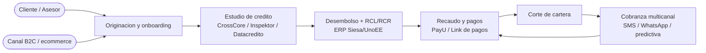
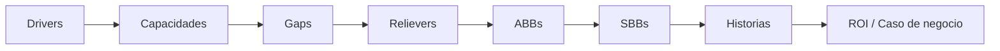
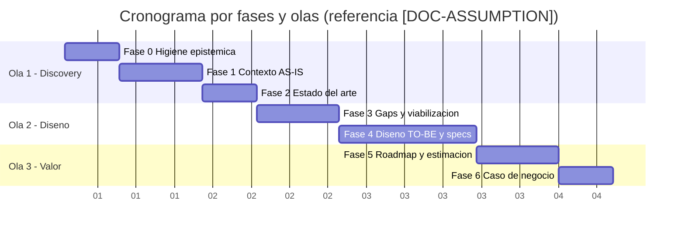

# Propuesta Comercial - Kulgops

> **Documento de venta** del servicio de consultoria de advisory y especificacion de requisitos, emitido por **Kulgops** hacia el prospecto/cliente. Generado de forma **determinista** por el motor del advisory (Python stdlib, sin red ni LLM) a partir del analisis del corpus; espanol con etiquetas tecnicas en ingles.

> Etiquetas epistemicas: **[VERIFIED-FACT]** evidencia explicita del corpus; **[DOC-ASSUMPTION]** supuesto/perfil/cifra de referencia a recalibrar; **[DOC-CONFLICT]** contradiccion entre fuentes; **[EPISTEMIC-VOID]** sin base documental (no se fabrica evidencia). En esta propuesta, el **perfil corporativo** de la consultora y las **cifras de inversion** se emiten como referencia **[DOC-ASSUMPTION]**.

## Indice de secciones

| # | Seccion |
| --- | --- |
| a | Quienes somos |
| b | Alcance del servicio |
| c | Contexto de negocio |
| d | Metodologia de consultoria |
| e | Entregables |
| f | Estrategia de consultoria |
| g | Equipo de trabajo |
| h | Cronograma de trabajo |
| i | Supuestos y restricciones |
| j | Inversion |
| k | Terminos y condiciones |

## a. Quienes somos

**Kulgops** es una consultora de tecnologia enfocada en **ingenieria de software**, **advisory** de arquitectura y transformacion, y **especificacion de requisitos** para el desarrollo de software. Acompanamos a las organizaciones desde el descubrimiento hasta la definicion de un backlog accionable, para que la construccion arranque con el minimo de ambiguedad y el maximo de trazabilidad.

> **Perfil corporativo de referencia [DOC-ASSUMPTION].** El perfil de **Kulgops** (historia, tamano, clientes, certificaciones) se presenta de forma **generica y plausible** como referencia recalibrable; **no** se presenta como dato verificado. Cambiar la marca emisora o el perfil no altera la metodologia ni el alcance de este documento.

Nuestra **propuesta de valor**: convertir un corpus heterogeneo de documentacion (RFPs, assessments, diagramas, procesos) en un diseno **TO-BE** fundamentado, con honestidad epistemica y una estimacion lo mas acertada posible. Servicios principales:

- **Advisory de arquitectura y transformacion** (AS-IS -> TO-BE).
- **Especificacion de requisitos** (historias de usuario + BDD/Gherkin).
- **Ingenieria de software** y diseno de solucion.
- **Gobierno del cambio** y habilitacion del modelo operativo.

## b. Alcance del servicio

El servicio ofertado es una **consultoria de advisory** mas la **especificacion de requisitos para desarrollo de software**. El objetivo de esta etapa es dejar el proyecto **listo para estimar y construir**: no entregamos el producto final, sino el **diseno, las specs y los insumos de estimacion** que habilitan una construccion predecible.

El alcance cubre, de punta a punta:

- **Descubrimiento e higiene epistemica** del corpus del cliente.
- **Diagnostico AS-IS** (negocio, aplicacion, datos, integracion, infraestructura, seguridad) y **estado del arte**.
- **Identificacion de gaps** y viabilizacion (relievers, ABBs).
- **Diseno TO-BE** y **especificacion de requisitos** (HU + Gherkin).
- **Roadmap, estimacion recalibrable, RAID y caso de negocio**.

Queda **fuera de alcance** en esta etapa la construccion del software, la ejecucion de pruebas sobre codigo productivo y el despliegue; estos se habilitan con los entregables de esta propuesta.

## c. Contexto de negocio

Para ilustrar la propuesta usamos como **ejemplo** el corpus que estamos procesando: **Credi10 2.0** del grupo **STF Group** [VERIFIED-FACT]. Es un negocio de **credito retail de consumo** con canales **B2C y ecommerce**, cuyo ciclo abarca originacion, estudio de credito (CrossCore -> Inspektor -> Datacredito/Dictum), desembolso con generacion de RCL/RCR en el ERP Siesa/UnoEE, recaudo y pagos (PayU / link de pagos), corte de cartera y cobranza multicanal.

Para este ejemplo procesamos **18** documentos del corpus **sin muestreo** (RFP, assessment WSO2/Studio F, diagramas de arquitectura y PDFs de proceso), de los que derivamos el contexto de negocio y la trazabilidad.

Diagrama de **contexto de alto nivel** del negocio procesado:

> El contexto se **deriva** del corpus del cliente; los datos de Credi10/STF Group se citan como **ejemplo de aplicacion** y se tratan con las etiquetas epistemicas correspondientes, nunca como atributos de la consultora.

## d. Metodologia de consultoria

Trabajamos con una metodologia **por fases con quality gates** y **gobierno continuo**. Cada fase produce entregables verificables y no avanza hasta superar su gate (QG-0..QG-6), lo que evita el *scope drift* y mantiene la trazabilidad de punta a punta (el **Hilo Dorado**).

| Fase | Foco | Quality Gate |
| --- | --- | --- |
| Fase 0 | Higiene epistemica del corpus | QG-0 |
| Fase 1 | Contexto AS-IS | QG-1 |
| Fase 2 | Estado del arte | QG-2 |
| Fase 3 | Gaps y viabilizacion | QG-3 |
| Fase 4 | Diseno TO-BE + specs | QG-4 |
| Fase 5 | Roadmap, estimacion y RAID | QG-5 |
| Fase 6 | Caso de negocio | QG-6 |

La calidad se audita con el marco **AICV-E** (Accuracy, Integrity, Congruence, Viability, Epistemic Certainty): cada entregable se somete a verificacion antes de cruzar su gate, y la honestidad epistemica es un principio no negociable (no se fabrica evidencia).

## e. Entregables

Los entregables son exactamente los **outputs que el motor del advisory genera** de forma determinista a partir del corpus. Todos se publican como Markdown versionable:

| Entregable | Descripcion | Ubicacion |
| --- | --- | --- |
| Informes por fase (00-06) | 7 informes, uno por fase Zero-Drift, con su quality gate | `advisory-credi10-2.0/0X-*.md` |
| Catalogo HU + BDD/Gherkin | Historias de usuario con criterios de aceptacion (happy + borde) | `advisory-credi10-2.0/04b-catalogo-historias.md` |
| Dossier SDLC TO-BE | Requisitos, arquitectura, specs, UX, pruebas e insumos de estimacion + registros | `advisory-credi10-2.0/to-be/` |
| Base de Conocimiento | Ingesta trazable del corpus (sin muestreo) + checklist de cobertura | `knowledge-base/` |
| Los 3 informes comerciales/tecnico | Propuesta comercial, reporte gerencial e informe tecnico narrativo | `advisory-credi10-2.0/` |

Esta **propuesta comercial** es el informe 1 de una familia de tres; **referencia** el informe tecnico como soporte del alcance ofertado, sin reemplazarlo.

## f. Estrategia de consultoria

Nuestra estrategia es el **framework Zero-Drift**, disenado para que el diseno no se desvie del objetivo de negocio ni de la evidencia. Comercialmente, se resume en cinco pilares:

- **Comite de Gobierno + 3 Celulas.** Un comite (direccion, gestion y calidad) gobierna tres celulas especializadas (Discovery, Diseno, Valor y Habilitacion).
- **7 fases con Quality Gates (QG-0..QG-6).** Ninguna fase avanza sin superar su gate; el veredicto es Go/No-Go.
- **RACI-V.** Cada entregable tiene Responsible, Accountable, Consulted, Informed y un **Verifier** explicito.
- **AICV-E.** Auditoria de Accuracy, Integrity, Congruence, Viability y Epistemic Certainty sobre cada entregable.
- **Hilo Dorado.** Trazabilidad continua Driver -> Capacidad -> Gap -> Reliever -> ABB -> SBB -> Historia -> ROI, sin eslabones rotos.

> El framework es **reutilizable** para cualquier cliente; Credi10 2.0 es solo el ejemplo de aplicacion de esta propuesta.

## g. Equipo de trabajo

El engagement lo ejecuta un equipo de **17 roles** organizados en un **Comite de Gobierno** y **3 celulas** especializadas. El comite asegura direccion, gestion y calidad; las celulas ejecutan el descubrimiento, el diseno y la habilitacion de valor.

| Rol | Nombre | Celula / Comite | Alcance |
| --- | --- | --- | --- |
| ED | Engagement Director | Comite de Gobierno | Direccion ejecutiva del engagement; patrocina la relacion con el cliente, asegura alineacion estrategica y preside el Comite de Gobierno. Responsable final del caso de negocio. |
| EM | Engagement Manager | Comite de Gobierno | Gestion operativa del engagement; coordina celulas, plan, tiempos y calidad de entrega. Accountable por defecto de las fases. |
| AM | Advisory Manager | Comite de Gobierno | Guardian de calidad AICV-E (Accuracy, Integrity, Congruence, Viability, Epistemic Certainty) y guardian del Hilo Dorado. Gobierna la trazabilidad y ejerce poder de veto sobre cualquier entregable que rompa la cadena. |
| EA | Lead Enterprise Architect | Celula 1 - Discovery | Arquitectura empresarial; mapea capacidades de negocio, dominios y la relacion entre estrategia y tecnologia (TOGAF/C4). |
| BA | Lead Business Architect | Celula 1 - Discovery | Arquitectura de negocio; capacidades, cadena de valor y modelo operativo del negocio de credito/originacion. |
| PIA | Process Intelligence Analyst | Celula 1 - Discovery | Inteligencia de procesos; analiza los procesos operativos (originacion, pagos, corte de cartera, cobranza) y detecta ineficiencias. |
| SME | Industry & Reference SME | Celula 1 - Discovery | Experto de industria y referencia; aporta estado del arte, benchmarks y mejores practicas del sector de credito de consumo y fintech. |
| TDA | Technical Discovery Architect | Celula 1 - Discovery | Arquitecto de descubrimiento tecnico; levanta el stack real (.NET, SQL Server, AWS, integraciones) y la deuda tecnica. |
| DRE | Domain & Requirements Lead | Celula 1 - Discovery | Lider de dominio y requisitos; estructura el dominio, define vacios epistemicos y requisitos de descubrimiento. |
| SA | Lead Solution Architect | Celula 2 - Diseno | Arquitecto de solucion; disena la solucion TO-BE, los SBBs y la arquitectura objetivo que resuelve los gaps. |
| DA | Data & Integration Architect | Celula 2 - Diseno | Arquitecto de datos e integracion; disena el modelo de datos y la estrategia de integracion (APIs centralizadas, WSO2). |
| PM | Product Manager / Spec BA | Celula 2 - Diseno | Product manager y business analyst de especificacion; traduce la solucion en specs, historias y backlog. |
| UX | Lead Product Designer | Celula 2 - Diseno | Diseno de producto y experiencia; define flujos, interaccion y experiencia de los canales (B2C, ecommerce, atencion). |
| AIA | AI Acceleration Architect | Celula 2 - Diseno | Arquitecto de aceleracion con IA; identifica oportunidades de automatizacion e IA (riesgo, originacion, cobranza, atencion). |
| FIN | Financial & Value Analyst | Celula 3 - Valor y Habilitacion | Analista financiero y de valor; cuantifica ROI, costos, beneficios e indicadores de retorno del RFP. |
| SEC | Cybersecurity Architect | Celula 3 - Valor y Habilitacion | Arquitecto de ciberseguridad; evalua postura de seguridad (WAF, VPN IPSec, segmentacion VPC) y requisitos de cumplimiento. |
| ORG | Operating Model Specialist | Celula 3 - Valor y Habilitacion | Especialista en modelo operativo; disena el modelo operativo objetivo, capacidades organizacionales y gestion del cambio. |

Los roles del **Comite de Gobierno** (Engagement Director y Engagement Manager) son los productores naturales de esta propuesta y del reporte gerencial que la soporta.

## h. Cronograma de trabajo

El trabajo se organiza en **tres olas** alineadas con las 7 fases. El siguiente **Gantt** es una planificacion de **referencia [DOC-ASSUMPTION]** recalibrable segun el alcance acordado y la disponibilidad del cliente:

Las fechas son relativas e ilustrativas; la secuencia fase-a-fase y la dependencia entre olas son lo relevante, no el calendario absoluto.

## i. Supuestos y restricciones

La propuesta se emite bajo los siguientes supuestos y restricciones. Los registros detallados (ambiguedades, riesgos, consideraciones, restricciones y prerrequisitos) se consolidan en el dossier TO-BE (`advisory-credi10-2.0/to-be/00-registros/`).

| Tipo | Enunciado | Etiqueta |
| --- | --- | --- |
| Supuesto | El cliente facilita el corpus y el acceso a SME para cerrar vacios epistemicos | [DOC-ASSUMPTION] |
| Supuesto | El perfil corporativo y las cifras de inversion son de referencia recalibrable | [DOC-ASSUMPTION] |
| Restriccion | La etapa es advisory + specs; **no** incluye construccion ni despliegue | [VERIFIED-FACT] |
| Restriccion | Parte del corpus es solo-imagen; sus reglas finas no son derivables | [EPISTEMIC-VOID] |
| Restriccion | Se preservan las reglas de negocio vigentes del cliente | [DOC-ASSUMPTION] |

> Los vacios epistemicos se **registran**, no se rellenan con suposiciones presentadas como hechos.

## j. Inversion

> **Inversion de referencia [DOC-ASSUMPTION].** Los valores siguientes son **rangos ilustrativos recalibrables**, **no** tarifas firmes ni compromisos. Se expresan en esfuerzo/tiempo por bloque de fases y se ajustan al alcance final acordado con el cliente.

| Bloque de fases | Duracion de referencia | Equipo | Nota |
| --- | --- | --- | --- |
| Discovery + Higiene Epistemica (Fases 0-2) | 4 - 6 semanas | Equipo Celula 1 + Comite | Ingesta del corpus, AS-IS y estado del arte. |
| Gaps, Diseno TO-BE y Specs (Fases 3-4) | 6 - 10 semanas | Celula 1 + Celula 2 | Gaps/relievers, arquitectura TO-BE, HU/Gherkin y dossier. |
| Roadmap, Estimacion, RAID y Caso de Negocio (Fases 5-6) | 3 - 5 semanas | Comite + Celula 3 | Olas de entrega, estimacion recalibrable, RAID y ROI. |

La inversion monetaria se cotiza aparte, una vez acordado el alcance y el modelo de contratacion; **toda cifra es [DOC-ASSUMPTION]** hasta su recalibracion con el cliente.

## k. Terminos y condiciones

Terminos y condiciones **genericos** de referencia (se formalizan en el contrato del engagement):

- **Validez de la oferta:** la propuesta es una referencia recalibrable y no constituye un compromiso de precio.
- **Propiedad intelectual:** los entregables generados para el cliente son del cliente; **Kulgops** conserva su metodologia y framework Zero-Drift.
- **Confidencialidad:** el corpus y los datos del cliente se tratan de forma confidencial y solo para el engagement.
- **Exclusiones:** construccion de software, pruebas sobre codigo productivo y despliegue no estan incluidos en esta etapa de advisory.
- **Dependencias:** la calidad de los entregables depende de la completitud del corpus y de la disponibilidad de SME del cliente.

> Esta propuesta esta enlazada desde el indice maestro del engagement (`README.md`) y referencia el informe tecnico como soporte del alcance.

## Cierre

Universo de alcance de referencia: **17** modulos y **17** historias de usuario especificables (ver catalogo 04b y dossier TO-BE).

> **Veredicto comercial:** propuesta completa con las 11 secciones a-k, diagrama de contexto + Gantt + tablas, y perfil/inversion marcados [DOC-ASSUMPTION]. Documento emitido por **Kulgops**; cifras recalibrables con el cliente.

