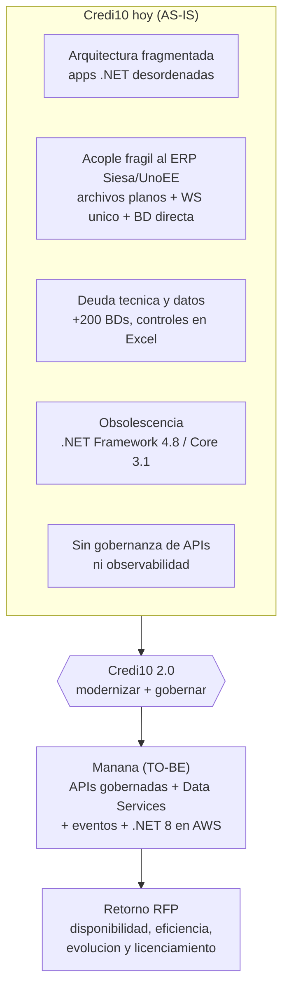

# Reporte Gerencial - Credi10 2.0

> **Soporte ejecutivo** de la propuesta comercial de **Kulgops**. Describe comercialmente el alcance, las fases, el diagnostico de alto nivel del proceso realizado, la estrategia, los riesgos, las consideraciones y los prerrequisitos del proyecto. Tono gerencial (no tecnico); el detalle tecnico vive en el informe 3. Generado de forma **determinista** por el motor del advisory (Python stdlib, sin red ni LLM); espanol con etiquetas tecnicas en ingles.

> **Familia de 3 informes del engagement:** [`1-propuesta-comercial.md`](1-propuesta-comercial.md) (propuesta comercial, informe 1), **este reporte gerencial** (informe 2) y [`3-informe-tecnico/README.md`](3-informe-tecnico/README.md) (informe tecnico, informe 3).

> Etiquetas epistemicas: **[VERIFIED-FACT]** evidencia explicita del corpus; **[DOC-ASSUMPTION]** supuesto/cifra de referencia a recalibrar; **[DOC-CONFLICT]** contradiccion entre fuentes; **[EPISTEMIC-VOID]** sin base documental (no se fabrica evidencia). En este reporte las **cifras de esfuerzo/inversion** son referencia **[DOC-ASSUMPTION]**.

## Indice

| # | Seccion |
| --- | --- |
| 1 | Resumen ejecutivo |
| 2 | Alcance comercial del proyecto |
| 3 | Fases del proyecto (Zero-Drift) |
| 4 | Diagnostico de alto nivel |
| 5 | Estrategia de implementacion |
| 6 | Riesgos |
| 7 | Consideraciones |
| 8 | Prerrequisitos |

## 1. Resumen ejecutivo

Este **reporte gerencial** es el soporte ejecutivo de la **propuesta comercial** de **Kulgops** ([`1-propuesta-comercial.md`](1-propuesta-comercial.md)). Resume, en lenguaje de negocio, el alcance del proyecto Credi10 2.0, las fases de trabajo, el diagnostico de alto nivel que obtuvimos y la estrategia, los riesgos, las consideraciones y los prerrequisitos que la gerencia debe conocer para decidir.

Partimos de **18** documentos del corpus analizados sin muestreo (RFP, assessment WSO2/Studio F, diagramas de arquitectura y PDFs de proceso). De ese analisis concluimos que Credi10 2.0 **no es un proyecto de features nuevas, sino de modernizacion y gobierno**: el negocio funciona, pero su plataforma esta **fragmentada, acoplada a un ERP legado por mecanismos fragiles y sobre runtimes obsoletos**, lo que limita disponibilidad, eficiencia y evolucion.

El valor de nuestra intervencion es dejar el proyecto **listo para estimar y construir** con trazabilidad completa desde cada indicador de negocio del RFP hasta una historia de usuario accionable. El detalle tecnico que respalda cada afirmacion vive en el **informe tecnico** ([`3-informe-tecnico/README.md`](3-informe-tecnico/README.md)).

## 2. Alcance comercial del proyecto

El servicio contratado es una **consultoria de advisory + especificacion de requisitos**. En terminos comerciales, lo que la gerencia recibe al cierre es un **paquete de decision**: el diagnostico del estado actual, el diseño objetivo, el backlog especificado, el plan de implementacion y la estimacion para presupuestar.

| Dentro del alcance | Fuera del alcance (en esta etapa) |
| --- | --- |
| Diagnostico AS-IS y estado del arte | Construccion del software |
| Gaps, diseño TO-BE y especificacion de requisitos | Pruebas sobre codigo productivo |
| Roadmap por olas, estimacion recalibrable y RAID | Despliegue a produccion |
| Caso de negocio y trazabilidad al retorno del RFP | Operacion y soporte post-produccion |

Universo de alcance de referencia: **17** modulos y **17** historias de usuario especificables, sin muestreo. La construccion se habilita con los entregables de esta etapa; no forma parte de ella.

## 3. Fases del proyecto (Zero-Drift)

El trabajo se organiza en **7 fases** con quality gates (QG-0..QG-6): ninguna fase avanza hasta superar su control de calidad, lo que evita el *scope drift* y mantiene la trazabilidad de punta a punta. Descripcion **comercial** de cada fase:

| Fase | Foco | Que entrega | Por que importa |
| --- | --- | --- | --- |
| Fase 0 | Higiene epistemica | Inventario trazable del corpus y registro honesto de supuestos, conflictos y vacios de informacion. | Arranca el proyecto sin fabricar evidencia: lo que no se sabe se declara, no se inventa. |
| Fase 1 | Contexto AS-IS | Radiografia del negocio y la tecnologia actuales: capacidades, procesos, inventario e indicadores de partida. | Fija la linea base contra la que se mide el retorno del proyecto. |
| Fase 2 | Estado del arte | Benchmarks de industria y patrones de referencia conectados a las capacidades del negocio. | Asegura que el rediseño se apoya en practicas probadas, no en opiniones. |
| Fase 3 | Gaps y viabilizacion | Diagnostico de brechas priorizadas y aliviadores para cerrarlas. | Convierte los dolores en un plan de accion viable y justificado. |
| Fase 4 | Diseño TO-BE y specs | Arquitectura objetivo, historias de usuario y especificaciones listas para construir. | Deja el proyecto listo para estimar y desarrollar con minima ambiguedad. |
| Fase 5 | Roadmap, estimacion y RAID | Plan por olas, estimacion recalibrable y registro de riesgos, supuestos, incidencias y dependencias. | Hace predecible la ejecucion y transparente la inversion. |
| Fase 6 | Caso de negocio | Retorno cuantificado contra los indicadores del RFP y veredicto de inversion del Comite. | Conecta cada peso invertido con un resultado de negocio medible. |

> Las tres **olas de entrega** agrupan estas fases: Ola 1 (Discovery, Fases 0-2), Ola 2 (Diseño, Fases 3-4) y Ola 3 (Valor y habilitacion, Fases 5-6).

## 4. Diagnostico de alto nivel

Este es el **resultado ejecutivo del proceso que realizamos**. No es una opinion: cada hallazgo esta trazado a evidencia del corpus y desarrollado en detalle en el informe tecnico ([`3-informe-tecnico/README.md`](3-informe-tecnico/README.md)). En una frase: **Credi10 opera un negocio solido sobre una plataforma fragil**, y el proyecto 2.0 consiste en modernizarla y gobernarla sin detener la operacion.

Vista de alto nivel del punto de partida, la transformacion y el retorno esperado:

### 4.1 Hallazgos clave

Los hallazgos (resumen de la Fase 3) se concentran en cinco frentes reales, todos evidenciados en el assessment WSO2/Studio F y los diagramas de arquitectura:

| Hallazgo | Diagnostico de alto nivel | Driver RFP afectado | Severidad |
| --- | --- | --- | --- |
| GAP-001 | Integracion rigida con el ERP Siesa (archivos planos + un unico Web Service, en su mayoria batch con intervencion manual) | DRV-002 (60% -> 80%) | Alta |
| GAP-002 | Lectura/escritura directa a la base de datos del ERP Siesa, una practica de ALTO RIESGO para la integridad de datos | DRV-001 (90% -> 99%) | Critica |
| GAP-003 | Datos fragmentados: +200 bases de datos duplicadas e inconsistentes con controles manuales en Excel | DRV-002 (60% -> 80%) | Alta |
| GAP-004 | Ausencia de gobernanza de APIs y observabilidad: integraciones dispersas sin trazabilidad de errores | DRV-004 (50% -> 100%) | Media |
| GAP-005 | Obsolescencia tecnologica: .NET Framework 4.8 / .NET Core 3.1 fuera de soporte y Wordpress/XAMPP en produccion | DRV-005 (70% -> 100%) | Alta |

En palabras de negocio: la **fragmentacion arquitectonica** y la **falta de gobernanza de APIs** encarecen cada cambio; el **acople al ERP Siesa/UnoEE** por archivos planos, un unico Web Service y lectura directa a su base de datos es el **riesgo mas severo** (puede corromper datos del ERP); la **deuda tecnica** de +200 bases de datos duplicadas resta confianza a la informacion; y la **obsolescencia de .NET Framework 4.8 / .NET Core 3.1** compromete soporte, seguridad y licenciamiento.

> **Base de evidencia reforzada.** 5 de 5 documentos clave que antes eran **vacios epistemicos** (entre ellos el **Assessment WSO2/Studio F** y las especificaciones de **originacion**, **cartera**, **pagos** e **integracion de atencion al cliente**) fueron **recuperados como texto verificado** ([VERIFIED-FACT]) y hoy aportan evidencia trazable (**60** hechos clave). En consecuencia, estos hallazgos ya **no descansan en supuestos**. El detalle del cambio y su lectura de suficiencia estan en el informe tecnico (Anexo C - 'En que cambio').

### 4.2 Indicadores de retorno del RFP

El negocio ya fijo los objetivos de retorno; nuestro diseño se ancla a ellos. Los cinco indicadores (cifras del RFP) son el marcador contra el que se medira el exito:

| Driver | Indicador de retorno (RFP) | AS-IS -> TO-BE |
| --- | --- | --- |
| DRV-001 | Disponibilidad de apps/servicios criticos | 90% -> 99% |
| DRV-002 | Optimizacion/eficiencia de recursos | 60% -> 80% |
| DRV-003 | Optimizacion de costo de infraestructura | 80% -> 80% |
| DRV-004 | Evolucion tecnologica y escalamiento | 50% -> 100% |
| DRV-005 | Cumplimiento de licenciamiento | 70% -> 100% |

> Cerrar los cinco hallazgos habilita estos saltos: **disponibilidad 90% -> 99%**, **eficiencia 60% -> 80%**, **costo de infraestructura 80% -> 80%** (sostenido al escalar), **evolucion 50% -> 100%** y **licenciamiento 70% -> 100%**. Las cifras son las del RFP; el esfuerzo para alcanzarlas es referencia **[DOC-ASSUMPTION]**.

## 5. Estrategia de implementacion

Proponemos una transformacion **incremental y reversible por olas** (patron *Strangler Fig*): modernizar sin un *big bang*, desviando gradualmente las integraciones hacia APIs gobernadas y Data Services sobre el ERP, de modo que la operacion nunca se detenga.

| Ola | Fases | Objetivo de negocio |
| --- | --- | --- |
| Ola 1 - Discovery | Fases 0-2 | Entender el negocio y la tecnologia actuales y fijar la linea base. |
| Ola 2 - Diseño | Fases 3-4 | Cerrar brechas con un diseño objetivo y un backlog especificado y estimable. |
| Ola 3 - Valor | Fases 5-6 | Planificar la entrega, estimar la inversion y justificar el retorno. |

Los aliviadores que guian la estrategia (resumen de la Fase 3) son:

| Aliviador | Que habilita | Gaps que cierra |
| --- | --- | --- |
| REL-001 | Simplificar y estandarizar las integraciones (patrones y contratos unicos) en lugar de archivos planos y un WS monolitico. | GAP-001 |
| REL-002 | Exponer los datos del ERP Siesa como Data Services gobernados en lugar de lectura/escritura directa a la BD del ERP. | GAP-002 |
| REL-003 | Gestionar todas las APIs de forma centralizada con una plataforma de API Management + Integration Platform (WSO2) y una fuente unica de verdad por dominio. | GAP-003, GAP-004 |
| REL-004 | Revisar y reemplazar las aplicaciones candidatas y modernizar el stack legado (.NET Framework 4.8 / .NET Core 3.1 -> .NET 8; retirar Wordpress/XAMPP de produccion). | GAP-005 |

> La secuencia por olas es lo relevante; el detalle de arquitectura objetivo y el roadmap tecnico estan en el informe tecnico ([`3-informe-tecnico/README.md`](3-informe-tecnico/README.md)).

## 6. Riesgos

El proyecto tiene **9 riesgos** registrados y gestionados en el dossier TO-BE (`to-be/00-registros/riesgos.md`). A nivel gerencial, los mas relevantes son:

| ID | Severidad | Resumen ejecutivo | Estado |
| --- | --- | --- | --- |
| RSK-001 | Alta | Lectura/escritura directa a la BD del ERP Siesa | Mitigando |
| RSK-002 | Alta | Obsolescencia de runtime .NET Framework 4.8 y .NET Core 3.1 | Mitigando |
| RSK-005 | Alta | Integracion fragmentada por batch y archivos planos | Mitigando |
| RSK-006 | Alta | Inconsistencia por +200 bases de datos duplicadas | Mitigando |
| RSK-003 | Media | Dependencia de la VPN IPSec con Telmex | Abierto |

> El riesgo mas severo es la **lectura/escritura directa a la base de datos del ERP Siesa**: el diseño TO-BE la prohibe explicitamente y la reemplaza por Data Services gobernados. Todos los riesgos tienen estado de mitigacion trazable.

## 7. Consideraciones

Hay **6 consideraciones** de diseño y gobierno que condicionan el proyecto sin ser restricciones duras (dossier TO-BE, `to-be/00-registros/consideraciones.md`). Las de mayor impacto gerencial:

| ID | Impacto | Resumen ejecutivo | Estado |
| --- | --- | --- | --- |
| CON-001 | Alta | Desacople incremental de Siesa (patron Strangler Fig) | Vigente |
| CON-002 | Alta | Preservar reglas de negocio al modernizar | Vigente |
| CON-004 | Alta | Modelo zero-trust y cifrado de datos sensibles | Vigente |
| CON-003 | Media | Estrategia cloud AWS con control de costo | Vigente |
| CON-005 | Media | Gobierno de dominios de datos (fuente unica de verdad) | Vigente |

> Destacan el **desacople incremental de Siesa** (sin interrumpir la operacion), la **preservacion de las reglas de negocio** al modernizar y el **control de costo en la nube** (disciplina FinOps).

## 8. Prerrequisitos

Para arrancar la construccion con seguridad se deben cerrar **6 prerrequisitos** (dossier TO-BE, `to-be/00-registros/prerrequisitos.md`). Los criticos para la gerencia:

| ID | Prioridad | Resumen ejecutivo | Estado |
| --- | --- | --- | --- |
| PRE-001 | Alta | Especificacion del contrato del WS/Data Services de Siesa | Pendiente |
| PRE-002 | Alta | Inventario y clasificacion de las +200 bases de datos | Pendiente |
| PRE-003 | Alta | Confirmacion de umbrales de scoring y reglas de decision | Pendiente |
| PRE-004 | Media | Cuenta AWS, VPC y conectividad Telmex habilitadas | Pendiente |
| PRE-005 | Media | Definicion de requisitos de cumplimiento (habeas data / PCI) | Pendiente |
| PRE-006 | Media | Base de pruebas de equivalencia de reglas de negocio | Pendiente |

> Varios prerrequisitos nacen de **vacios de informacion honestamente declarados** (p. ej. el contrato real del Web Service de Siesa): se registran como pendientes, no se rellenan con suposiciones presentadas como hechos.

## Cierre

Este reporte gerencial y la propuesta comercial se sostienen sobre el mismo analisis: el informe tecnico. Juntos permiten a la gerencia **decidir la inversion con evidencia** y a los equipos **arrancar la construccion con una estimacion acertada**.

> **Veredicto gerencial:** diagnostico de alto nivel completo (5 hallazgos reales ligados a los 5 indicadores del RFP), estrategia por olas, 9 riesgos, 6 consideraciones y 6 prerrequisitos registrados. Cifras recalibrables [DOC-ASSUMPTION]; detalle tecnico en [`3-informe-tecnico/README.md`](3-informe-tecnico/README.md).

