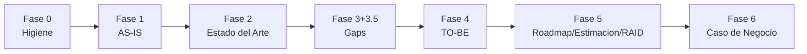
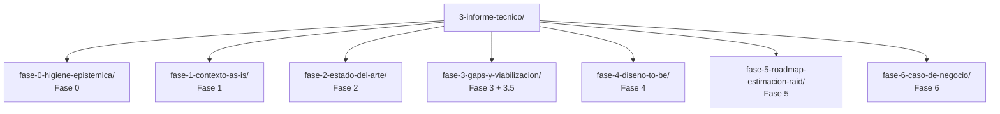
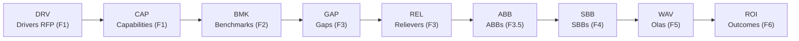

# Informe Tecnico - Credi10 2.0 (vista multinivel narrativa)

> **Informe tecnico** del engagement, rediseñado a una estructura **multinivel y narrativa** facil de leer: una **subcarpeta por fase** (nivel 1), **varios archivos por tema** dentro de cada fase (nivel 2) y jerarquia interna H1->H2->H3 (nivel 3). A diferencia de los informes planos por fase (vista compacta), aqui el foco es la **narrativa de analisis**: interpretar los hallazgos y explicar sus implicaciones para la **estimacion**, la **estrategia de implementacion** y los **riesgos**. Fundamentado en la Base de Conocimiento (**18** documentos del corpus, sin muestreo).

Es documentacion **generada de forma determinista** por el motor (`advisory-system/phases/technical_report.py`); no se escribe a mano y se regenera con el quickstart.

> **Regenerar (parte de `--phase all`):**
>
> ```bash
> python3 advisory-system/quickstart.py --phase all
> ```

> **Etiquetas epistemicas:** **[VERIFIED-FACT]** evidencia explicita del corpus; **[DOC-ASSUMPTION]** supuesto razonable a validar; **[DOC-CONFLICT]** tension entre fuentes; **[EPISTEMIC-VOID]** sin base documental (no se fabrica evidencia).

## Hilo narrativo (storytelling): de la incertidumbre a la estimacion

El informe tecnico cuenta una sola historia en seis capitulos. **Partimos** (Fase 0) saneando la evidencia para saber que podemos afirmar y con que confianza. **Retratamos** (Fase 1) el AS-IS real de Credi10: drivers de negocio, procesos, tecnologia y deuda. **Comparamos** (Fase 2) contra el estado del arte para medir la brecha. **Convertimos** (Fase 3) esa brecha en gaps acotados y estimables, con sus aliviadores y building blocks. **Diseñamos** (Fase 4) la solucion TO-BE con vistas C4, ADRs, contratos, UX y pruebas. **Planeamos** (Fase 5) con estimacion por modulo, priorizacion WSJF, roadmap por olas y RAID. Y **cerramos** (Fase 6) con el caso de negocio que ata el esfuerzo a un retorno. Cada fase **reduce incertidumbre** y, por tanto, acerca la estimacion a lo mas acertado posible sin fabricar precision que el corpus no soporta.

## Flujo de fases




## Estructura del informe (nivel 1)



El informe se compone de **7 fases** y **22 archivos de tema** en total. Indice navegable:

| Fase | Carpeta | Temas (nivel 2) | Vista compacta |
| --- | --- | --- | --- |
| Fase 0 - Higiene Epistemica | [`fase-0-higiene-epistemica/`](fase-0-higiene-epistemica/README.md) | [Corpus, trazabilidad y cobertura de evidencia](fase-0-higiene-epistemica/corpus-y-trazabilidad.md), [Grafo de conceptos y modelo mental del ecosistema](fase-0-higiene-epistemica/grafo-de-conceptos.md) | [plano](../../00-higiene-epistemica.md) |
| Fase 1 - Contexto AS-IS | [`fase-1-contexto-as-is/`](fase-1-contexto-as-is/README.md) | [Contexto de negocio: drivers y capacidades](fase-1-contexto-as-is/contexto-negocio.md), [Procesos de negocio AS-IS (BPMN) y metricas base](fase-1-contexto-as-is/procesos-bpmn.md), [Ecosistema tecnologico y de datos AS-IS](fase-1-contexto-as-is/ecosistema-tecnologico.md), [Deuda tecnica y riesgos del AS-IS](fase-1-contexto-as-is/deuda-tecnica.md) | [plano](../../01-contexto-as-is.md) |
| Fase 2 - Estado del Arte | [`fase-2-estado-del-arte/`](fase-2-estado-del-arte/README.md) | [Benchmarks de industria y comparativo AS-IS](fase-2-estado-del-arte/benchmarks.md), [Radar de tendencias y modelo de referencia sectorial](fase-2-estado-del-arte/tendencias-y-referencia.md) | [plano](../../02-estado-del-arte.md) |
| Fase 3 + 3.5 - Gaps y Viabilizacion | [`fase-3-gaps-y-viabilizacion/`](fase-3-gaps-y-viabilizacion/README.md) | [Matriz de dolores, causas raiz y gap analysis](fase-3-gaps-y-viabilizacion/gap-analysis.md), [Aliviadores, bounded contexts y ABBs](fase-3-gaps-y-viabilizacion/viabilizacion.md), [Reglas de negocio, excepciones y NFR base](fase-3-gaps-y-viabilizacion/reglas-y-nfr.md) | [plano](../../03-gaps-y-viabilizacion.md) |
| Fase 4 - Diseno TO-BE | [`fase-4-diseno-to-be/`](fase-4-diseno-to-be/README.md) | [Arquitectura TO-BE: vistas C4 y SBBs](fase-4-diseno-to-be/arquitectura-c4.md), [Decisiones de arquitectura (ADRs)](fase-4-diseno-to-be/adrs.md), [Modelo de datos (ERD) y contratos de API/eventos](fase-4-diseno-to-be/modelo-datos-y-contratos.md), [Catalogo de oportunidades de IA](fase-4-diseno-to-be/catalogo-ia.md), [UX, BPMN TO-BE, Dry-Run y seguridad](fase-4-diseno-to-be/ux-y-pruebas.md) | [plano](../../04-diseno-to-be.md) |
| Fase 5 - Roadmap, Estimacion y RAID | [`fase-5-roadmap-estimacion-raid/`](fase-5-roadmap-estimacion-raid/README.md) | [Estimacion por modulo y modelo parametrico](fase-5-roadmap-estimacion-raid/estimacion-por-modulo.md), [Roadmap por olas, WSJF y ruta critica](fase-5-roadmap-estimacion-raid/roadmap-olas.md), [Matriz RAID (supuestos, restricciones, dependencias, prerrequisitos)](fase-5-roadmap-estimacion-raid/raid.md), [Evaluacion de suficiencia y riesgo de desfase](fase-5-roadmap-estimacion-raid/riesgo-de-desfase.md) | [plano](../../05-roadmap-estimacion-raid.md) |
| Fase 6 - Caso de Negocio | [`fase-6-caso-de-negocio/`](fase-6-caso-de-negocio/README.md) | [Value driver tree y outcomes de negocio](fase-6-caso-de-negocio/value-driver-tree.md), [Modelo financiero y defensa ejecutiva](fase-6-caso-de-negocio/modelo-financiero.md) | [plano](../../06-caso-de-negocio.md) |

## Anexo A - Trazabilidad de requisitos

El **Anexo A** responde **punto a punto** cada solicitud del cliente presente en el corpus, con **cita al documento fuente**, el lugar del advisory donde se responde (fase/seccion/entregable), un estado **Cubierto/Parcial/Pendiente** y una nota de evidencia. Incluye un **checklist marcable** de que desarrollar y una **tabla de trazabilidad** detallada. Es **dinamico y derivado del corpus**: las solicitudes se extraen automaticamente de la documentacion (no estan hardcodeadas), de modo que con el corpus de otro cliente el anexo se regenera con sus solicitudes. Gobernado por el skill `requirements-traceability`.

| Anexo | Contenido | Donde |
| --- | --- | --- |
| Anexo A - Trazabilidad de requisitos | Checklist marcable + tabla punto a punto (dinamica, derivada del corpus) | [`anexo-a-trazabilidad-requisitos/README.md`](anexo-a-trazabilidad-requisitos/README.md) |
| Anexo B - Arquitectura IA multicapa de extraccion | Estrategia y tactica L1-L4 para maximizar el texto util, con el resultado real antes/despues del corpus (diagrama Mermaid + tabla por tipo de documento) | [`anexo-b-arquitectura-extraccion/README.md`](anexo-b-arquitectura-extraccion/README.md) |

## Anexo B - Arquitectura IA multicapa de extraccion de texto util

El **Anexo B** presenta, como recomendacion de advisory, la arquitectura de **ingesta documental multicapa (L1-L4)** cuyo objetivo es **maximizar el texto util real** de todo el corpus: L1 texto nativo + decodificacion de fuentes (`/ToUnicode`), L2 OCR de paginas imagen, L3 vision/LLM multimodal y L4 NLP/LLM de post-proceso. Esta **fundamentado en el analisis de cobertura real** (cifras antes/despues de texto util leidas de la Base de Conocimiento) y separa de forma explicita lo **implementado aqui (L1)** de lo que requiere el entorno de produccion (L2-L4). Gobernado por el skill generico `document-extraction-architecture`.

## Hilo Dorado (trazabilidad F1 -> F6)

La trazabilidad end-to-end conecta cada decision tecnica con un indicador del RFP:




## Integracion del dossier TO-BE (vista de ejecucion)

El **dossier de proyecto TO-BE** por etapa del SDLC es la **vista orientada a ejecutar el proyecto** (requisitos, arquitectura, specs, UX, pruebas, insumos de estimacion y registros transversales). Vive en [`../to-be/`](../to-be/README.md) y queda **integrado dentro de este informe tecnico** por referencia inequivoca: es la vista de ejecucion del mismo diseño que este informe narra por fase (no un arbol paralelo). Reutiliza las mismas fuentes de verdad (`phases/modules.py`, SBBs, gaps/ABBs) y no se duplica aqui para evitar incoherencias.

| Vista | Proposito | Donde |
| --- | --- | --- |
| Informe tecnico multinivel | Narrativa de analisis por fase/tema (este documento) | `3-informe-tecnico/` |
| Informes planos por fase (00..06, 04b) | Vista compacta y canonica de cada fase (gobernada por gates QG) | `../00..06-*.md` |
| Dossier TO-BE | Vista de ejecucion por etapa del SDLC | [`../to-be/`](../to-be/README.md) |

> **Vista canonica.** El contenido canonico de cada fase es su informe plano (00..06 + 04b), gobernado por los gates de calidad QG-0..QG-6. Este informe multinivel es la **vista narrativa navegable** que los reorganiza y enriquece con analisis en prosa; el dossier TO-BE es la vista de ejecucion. Las tres vistas comparten las mismas fuentes de verdad y no se contradicen.

## Relacion con los otros dos informes del engagement

Este informe tecnico es el **detalle** que referencian los otros dos informes del engagement: la [propuesta comercial](../1-propuesta-comercial.md) y el [reporte gerencial](../2-reporte-gerencial.md). Para el indice maestro de los tres informes ver [`../README.md`](../README.md).

## Mejores practicas del SDLC aplicadas

El informe aplica practicas actuales del ciclo de vida: requisitos (funcionales + NFR ISO/IEC 25010), arquitectura con vistas **C4** y **ADRs**, specs/contratos (OpenAPI/AsyncAPI), **UX** (journeys, blueprints), **pruebas** (estrategia + Dry-Run + aceptacion), **DevOps/observabilidad**, **estimacion** (modelo parametrico recalibrable) y **roadmap** por olas con RAID.

> **Veredicto del informe tecnico:** vista multinivel con 7 fases, 22 temas con narrativa sustancial (H1->H2->H3), dossier TO-BE integrado por referencia y trazabilidad completa del Hilo Dorado; generada deterministamente.

