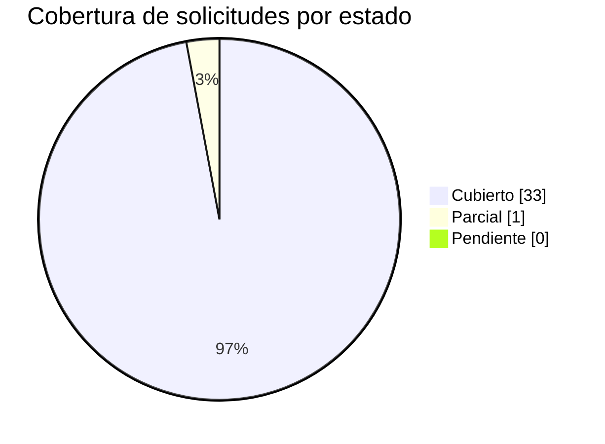

# Anexo A - Trazabilidad de requisitos del cliente

> Anexo del **informe tecnico** que responde **punto a punto** cada solicitud del cliente presente en el corpus, con **cita al documento fuente**. Es documentacion **generada de forma determinista** por el motor (`advisory-system/phases/requirements_traceability.py`) y es **dinamica**: las solicitudes se **extraen del corpus** (no estan hardcodeadas para ningun cliente), de modo que si cambian los documentos de contexto el anexo se **regenera** con las solicitudes de ese nuevo cliente. Gobernado por el skill `requirements-traceability`.

Se derivaron **34 solicitudes** sobre un corpus de **18** documentos: **33 Cubierto**, **1 Parcial**, **0 Pendiente**.

> **Etiquetas epistemicas:** **[VERIFIED-FACT]** solicitud derivada de capa de texto util verificada; **[OCR-EXTRACTED]** derivada de texto recuperado via OCR; **[DOC-ASSUMPTION]** supuesto a validar; **[DOC-CONFLICT]** tension entre fuentes; **[EPISTEMIC-VOID]** el corpus no permite derivar/responder (OCR pendiente). No se fabrica cobertura.

> **Regenerar (parte de `--phase all`):**
>
> ```bash
> python3 advisory-system/quickstart.py --phase all
> ```

## Resumen de cobertura




## 1. Checklist marcable (que desarrollar / que pide el cliente)

Leyenda: `- [x]` Cubierto - `- [~]` Parcial - `- [ ]` Pendiente.

- [x] **REQ-001** (Cubierto) ALCANCE La propuesta presentada por el oferente debe contemplar el cumplimiento a cabalidad de los requerimientos solicitados por LA EMPRESA para “ PROYECTO CREDI10 2.0 ”. 1. 4 VISITA AL LUGAR DE PRESTACIÓN DE L SERVICIO... _[fuente: RFP_CREDI10_2_0.pdf - Alcance]_ [VERIFIED-FACT]
- [x] **REQ-002** (Cubierto) Objetivo general Realizar el diagnóstico, diseñoy transformación progresiva de la arquitectura tecnológica de Credi10 hacia una arquitectura objetivo Credi10 2.0, que permita disponer de una plataforma robusta, escalable... _[fuente: RFP_CREDI10_2_0.pdf - Objetivo general]_ [VERIFIED-FACT]
- [x] **REQ-003** (Cubierto) arquitectura objetivo Credi10 2.0, que permita disponer de una plataforma robusta, escalable, segura, mantenible, observable y sostenible tecnol ógicamente, alineada con las necesidades actuales y futuras del negocio. 2.... _[fuente: RFP_CREDI10_2_0.pdf - Arquitectura objetivo]_ [VERIFIED-FACT]
- [x] **REQ-004** (Cubierto) Objetivos específicos • Realizar el levantamiento e inventario detallado de los componentes tecnológicos actuales. • Evaluar la arquitectura actual desde las perspectivas de aplicaciones, datos, infraestructura, integrac... _[fuente: RFP_CREDI10_2_0.pdf - Objetivos especificos]_ [VERIFIED-FACT]
- [x] **REQ-005** (Cubierto) Alcance del proyecto El alcance comprende el diagnóstico integral, diseño de arquitectura objetivo, definición del roadmap y ejecución de las iniciativas de transformación tecnológica requeridas para Credi10 2.0. 1. Asse... _[fuente: RFP_CREDI10_2_0.pdf - Alcance del proyecto]_ [VERIFIED-FACT]
- [x] **REQ-006** (Cubierto) Assessment de arquitectura actual El proveedor deberá realizar un assessment de: • Aplicaciones. • Servicios Windows. • APIs. • Integradores. • Bases de datos. • Componentes de procesamiento batch y/o programado. • Front... _[fuente: RFP_CREDI10_2_0.pdf - Assessment de arquitectura actual]_ [VERIFIED-FACT]
- [x] **REQ-007** (Cubierto) Evaluación tecnológica Para cada componente se deberá evaluar como mínimo los siguientes items : • Lenguaje de programación. • Framework y versión. • Librerías y dependencias. • Estado de soporte tecnológico. • Obsolesce... _[fuente: RFP_CREDI10_2_0.pdf - Evaluacion tecnologica]_ [VERIFIED-FACT]
- [x] **REQ-008** (Cubierto) Evaluación de bases de datos Se deberá evaluar la arquitectura y estado de las bases de datos asociadas a Credi10, incluyendo: • Motor y versión. • Modelo de datos. • Volumen y crecimiento. • Performance. • Índices y con... _[fuente: RFP_CREDI10_2_0.pdf - Evaluacion de bases de datos]_ [VERIFIED-FACT]
- [x] **REQ-009** (Cubierto) Evaluación de integraciones Se deberán identificar y evaluar las integraciones con sistemas internos, externos y proveedores, incluyendo, entre otros y documentar las dependencias, mecanismos de integración, criticidad,... _[fuente: RFP_CREDI10_2_0.pdf - Evaluacion de integraciones]_ [VERIFIED-FACT]
- [x] **REQ-010** (Cubierto) Indicadores de retorno # Indicador Porcentaje Actual Porcentaje esperado 1 Disponibilidad de aplicaci ones y servicios críticos 90% 99 % 2 Optimización y eficiencia de recursos tecnológicos 60% 80 % 3 Optimización del c... _[fuente: RFP_CREDI10_2_0.pdf - Indicadores de retorno]_ [VERIFIED-FACT]
- [x] **REQ-011** (Cubierto) Requerimientos funcionales: Concepto Descripción Requerimientos funcionales y del proceso La transformación tecnológica deberá preservar las funcionalidades y reglas de negocio existentes en Credi10, incluyendo las perso... _[fuente: RFP_CREDI10_2_0.pdf - Requerimientos funcionales]_ [VERIFIED-FACT]
- [x] **REQ-012** (Cubierto) Requerimientos de la operación El assesment y la arquitectura objetivo deberán contemplar como mínimo los siguientes aspectos : • Alta disponibilidad de los componentes críticos los cuales son: Carrera 34 No. 10 - 581 Te... _[fuente: RFP_CREDI10_2_0.pdf - Requerimientos de la operacion]_ [VERIFIED-FACT]
- [x] **REQ-013** (Cubierto) Informes requeridos El proveedor deberá entregar como mínimo: 1. Assessment • Inventario tecnológico. • Inventario de aplicaciones y servicios. • Inventario de APIs. • Inventario de bases de datos. • Inventario de integr... _[fuente: RFP_CREDI10_2_0.pdf - Informes requeridos]_ [VERIFIED-FACT]
- [x] **REQ-014** (Cubierto) Requerimientos técnicos : (Diligenciados por TI) Concepto Descripción Arquitectura de la solución La arquitectura objetivo deberá estar orientada a principios de: • A coplamiento. • Alta cohesión. • Escalabilidad. • Disp... _[fuente: RFP_CREDI10_2_0.pdf - Requerimientos tecnicos]_ [VERIFIED-FACT]
- [x] **REQ-015** (Cubierto) Métodos de integración El proveedor deberá evaluar los mecanismos de integración actuales y definir los métodos recomendados para la arquitectura Credi10 2.0. Podrán contemplarse, según corresponda: • APIs REST. • APIs S... _[fuente: RFP_CREDI10_2_0.pdf - Metodos de integracion]_ [VERIFIED-FACT]
- [x] **REQ-016** (Cubierto) EVALUACIÓN DE LAS PROPUESTAS Las ofertas serán evaluadas con base en los siguientes criterios y calificaciones, para obtener un puntaje máximo de 100 puntos . Aspecto a evaluar Puntaje Experiencia: años y certificaciones... _[fuente: RFP_CREDI10_2_0.pdf - Evaluacion de las propuestas]_ [VERIFIED-FACT]
- [x] **REQ-017** (Cubierto) corre sobre .NET Framework 4.8 en IIS 10; integradores en .NET y Windows Services en .NET Core 8 y .NET 4.8. Bases de datos SQL Server 2019 Enterprise: C10_Credi10NET, C10_Inspektor, C10_Datacredito y C10_Database. El mo... _[fuente: Arquitectura_Aplicacion_Despliegue_Credi10.png - Numeral 10]_ [VERIFIED-FACT]
- [~] **REQ-018** (Parcial) VPC 'STUDIO F' con WAF -> ALB -> instancias EC2 privadas, almacenamiento S3, monitoreo CloudWatch, NAT Gateway y Bastion host. Conectividad hibrida mediante VPN IPSec de Telmex hacia el centro de datos on-prem 'Cokioto'. _[fuente: Arquitectura_Infraestructura_AWS_Credi10.png - Numeral 2]_ [VERIFIED-FACT]
- [x] **REQ-019** (Cubierto) de Credi10. Aplicacion web central CREDI10 en .NET integrada con UNOEE/Siesa (ERP), PENTAHO (BI/ETL), CROSSCORE -> INSPEKTOR -> DICTUM/Datacredito (originacion y riesgo), Numrot, Cobranza, B2C, Link de Recaudo -> PayU, V... _[fuente: Diagrama_Contexto_Credi10.png - Numeral 4]_ [VERIFIED-FACT]
- [x] **REQ-020** (Cubierto) Assessment de Arquitectura Fecha: Mayo, 2026 Index 1. Objetivo del Documento ................................ ................................ ................................ ............ 3 2. Contexto de Negócio ......... _[fuente: WSO2 y Studio F - Assessment Mayo2026-Final.pdf - Assessment de arquitectura actual]_ [VERIFIED-FACT]
- [x] **REQ-021** (Cubierto) 2 Versión:001 Fecha: 08/06/2021 FORMATO DE DESARROLLO E INTEGRACIONES API Integrador Atención Al Cliente STF GROUP S.A. INFORMATICA – Py. CREDI10 SOFTWARE PROPIO Cali , viernes 26 de diciembre del 202 5 Código:FT - DG -... _[fuente: Api Integrador Atencion al cliente.pdf - Numeral 00]_ [VERIFIED-FACT]
- [x] **REQ-022** (Cubierto) 2 Versión:001 Fecha: 08/06/2021 FORMATO DE DESARROLLO E INTEGRACIONES FT - SL - 011 - APIs Portal clientes B2C STF GROUP S.A. INFORMATICA – Py. CREDI10 SOFTWARE PROPIO Cali , jueves 19 de febrero del 2024 Código:FT - DG... _[fuente: B2C.pdf - Numeral 00]_ [VERIFIED-FACT]
- [x] **REQ-023** (Cubierto) 2 Versión:001 Fecha: 08/06/2021 FORMATO DE DESARROLLO E INTEGRACIONES FT - SL - 011 - APIs Botón Ecommerce Credi10 STF GROUP S.A. INFORMATICA – Py. CREDI10 SOFTWARE PROPIO Cali , jueves 19 de febrero del 2024 Código:FT -... _[fuente: BotonEcommerce.pdf - Numeral 00]_ [VERIFIED-FACT]
- [x] **REQ-024** (Cubierto) 2 Versión:001 Fecha: 08/06/2021 FORMATO DE DESARROLLO E INTEGRACIONES CAPTURA FOTO STF GROUP S.A. INFORMATICA – Py. CREDI10 SOFTWARE PROPIO Cali , lunes , 29 de enero de 202 4 Código:FT - DG - 00 2 Versión:001 Fecha: 08/... _[fuente: Captura Foto.pdf - Numeral 00]_ [VERIFIED-FACT]
- [x] **REQ-025** (Cubierto) SOFTWARE PROPIO Cali, viernes 28 de noviembre del 2025 DETALLE TECNICO 1.1 Descripción del Requerimiento: Un servicio que generé y envié recibos consolidados RCL (Recibos de caja payu) y RCR (recibos de consignaciones) a... _[fuente: Envio de RCL y RCR.pdf - Numeral 10]_ [VERIFIED-FACT]
- [x] **REQ-026** (Cubierto) objet ivos específicos. 1. Realizar calculo a la fecha de los diferentes montos pendientes a pagar . 2. Registrar pagos, generando un comprobante. Ver el requerimiento en el link: FT - SL - 003 - Módulo_Pago - V5 1.1.2 F... _[fuente: GenerarPagos.pdf - Objetivos especificos]_ [VERIFIED-FACT]
- [x] **REQ-027** (Cubierto) objetivo general es validar que el usuario que está intentando ingresar a una vista haya iniciado sesión anteriormente y si tiene los permisos neces arios para permitir ver la vista y devolver los recursos necesarios en... _[fuente: GenerarPagos.pdf - Objetivo general]_ [VERIFIED-FACT]
- [x] **REQ-028** (Cubierto) 2 Versión:001 Fecha: 08/06/2021 FORMATO DE DESARROLLO E INTEGRACIONES FT - SL - 011 - APIs Link de recaudos Credi10 STF GROUP S.A. INFORMATICA – Py. CREDI10 SOFTWARE PROPIO Cali , jueves 16 de febrero del 2024 Código:FT... _[fuente: LinkDePagos.pdf - Numeral 00]_ [VERIFIED-FACT]
- [x] **REQ-029** (Cubierto) SOFTWARE PROPIO Cali, martes 6 de enero del 202 6 I NTRODUCCION La integración de Llamada Predictiva es un Worker Service desarrollado en .NET 8 que funciona como servicio de Windows, diseñado para automatizar la gestión... _[fuente: Llamada predictiva.pdf - Numeral 10]_ [VERIFIED-FACT]
- [x] **REQ-030** (Cubierto) 1 Versión:001 Fecha: 08/ 11 /202 3 FORMATO DE DESARROLLO E INTEGRACIONES API DATACREDITO STF GROUP S.A. INFORMATICA – Py. CREDI10 SOFTWARE PROPIO Cali , martes, 15 de septiembre de 2026 Código: ORI - API - 00 1 Versión:0... _[fuente: Originacion_API_Datacredito.pdf - Numeral 00]_ [VERIFIED-FACT]
- [x] **REQ-031** (Cubierto) 1 Versión:001 Fecha: 08/ 11 /202 3 FORMATO DE DESARROLLO E INTEGRACIONES API IN SPEKTOR STF GROUP S.A. INFORMATICA – Py. CREDI10 SOFTWARE PROPIO Cali , martes, 15 de septiembre de 2026 Código: ORI - API - 00 1 Versión:00... _[fuente: Originacion_API_Inspektor.pdf - Numeral 00]_ [VERIFIED-FACT]
- [x] **REQ-032** (Cubierto) 2 Versión:001 Fecha: 08/06/2021 FORMATO DE DESARROLLO E INTEGRACIONES Originacion Aplicación Admin STF GROUP S.A. INFORMATICA – Py. CREDI10 SOFTWARE PROPIO Cali , Viernes, 17 de noviembre de 2023 Código:FT - DG - 00 2 Ve... _[fuente: Originacion_Aplicacion_ADMIN.pdf - Numeral 00]_ [VERIFIED-FACT]
- [x] **REQ-033** (Cubierto) 2 Versión:001 Fecha: 08/06/2021 FORMATO DE DESARROLLO E INTEGRACIONES ORIGINACION CROSSCORE STF GROUP S.A. INFORMATICA – Py. CREDI10 SOFTWARE PROPIO Cali , viernes , 16 de febrero de 202 4 Código:FT - DG - 00 2 Versión:0... _[fuente: Originacion_CrossCore.pdf - Numeral 00]_ [VERIFIED-FACT]
- [x] **REQ-034** (Cubierto) 2 Versión:001 Fecha: 08/06/2021 FORMATO DE DESARROLLO E INTEGRACIONES FT - SL - 004 - Módulo_Cartera STF GROUP S.A. INFORMATICA – Py. CREDI10 SOFTWARE PROPIO C ali , lunes 12 de febrero del 2024 Código:FT - DG - 00 2 Ver... _[fuente: ProcesoCorteCartera.pdf - Numeral 00]_ [VERIFIED-FACT]

## 2. Tabla de trazabilidad punto a punto

| ID | Solicitud del cliente | Cita al documento fuente | Donde se responde (fase/seccion/entregable) | Estado | Evidencia/Nota |
| --- | --- | --- | --- | --- | --- |
| REQ-001 | ALCANCE La propuesta presentada por el oferente debe contemplar el cumplimiento a cabalidad de los requerimientos solicitados por LA EMPRESA para “ PROYECTO CREDI10 2.0 ”. 1. 4 VISITA AL LUGAR DE PRESTACIÓN DE L SERVICIO... | RFP_CREDI10_2_0.pdf - Alcance | Fase 0 higiene epistemica + Fase 1 AS-IS (00-higiene-epistemica.md, 01-contexto-as-is.md) | Cubierto | [VERIFIED-FACT] Respondida por Fase 0 higiene epistemica + Fase 1 AS-IS (00-higiene-epistemica.md, 01-contexto-as-is.md). |
| REQ-002 | Objetivo general Realizar el diagnóstico, diseñoy transformación progresiva de la arquitectura tecnológica de Credi10 hacia una arquitectura objetivo Credi10 2.0, que permita disponer de una plataforma robusta, escalable... | RFP_CREDI10_2_0.pdf - Objetivo general | Fase 1 contexto-negocio + Fase 6 caso de negocio (01-contexto-as-is.md, 06-caso-de-negocio.md) | Cubierto | [VERIFIED-FACT] Respondida por Fase 1 contexto-negocio + Fase 6 caso de negocio (01-contexto-as-is.md, 06-caso-de-negocio.md). |
| REQ-003 | arquitectura objetivo Credi10 2.0, que permita disponer de una plataforma robusta, escalable, segura, mantenible, observable y sostenible tecnol ógicamente, alineada con las necesidades actuales y futuras del negocio. 2.... | RFP_CREDI10_2_0.pdf - Arquitectura objetivo | Fase 4 diseno TO-BE: C4 + ADRs (04-diseno-to-be.md, to-be/) | Cubierto | [VERIFIED-FACT] Respondida por Fase 4 diseno TO-BE: C4 + ADRs (04-diseno-to-be.md, to-be/). |
| REQ-004 | Objetivos específicos • Realizar el levantamiento e inventario detallado de los componentes tecnológicos actuales. • Evaluar la arquitectura actual desde las perspectivas de aplicaciones, datos, infraestructura, integrac... | RFP_CREDI10_2_0.pdf - Objetivos especificos | Fase 1 contexto-negocio + Fase 6 caso de negocio (01-contexto-as-is.md, 06-caso-de-negocio.md) | Cubierto | [VERIFIED-FACT] Respondida por Fase 1 contexto-negocio + Fase 6 caso de negocio (01-contexto-as-is.md, 06-caso-de-negocio.md). |
| REQ-005 | Alcance del proyecto El alcance comprende el diagnóstico integral, diseño de arquitectura objetivo, definición del roadmap y ejecución de las iniciativas de transformación tecnológica requeridas para Credi10 2.0. 1. Asse... | RFP_CREDI10_2_0.pdf - Alcance del proyecto | Fase 0 higiene epistemica + Fase 1 AS-IS (00-higiene-epistemica.md, 01-contexto-as-is.md) | Cubierto | [VERIFIED-FACT] Respondida por Fase 0 higiene epistemica + Fase 1 AS-IS (00-higiene-epistemica.md, 01-contexto-as-is.md). |
| REQ-006 | Assessment de arquitectura actual El proveedor deberá realizar un assessment de: • Aplicaciones. • Servicios Windows. • APIs. • Integradores. • Bases de datos. • Componentes de procesamiento batch y/o programado. • Front... | RFP_CREDI10_2_0.pdf - Assessment de arquitectura actual | Fase 0 higiene epistemica + Fase 1 AS-IS (00-higiene-epistemica.md, 01-contexto-as-is.md) | Cubierto | [VERIFIED-FACT] Respondida por Fase 0 higiene epistemica + Fase 1 AS-IS (00-higiene-epistemica.md, 01-contexto-as-is.md). |
| REQ-007 | Evaluación tecnológica Para cada componente se deberá evaluar como mínimo los siguientes items : • Lenguaje de programación. • Framework y versión. • Librerías y dependencias. • Estado de soporte tecnológico. • Obsolesce... | RFP_CREDI10_2_0.pdf - Evaluacion tecnologica | Fase 1 deuda tecnica + Fase 2 estado del arte (01-contexto-as-is.md, 02-estado-del-arte.md) | Cubierto | [VERIFIED-FACT] Respondida por Fase 1 deuda tecnica + Fase 2 estado del arte (01-contexto-as-is.md, 02-estado-del-arte.md). |
| REQ-008 | Evaluación de bases de datos Se deberá evaluar la arquitectura y estado de las bases de datos asociadas a Credi10, incluyendo: • Motor y versión. • Modelo de datos. • Volumen y crecimiento. • Performance. • Índices y con... | RFP_CREDI10_2_0.pdf - Evaluacion de bases de datos | Fase 1 ecosistema (datos) + Fase 4 modelo de datos y contratos (01-contexto-as-is.md, 04-diseno-to-be.md) | Cubierto | [VERIFIED-FACT] Respondida por Fase 1 ecosistema (datos) + Fase 4 modelo de datos y contratos (01-contexto-as-is.md, 04-diseno-to-be.md). |
| REQ-009 | Evaluación de integraciones Se deberán identificar y evaluar las integraciones con sistemas internos, externos y proveedores, incluyendo, entre otros y documentar las dependencias, mecanismos de integración, criticidad,... | RFP_CREDI10_2_0.pdf - Evaluacion de integraciones | Fase 1 ecosistema + Fase 4 contratos (OpenAPI/AsyncAPI) (01-contexto-as-is.md, 04-diseno-to-be.md) | Cubierto | [VERIFIED-FACT] Respondida por Fase 1 ecosistema + Fase 4 contratos (OpenAPI/AsyncAPI) (01-contexto-as-is.md, 04-diseno-to-be.md). |
| REQ-010 | Indicadores de retorno # Indicador Porcentaje Actual Porcentaje esperado 1 Disponibilidad de aplicaci ones y servicios críticos 90% 99 % 2 Optimización y eficiencia de recursos tecnológicos 60% 80 % 3 Optimización del c... | RFP_CREDI10_2_0.pdf - Indicadores de retorno | Fase 6 value-driver-tree + modelo financiero (06-caso-de-negocio.md) | Cubierto | [VERIFIED-FACT] Respondida por Fase 6 value-driver-tree + modelo financiero (06-caso-de-negocio.md). |
| REQ-011 | Requerimientos funcionales: Concepto Descripción Requerimientos funcionales y del proceso La transformación tecnológica deberá preservar las funcionalidades y reglas de negocio existentes en Credi10, incluyendo las perso... | RFP_CREDI10_2_0.pdf - Requerimientos funcionales | Fase 4 catalogo de historias + modelo de datos (04b-catalogo-historias.md, 04-diseno-to-be.md) | Cubierto | [VERIFIED-FACT] Respondida por Fase 4 catalogo de historias + modelo de datos (04b-catalogo-historias.md, 04-diseno-to-be.md). |
| REQ-012 | Requerimientos de la operación El assesment y la arquitectura objetivo deberán contemplar como mínimo los siguientes aspectos : • Alta disponibilidad de los componentes críticos los cuales son: Carrera 34 No. 10 - 581 Te... | RFP_CREDI10_2_0.pdf - Requerimientos de la operacion | Fase 4 UX y pruebas + Fase 5 RAID (04-diseno-to-be.md, 05-roadmap-estimacion-raid.md) | Cubierto | [VERIFIED-FACT] Respondida por Fase 4 UX y pruebas + Fase 5 RAID (04-diseno-to-be.md, 05-roadmap-estimacion-raid.md). |
| REQ-013 | Informes requeridos El proveedor deberá entregar como mínimo: 1. Assessment • Inventario tecnológico. • Inventario de aplicaciones y servicios. • Inventario de APIs. • Inventario de bases de datos. • Inventario de integr... | RFP_CREDI10_2_0.pdf - Informes requeridos | Los 3 informes del engagement + dossier TO-BE (1-propuesta-comercial.md, 2-reporte-gerencial.md, 3-informe-tecnico/, to-be/) | Cubierto | [VERIFIED-FACT] Respondida por Los 3 informes del engagement + dossier TO-BE (1-propuesta-comercial.md, 2-reporte-gerencial.md, 3-informe-tecnico/, to-be/). |
| REQ-014 | Requerimientos técnicos : (Diligenciados por TI) Concepto Descripción Arquitectura de la solución La arquitectura objetivo deberá estar orientada a principios de: • A coplamiento. • Alta cohesión. • Escalabilidad. • Disp... | RFP_CREDI10_2_0.pdf - Requerimientos tecnicos | Fase 4 diseno TO-BE + ADRs (04-diseno-to-be.md, to-be/) | Cubierto | [VERIFIED-FACT] Respondida por Fase 4 diseno TO-BE + ADRs (04-diseno-to-be.md, to-be/). |
| REQ-015 | Métodos de integración El proveedor deberá evaluar los mecanismos de integración actuales y definir los métodos recomendados para la arquitectura Credi10 2.0. Podrán contemplarse, según corresponda: • APIs REST. • APIs S... | RFP_CREDI10_2_0.pdf - Metodos de integracion | Fase 1 ecosistema + Fase 4 contratos (OpenAPI/AsyncAPI) (01-contexto-as-is.md, 04-diseno-to-be.md) | Cubierto | [VERIFIED-FACT] Respondida por Fase 1 ecosistema + Fase 4 contratos (OpenAPI/AsyncAPI) (01-contexto-as-is.md, 04-diseno-to-be.md). |
| REQ-016 | EVALUACIÓN DE LAS PROPUESTAS Las ofertas serán evaluadas con base en los siguientes criterios y calificaciones, para obtener un puntaje máximo de 100 puntos . Aspecto a evaluar Puntaje Experiencia: años y certificaciones... | RFP_CREDI10_2_0.pdf - Evaluacion de las propuestas | Fase 5 roadmap/estimacion + Fase 6 caso de negocio (05-roadmap-estimacion-raid.md, 06-caso-de-negocio.md) | Cubierto | [VERIFIED-FACT] Respondida por Fase 5 roadmap/estimacion + Fase 6 caso de negocio (05-roadmap-estimacion-raid.md, 06-caso-de-negocio.md). |
| REQ-017 | corre sobre .NET Framework 4.8 en IIS 10; integradores en .NET y Windows Services en .NET Core 8 y .NET 4.8. Bases de datos SQL Server 2019 Enterprise: C10_Credi10NET, C10_Inspektor, C10_Datacredito y C10_Database. El mo... | Arquitectura_Aplicacion_Despliegue_Credi10.png - Numeral 10 | Fase 1 ecosistema (datos) + Fase 4 modelo de datos y contratos (01-contexto-as-is.md, 04-diseno-to-be.md) | Cubierto | [VERIFIED-FACT] Respondida por Fase 1 ecosistema (datos) + Fase 4 modelo de datos y contratos (01-contexto-as-is.md, 04-diseno-to-be.md). |
| REQ-018 | VPC 'STUDIO F' con WAF -> ALB -> instancias EC2 privadas, almacenamiento S3, monitoreo CloudWatch, NAT Gateway y Bastion host. Conectividad hibrida mediante VPN IPSec de Telmex hacia el centro de datos on-prem 'Cokioto'. | Arquitectura_Infraestructura_AWS_Credi10.png - Numeral 2 | Fase 1 AS-IS + Fase 4 diseno TO-BE (01-contexto-as-is.md, 04-diseno-to-be.md) | Parcial | [VERIFIED-FACT] Solicitud abordable por el advisory; el mapeo es generico y se afina al cerrar los deltas de elicitacion. |
| REQ-019 | de Credi10. Aplicacion web central CREDI10 en .NET integrada con UNOEE/Siesa (ERP), PENTAHO (BI/ETL), CROSSCORE -> INSPEKTOR -> DICTUM/Datacredito (originacion y riesgo), Numrot, Cobranza, B2C, Link de Recaudo -> PayU, V... | Diagrama_Contexto_Credi10.png - Numeral 4 | Fase 1 ecosistema + Fase 4 contratos (OpenAPI/AsyncAPI) (01-contexto-as-is.md, 04-diseno-to-be.md) | Cubierto | [VERIFIED-FACT] Respondida por Fase 1 ecosistema + Fase 4 contratos (OpenAPI/AsyncAPI) (01-contexto-as-is.md, 04-diseno-to-be.md). |
| REQ-020 | Assessment de Arquitectura Fecha: Mayo, 2026 Index 1. Objetivo del Documento ................................ ................................ ................................ ............ 3 2. Contexto de Negócio ......... | WSO2 y Studio F - Assessment Mayo2026-Final.pdf - Assessment de arquitectura actual | Fase 0 higiene epistemica + Fase 1 AS-IS (00-higiene-epistemica.md, 01-contexto-as-is.md) | Cubierto | [VERIFIED-FACT] Respondida por Fase 0 higiene epistemica + Fase 1 AS-IS (00-higiene-epistemica.md, 01-contexto-as-is.md). |
| REQ-021 | 2 Versión:001 Fecha: 08/06/2021 FORMATO DE DESARROLLO E INTEGRACIONES API Integrador Atención Al Cliente STF GROUP S.A. INFORMATICA – Py. CREDI10 SOFTWARE PROPIO Cali , viernes 26 de diciembre del 202 5 Código:FT - DG -... | Api Integrador Atencion al cliente.pdf - Numeral 00 | Fase 1 ecosistema + Fase 4 contratos (OpenAPI/AsyncAPI) (01-contexto-as-is.md, 04-diseno-to-be.md) | Cubierto | [VERIFIED-FACT] Respondida por Fase 1 ecosistema + Fase 4 contratos (OpenAPI/AsyncAPI) (01-contexto-as-is.md, 04-diseno-to-be.md). |
| REQ-022 | 2 Versión:001 Fecha: 08/06/2021 FORMATO DE DESARROLLO E INTEGRACIONES FT - SL - 011 - APIs Portal clientes B2C STF GROUP S.A. INFORMATICA – Py. CREDI10 SOFTWARE PROPIO Cali , jueves 19 de febrero del 2024 Código:FT - DG... | B2C.pdf - Numeral 00 | Fase 1 contexto-negocio + Fase 6 caso de negocio (01-contexto-as-is.md, 06-caso-de-negocio.md) | Cubierto | [VERIFIED-FACT] Respondida por Fase 1 contexto-negocio + Fase 6 caso de negocio (01-contexto-as-is.md, 06-caso-de-negocio.md). |
| REQ-023 | 2 Versión:001 Fecha: 08/06/2021 FORMATO DE DESARROLLO E INTEGRACIONES FT - SL - 011 - APIs Botón Ecommerce Credi10 STF GROUP S.A. INFORMATICA – Py. CREDI10 SOFTWARE PROPIO Cali , jueves 19 de febrero del 2024 Código:FT -... | BotonEcommerce.pdf - Numeral 00 | Fase 1 contexto-negocio + Fase 6 caso de negocio (01-contexto-as-is.md, 06-caso-de-negocio.md) | Cubierto | [VERIFIED-FACT] Respondida por Fase 1 contexto-negocio + Fase 6 caso de negocio (01-contexto-as-is.md, 06-caso-de-negocio.md). |
| REQ-024 | 2 Versión:001 Fecha: 08/06/2021 FORMATO DE DESARROLLO E INTEGRACIONES CAPTURA FOTO STF GROUP S.A. INFORMATICA – Py. CREDI10 SOFTWARE PROPIO Cali , lunes , 29 de enero de 202 4 Código:FT - DG - 00 2 Versión:001 Fecha: 08/... | Captura Foto.pdf - Numeral 00 | Fase 1 ecosistema + Fase 4 contratos (OpenAPI/AsyncAPI) (01-contexto-as-is.md, 04-diseno-to-be.md) | Cubierto | [VERIFIED-FACT] Respondida por Fase 1 ecosistema + Fase 4 contratos (OpenAPI/AsyncAPI) (01-contexto-as-is.md, 04-diseno-to-be.md). |
| REQ-025 | SOFTWARE PROPIO Cali, viernes 28 de noviembre del 2025 DETALLE TECNICO 1.1 Descripción del Requerimiento: Un servicio que generé y envié recibos consolidados RCL (Recibos de caja payu) y RCR (recibos de consignaciones) a... | Envio de RCL y RCR.pdf - Numeral 10 | Fase 1 ecosistema + Fase 4 contratos (OpenAPI/AsyncAPI) (01-contexto-as-is.md, 04-diseno-to-be.md) | Cubierto | [VERIFIED-FACT] Respondida por Fase 1 ecosistema + Fase 4 contratos (OpenAPI/AsyncAPI) (01-contexto-as-is.md, 04-diseno-to-be.md). |
| REQ-026 | objet ivos específicos. 1. Realizar calculo a la fecha de los diferentes montos pendientes a pagar . 2. Registrar pagos, generando un comprobante. Ver el requerimiento en el link: FT - SL - 003 - Módulo_Pago - V5 1.1.2 F... | GenerarPagos.pdf - Objetivos especificos | Fase 1 contexto-negocio + Fase 6 caso de negocio (01-contexto-as-is.md, 06-caso-de-negocio.md) | Cubierto | [VERIFIED-FACT] Respondida por Fase 1 contexto-negocio + Fase 6 caso de negocio (01-contexto-as-is.md, 06-caso-de-negocio.md). |
| REQ-027 | objetivo general es validar que el usuario que está intentando ingresar a una vista haya iniciado sesión anteriormente y si tiene los permisos neces arios para permitir ver la vista y devolver los recursos necesarios en... | GenerarPagos.pdf - Objetivo general | Fase 1 contexto-negocio + Fase 6 caso de negocio (01-contexto-as-is.md, 06-caso-de-negocio.md) | Cubierto | [VERIFIED-FACT] Respondida por Fase 1 contexto-negocio + Fase 6 caso de negocio (01-contexto-as-is.md, 06-caso-de-negocio.md). |
| REQ-028 | 2 Versión:001 Fecha: 08/06/2021 FORMATO DE DESARROLLO E INTEGRACIONES FT - SL - 011 - APIs Link de recaudos Credi10 STF GROUP S.A. INFORMATICA – Py. CREDI10 SOFTWARE PROPIO Cali , jueves 16 de febrero del 2024 Código:FT... | LinkDePagos.pdf - Numeral 00 | Fase 1 contexto-negocio + Fase 6 caso de negocio (01-contexto-as-is.md, 06-caso-de-negocio.md) | Cubierto | [VERIFIED-FACT] Respondida por Fase 1 contexto-negocio + Fase 6 caso de negocio (01-contexto-as-is.md, 06-caso-de-negocio.md). |
| REQ-029 | SOFTWARE PROPIO Cali, martes 6 de enero del 202 6 I NTRODUCCION La integración de Llamada Predictiva es un Worker Service desarrollado en .NET 8 que funciona como servicio de Windows, diseñado para automatizar la gestión... | Llamada predictiva.pdf - Numeral 10 | Fase 1 ecosistema + Fase 4 contratos (OpenAPI/AsyncAPI) (01-contexto-as-is.md, 04-diseno-to-be.md) | Cubierto | [VERIFIED-FACT] Respondida por Fase 1 ecosistema + Fase 4 contratos (OpenAPI/AsyncAPI) (01-contexto-as-is.md, 04-diseno-to-be.md). |
| REQ-030 | 1 Versión:001 Fecha: 08/ 11 /202 3 FORMATO DE DESARROLLO E INTEGRACIONES API DATACREDITO STF GROUP S.A. INFORMATICA – Py. CREDI10 SOFTWARE PROPIO Cali , martes, 15 de septiembre de 2026 Código: ORI - API - 00 1 Versión:0... | Originacion_API_Datacredito.pdf - Numeral 00 | Fase 1 ecosistema + Fase 4 contratos (OpenAPI/AsyncAPI) (01-contexto-as-is.md, 04-diseno-to-be.md) | Cubierto | [VERIFIED-FACT] Respondida por Fase 1 ecosistema + Fase 4 contratos (OpenAPI/AsyncAPI) (01-contexto-as-is.md, 04-diseno-to-be.md). |
| REQ-031 | 1 Versión:001 Fecha: 08/ 11 /202 3 FORMATO DE DESARROLLO E INTEGRACIONES API IN SPEKTOR STF GROUP S.A. INFORMATICA – Py. CREDI10 SOFTWARE PROPIO Cali , martes, 15 de septiembre de 2026 Código: ORI - API - 00 1 Versión:00... | Originacion_API_Inspektor.pdf - Numeral 00 | Fase 1 ecosistema + Fase 4 contratos (OpenAPI/AsyncAPI) (01-contexto-as-is.md, 04-diseno-to-be.md) | Cubierto | [VERIFIED-FACT] Respondida por Fase 1 ecosistema + Fase 4 contratos (OpenAPI/AsyncAPI) (01-contexto-as-is.md, 04-diseno-to-be.md). |
| REQ-032 | 2 Versión:001 Fecha: 08/06/2021 FORMATO DE DESARROLLO E INTEGRACIONES Originacion Aplicación Admin STF GROUP S.A. INFORMATICA – Py. CREDI10 SOFTWARE PROPIO Cali , Viernes, 17 de noviembre de 2023 Código:FT - DG - 00 2 Ve... | Originacion_Aplicacion_ADMIN.pdf - Numeral 00 | Fase 1 ecosistema + Fase 4 contratos (OpenAPI/AsyncAPI) (01-contexto-as-is.md, 04-diseno-to-be.md) | Cubierto | [VERIFIED-FACT] Respondida por Fase 1 ecosistema + Fase 4 contratos (OpenAPI/AsyncAPI) (01-contexto-as-is.md, 04-diseno-to-be.md). |
| REQ-033 | 2 Versión:001 Fecha: 08/06/2021 FORMATO DE DESARROLLO E INTEGRACIONES ORIGINACION CROSSCORE STF GROUP S.A. INFORMATICA – Py. CREDI10 SOFTWARE PROPIO Cali , viernes , 16 de febrero de 202 4 Código:FT - DG - 00 2 Versión:0... | Originacion_CrossCore.pdf - Numeral 00 | Fase 1 ecosistema + Fase 4 contratos (OpenAPI/AsyncAPI) (01-contexto-as-is.md, 04-diseno-to-be.md) | Cubierto | [VERIFIED-FACT] Respondida por Fase 1 ecosistema + Fase 4 contratos (OpenAPI/AsyncAPI) (01-contexto-as-is.md, 04-diseno-to-be.md). |
| REQ-034 | 2 Versión:001 Fecha: 08/06/2021 FORMATO DE DESARROLLO E INTEGRACIONES FT - SL - 004 - Módulo_Cartera STF GROUP S.A. INFORMATICA – Py. CREDI10 SOFTWARE PROPIO C ali , lunes 12 de febrero del 2024 Código:FT - DG - 00 2 Ver... | ProcesoCorteCartera.pdf - Numeral 00 | Fase 1 ecosistema + Fase 4 contratos (OpenAPI/AsyncAPI) (01-contexto-as-is.md, 04-diseno-to-be.md) | Cubierto | [VERIFIED-FACT] Respondida por Fase 1 ecosistema + Fase 4 contratos (OpenAPI/AsyncAPI) (01-contexto-as-is.md, 04-diseno-to-be.md). |

## Metodo de derivacion (determinista y dinamico)

Las solicitudes se extraen priorizando el documento `primary` tipo RFP (heuristica de rol/nombre) y complementando con el resto del corpus. En cada documento se localizan **anclas de seccion** portadoras de requisitos (objetivos, alcance, requisitos, informes requeridos, evaluacion, indicadores de retorno) mediante una normalizacion **sin espacios y sin acentos** robusta a la fragmentacion del PDF escaneado; como respaldo generico se detectan numerales/vinetas. Cada solicitud recibe un **ID estable** `REQ-NNN` en orden de documento, una **cita** a su documento (y seccion cuando es recuperable) y un **Estado** honesto derivado del **texto util real** y el flag epistemico de la Base de Conocimiento: **Pendiente + [EPISTEMIC-VOID]** cuando el documento fuente no tiene texto util (OCR pendiente).

