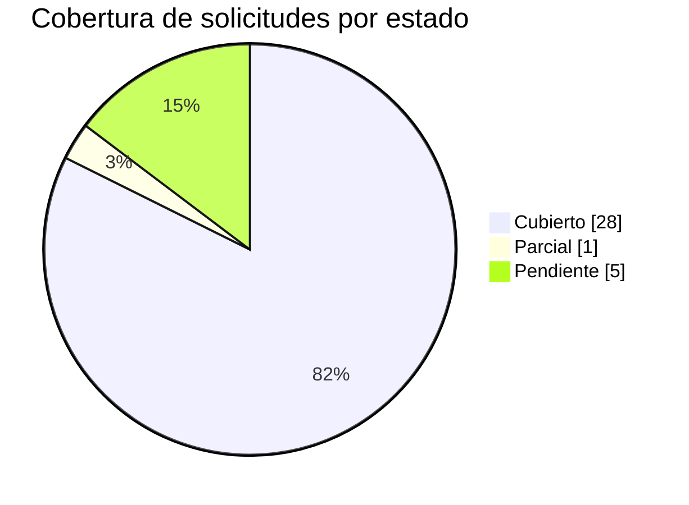

# Anexo A - Trazabilidad de requisitos del cliente

> Anexo del **informe tecnico** que responde **punto a punto** cada solicitud del cliente presente en el corpus, con **cita al documento fuente**. Es documentacion **generada de forma determinista** por el motor (`advisory-system/phases/requirements_traceability.py`) y es **dinamica**: las solicitudes se **extraen del corpus** (no estan hardcodeadas para ningun cliente), de modo que si cambian los documentos de contexto el anexo se **regenera** con las solicitudes de ese nuevo cliente. Gobernado por el skill `requirements-traceability`.

Se derivaron **34 solicitudes** sobre un corpus de **18** documentos: **28 Cubierto**, **1 Parcial**, **5 Pendiente**.

> **Etiquetas epistemicas:** **[VERIFIED-FACT]** solicitud derivada de capa de texto util verificada; **[OCR-EXTRACTED]** derivada de texto recuperado via OCR; **[DOC-ASSUMPTION]** supuesto a validar; **[DOC-CONFLICT]** tension entre fuentes; **[EPISTEMIC-VOID]** el corpus no permite derivar/responder (OCR pendiente). No se fabrica cobertura.

> **Regenerar (parte de `--phase all`):**
>
> ```bash
> python3 advisory-system/quickstart.py --phase all
> ```

## Resumen de cobertura




## 1. Checklist marcable (que desarrollar / que pide el cliente)

Leyenda: `- [x]` Cubierto - `- [~]` Parcial - `- [ ]` Pendiente.

- [x] **REQ-001** (Cubierto) A LC ANCE La propue st a presen t ad a po r el ofe r en te de be con t empl ar el cumpl imie nto a cab al i da d de l os r eq ue rimi en tos sol i ci t ad os po r LA EMPRESA pa ra PROYECTO CREDI10 2.0 1. 4 VISI TA AL LU... _[fuente: RFP_CREDI10_2_0.pdf - Alcance]_ [VERIFIED-FACT]
- [x] **REQ-002** (Cubierto) Ob jetivo g ene r al Real iz ar el di ag nó s ti co , diseñ oy tra ns formac i ón progr es ivade la arqui t ec tura t ec no l ógicade Cr ed i 10 ha cia un aarq ui t ec tura ob j et ivo Cr ed i 10 2 .0, qu e pe rmi ta di... _[fuente: RFP_CREDI10_2_0.pdf - Objetivo general]_ [VERIFIED-FACT]
- [x] **REQ-003** (Cubierto) arq ui t ec tura ob j et ivo Cr ed i 10 2 .0, qu e pe rmi ta di s po ne r deu na pl at afo rmar ob us ta, es c al a bl e, s eg ura, ma nt en i bl e, o bs erv ab ley s os ten i bl et ec n ol ógic am en te, al i ne ad a c... _[fuente: RFP_CREDI10_2_0.pdf - Arquitectura objetivo]_ [VERIFIED-FACT]
- [x] **REQ-004** (Cubierto) Ob jetivos e specífi cos Real iz ar el l ev an t am i en toe i nv en tari ode tal la do del os c om po n en t es te c no l ó gi c os ac tua l es . Ev al u ar laarq ui t ec tura ac tu al d es de l as p ers pe c ti v as de... _[fuente: RFP_CREDI10_2_0.pdf - Objetivos especificos]_ [VERIFIED-FACT]
- [x] **REQ-005** (Cubierto) Alca nce del pro ye cto El al c an cec om pr en deel di ag nó sticoi nte gral , di se ño dear qu i tec tur a ob j eti vo, de finici ó nd el ro ad ma py ej ec uc i ón de l as i ni ci ati v as de tr an s formac i ón t ec n... _[fuente: RFP_CREDI10_2_0.pdf - Alcance del proyecto]_ [VERIFIED-FACT]
- [x] **REQ-006** (Cubierto) Asse ss m ent de arqu it ec turaa ctu al El prov ee d or de be r á re al iz ar un ass es s me nt de: A pl ic ac i on es . S erv ici os Wi nd o ws . AP Is . Int eg ra do r es . B as es de da t os . Comp on e nte s depr oc... _[fuente: RFP_CREDI10_2_0.pdf - Assessment de arquitectura actual]_ [VERIFIED-FACT]
- [x] **REQ-007** (Cubierto) E va lu ac ión te cno lóg ica P ara ca da co mp o ne nt ese de be r á eval ua r co mo míni mo l os sig ui e nte s i tem s : Le ng ua jedepro gram ac i ó n. Fr am ework y v ers i ón . Li brer í as y de p en d en ci as . E... _[fuente: RFP_CREDI10_2_0.pdf - Evaluacion tecnologica]_ [VERIFIED-FACT]
- [x] **REQ-008** (Cubierto) E va lu ac ión de bas es de d ato s Sed eb er á eval ua r la arqu it ec tura y es tad odel as ba ses de da tos as oc i ad as a Cr e di 10, i nc l uy en do : Mo tor y v ers i ó n. Mo de lo de da t os . V ol um en y cr ec... _[fuente: RFP_CREDI10_2_0.pdf - Evaluacion de bases de datos]_ [VERIFIED-FACT]
- [x] **REQ-009** (Cubierto) E va lu ac ión de int egra cio n es Sed eb er án i de nti fic ar y ev al u ar l as i nt eg r ac i on es c on sis tem as i nte rn os , ex ternos y prov ee do r es , incl uy en do, e ntre o tr os y do c um en tar l as de p... _[fuente: RFP_CREDI10_2_0.pdf - Evaluacion de integraciones]_ [VERIFIED-FACT]
- [x] **REQ-010** (Cubierto) Ind ica dores de r eto rno # Ind ica dor Porc ent aje Act u al Porc ent aje es p er ado 1 Di s po nibilid ad dea pl ic ac io ne s y s erv ici os cr íti c os 90% 99 % 2 O pti miz ac i ó n y ef icie nc ia de r ec urs os te... _[fuente: RFP_CREDI10_2_0.pdf - Indicadores de retorno]_ [VERIFIED-FACT]
- [x] **REQ-011** (Cubierto) R eq ue ri mi en t os f un cio na l es : Co n ce pto Desc r ipció n Requ er im ient os fun cion ale s y del pro ce so La tr an s for ma ci ón tec n ol ó gi ca d eb erá pres erv ar l as fun cio na lid ad es y r eg l as de... _[fuente: RFP_CREDI10_2_0.pdf - Requerimientos funcionales]_ [VERIFIED-FACT]
- [x] **REQ-012** (Cubierto) Requ er im ient os de la op er ac ión El as s es me nt y la arqu i tec t ura ob j et ivod eb er án c on te mp l ar c om o míni mo l os si gu i en t es as pe c tos : Altadis po nibili da ddel os c om po ne nte s cr íti c... _[fuente: RFP_CREDI10_2_0.pdf - Requerimientos de la operacion]_ [VERIFIED-FACT]
- [x] **REQ-013** (Cubierto) Inf or mes r equ er ido s El prov ee d or de be r á en tr eg ar c om o míni mo : 1. Asse ss men t Inv en tar iot ec no l ógico. Inv en tar iodea pl ic ac io ne s y s erv ici os . Inv en tar iode AP Is . Inv en tar iodeb... _[fuente: RFP_CREDI10_2_0.pdf - Informes requeridos]_ [VERIFIED-FACT]
- [x] **REQ-014** (Cubierto) R eq ue ri mi en t os t écnic os : ( Dili ge nc i ad os po r TI) Co n ce pto Desc r ipció n Arqu it ec tura de laso luc ión La arq ui t ec tura o bj eti vo de be r á es tar orie nta da a pri nc i pi os de : Ac op l am i... _[fuente: RFP_CREDI10_2_0.pdf - Requerimientos tecnicos]_ [VERIFIED-FACT]
- [x] **REQ-015** (Cubierto) Mé todos de int eg r ac ión El prov ee d or de be r á ev al u ar l os m ec an is mo s dei nte gr ac i ón ac tua l es y de finir l os mé to d os r ec om en da d os pa ra la ar qu i tec t ura Cr ed i 10 2 .0. P od r á nc o... _[fuente: RFP_CREDI10_2_0.pdf - Metodos de integracion]_ [VERIFIED-FACT]
- [x] **REQ-016** (Cubierto) EV AL UA CIÓN DE LA S P ROP UES T AS La s ofe rt as serán eva l ua da s con ba se en l os si gu i en t es crit erio s y cal ifi caci on es, pa ra ob t en er un pu ntaj e m á xi mo de 10 0 pu ntos . A sp ec to a eva l ua... _[fuente: RFP_CREDI10_2_0.pdf - Evaluacion de las propuestas]_ [VERIFIED-FACT]
- [x] **REQ-017** (Cubierto) corre sobre .NET Framework 4.8 en IIS 10; integradores en .NET y Windows Services en .NET Core 8 y .NET 4.8. Bases de datos SQL Server 2019 Enterprise: C10_Credi10NET, C10_Inspektor, C10_Datacredito y C10_Database. El mo... _[fuente: Arquitectura_Aplicacion_Despliegue_Credi10.png - Numeral 10]_ [VERIFIED-FACT]
- [~] **REQ-018** (Parcial) VPC 'STUDIO F' con WAF -> ALB -> instancias EC2 privadas, almacenamiento S3, monitoreo CloudWatch, NAT Gateway y Bastion host. Conectividad hibrida mediante VPN IPSec de Telmex hacia el centro de datos on-prem 'Cokioto'. _[fuente: Arquitectura_Infraestructura_AWS_Credi10.png - Numeral 2]_ [VERIFIED-FACT]
- [x] **REQ-019** (Cubierto) de Credi10. Aplicacion web central CREDI10 en .NET integrada con UNOEE/Siesa (ERP), PENTAHO (BI/ETL), CROSSCORE -> INSPEKTOR -> DICTUM/Datacredito (originacion y riesgo), Numrot, Cobranza, B2C, Link de Recaudo -> PayU, V... _[fuente: Diagrama_Contexto_Credi10.png - Numeral 4]_ [VERIFIED-FACT]
- [ ] **REQ-020** (Pendiente) Assessment de Arquitectura Fecha : Mayo , 2026 Ind ex 1. Ob je tivo del Documen to ................................ ................................ ................................ ............ 3 2. Conte xto de Ne g óc... _[fuente: WSO2 y Studio F - Assessment Mayo2026-Final.pdf - Assessment de arquitectura actual]_ [EPISTEMIC-VOID]
- [ ] **REQ-021** (Pendiente) 2 Ve rs i ó n :001 Fe cha : 08 / 06 /2021 es-AR FOR MA TO DE DESARRO LL O E INTEGRACIONES API Int eg rado r At en ci ó n Al Cli en te STF GROUP S . A . IN FORM A TICA Py . es-MX CREDI 10 SOF TWA RE PROPIO Ca li , vier ne... _[fuente: Api Integrador Atencion al cliente.pdf - Numeral 00]_ [EPISTEMIC-VOID]
- [ ] **REQ-022** (Pendiente) 2 Ve rs i ó n :001 Fe cha : 08 / 06 /2021 es-AR FOR MA TO DE DESARRO LL O E INTEGRACIONES FT - SL - 011 - APIs P ort al cl i en t es B 2C STF GROUP S . A . IN FORM A TICA Py . es-MX CREDI 10 SOF TWA RE PROPIO C ali , j u... _[fuente: B2C.pdf - Numeral 00]_ [EPISTEMIC-VOID]
- [x] **REQ-023** (Cubierto) 2 Ve rs i ó n :001 Fe cha : 08 / 06 /2021 es-AR FOR MA TO DE DESARRO LL O E INTEGRACIONES FT - SL - 011 - APIs B otón Ec om merce C re di10 STF GROUP S . A . IN FORM A TICA Py . es-MX CREDI 10 SOF TWA RE PROPIO C ali , j... _[fuente: BotonEcommerce.pdf - Numeral 00]_ [VERIFIED-FACT]
- [x] **REQ-024** (Cubierto) 2 Ve rs i ó n :001 Fecha : 08 / 06 /2021 es-AR FO RMA TO DE DESARRO LLO E INTEGRACIONES CAPTURA FO TO STF GROUP S . A . IN FO RMA TICA Py . CREDI 10 SOF TWA RE PROPIO C ali , l une s , 29 de ene ro de 202 4 {{{åååÿÿÿÿÿÿÿ... _[fuente: Captura Foto.pdf - Numeral 00]_ [VERIFIED-FACT]
- [x] **REQ-025** (Cubierto) SOF TWA RE PROPIO C ali , vie rnes 28 de no vi embre de l 20 25 DET AL LE TE CN ICO 1 .1 Des c rip ción de l Re quer imi e nt o: Un se rvi cio que gener é y en vié recib os conso li dados RC L (Re cibo s de ca ja pa yu )... _[fuente: Envio de RCL y RCR.pdf - Numeral 10]_ [VERIFIED-FACT]
- [x] **REQ-026** (Cubierto) obj et i vos espec í fi cos . es-MX es-MX es-MX 1. es-CL R eal i zar cal cul oa la f ech a de l os di f er en t es m on t os pen di entes a paga r es-MX . es-MX 2. R egi st r ar pag os, gen er a ndo un co m pr oba nte .... _[fuente: GenerarPagos.pdf - Objetivos especificos]_ [VERIFIED-FACT]
- [x] **REQ-027** (Cubierto) ob je tivo general es va lida r que el u su ar io que e st á in te ntando in gresar a una vist a ha ya in icia do se sió n an te r io rmen te y si tie ne lo s perm is os necesar io s para perm itir ve r la vist a y de vo... _[fuente: GenerarPagos.pdf - Objetivo general]_ [VERIFIED-FACT]
- [x] **REQ-028** (Cubierto) 2 Ve rs i ó n :001 Fe cha : 08 / 06 /2021 es-AR FOR MA TO DE DESARRO LL O E INTEGRACIONES FT - SL - 011 - APIs Link de recau do s C redi 10 STF GROUP S . A . IN FORM A TICA Py . es-MX CREDI 10 SOF TWA RE PROPIO C ali , j... _[fuente: LinkDePagos.pdf - Numeral 00]_ [VERIFIED-FACT]
- [x] **REQ-029** (Cubierto) 0 S OF TW AR E P ROP IO Cal i, ma rtes 6 de e ne ro de l 2026 I NT RODU CC IO N La integ r ac ión de Llam ada Predic tiv a es un W or ke r S ervic e des ar r olla do en . NET 8 qu e func iona c om o s ervic io de Wind ow... _[fuente: Llamada predictiva.pdf - Numeral 1]_ [VERIFIED-FACT]
- [x] **REQ-030** (Cubierto) 1 Ve rs i ó n :001 Fe cha : 08/ 11 /2023 es-AR FOR MA TO DE DESARRO LL O E INTEGRACIONES API DA TA CREDI TO es-MX STF GROUP S . A . es-MX IN FORM A TICA Py . CREDI 10 SOF TWA RE PROPIO es-MX es-MX es-MX es-MX es-MX es-MX... _[fuente: Originacion_API_Datacredito.pdf - Numeral 00]_ [VERIFIED-FACT]
- [ ] **REQ-031** (Pendiente) 1 Ve rs i ó n :001 Fe cha : 08/ 11 /2023 es-AR FOR MA TO DE DESARRO LL O E INTEGRACIONES API IN SPEK TOR STF GROUP S . A . IN FORM A TICA Py . CREDI 10 SOF TWA RE PROPIO es-MX es-MX es-MX es-MX es-MX es-MX es-MX es-MX es... _[fuente: Originacion_API_Inspektor.pdf - Numeral 00]_ [EPISTEMIC-VOID]
- [x] **REQ-032** (Cubierto) 2 Ve rs i ó n :001 Fecha : 08 / 06 /2021 es-AR FO RMA TO DE DESARRO LLO E INTEGRACIONES Ori ginac i on Apli ca ci ón Ad mi n STF GROUP S . A . IN FO RMA TICA Py . CREDI 10 SOF TWA RE PROPIO C ali , Vier nes , 17 de no vi... _[fuente: Originacion_Aplicacion_ADMIN.pdf - Numeral 00]_ [VERIFIED-FACT]
- [x] **REQ-033** (Cubierto) 2 Versión:001 Fecha: 08/06/2021 es-AR FORM ATO DE DESARRO LL O E INTEGRACIONES ORIGINACION CROSSCORE STFGROUP S . A . IN FORM ATICA Py . CREDI10 SO FT WARE PROPIO Cali , vie rne s , 16 de fe bre ro de 2024 ... _[fuente: Originacion_CrossCore.pdf - Numeral 00]_ [VERIFIED-FACT]
- [ ] **REQ-034** (Pendiente) 2 Ve rs i ó n :001 Fe cha : 08 / 06 /2021 es-AR FOR MA TO DE DESARRO LL O E INTEGRACIONES FT - SL - 004 - M ód ulo _C ar t era STF GROUP S . A . IN FORM A TICA Py . es-MX CREDI 10 SOF TWA RE PROPIO C ali , l un es 12 de... _[fuente: ProcesoCorteCartera.pdf - Numeral 00]_ [EPISTEMIC-VOID]

## 2. Tabla de trazabilidad punto a punto

| ID | Solicitud del cliente | Cita al documento fuente | Donde se responde (fase/seccion/entregable) | Estado | Evidencia/Nota |
| --- | --- | --- | --- | --- | --- |
| REQ-001 | A LC ANCE La propue st a presen t ad a po r el ofe r en te de be con t empl ar el cumpl imie nto a cab al i da d de l os r eq ue rimi en tos sol i ci t ad os po r LA EMPRESA pa ra PROYECTO CREDI10 2.0 1. 4 VISI TA AL LU... | RFP_CREDI10_2_0.pdf - Alcance | Fase 0 higiene epistemica + Fase 1 AS-IS (00-higiene-epistemica.md, 01-contexto-as-is.md) | Cubierto | [VERIFIED-FACT] Respondida por Fase 0 higiene epistemica + Fase 1 AS-IS (00-higiene-epistemica.md, 01-contexto-as-is.md). |
| REQ-002 | Ob jetivo g ene r al Real iz ar el di ag nó s ti co , diseñ oy tra ns formac i ón progr es ivade la arqui t ec tura t ec no l ógicade Cr ed i 10 ha cia un aarq ui t ec tura ob j et ivo Cr ed i 10 2 .0, qu e pe rmi ta di... | RFP_CREDI10_2_0.pdf - Objetivo general | Fase 1 contexto-negocio + Fase 6 caso de negocio (01-contexto-as-is.md, 06-caso-de-negocio.md) | Cubierto | [VERIFIED-FACT] Respondida por Fase 1 contexto-negocio + Fase 6 caso de negocio (01-contexto-as-is.md, 06-caso-de-negocio.md). |
| REQ-003 | arq ui t ec tura ob j et ivo Cr ed i 10 2 .0, qu e pe rmi ta di s po ne r deu na pl at afo rmar ob us ta, es c al a bl e, s eg ura, ma nt en i bl e, o bs erv ab ley s os ten i bl et ec n ol ógic am en te, al i ne ad a c... | RFP_CREDI10_2_0.pdf - Arquitectura objetivo | Fase 4 diseno TO-BE: C4 + ADRs (04-diseno-to-be.md, to-be/) | Cubierto | [VERIFIED-FACT] Respondida por Fase 4 diseno TO-BE: C4 + ADRs (04-diseno-to-be.md, to-be/). |
| REQ-004 | Ob jetivos e specífi cos Real iz ar el l ev an t am i en toe i nv en tari ode tal la do del os c om po n en t es te c no l ó gi c os ac tua l es . Ev al u ar laarq ui t ec tura ac tu al d es de l as p ers pe c ti v as de... | RFP_CREDI10_2_0.pdf - Objetivos especificos | Fase 1 contexto-negocio + Fase 6 caso de negocio (01-contexto-as-is.md, 06-caso-de-negocio.md) | Cubierto | [VERIFIED-FACT] Respondida por Fase 1 contexto-negocio + Fase 6 caso de negocio (01-contexto-as-is.md, 06-caso-de-negocio.md). |
| REQ-005 | Alca nce del pro ye cto El al c an cec om pr en deel di ag nó sticoi nte gral , di se ño dear qu i tec tur a ob j eti vo, de finici ó nd el ro ad ma py ej ec uc i ón de l as i ni ci ati v as de tr an s formac i ón t ec n... | RFP_CREDI10_2_0.pdf - Alcance del proyecto | Fase 0 higiene epistemica + Fase 1 AS-IS (00-higiene-epistemica.md, 01-contexto-as-is.md) | Cubierto | [VERIFIED-FACT] Respondida por Fase 0 higiene epistemica + Fase 1 AS-IS (00-higiene-epistemica.md, 01-contexto-as-is.md). |
| REQ-006 | Asse ss m ent de arqu it ec turaa ctu al El prov ee d or de be r á re al iz ar un ass es s me nt de: A pl ic ac i on es . S erv ici os Wi nd o ws . AP Is . Int eg ra do r es . B as es de da t os . Comp on e nte s depr oc... | RFP_CREDI10_2_0.pdf - Assessment de arquitectura actual | Fase 0 higiene epistemica + Fase 1 AS-IS (00-higiene-epistemica.md, 01-contexto-as-is.md) | Cubierto | [VERIFIED-FACT] Respondida por Fase 0 higiene epistemica + Fase 1 AS-IS (00-higiene-epistemica.md, 01-contexto-as-is.md). |
| REQ-007 | E va lu ac ión te cno lóg ica P ara ca da co mp o ne nt ese de be r á eval ua r co mo míni mo l os sig ui e nte s i tem s : Le ng ua jedepro gram ac i ó n. Fr am ework y v ers i ón . Li brer í as y de p en d en ci as . E... | RFP_CREDI10_2_0.pdf - Evaluacion tecnologica | Fase 1 deuda tecnica + Fase 2 estado del arte (01-contexto-as-is.md, 02-estado-del-arte.md) | Cubierto | [VERIFIED-FACT] Respondida por Fase 1 deuda tecnica + Fase 2 estado del arte (01-contexto-as-is.md, 02-estado-del-arte.md). |
| REQ-008 | E va lu ac ión de bas es de d ato s Sed eb er á eval ua r la arqu it ec tura y es tad odel as ba ses de da tos as oc i ad as a Cr e di 10, i nc l uy en do : Mo tor y v ers i ó n. Mo de lo de da t os . V ol um en y cr ec... | RFP_CREDI10_2_0.pdf - Evaluacion de bases de datos | Fase 1 ecosistema (datos) + Fase 4 modelo de datos y contratos (01-contexto-as-is.md, 04-diseno-to-be.md) | Cubierto | [VERIFIED-FACT] Respondida por Fase 1 ecosistema (datos) + Fase 4 modelo de datos y contratos (01-contexto-as-is.md, 04-diseno-to-be.md). |
| REQ-009 | E va lu ac ión de int egra cio n es Sed eb er án i de nti fic ar y ev al u ar l as i nt eg r ac i on es c on sis tem as i nte rn os , ex ternos y prov ee do r es , incl uy en do, e ntre o tr os y do c um en tar l as de p... | RFP_CREDI10_2_0.pdf - Evaluacion de integraciones | Fase 1 ecosistema + Fase 4 contratos (OpenAPI/AsyncAPI) (01-contexto-as-is.md, 04-diseno-to-be.md) | Cubierto | [VERIFIED-FACT] Respondida por Fase 1 ecosistema + Fase 4 contratos (OpenAPI/AsyncAPI) (01-contexto-as-is.md, 04-diseno-to-be.md). |
| REQ-010 | Ind ica dores de r eto rno # Ind ica dor Porc ent aje Act u al Porc ent aje es p er ado 1 Di s po nibilid ad dea pl ic ac io ne s y s erv ici os cr íti c os 90% 99 % 2 O pti miz ac i ó n y ef icie nc ia de r ec urs os te... | RFP_CREDI10_2_0.pdf - Indicadores de retorno | Fase 6 value-driver-tree + modelo financiero (06-caso-de-negocio.md) | Cubierto | [VERIFIED-FACT] Respondida por Fase 6 value-driver-tree + modelo financiero (06-caso-de-negocio.md). |
| REQ-011 | R eq ue ri mi en t os f un cio na l es : Co n ce pto Desc r ipció n Requ er im ient os fun cion ale s y del pro ce so La tr an s for ma ci ón tec n ol ó gi ca d eb erá pres erv ar l as fun cio na lid ad es y r eg l as de... | RFP_CREDI10_2_0.pdf - Requerimientos funcionales | Fase 4 catalogo de historias + modelo de datos (04b-catalogo-historias.md, 04-diseno-to-be.md) | Cubierto | [VERIFIED-FACT] Respondida por Fase 4 catalogo de historias + modelo de datos (04b-catalogo-historias.md, 04-diseno-to-be.md). |
| REQ-012 | Requ er im ient os de la op er ac ión El as s es me nt y la arqu i tec t ura ob j et ivod eb er án c on te mp l ar c om o míni mo l os si gu i en t es as pe c tos : Altadis po nibili da ddel os c om po ne nte s cr íti c... | RFP_CREDI10_2_0.pdf - Requerimientos de la operacion | Fase 4 UX y pruebas + Fase 5 RAID (04-diseno-to-be.md, 05-roadmap-estimacion-raid.md) | Cubierto | [VERIFIED-FACT] Respondida por Fase 4 UX y pruebas + Fase 5 RAID (04-diseno-to-be.md, 05-roadmap-estimacion-raid.md). |
| REQ-013 | Inf or mes r equ er ido s El prov ee d or de be r á en tr eg ar c om o míni mo : 1. Asse ss men t Inv en tar iot ec no l ógico. Inv en tar iodea pl ic ac io ne s y s erv ici os . Inv en tar iode AP Is . Inv en tar iodeb... | RFP_CREDI10_2_0.pdf - Informes requeridos | Los 3 informes del engagement + dossier TO-BE (1-propuesta-comercial.md, 2-reporte-gerencial.md, 3-informe-tecnico/, to-be/) | Cubierto | [VERIFIED-FACT] Respondida por Los 3 informes del engagement + dossier TO-BE (1-propuesta-comercial.md, 2-reporte-gerencial.md, 3-informe-tecnico/, to-be/). |
| REQ-014 | R eq ue ri mi en t os t écnic os : ( Dili ge nc i ad os po r TI) Co n ce pto Desc r ipció n Arqu it ec tura de laso luc ión La arq ui t ec tura o bj eti vo de be r á es tar orie nta da a pri nc i pi os de : Ac op l am i... | RFP_CREDI10_2_0.pdf - Requerimientos tecnicos | Fase 4 diseno TO-BE + ADRs (04-diseno-to-be.md, to-be/) | Cubierto | [VERIFIED-FACT] Respondida por Fase 4 diseno TO-BE + ADRs (04-diseno-to-be.md, to-be/). |
| REQ-015 | Mé todos de int eg r ac ión El prov ee d or de be r á ev al u ar l os m ec an is mo s dei nte gr ac i ón ac tua l es y de finir l os mé to d os r ec om en da d os pa ra la ar qu i tec t ura Cr ed i 10 2 .0. P od r á nc o... | RFP_CREDI10_2_0.pdf - Metodos de integracion | Fase 1 ecosistema + Fase 4 contratos (OpenAPI/AsyncAPI) (01-contexto-as-is.md, 04-diseno-to-be.md) | Cubierto | [VERIFIED-FACT] Respondida por Fase 1 ecosistema + Fase 4 contratos (OpenAPI/AsyncAPI) (01-contexto-as-is.md, 04-diseno-to-be.md). |
| REQ-016 | EV AL UA CIÓN DE LA S P ROP UES T AS La s ofe rt as serán eva l ua da s con ba se en l os si gu i en t es crit erio s y cal ifi caci on es, pa ra ob t en er un pu ntaj e m á xi mo de 10 0 pu ntos . A sp ec to a eva l ua... | RFP_CREDI10_2_0.pdf - Evaluacion de las propuestas | Fase 5 roadmap/estimacion + Fase 6 caso de negocio (05-roadmap-estimacion-raid.md, 06-caso-de-negocio.md) | Cubierto | [VERIFIED-FACT] Respondida por Fase 5 roadmap/estimacion + Fase 6 caso de negocio (05-roadmap-estimacion-raid.md, 06-caso-de-negocio.md). |
| REQ-017 | corre sobre .NET Framework 4.8 en IIS 10; integradores en .NET y Windows Services en .NET Core 8 y .NET 4.8. Bases de datos SQL Server 2019 Enterprise: C10_Credi10NET, C10_Inspektor, C10_Datacredito y C10_Database. El mo... | Arquitectura_Aplicacion_Despliegue_Credi10.png - Numeral 10 | Fase 1 ecosistema (datos) + Fase 4 modelo de datos y contratos (01-contexto-as-is.md, 04-diseno-to-be.md) | Cubierto | [VERIFIED-FACT] Respondida por Fase 1 ecosistema (datos) + Fase 4 modelo de datos y contratos (01-contexto-as-is.md, 04-diseno-to-be.md). |
| REQ-018 | VPC 'STUDIO F' con WAF -> ALB -> instancias EC2 privadas, almacenamiento S3, monitoreo CloudWatch, NAT Gateway y Bastion host. Conectividad hibrida mediante VPN IPSec de Telmex hacia el centro de datos on-prem 'Cokioto'. | Arquitectura_Infraestructura_AWS_Credi10.png - Numeral 2 | Fase 1 AS-IS + Fase 4 diseno TO-BE (01-contexto-as-is.md, 04-diseno-to-be.md) | Parcial | [VERIFIED-FACT] Solicitud abordable por el advisory; el mapeo es generico y se afina al cerrar los deltas de elicitacion. |
| REQ-019 | de Credi10. Aplicacion web central CREDI10 en .NET integrada con UNOEE/Siesa (ERP), PENTAHO (BI/ETL), CROSSCORE -> INSPEKTOR -> DICTUM/Datacredito (originacion y riesgo), Numrot, Cobranza, B2C, Link de Recaudo -> PayU, V... | Diagrama_Contexto_Credi10.png - Numeral 4 | Fase 1 ecosistema + Fase 4 contratos (OpenAPI/AsyncAPI) (01-contexto-as-is.md, 04-diseno-to-be.md) | Cubierto | [VERIFIED-FACT] Respondida por Fase 1 ecosistema + Fase 4 contratos (OpenAPI/AsyncAPI) (01-contexto-as-is.md, 04-diseno-to-be.md). |
| REQ-020 | Assessment de Arquitectura Fecha : Mayo , 2026 Ind ex 1. Ob je tivo del Documen to ................................ ................................ ................................ ............ 3 2. Conte xto de Ne g óc... | WSO2 y Studio F - Assessment Mayo2026-Final.pdf - Assessment de arquitectura actual | Fase 0 higiene epistemica + Fase 1 AS-IS (00-higiene-epistemica.md, 01-contexto-as-is.md) | Pendiente | [EPISTEMIC-VOID] El documento fuente no aporta texto util (documento basado en imagen, OCR pendiente en este entorno); la solicitud no puede responderse sin recuperar su contenido. No se fabrica cobertura. |
| REQ-021 | 2 Ve rs i ó n :001 Fe cha : 08 / 06 /2021 es-AR FOR MA TO DE DESARRO LL O E INTEGRACIONES API Int eg rado r At en ci ó n Al Cli en te STF GROUP S . A . IN FORM A TICA Py . es-MX CREDI 10 SOF TWA RE PROPIO Ca li , vier ne... | Api Integrador Atencion al cliente.pdf - Numeral 00 | Fase 1 ecosistema + Fase 4 contratos (OpenAPI/AsyncAPI) (01-contexto-as-is.md, 04-diseno-to-be.md) | Pendiente | [EPISTEMIC-VOID] El documento fuente no aporta texto util (documento basado en imagen, OCR pendiente en este entorno); la solicitud no puede responderse sin recuperar su contenido. No se fabrica cobertura. |
| REQ-022 | 2 Ve rs i ó n :001 Fe cha : 08 / 06 /2021 es-AR FOR MA TO DE DESARRO LL O E INTEGRACIONES FT - SL - 011 - APIs P ort al cl i en t es B 2C STF GROUP S . A . IN FORM A TICA Py . es-MX CREDI 10 SOF TWA RE PROPIO C ali , j u... | B2C.pdf - Numeral 00 | Fase 1 ecosistema + Fase 4 contratos (OpenAPI/AsyncAPI) (01-contexto-as-is.md, 04-diseno-to-be.md) | Pendiente | [EPISTEMIC-VOID] El documento fuente no aporta texto util (documento basado en imagen, OCR pendiente en este entorno); la solicitud no puede responderse sin recuperar su contenido. No se fabrica cobertura. |
| REQ-023 | 2 Ve rs i ó n :001 Fe cha : 08 / 06 /2021 es-AR FOR MA TO DE DESARRO LL O E INTEGRACIONES FT - SL - 011 - APIs B otón Ec om merce C re di10 STF GROUP S . A . IN FORM A TICA Py . es-MX CREDI 10 SOF TWA RE PROPIO C ali , j... | BotonEcommerce.pdf - Numeral 00 | Fase 1 contexto-negocio + Fase 6 caso de negocio (01-contexto-as-is.md, 06-caso-de-negocio.md) | Cubierto | [VERIFIED-FACT] Respondida por Fase 1 contexto-negocio + Fase 6 caso de negocio (01-contexto-as-is.md, 06-caso-de-negocio.md). |
| REQ-024 | 2 Ve rs i ó n :001 Fecha : 08 / 06 /2021 es-AR FO RMA TO DE DESARRO LLO E INTEGRACIONES CAPTURA FO TO STF GROUP S . A . IN FO RMA TICA Py . CREDI 10 SOF TWA RE PROPIO C ali , l une s , 29 de ene ro de 202 4 {{{åååÿÿÿÿÿÿÿ... | Captura Foto.pdf - Numeral 00 | Fase 1 ecosistema + Fase 4 contratos (OpenAPI/AsyncAPI) (01-contexto-as-is.md, 04-diseno-to-be.md) | Cubierto | [VERIFIED-FACT] Respondida por Fase 1 ecosistema + Fase 4 contratos (OpenAPI/AsyncAPI) (01-contexto-as-is.md, 04-diseno-to-be.md). |
| REQ-025 | SOF TWA RE PROPIO C ali , vie rnes 28 de no vi embre de l 20 25 DET AL LE TE CN ICO 1 .1 Des c rip ción de l Re quer imi e nt o: Un se rvi cio que gener é y en vié recib os conso li dados RC L (Re cibo s de ca ja pa yu )... | Envio de RCL y RCR.pdf - Numeral 10 | Fase 1 ecosistema + Fase 4 contratos (OpenAPI/AsyncAPI) (01-contexto-as-is.md, 04-diseno-to-be.md) | Cubierto | [VERIFIED-FACT] Respondida por Fase 1 ecosistema + Fase 4 contratos (OpenAPI/AsyncAPI) (01-contexto-as-is.md, 04-diseno-to-be.md). |
| REQ-026 | obj et i vos espec í fi cos . es-MX es-MX es-MX 1. es-CL R eal i zar cal cul oa la f ech a de l os di f er en t es m on t os pen di entes a paga r es-MX . es-MX 2. R egi st r ar pag os, gen er a ndo un co m pr oba nte .... | GenerarPagos.pdf - Objetivos especificos | Fase 1 contexto-negocio + Fase 6 caso de negocio (01-contexto-as-is.md, 06-caso-de-negocio.md) | Cubierto | [VERIFIED-FACT] Respondida por Fase 1 contexto-negocio + Fase 6 caso de negocio (01-contexto-as-is.md, 06-caso-de-negocio.md). |
| REQ-027 | ob je tivo general es va lida r que el u su ar io que e st á in te ntando in gresar a una vist a ha ya in icia do se sió n an te r io rmen te y si tie ne lo s perm is os necesar io s para perm itir ve r la vist a y de vo... | GenerarPagos.pdf - Objetivo general | Fase 1 contexto-negocio + Fase 6 caso de negocio (01-contexto-as-is.md, 06-caso-de-negocio.md) | Cubierto | [VERIFIED-FACT] Respondida por Fase 1 contexto-negocio + Fase 6 caso de negocio (01-contexto-as-is.md, 06-caso-de-negocio.md). |
| REQ-028 | 2 Ve rs i ó n :001 Fe cha : 08 / 06 /2021 es-AR FOR MA TO DE DESARRO LL O E INTEGRACIONES FT - SL - 011 - APIs Link de recau do s C redi 10 STF GROUP S . A . IN FORM A TICA Py . es-MX CREDI 10 SOF TWA RE PROPIO C ali , j... | LinkDePagos.pdf - Numeral 00 | Fase 1 contexto-negocio + Fase 6 caso de negocio (01-contexto-as-is.md, 06-caso-de-negocio.md) | Cubierto | [VERIFIED-FACT] Respondida por Fase 1 contexto-negocio + Fase 6 caso de negocio (01-contexto-as-is.md, 06-caso-de-negocio.md). |
| REQ-029 | 0 S OF TW AR E P ROP IO Cal i, ma rtes 6 de e ne ro de l 2026 I NT RODU CC IO N La integ r ac ión de Llam ada Predic tiv a es un W or ke r S ervic e des ar r olla do en . NET 8 qu e func iona c om o s ervic io de Wind ow... | Llamada predictiva.pdf - Numeral 1 | Fase 1 ecosistema + Fase 4 contratos (OpenAPI/AsyncAPI) (01-contexto-as-is.md, 04-diseno-to-be.md) | Cubierto | [VERIFIED-FACT] Respondida por Fase 1 ecosistema + Fase 4 contratos (OpenAPI/AsyncAPI) (01-contexto-as-is.md, 04-diseno-to-be.md). |
| REQ-030 | 1 Ve rs i ó n :001 Fe cha : 08/ 11 /2023 es-AR FOR MA TO DE DESARRO LL O E INTEGRACIONES API DA TA CREDI TO es-MX STF GROUP S . A . es-MX IN FORM A TICA Py . CREDI 10 SOF TWA RE PROPIO es-MX es-MX es-MX es-MX es-MX es-MX... | Originacion_API_Datacredito.pdf - Numeral 00 | Fase 1 ecosistema + Fase 4 contratos (OpenAPI/AsyncAPI) (01-contexto-as-is.md, 04-diseno-to-be.md) | Cubierto | [VERIFIED-FACT] Respondida por Fase 1 ecosistema + Fase 4 contratos (OpenAPI/AsyncAPI) (01-contexto-as-is.md, 04-diseno-to-be.md). |
| REQ-031 | 1 Ve rs i ó n :001 Fe cha : 08/ 11 /2023 es-AR FOR MA TO DE DESARRO LL O E INTEGRACIONES API IN SPEK TOR STF GROUP S . A . IN FORM A TICA Py . CREDI 10 SOF TWA RE PROPIO es-MX es-MX es-MX es-MX es-MX es-MX es-MX es-MX es... | Originacion_API_Inspektor.pdf - Numeral 00 | Fase 1 ecosistema + Fase 4 contratos (OpenAPI/AsyncAPI) (01-contexto-as-is.md, 04-diseno-to-be.md) | Pendiente | [EPISTEMIC-VOID] El documento fuente no aporta texto util (documento basado en imagen, OCR pendiente en este entorno); la solicitud no puede responderse sin recuperar su contenido. No se fabrica cobertura. |
| REQ-032 | 2 Ve rs i ó n :001 Fecha : 08 / 06 /2021 es-AR FO RMA TO DE DESARRO LLO E INTEGRACIONES Ori ginac i on Apli ca ci ón Ad mi n STF GROUP S . A . IN FO RMA TICA Py . CREDI 10 SOF TWA RE PROPIO C ali , Vier nes , 17 de no vi... | Originacion_Aplicacion_ADMIN.pdf - Numeral 00 | Fase 1 ecosistema + Fase 4 contratos (OpenAPI/AsyncAPI) (01-contexto-as-is.md, 04-diseno-to-be.md) | Cubierto | [VERIFIED-FACT] Respondida por Fase 1 ecosistema + Fase 4 contratos (OpenAPI/AsyncAPI) (01-contexto-as-is.md, 04-diseno-to-be.md). |
| REQ-033 | 2 Versión:001 Fecha: 08/06/2021 es-AR FORM ATO DE DESARRO LL O E INTEGRACIONES ORIGINACION CROSSCORE STFGROUP S . A . IN FORM ATICA Py . CREDI10 SO FT WARE PROPIO Cali , vie rne s , 16 de fe bre ro de 2024 ... | Originacion_CrossCore.pdf - Numeral 00 | Fase 1 ecosistema + Fase 4 contratos (OpenAPI/AsyncAPI) (01-contexto-as-is.md, 04-diseno-to-be.md) | Cubierto | [VERIFIED-FACT] Respondida por Fase 1 ecosistema + Fase 4 contratos (OpenAPI/AsyncAPI) (01-contexto-as-is.md, 04-diseno-to-be.md). |
| REQ-034 | 2 Ve rs i ó n :001 Fe cha : 08 / 06 /2021 es-AR FOR MA TO DE DESARRO LL O E INTEGRACIONES FT - SL - 004 - M ód ulo _C ar t era STF GROUP S . A . IN FORM A TICA Py . es-MX CREDI 10 SOF TWA RE PROPIO C ali , l un es 12 de... | ProcesoCorteCartera.pdf - Numeral 00 | Fase 1 ecosistema + Fase 4 contratos (OpenAPI/AsyncAPI) (01-contexto-as-is.md, 04-diseno-to-be.md) | Pendiente | [EPISTEMIC-VOID] El documento fuente no aporta texto util (documento basado en imagen, OCR pendiente en este entorno); la solicitud no puede responderse sin recuperar su contenido. No se fabrica cobertura. |

## Metodo de derivacion (determinista y dinamico)

Las solicitudes se extraen priorizando el documento `primary` tipo RFP (heuristica de rol/nombre) y complementando con el resto del corpus. En cada documento se localizan **anclas de seccion** portadoras de requisitos (objetivos, alcance, requisitos, informes requeridos, evaluacion, indicadores de retorno) mediante una normalizacion **sin espacios y sin acentos** robusta a la fragmentacion del PDF escaneado; como respaldo generico se detectan numerales/vinetas. Cada solicitud recibe un **ID estable** `REQ-NNN` en orden de documento, una **cita** a su documento (y seccion cuando es recuperable) y un **Estado** honesto derivado del **texto util real** y el flag epistemico de la Base de Conocimiento: **Pendiente + [EPISTEMIC-VOID]** cuando el documento fuente no tiene texto util (OCR pendiente).

