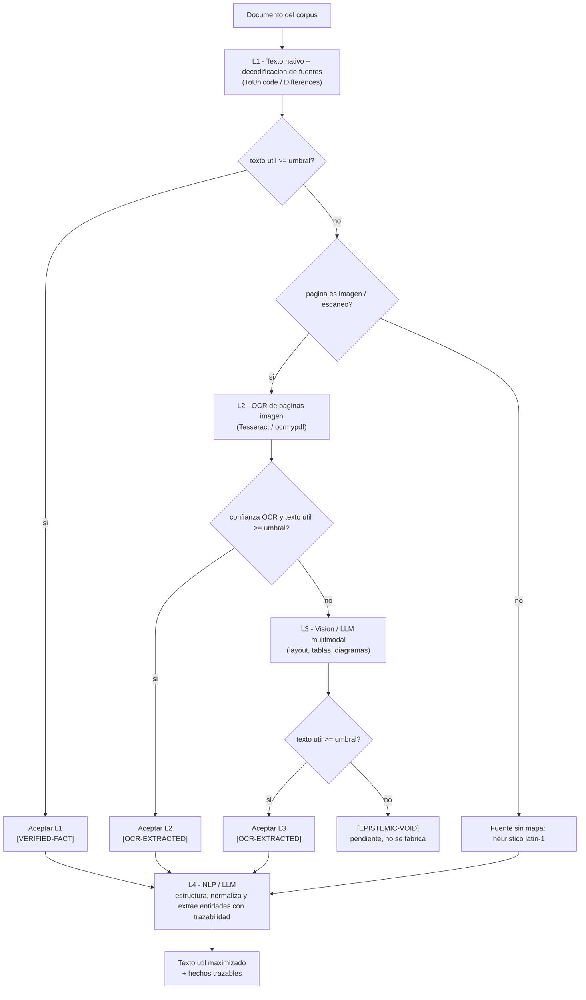

# Anexo B - Arquitectura IA multicapa de extraccion de texto util

> **Anexo del informe tecnico** de Credi10 2.0. Presenta, como **recomendacion de advisory**, la arquitectura de **ingesta documental multicapa (L1-L4)** cuyo objetivo es **maximizar el texto util real** de todo el corpus. Esta gobernado por el skill generico [`document-extraction-architecture`](../../../../.kiro/skills/document-extraction-architecture/SKILL.md) e integra las politicas [`complete-corpus-ingestion`](../../../../.kiro/skills/complete-corpus-ingestion/SKILL.md), [`ocr-image-extraction`](../../../../.kiro/skills/ocr-image-extraction/SKILL.md) y [`token-budget-optimization`](../../../../.kiro/skills/token-budget-optimization/SKILL.md).

> **Etiquetas epistemicas:** **[VERIFIED-FACT]** capa de texto nativa util (incluida la recuperada por decodificacion de fuentes) o transcripcion humana estatica; **[OCR-EXTRACTED]** texto recuperado por OCR o por modelo de vision; **[EPISTEMIC-VOID]** no recuperable en este entorno (no se fabrica); **[DOC-ASSUMPTION]** supuesto a validar; **[DOC-CONFLICT]** tension entre fuentes.

## 1. Por que una arquitectura de extraccion y no un extractor unico

El analisis de cobertura del corpus revelo un patron que suele pasar inadvertido y que, de no corregirse, contamina toda la estimacion: varios PDFs que parecian 'vacios' o 'solo imagen' **si tenian una capa de texto real**, pero codificada con fuentes embebidas de codificacion personalizada (`Type0`/`Identity-H` con un CMap `/ToUnicode` por fuente). Un extractor ingenuo que lee literales `( ... )` sin aplicar el mapeo por fuente devuelve ruido, y ademas tiende a ingerir bytes binarios de imagenes y programas de fuente como si fueran texto, hundiendo artificialmente el ratio de texto util. El diagnostico, por tanto, no era 'faltan documentos' sino 'falta la capa de extraccion correcta para cada tipo de documento'.

De ahi la decision de advisory: en lugar de un unico extractor, se adopta una **arquitectura por capas** que aplica a cada documento la tecnica mas barata y mas fiel capaz de recuperar su contenido, y **escala** a capas mas potentes solo cuando la capa previa no alcanza el umbral de texto util. Es una estrategia de **maximizacion del texto util con degradacion honesta**: lo que una capa no recupera lo intenta la siguiente, y lo que ninguna capa disponible recupera se marca como vacio epistemico en vez de inventarse. Esta disciplina es lo que convierte la ingesta en un cimiento defendible para la estimacion: cada afirmacion del informe queda anclada a texto realmente recuperado y etiquetado segun su procedencia.

## 2. La escalera de capas (estrategia)

La estrategia organiza la extraccion como una escalera de cuatro capas. Cada documento ocupa la capa mas baja que supere el umbral de texto util (`MIN_USEFUL_RATIO_FOR_TEXT`, 3%); solo escala cuando esa capa se queda corta. Preferir la capa mas baja no es una preferencia estetica: la capa L1 es la unica **determinista y sin costo de inferencia**, reproduce el original sin alucinaciones y no depende de servicios externos.

| Capa | Que hace | Tecnologia tipica | Etiqueta | Estado aqui |
| --- | --- | --- | --- | --- |
| **L1** Texto nativo + decodificacion de fuentes | Lee la capa de texto del PDF y decodifica fuentes embebidas de codificacion personalizada (CMap `/ToUnicode`, `/Encoding /Differences`, `Type0`/`Identity-H`). | stdlib (`zlib`+`re`), sin red | `[VERIFIED-FACT]` | **IMPLEMENTADA** |
| **L2** OCR de paginas imagen | Rasteriza y aplica OCR a paginas que son imagen/escaneo sin capa de texto. | Tesseract / ocrmypdf | `[OCR-EXTRACTED]` | Requiere produccion |
| **L3** Vision / LLM multimodal | Interpreta layout complejo, tablas, formularios y diagramas. | Document AI / LLM multimodal | `[OCR-EXTRACTED]` | Requiere produccion |
| **L4** NLP / LLM de post-proceso | Estructura, normaliza y extrae entidades/hechos con trazabilidad, sin inventar lo ausente. | NLP / LLM con citas | hereda la capa origen | Requiere produccion |

La regla de oro de la capa L4 es que **estructura y normaliza lo ya recuperado por L1-L3, sin inventar** datos que el texto no contiene: si una entidad no aparece en el texto extraido, queda como `[EPISTEMIC-VOID]`, no se completa por inferencia del modelo. Esta frontera entre 'normalizar' y 'fabricar' es la que preserva la honestidad epistemica del advisory cuando entran modelos generativos.

## 3. Flujo de decision con fallback (tactica)

La tactica concreta es un flujo de decision que evalua el **texto util real** de cada documento y escala de capa hasta cruzar el umbral o agotar las capas disponibles en el entorno. El flujo es tolerante a fallos (un error en una capa degrada a la siguiente, nunca aborta el pipeline) y determinista (re-ejecutar deja la salida byte-identica).

El diagrama hace explicito el punto de bifurcacion mas importante: cuando L1 no alcanza el umbral, la pregunta no es 'aplicar OCR o no' sino **por que** la capa de texto es insuficiente. Si la pagina es realmente una imagen/escaneo, corresponde L2 (OCR); si hay capa de texto pero la fuente carece de mapa, corresponde el heuristico de respaldo. Distinguir ambos casos evita gastar OCR donde bastaba decodificar una fuente, que es exactamente el error que inflaba el problema en este corpus.

## 4. Tactica por tipo de documento

La capa de entrada se elige segun la naturaleza del documento. Esta tabla es la guia operativa que el motor aplica y que el equipo de produccion debe respetar al activar L2-L4:

| Tipo de documento | Capa recomendada | Fallback | Nota |
| --- | --- | --- | --- |
| PDF con capa de texto nativa limpia | L1 | - | Caso ideal, costo minimo. |
| PDF con fuentes embebidas de codificacion personalizada (`Type0`/`Identity-H`, `/ToUnicode`) | L1 (decodificacion de fuentes) | L2 | El contenido SI existe; hay que decodificarlo, no escanearlo. |
| PDF escaneado / pagina imagen (`DCTDecode`, sin capa de texto) | L2 (OCR) | L3 | Requiere motor OCR en el entorno. |
| PDF con tablas / formularios / layout complejo | L3 (vision/LLM) | L2 | El OCR plano pierde la estructura. |
| Diagrama / plano (PNG/JPG) de arquitectura | Transcripcion humana estatica `[VERIFIED-FACT]` o L3 | L2 | El valor esta en relaciones, no en texto corrido. |
| Documento ofimatico nativo (docx/xlsx/pptx) | L1 (parser del formato) | L4 | Texto ya estructurado; L4 normaliza entidades. |

## 5. Resultado real sobre el corpus Credi10 (antes / despues)

La recomendacion no es teorica: la **capa L1 ya se ejecuto** sobre el corpus real de este engagement y los numeros que siguen se leen directamente de la Base de Conocimiento del run (columna 'ahora') frente a la linea base previa a la decodificacion de fuentes (columna 'antes', constante declarativa `knowledge.USEFUL_TEXT_BASELINE_PCT`). No hay cifras hardcodeadas en este anexo: se mantienen en sincronia con el analisis de cobertura.

| # | Documento | Texto util antes | Texto util ahora | Delta | Banda ahora | Flag |
| --- | --- | ---: | ---: | ---: | --- | --- |
| 1 | WSO2 y Studio F - Assessment Mayo2026-Final.pdf | 1.60% | 74.90% | +73.30 pp | alta | [VERIFIED-FACT] |
| 2 | Api Integrador Atencion al cliente.pdf | 0.70% | 69.65% | +68.95 pp | alta | [VERIFIED-FACT] |
| 3 | Llamada predictiva.pdf | 7.15% | 75.66% | +68.51 pp | alta | [VERIFIED-FACT] |
| 4 | Originacion_API_Inspektor.pdf | 0.99% | 69.31% | +68.32 pp | alta | [VERIFIED-FACT] |
| 5 | RFP_CREDI10_2_0.pdf | 5.92% | 73.05% | +67.13 pp | alta | [VERIFIED-FACT] |
| 6 | Originacion_Aplicacion_ADMIN.pdf | 5.75% | 70.45% | +64.70 pp | alta | [VERIFIED-FACT] |
| 7 | Originacion_API_Datacredito.pdf | 4.35% | 68.80% | +64.45 pp | alta | [VERIFIED-FACT] |
| 8 | LinkDePagos.pdf | 3.43% | 67.29% | +63.86 pp | alta | [VERIFIED-FACT] |
| 9 | Envio de RCL y RCR.pdf | 4.13% | 66.43% | +62.30 pp | alta | [VERIFIED-FACT] |
| 10 | Captura Foto.pdf | 6.48% | 67.02% | +60.54 pp | alta | [VERIFIED-FACT] |
| 11 | GenerarPagos.pdf | 6.86% | 60.56% | +53.70 pp | alta | [VERIFIED-FACT] |
| 12 | ProcesoCorteCartera.pdf | 1.09% | 54.15% | +53.06 pp | alta | [VERIFIED-FACT] |
| 13 | B2C.pdf | 2.55% | 55.54% | +52.99 pp | alta | [VERIFIED-FACT] |
| 14 | Originacion_CrossCore.pdf | 13.37% | 64.94% | +51.57 pp | alta | [VERIFIED-FACT] |
| 15 | BotonEcommerce.pdf | 3.29% | 50.96% | +47.67 pp | alta | [VERIFIED-FACT] |
| 16 | Arquitectura_Aplicacion_Despliegue_Credi10.png | 64.87% | 64.87% | +0.00 pp | alta | [VERIFIED-FACT] |
| 17 | Arquitectura_Infraestructura_AWS_Credi10.png | 70.29% | 70.29% | +0.00 pp | alta | [VERIFIED-FACT] |
| 18 | Diagrama_Contexto_Credi10.png | 70.95% | 70.95% | +0.00 pp | alta | [VERIFIED-FACT] |

### Lectura de los resultados

La decodificacion de fuentes de **L1 recupero texto nativo real** en todo el bloque de PDFs. En particular, el assessment WSO2/Studio F paso de **1.60%** de texto util (banda 'nula', `[EPISTEMIC-VOID]`) a **74.90%** (banda 'alta', `[VERIFIED-FACT]`); y **5 de 5** PDFs que estaban en banda 'nula' con `[EPISTEMIC-VOID]` cruzaron el umbral de texto util (3%) y hoy son texto nativo `[VERIFIED-FACT]`: Api Integrador Atencion al cliente.pdf, B2C.pdf, Originacion_API_Inspektor.pdf, ProcesoCorteCartera.pdf, WSO2 y Studio F - Assessment Mayo2026-Final.pdf. El salto se explica porque su capa de texto SI existia pero usaba fuentes con CMap `/ToUnicode`; el extractor consciente de la fuente (`engine/pdf_text.py`) la decodifica y lee solo dentro de objetos de texto `BT ... ET`, recuperando espanol legible como 'aplicacion', 'arquitectura' o 'integracion'.

Es importante subrayar que esta recuperacion es de **texto nativo**, no de OCR: el documento siempre tuvo el texto, solo estaba mal decodificado. Por eso conserva la etiqueta `[VERIFIED-FACT]` y no `[OCR-EXTRACTED]`. El adaptador OCR del motor sigue degradando honestamente (0 OCR en este entorno), sin fabricar contenido.

## 6. Alcance: lo IMPLEMENTADO aqui (L1) vs. lo que requiere produccion (L2-L4)

> **Marca de alcance explicita.** En este entorno (stdlib-only, sin red, sin motor OCR) **solo la capa L1 esta implementada y en ejecucion**. Las capas L2, L3 y L4 estan **disenadas y listas por contrato**, pero su activacion requiere el **entorno de produccion**.

| Capa | Estado en este entorno | Requiere para activarse |
| --- | --- | --- |
| **L1** texto nativo + decodificacion de fuentes | **IMPLEMENTADA y ejecutada** (`advisory-system/engine/pdf_text.py`, stdlib) | nada |
| **L2** OCR de paginas imagen | **No disponible** (degradacion honesta) | Tesseract / ocrmypdf en el entorno |
| **L3** vision / LLM multimodal | **No disponible** | Document AI / LLM multimodal con red |
| **L4** NLP / LLM de post-proceso | **No disponible** | servicio NLP / LLM con red |

Lo que **L1 NO resuelve** y queda explicitamente para L2-L4 en produccion: las paginas que son imagenes reales (JPEG `DCTDecode` sin capa de texto) siguen necesitando **OCR real (L2)**; el layout complejo, las tablas y los diagramas se interpretan mejor con **vision/LLM (L3)**; y la estructuracion y extraccion de entidades con trazabilidad es trabajo de **L4**. Nada de esto se simula aqui: cuando el mismo corpus se procese en produccion, L2-L4 se activan sin cambiar la estrategia ni las etiquetas epistemicas ya definidas.

## 7. Implicaciones para la estimacion, la estrategia y los riesgos

**Para la estimacion.** Al recuperar como texto nativo los PDFs que antes eran vacios epistemicos, los frentes que dependian de esos documentos (assessment WSO2, procesos de cartera, integraciones de originacion) pasan a estar soportados por evidencia `[VERIFIED-FACT]` y se pueden tallar con mayor confianza, reduciendo la contingencia que antes cargaba la incertidumbre documental.

**Para la estrategia de implementacion.** La arquitectura por capas se implanta de forma incremental: L1 es inmediata y sin costo externo; L2 se habilita cuando el entorno de produccion disponga de motor OCR; L3 y L4 se incorporan cuando se justifique el layout complejo o la extraccion de entidades a escala. La priorizacion por presupuesto de tokens cambia el orden/esfuerzo de las capas, nunca excluye un documento.

**Para los riesgos.** El riesgo dominante es confundir 'documento sin texto util' con 'documento sin informacion': este corpus demostro que el contenido estaba presente y mal decodificado. La arquitectura mitiga ese riesgo obligando a diagnosticar la causa (fuente sin mapa vs. imagen real) antes de escalar de capa, y manteniendo la degradacion honesta para no fabricar lo que no se recupera. `[DOC-ASSUMPTION]` cualquier cifra de L2-L4 queda sujeta a su activacion en produccion.

## 8. Trazabilidad con las politicas de la organizacion

Este anexo materializa, sobre el corpus real de Credi10, la politica generica [`document-extraction-architecture`](../../../../.kiro/skills/document-extraction-architecture/SKILL.md): la capa L1 es su implementacion de referencia; L2 es la tactica de [`ocr-image-extraction`](../../../../.kiro/skills/ocr-image-extraction/SKILL.md); la cobertura total sin muestreo es la obligacion de [`complete-corpus-ingestion`](../../../../.kiro/skills/complete-corpus-ingestion/SKILL.md); y el control de volumen de L4 obedece a [`token-budget-optimization`](../../../../.kiro/skills/token-budget-optimization/SKILL.md). Para volver al indice maestro del informe tecnico ver [`../README.md`](../README.md).

