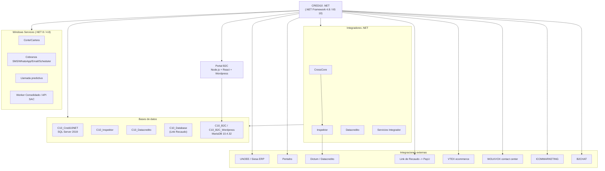

# Grafo de conceptos y modelo mental del ecosistema

> Tema del **informe tecnico multinivel** de Credi10 2.0, dentro de **Fase 0 - Higiene Epistemica**. Vista narrativa que reorganiza y **enriquece** el informe plano de respaldo ([vista compacta de la fase](../../00-higiene-epistemica.md)); aqui el foco es la **interpretacion** de los hallazgos y sus implicaciones para la **estimacion**, la **estrategia de implementacion** y los **riesgos**.

> **Etiquetas epistemicas:** **[VERIFIED-FACT]** evidencia explicita del corpus; **[DOC-ASSUMPTION]** supuesto razonable a validar; **[DOC-CONFLICT]** tension entre fuentes; **[EPISTEMIC-VOID]** sin base documental (no se fabrica evidencia).

> **Hilo Dorado:** la trazabilidad end-to-end encadena Driver (DRV) -> Capability (CAP) -> Benchmark (BMK) -> Gap (GAP) -> Reliever (REL) -> ABB -> SBB -> Ola (WAV) -> ROI/Outcome, de modo que cada decision tecnica de este informe es trazable hasta un indicador de retorno del RFP.

## Que estamos mirando y por que importa

El grafo preliminar de conceptos traduce la evidencia dispersa en un **modelo mental compartido** del ecosistema Credi10: la aplicacion nucleo .NET, sus integradores (CrossCore, Inspektor, Datacredito), los workers, las bases de datos y las integraciones externas. Este mapa es el lenguaje comun que todas las fases siguientes usan para no 'derivar' (zero-drift) hacia interpretaciones divergentes.

Importa para la estimacion porque revela de un vistazo **donde se concentra el acoplamiento**: el nodo ERP Siesa/UnoEE y los integradores de buros son centros de gravedad que atraen esfuerzo e incertidumbre. Verlos temprano permite secuenciar el trabajo para atacar primero esos cuellos de botella.

## Mapa del ecosistema (grafo preliminar)

### Que nos dice el grafo

El grafo evidencia una **arquitectura centrada en un nucleo .NET** del que cuelgan integradores y workers, con el ERP Siesa y los buros como dependencias externas criticas. No hay una capa de integracion gobernada: cada flecha es una integracion punto a punto. Esa topologia es precisamente la que la Fase 3 convertira en gaps y la Fase 4 en building blocks de solucion.

### Centros de gravedad del ecosistema

| Nodo | Rol en el ecosistema | Por que concentra esfuerzo/riesgo |
| --- | --- | --- |
| Nucleo Credi10 .NET | Aplicacion central | Orquesta casi todo; su modernizacion toca muchos flujos |
| ERP Siesa / UnoEE | Sistema de registro | Punto de mayor acoplamiento (WS unico + BD directa) |
| Integradores de buros | CrossCore/Inspektor/Datacredito | Integracion sincrona critica del estudio de credito |
| Bases de datos SQL Server | Persistencia | Dispersion/duplicacion a nivel grupo (consolidacion pendiente) |
## Implicaciones para la estimacion

El grado de acoplamiento visible en el grafo es un **predictor de esfuerzo**: cuantas mas flechas convergen en un nodo (Siesa, buros), mayor el costo de desacoplarlo con seguridad. El modelo mental permite anticipar que MOD-16 (integracion Siesa) sera el modulo mas pesado, algo que la Fase 5 confirma con talla XL.

## Implicaciones para la estrategia de implementacion

La estrategia se ordena alrededor de los centros de gravedad del grafo: primero una capa de integracion gobernada y el desacople de Siesa, luego los dominios que dependen de ella. El grafo justifica por que los enablers van al inicio del roadmap.

## Riesgos e incertidumbre

El riesgo es subestimar el efecto domino de un nodo central: tocar Siesa sin un contrato claro puede propagar fallos a originacion, pagos y cartera. El grafo hace ese riesgo visible y, por tanto, gestionable. [DOC-ASSUMPTION]

