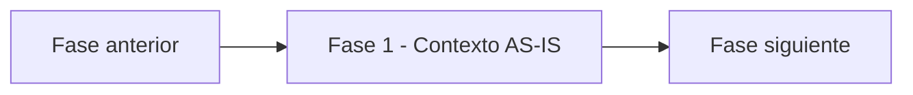

# Fase 1 - Contexto AS-IS - Vista narrativa multinivel

> Nivel 1 del **informe tecnico multinivel** de Credi10 2.0. Esta fase se desagrega en **4 temas** (nivel 2), cada uno con jerarquia interna H1->H2->H3 (nivel 3) y narrativa de analisis sustancial, ademas de las tablas y diagramas reutilizados del motor.

> **Hilo narrativo de la fase.** Con el corpus saneado, retratamos el AS-IS: drivers de negocio, procesos, ecosistema tecnologico y deuda tecnica. Es el terreno real sobre el que estimaremos; conocerlo en detalle convierte la corazonada en estimacion.

> **Etiquetas epistemicas:** **[VERIFIED-FACT]** evidencia explicita del corpus; **[DOC-ASSUMPTION]** supuesto razonable a validar; **[DOC-CONFLICT]** tension entre fuentes; **[EPISTEMIC-VOID]** sin base documental (no se fabrica evidencia).

## Temas de esta fase

| # | Tema | Archivo |
| --- | --- | --- |
| 1 | Contexto de negocio: drivers y capacidades | [`contexto-negocio.md`](contexto-negocio.md) |
| 2 | Procesos de negocio AS-IS (BPMN) y metricas base | [`procesos-bpmn.md`](procesos-bpmn.md) |
| 3 | Ecosistema tecnologico y de datos AS-IS | [`ecosistema-tecnologico.md`](ecosistema-tecnologico.md) |
| 4 | Deuda tecnica y riesgos del AS-IS | [`deuda-tecnica.md`](deuda-tecnica.md) |

## Como se conecta con el resto del informe

Para la **vista compacta** de esta fase (un solo archivo, misma evidencia, gobernada por el gate de calidad) ver [el informe plano de la fase](../../01-contexto-as-is.md). Para volver al indice maestro del informe tecnico, ver [`../README.md`](../README.md).

