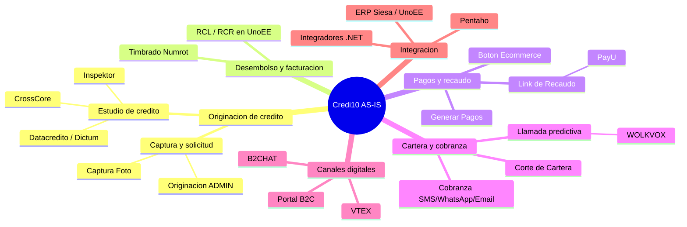
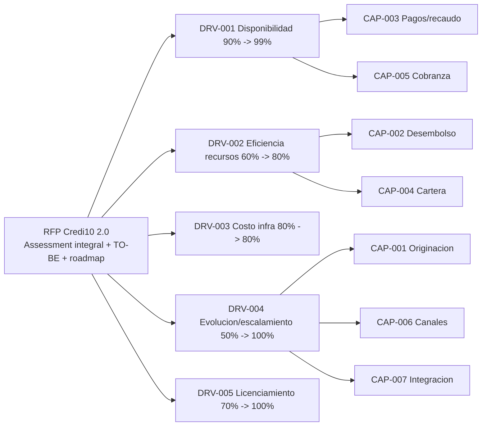

# Contexto de negocio: drivers y capacidades

> Tema del **informe tecnico multinivel** de Credi10 2.0, dentro de **Fase 1 - Contexto AS-IS**. Vista narrativa que reorganiza y **enriquece** el informe plano de respaldo ([vista compacta de la fase](../../01-contexto-as-is.md)); aqui el foco es la **interpretacion** de los hallazgos y sus implicaciones para la **estimacion**, la **estrategia de implementacion** y los **riesgos**.

> **Etiquetas epistemicas:** **[VERIFIED-FACT]** evidencia explicita del corpus; **[DOC-ASSUMPTION]** supuesto razonable a validar; **[DOC-CONFLICT]** tension entre fuentes; **[EPISTEMIC-VOID]** sin base documental (no se fabrica evidencia).

> **Hilo Dorado:** la trazabilidad end-to-end encadena Driver (DRV) -> Capability (CAP) -> Benchmark (BMK) -> Gap (GAP) -> Reliever (REL) -> ABB -> SBB -> Ola (WAV) -> ROI/Outcome, de modo que cada decision tecnica de este informe es trazable hasta un indicador de retorno del RFP.

## Que estamos mirando y por que importa

El contexto de negocio ancla todo el advisory en los **cinco indicadores de retorno del RFP** (disponibilidad 90% -> 99%, eficiencia 60% -> 80%, costo de infraestructura 80% -> 80%, evolucion/escalamiento 50% -> 100% y licenciamiento 70% -> 100%). Estos drivers no son adorno: son los criterios contra los que se juzgara el exito del proyecto y, por tanto, el norte que ordena la priorizacion. Cada capacidad de negocio (originacion, desembolso, pagos, cartera, cobranza, canales, integracion) se cuelga de un driver, de modo que el esfuerzo tecnico siempre responde a un 'para que' de negocio.

Entender esta jerarquia es lo que permite estimar con criterio: no todas las capacidades valen lo mismo, y el valor de negocio de cada una (via su driver) es el numerador del WSJF que la Fase 5 usa para secuenciar las olas.

## Drivers estrategicos (indicadores del RFP)

| Hilo Dorado | Indicador de retorno (RFP) | AS-IS -> TO-BE | Driver estrategico |
| --- | --- | --- | --- |
| DRV-001 | Disponibilidad de apps/servicios criticos | 90% -> 99% | Elevar la disponibilidad de la plataforma Credi10 y sus componentes criticos. |
| DRV-002 | Optimizacion/eficiencia de recursos | 60% -> 80% | Mejorar la eficiencia operativa reduciendo procesos manuales y batch. |
| DRV-003 | Optimizacion de costo de infraestructura | 80% -> 80% | Sostener el costo de infraestructura sin degradar servicio al escalar. |
| DRV-004 | Evolucion tecnologica y escalamiento | 50% -> 100% | Modernizar el stack obsoleto y habilitar escalamiento elastico. |
| DRV-005 | Cumplimiento de licenciamiento | 70% -> 100% | Cerrar brechas de licenciamiento del stack .NET/SQL Server/Wordpress. |

### Interpretacion de los drivers

Dos drivers son de **continuidad** (disponibilidad y eficiencia) y pesan sobre la operacion diaria; dos son de **evolucion** (escalamiento y licenciamiento) y pesan sobre la sostenibilidad; uno es de **disciplina de costo**. La estimacion debe equilibrar ambos mundos: entregar continuidad temprano (para capturar valor rapido) sin hipotecar la evolucion. El indicador de costo 80% -> 80% es revelador: no se pide ahorrar, se pide **no degradar el costo al escalar**, lo que empuja hacia practicas FinOps desde el diseno.

## Mapa de capacidades y arbol de motivadores

| Hilo Dorado | Capacidad L1 | Driver asociado | Descripcion |
| --- | --- | --- | --- |
| CAP-001 | Originacion de credito | DRV-004 | Captura, estudio de credito y aprobacion (CrossCore/Inspektor/Datacredito). |
| CAP-002 | Desembolso y facturacion electronica | DRV-002 | Generacion de RCL/RCR en UnoEE, timbrado con Numrot. |
| CAP-003 | Pagos y recaudo | DRV-001 | Link de Recaudo -> PayU, generacion de pagos, boton ecommerce. |
| CAP-004 | Corte y gestion de cartera | DRV-002 | Proceso de corte de cartera (FT-SL-004) y consolidacion. |
| CAP-005 | Cobranza omnicanal | DRV-001 | Scheduler + SMS/WhatsApp/Email + llamada predictiva (WOLKVOX). |
| CAP-006 | Canales digitales B2C/ecommerce | DRV-004 | Portal B2C (Node.js+React+Wordpress), VTEX, B2CHAT. |
| CAP-007 | Integracion e interoperabilidad | DRV-004 | Integradores .NET e integracion con ERP Siesa/UnoEE y Pentaho. |

## Implicaciones para la estimacion

El valor de negocio por capacidad (heredado del driver) alimenta directamente la priorizacion WSJF de la Fase 5. Capacidades ligadas a disponibilidad (DRV-001) y eficiencia (DRV-002) obtienen mayor Cost of Delay y, por tanto, se estiman y planifican primero.

## Implicaciones para la estrategia de implementacion

La estrategia entrega valor por **capacidad de negocio**, no por componente tecnico aislado: cada ola cierra un arco de capacidad (p. ej. originacion + estudio de credito) para que el negocio perciba resultado, en linea con el principio de continuidad operativa del RFP.

## Riesgos e incertidumbre

El riesgo es optimizar un driver a costa de otro (p. ej. escalar sin control de costo, violando DRV-003). La trazabilidad capacidad -> driver mantiene la tension visible y evita decisiones locales que rompan un indicador global. [DOC-ASSUMPTION]

