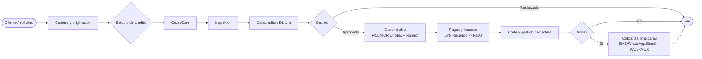

# Procesos de negocio AS-IS (BPMN) y metricas base

> Tema del **informe tecnico multinivel** de Credi10 2.0, dentro de **Fase 1 - Contexto AS-IS**. Vista narrativa que reorganiza y **enriquece** el informe plano de respaldo ([vista compacta de la fase](../../01-contexto-as-is.md)); aqui el foco es la **interpretacion** de los hallazgos y sus implicaciones para la **estimacion**, la **estrategia de implementacion** y los **riesgos**.

> **Etiquetas epistemicas:** **[VERIFIED-FACT]** evidencia explicita del corpus; **[DOC-ASSUMPTION]** supuesto razonable a validar; **[DOC-CONFLICT]** tension entre fuentes; **[EPISTEMIC-VOID]** sin base documental (no se fabrica evidencia).

> **Hilo Dorado:** la trazabilidad end-to-end encadena Driver (DRV) -> Capability (CAP) -> Benchmark (BMK) -> Gap (GAP) -> Reliever (REL) -> ABB -> SBB -> Ola (WAV) -> ROI/Outcome, de modo que cada decision tecnica de este informe es trazable hasta un indicador de retorno del RFP.

## Que estamos mirando y por que importa

El flujo operativo real de Credi10 va de la **originacion** al **estudio de credito** (CrossCore -> Inspektor -> Datacredito/Dictum), luego **desembolso** (RCL/RCR en UnoEE, timbrado Numrot), **pagos/recaudo** (Link de Recaudo -> PayU), **corte de cartera** y **cobranza omnicanal**. Mapear este proceso extremo a extremo es indispensable porque **el proceso es la unidad de valor**: la estimacion y el roadmap se organizan alrededor de tramos de este flujo, no de componentes sueltos.

La narrativa clave es que el proceso esta encadenado: una interrupcion en el estudio de credito paraliza el desembolso y, aguas abajo, el recaudo. Esa dependencia secuencial explica por que la disponibilidad (DRV-001) es tan critica y por que el desacople de las integraciones es el enabler que desbloquea todo.

## Proceso BPMN AS-IS (extremo a extremo)

### Lectura del flujo

El diagrama muestra un proceso lineal con una bifurcacion de decision (aprobado/rechazado) y un ciclo de cobranza. Los puntos de mayor riesgo operativo son las **llamadas sincronas a buros** (si uno cae, se detiene el estudio) y la **escritura a Siesa** en el desembolso. Ambos se convierten en requisitos no funcionales de resiliencia en el TO-BE.

## Metricas baseline AS-IS

| Cadena de valor | Metrica baseline (AS-IS) | Fuente | Driver |
| --- | --- | --- | --- |
| Disponibilidad plataforma | 90% (objetivo RFP 99%) | RFP | DRV-001 |
| Eficiencia de recursos | 60% (objetivo 80%) | RFP | DRV-002 |
| Evolucion/escalamiento | 50% (objetivo 100%) | RFP | DRV-004 |
| Cumplimiento licenciamiento | 70% (objetivo 100%) | RFP | DRV-005 |
| Estudio de credito | Encadenado CrossCore->Inspektor->Dictum (latencia no instrumentada) [EPISTEMIC-VOID] | Diagrama Contexto | CAP-001 |
| Integracion ERP Siesa | Batch por archivos planos + WS unico; errores con intervencion manual | Assessment WSO2 | CAP-007 |

### Que falta medir

Las metricas confirman los objetivos del RFP pero exponen un vacio: la **latencia del estudio de credito no esta instrumentada** [EPISTEMIC-VOID]. No se puede mejorar lo que no se mide, asi que instrumentar observabilidad es un prerrequisito, no un lujo.
## Implicaciones para la estimacion

Estimar por tramos del proceso (originacion, estudio, desembolso, recaudo, cartera, cobranza) da una descomposicion natural que se mapea a los modulos MOD-xx de la Fase 5. La ausencia de metricas de latencia obliga a estimar algunos NFR con [DOC-ASSUMPTION] y contingencia.

## Implicaciones para la estrategia de implementacion

La estrategia respeta el orden del proceso pero inserta primero los enablers transversales (observabilidad, integracion gobernada) para no reconstruir cada tramo sobre bases inestables.

## Riesgos e incertidumbre

El riesgo operativo es la **propagacion de fallos** por el encadenamiento sincrono del proceso. El TO-BE lo mitiga con eventos y resiliencia; mientras tanto, cualquier ola debe preservar la continuidad del flujo (restriccion del RFP).

