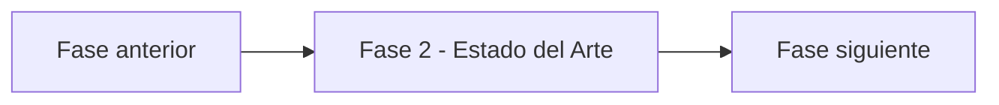

# Fase 2 - Estado del Arte - Vista narrativa multinivel

> Nivel 1 del **informe tecnico multinivel** de Credi10 2.0. Esta fase se desagrega en **2 temas** (nivel 2), cada uno con jerarquia interna H1->H2->H3 (nivel 3) y narrativa de analisis sustancial, ademas de las tablas y diagramas reutilizados del motor.

> **Hilo narrativo de la fase.** Comparamos el AS-IS contra los patrones de industria para medir la brecha con referencias reconocidas. Esto calibra el esfuerzo y evita reinventar soluciones ya probadas.

> **Etiquetas epistemicas:** **[VERIFIED-FACT]** evidencia explicita del corpus; **[DOC-ASSUMPTION]** supuesto razonable a validar; **[DOC-CONFLICT]** tension entre fuentes; **[EPISTEMIC-VOID]** sin base documental (no se fabrica evidencia).

## Temas de esta fase

| # | Tema | Archivo |
| --- | --- | --- |
| 1 | Benchmarks de industria y comparativo AS-IS | [`benchmarks.md`](benchmarks.md) |
| 2 | Radar de tendencias y modelo de referencia sectorial | [`tendencias-y-referencia.md`](tendencias-y-referencia.md) |

## Como se conecta con el resto del informe

Para la **vista compacta** de esta fase (un solo archivo, misma evidencia, gobernada por el gate de calidad) ver [el informe plano de la fase](../../02-estado-del-arte.md). Para volver al indice maestro del informe tecnico, ver [`../README.md`](../README.md).

