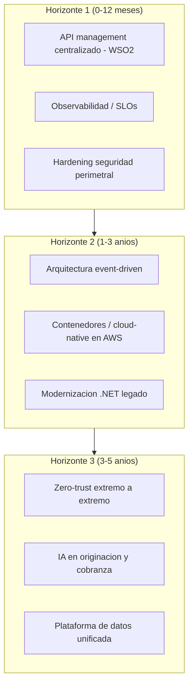
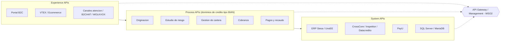

# Radar de tendencias y modelo de referencia sectorial

> Tema del **informe tecnico multinivel** de Credi10 2.0, dentro de **Fase 2 - Estado del Arte**. Vista narrativa que reorganiza y **enriquece** el informe plano de respaldo ([vista compacta de la fase](../../02-estado-del-arte.md)); aqui el foco es la **interpretacion** de los hallazgos y sus implicaciones para la **estimacion**, la **estrategia de implementacion** y los **riesgos**.

> **Etiquetas epistemicas:** **[VERIFIED-FACT]** evidencia explicita del corpus; **[DOC-ASSUMPTION]** supuesto razonable a validar; **[DOC-CONFLICT]** tension entre fuentes; **[EPISTEMIC-VOID]** sin base documental (no se fabrica evidencia).

> **Hilo Dorado:** la trazabilidad end-to-end encadena Driver (DRV) -> Capability (CAP) -> Benchmark (BMK) -> Gap (GAP) -> Reliever (REL) -> ABB -> SBB -> Ola (WAV) -> ROI/Outcome, de modo que cada decision tecnica de este informe es trazable hasta un indicador de retorno del RFP.

## Que estamos mirando y por que importa

El radar de tendencias ordena las apuestas tecnologicas en horizontes (0-12 meses, 1-3 anios, 3-5 anios) y el modelo de referencia (API-led con descomposicion de dominio estilo BIAN) ofrece el **plano objetivo** hacia el que converge el diseño. Para la estimacion, separar lo que se adopta ya de lo que se pilota evita inflar el alcance con tecnologias inmaduras.

El hilo con la fase siguiente es que este modelo de referencia es el molde del que la Fase 4 saca los Solution Building Blocks: Experience / Process / System APIs se vuelven servicios concretos.

## Radar de tendencias por horizonte

## Posicionamiento cualitativo (Hype Cycle)

| Tendencia | Posicion cualitativa (Gartner Hype Cycle) | Adopcion sugerida | Nota |
| --- | --- | --- | --- |
| API management / API-led | Plateau of Productivity | Adoptar ya | [DOC-ASSUMPTION] |
| Event-driven architecture | Slope of Enlightenment | Adoptar 1-3 anios | [DOC-ASSUMPTION] |
| Cloud-native / contenedores | Slope of Enlightenment | Adoptar 1-3 anios | [DOC-ASSUMPTION] |
| Zero-trust | Trough / Slope | Pilotar | [DOC-ASSUMPTION] |
| IA generativa en credito/cobranza | Peak of Inflated Expectations | Experimentar con cautela | [DOC-ASSUMPTION] |

## Modelo de referencia (API-led + BIAN)

| Capa del modelo de referencia | Patron | Aplicacion a Credi10 | Hilo Dorado |
| --- | --- | --- | --- |
| Experience APIs | API-led (experiencia) | B2C, VTEX, B2CHAT, WOLKVOX | CAP-006 |
| Process APIs | Descomposicion de dominio estilo BIAN | Originacion, riesgo, cartera, cobranza, pagos | CAP-001, CAP-004, CAP-005 |
| System APIs | API-led (sistema) | ERP Siesa/UnoEE, buros, PayU, BDs | CAP-007 |
| Gobierno de APIs | API management centralizado | WSO2 API + Integration Platform (rec. 5.2 del assessment) | BMK-001 / DRV-004 |

### Como se usa el modelo de referencia

El modelo separa **Experience APIs** (canales), **Process APIs** (dominios de credito) y **System APIs** (ERP, buros, PayU, datos). Esta separacion por capas es la que permite estimar por dominio y desacoplar la evolucion de los canales de la del core, un principio clave para no bloquear al negocio durante la transformacion.
## Implicaciones para la estimacion

El modelo de referencia da una **taxonomia estable** para descomponer el alcance en capas y dominios, lo que hace la estimacion mas repetible y auditable. Lo que se pilota (IA generativa) se estima como spikes acotados, no como alcance firme.

## Implicaciones para la estrategia de implementacion

La secuencia adopta primero lo maduro (API management, observabilidad), luego event-driven y cloud-native, y deja zero-trust e IA para horizontes posteriores. Asi el esfuerzo se concentra donde el retorno es mas seguro.

## Riesgos e incertidumbre

El riesgo es el 'gold-plating': construir para tendencias que el negocio aun no necesita. El posicionamiento por horizonte y el WSJF de la Fase 5 contienen ese riesgo. [DOC-ASSUMPTION]

