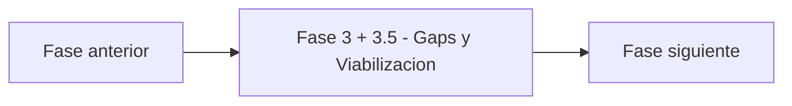

# Fase 3 + 3.5 - Gaps y Viabilizacion - Vista narrativa multinivel

> Nivel 1 del **informe tecnico multinivel** de Credi10 2.0. Esta fase se desagrega en **3 temas** (nivel 2), cada uno con jerarquia interna H1->H2->H3 (nivel 3) y narrativa de analisis sustancial, ademas de las tablas y diagramas reutilizados del motor.

> **Hilo narrativo de la fase.** La brecha se vuelve una lista acotada de gaps estimables, con sus aliviadores, bounded contexts y building blocks. Aqui el diagnostico se transforma en alcance.

> **Etiquetas epistemicas:** **[VERIFIED-FACT]** evidencia explicita del corpus; **[DOC-ASSUMPTION]** supuesto razonable a validar; **[DOC-CONFLICT]** tension entre fuentes; **[EPISTEMIC-VOID]** sin base documental (no se fabrica evidencia).

## Temas de esta fase

| # | Tema | Archivo |
| --- | --- | --- |
| 1 | Matriz de dolores, causas raiz y gap analysis | [`gap-analysis.md`](gap-analysis.md) |
| 2 | Aliviadores, bounded contexts y ABBs | [`viabilizacion.md`](viabilizacion.md) |
| 3 | Reglas de negocio, excepciones y NFR base | [`reglas-y-nfr.md`](reglas-y-nfr.md) |

## Como se conecta con el resto del informe

Para la **vista compacta** de esta fase (un solo archivo, misma evidencia, gobernada por el gate de calidad) ver [el informe plano de la fase](../../03-gaps-y-viabilizacion.md). Para volver al indice maestro del informe tecnico, ver [`../README.md`](../README.md).

