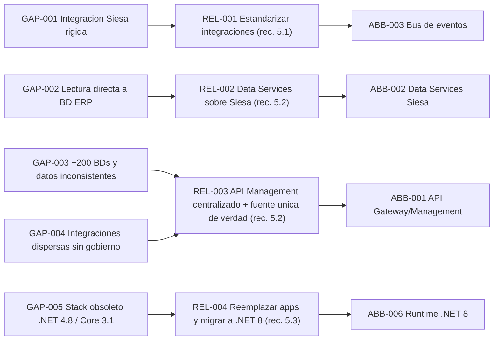
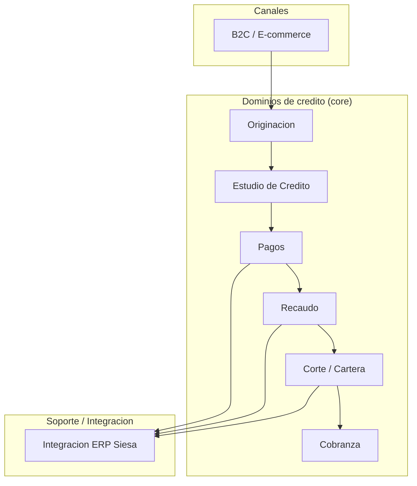

# Aliviadores, bounded contexts y ABBs

> Tema del **informe tecnico multinivel** de Credi10 2.0, dentro de **Fase 3 + 3.5 - Gaps y Viabilizacion**. Vista narrativa que reorganiza y **enriquece** el informe plano de respaldo ([vista compacta de la fase](../../03-gaps-y-viabilizacion.md)); aqui el foco es la **interpretacion** de los hallazgos y sus implicaciones para la **estimacion**, la **estrategia de implementacion** y los **riesgos**.

> **Etiquetas epistemicas:** **[VERIFIED-FACT]** evidencia explicita del corpus; **[DOC-ASSUMPTION]** supuesto razonable a validar; **[DOC-CONFLICT]** tension entre fuentes; **[EPISTEMIC-VOID]** sin base documental (no se fabrica evidencia).

> **Hilo Dorado:** la trazabilidad end-to-end encadena Driver (DRV) -> Capability (CAP) -> Benchmark (BMK) -> Gap (GAP) -> Reliever (REL) -> ABB -> SBB -> Ola (WAV) -> ROI/Outcome, de modo que cada decision tecnica de este informe es trazable hasta un indicador de retorno del RFP.

## Que estamos mirando y por que importa

Los **aliviadores** (REL-001..004) responden a cada gap haciendo eco de las recomendaciones del assessment, y los **bounded contexts** (DDD) junto con los **ABBs** (Architecture Building Blocks) dan la primera forma arquitectonica a la solucion. Este es el puente entre el problema y el diseño: cada reliever apunta a un ABB que la Fase 4 convertira en un SBB concreto.

Para la estimacion, los bounded contexts son oro: delimitan **fronteras de equipo y de esfuerzo**. Un contexto bien acotado se puede asignar a un squad stream-aligned y estimar de forma relativamente independiente, lo que reduce el riesgo de estimaciones acopladas.

## Mapa de aliviadores

| Hilo Dorado | Aliviador | Recomendacion (assessment) | Mitiga | Driver |
| --- | --- | --- | --- | --- |
| REL-001 | Simplificar y estandarizar las integraciones (patrones y contratos unicos) en lugar de archivos planos y un WS monolitico. | Rec. 5.1 del assessment | GAP-001 | DRV-002 |
| REL-002 | Exponer los datos del ERP Siesa como Data Services gobernados en lugar de lectura/escritura directa a la BD del ERP. | Rec. 5.2 del assessment | GAP-002 | DRV-001 |
| REL-003 | Gestionar todas las APIs de forma centralizada con una plataforma de API Management + Integration Platform (WSO2) y una fuente unica de verdad por dominio. | Rec. 5.2 del assessment | GAP-003, GAP-004 | DRV-004 |
| REL-004 | Revisar y reemplazar las aplicaciones candidatas y modernizar el stack legado (.NET Framework 4.8 / .NET Core 3.1 -> .NET 8; retirar Wordpress/XAMPP de produccion). | Rec. 5.3 del assessment | GAP-005 | DRV-005 |

## Bounded contexts y lenguaje ubicuo

| Bounded Context | Componentes reales | 
| --- | --- |
| Originacion | Captura de solicitud, Originacion ADMIN, Captura Foto. |
| Estudio de Credito | CrossCore -> Inspektor -> Datacredito / Dictum. |
| Pagos | GenerarPagos (FT-SL-003), Boton Ecommerce. |
| Recaudo | LinkDePagos (FT-SL-011) -> PayU. |
| Corte / Cartera | ProcesoCorteCartera (FT-SL-004) y consolidacion. |
| Cobranza | Scheduler + SMS/WhatsApp/Email + Llamada predictiva (WOLKVOX). |
| B2C / E-commerce | Portal B2C (Node.js+React+Wordpress), VTEX, BotonEcommerce, B2CHAT. |
| Integracion ERP | Siesa/UnoEE, RCL/RCR, Pentaho, timbrado Numrot. |

| Termino (Lenguaje Ubicuo) | Definicion |
| --- | --- |
| Solicitud | Peticion de credito originada por un cliente en Originacion. |
| Estudio de Credito | Evaluacion de riesgo encadenada CrossCore -> Inspektor -> Datacredito/Dictum que decide aprobacion. |
| RCL / RCR | Documentos de facturacion electronica generados en UnoEE (timbrados con Numrot) tras el desembolso. |
| Link de Recaudo | Enlace de pago (FT-SL-011) que redirige a PayU para recaudo. |
| Corte de Cartera | Proceso periodico (FT-SL-004) que consolida saldos y mora de la cartera. |
| Obligacion | Credito desembolsado sujeto a corte, recaudo y, si aplica, cobranza. |

## Catalogo de ABBs

| Hilo Dorado | ABB (Architecture Building Block) | Reliever origen | Bounded Context |
| --- | --- | --- | --- |
| ABB-001 | API Gateway y plataforma de API Management centralizada | REL-003 | Integracion ERP / transversal |
| ABB-002 | Capa de Data Services sobre el ERP Siesa (reemplaza lectura directa a BD) | REL-002 | Integracion ERP |
| ABB-003 | Bus de eventos / mensajeria para sincronizacion casi en tiempo real | REL-001 | Integracion ERP / Pagos / Recaudo |
| ABB-004 | Servicios de dominio desacoplados (Originacion, Estudio de Credito, Pagos, Recaudo, Cartera, Cobranza) | REL-003 | Multidominio |
| ABB-005 | Plano de observabilidad y trazabilidad de errores (logging, metricas, SLOs) | REL-003 | Transversal |
| ABB-006 | Runtime modernizado .NET 8 contenerizado | REL-004 | Transversal / Despliegue |

### Del ABB al esfuerzo

Los ABBs transversales (API Gateway, Data Services, bus de eventos, observabilidad) son **enablers** que benefician a todos los dominios pero no entregan valor de negocio por si solos. Reconocerlos como enablers es clave para la estimacion: su esfuerzo se amortiza entre varios modulos y su ausencia bloquea el resto, por lo que van primero en el roadmap.
## Implicaciones para la estimacion

La descomposicion por bounded context es la base de la estimacion por modulo de la Fase 5: cada contexto agrupa modulos estimables por separado. Los ABBs enabler se estiman como inversion compartida.

## Implicaciones para la estrategia de implementacion

La estrategia entrega primero los ABBs enabler (integracion, observabilidad) y luego los dominios de negocio, respetando el lenguaje ubicuo para que el equipo y el negocio hablen el mismo idioma y no haya drift semantico.

## Riesgos e incertidumbre

El riesgo es que un enabler se retrase y arrastre a todos sus dependientes. Por eso el reverse briefing a la celula de diseño marca explicitamente las dependencias.

