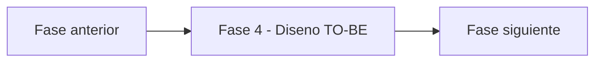

# Fase 4 - Diseno TO-BE - Vista narrativa multinivel

> Nivel 1 del **informe tecnico multinivel** de Credi10 2.0. Esta fase se desagrega en **5 temas** (nivel 2), cada uno con jerarquia interna H1->H2->H3 (nivel 3) y narrativa de analisis sustancial, ademas de las tablas y diagramas reutilizados del motor.

> **Hilo narrativo de la fase.** Diseñamos la solucion: vistas C4, ADRs, modelo de datos, contratos, UX, pruebas y seguridad. Cada building block es un paquete de esfuerzo con stack definido, lo que hace la estimacion contable.

> **Etiquetas epistemicas:** **[VERIFIED-FACT]** evidencia explicita del corpus; **[DOC-ASSUMPTION]** supuesto razonable a validar; **[DOC-CONFLICT]** tension entre fuentes; **[EPISTEMIC-VOID]** sin base documental (no se fabrica evidencia).

## Temas de esta fase

| # | Tema | Archivo |
| --- | --- | --- |
| 1 | Arquitectura TO-BE: vistas C4 y SBBs | [`arquitectura-c4.md`](arquitectura-c4.md) |
| 2 | Decisiones de arquitectura (ADRs) | [`adrs.md`](adrs.md) |
| 3 | Modelo de datos (ERD) y contratos de API/eventos | [`modelo-datos-y-contratos.md`](modelo-datos-y-contratos.md) |
| 4 | Catalogo de oportunidades de IA | [`catalogo-ia.md`](catalogo-ia.md) |
| 5 | UX, BPMN TO-BE, Dry-Run y seguridad | [`ux-y-pruebas.md`](ux-y-pruebas.md) |

## Como se conecta con el resto del informe

Para la **vista compacta** de esta fase (un solo archivo, misma evidencia, gobernada por el gate de calidad) ver [el informe plano de la fase](../../04-diseno-to-be.md). Para volver al indice maestro del informe tecnico, ver [`../README.md`](../README.md).

