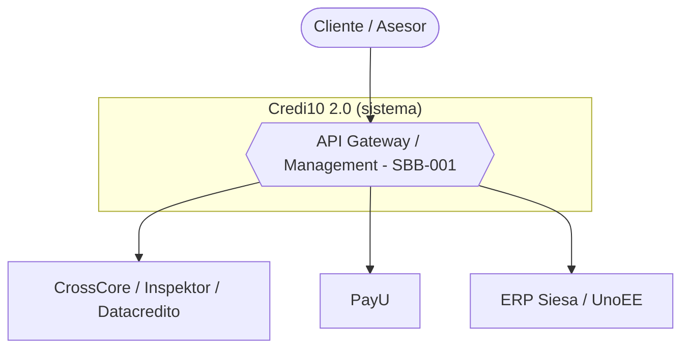
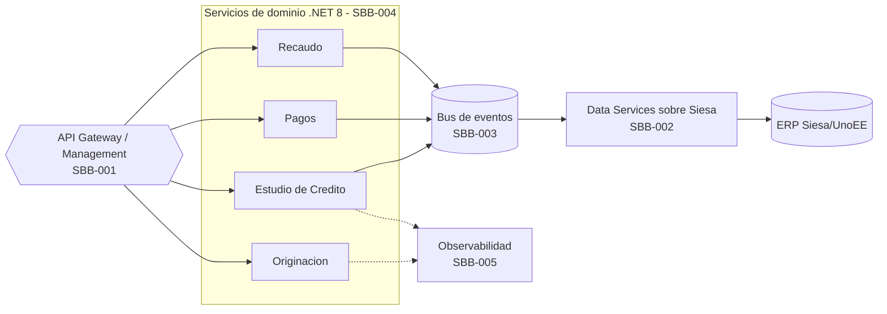
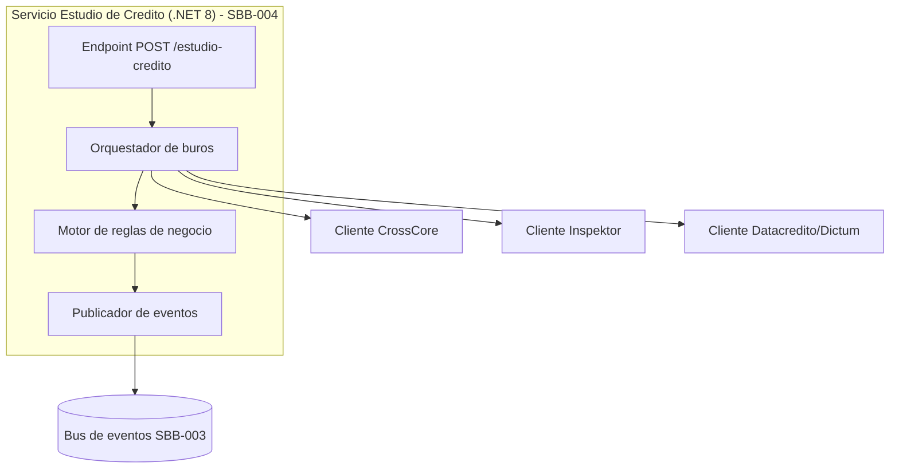

# Arquitectura TO-BE: vistas C4 y SBBs

> Tema del **informe tecnico multinivel** de Credi10 2.0, dentro de **Fase 4 - Diseno TO-BE**. Vista narrativa que reorganiza y **enriquece** el informe plano de respaldo ([vista compacta de la fase](../../04-diseno-to-be.md)); aqui el foco es la **interpretacion** de los hallazgos y sus implicaciones para la **estimacion**, la **estrategia de implementacion** y los **riesgos**.

> **Etiquetas epistemicas:** **[VERIFIED-FACT]** evidencia explicita del corpus; **[DOC-ASSUMPTION]** supuesto razonable a validar; **[DOC-CONFLICT]** tension entre fuentes; **[EPISTEMIC-VOID]** sin base documental (no se fabrica evidencia).

> **Hilo Dorado:** la trazabilidad end-to-end encadena Driver (DRV) -> Capability (CAP) -> Benchmark (BMK) -> Gap (GAP) -> Reliever (REL) -> ABB -> SBB -> Ola (WAV) -> ROI/Outcome, de modo que cada decision tecnica de este informe es trazable hasta un indicador de retorno del RFP.

## Que estamos mirando y por que importa

El diseño TO-BE materializa los ABBs en **Solution Building Blocks** (SBB-001..008) y los organiza en vistas C4 (contexto, contenedores, componentes). Esta es la columna vertebral tecnica del proyecto: una plataforma de API Management (WSO2), Data Services gobernados sobre Siesa, un bus de eventos, servicios de dominio en .NET 8, observabilidad y una estrategia cloud AWS. Cada SBB resuelve uno o varios gaps y habilita uno o varios drivers.

Para la estimacion, el mapeo ABB -> SBB es lo que convierte la arquitectura en trabajo contable: cada SBB es un paquete de esfuerzo con un stack objetivo definido, lo que permite tallar su construccion con criterio en lugar de adivinar.

## Mapeo ABB -> SBB (Hilo Dorado)

| Hilo Dorado | SBB (Solution Building Block) | ABB origen | Stack TO-BE |
| --- | --- | --- | --- |
| SBB-001 | API Gateway + plataforma de API Management (WSO2 API Platform + Integration Platform) | ABB-001 | WSO2 API Manager / Integration |
| SBB-002 | Data Services sobre el ERP Siesa (reemplazan la lectura directa a la BD) | ABB-002 | .NET 8 Data Services + WSO2 Data Services |
| SBB-003 | Bus de eventos / mensajeria para sincronizacion con Siesa | ABB-003 | Broker de eventos (AsyncAPI) |
| SBB-004 | Microservicios de dominio (.NET 8) por bounded context | ABB-004 | .NET 8 contenerizado |
| SBB-005 | Observabilidad y trazabilidad (logging/metricas/SLOs) | ABB-005 | CloudWatch + stack de observabilidad |
| SBB-006 | Migracion de runtime .NET Framework 4.8 / .NET Core 3.1 -> .NET 8 | ABB-006 | .NET 8 / contenedores |
| SBB-007 | Fuente unica de verdad por dominio (consolidar las +200 BDs duplicadas) | ABB-004 | SQL Server consolidado + dominios de datos |
| SBB-008 | Estrategia cloud AWS (VPC, ALB/WAF, escalamiento, contenedores) | ABB-006 | AWS (VPC, ALB, WAF, ECS/EKS) |

## Vistas C4 del TO-BE

### C4 Nivel 1 - Contexto

### C4 Nivel 2 - Contenedores

### C4 Nivel 3 - Componentes (Estudio de Credito)

### Lectura de las vistas

El patron central es un **API Gateway** que media todo el trafico y un **bus de eventos** que desacopla la escritura a Siesa. Esta eleccion arquitectonica es la que hace viable la continuidad operativa: permite desviar trafico del legado al TO-BE de forma incremental, sin un corte big-bang.

## NFR habilitados por los SBBs

| NFR TO-BE | Objetivo | SBB que lo habilita | Driver |
| --- | --- | --- | --- |
| Disponibilidad | 90% -> 99% | SBB-001, SBB-005 | DRV-001 |
| Eficiencia de recursos | 60% -> 80% (latencia base sin instrumentar hoy [EPISTEMIC-VOID]) | SBB-002, SBB-003 | DRV-002 |
| Costo de infraestructura | 80% -> 80% (sin degradar) | SBB-004 | DRV-003 |
| Evolucion/escalamiento | 50% -> 100% | SBB-004, SBB-006 | DRV-004 |
| Licenciamiento | 70% -> 100% | SBB-006 | DRV-005 |
## Implicaciones para la estimacion

Cada SBB es una unidad de estimacion con stack conocido. Los SBB de integracion (001, 002, 003) concentran el mayor esfuerzo y riesgo porque tocan el nucleo del acoplamiento; la Fase 5 los refleja en las tallas L/XL de los modulos asociados.

## Implicaciones para la estrategia de implementacion

La estrategia construye primero los SBB enabler (API Management, Data Services, observabilidad) y luego los servicios de dominio, aplicando Strangler Fig para migrar sin interrumpir. El diseño esta pensado para ser entregado por olas.

## Riesgos e incertidumbre

El riesgo arquitectonico es crear un nuevo cuello de botella en el gateway o el bus. Se mitiga con observabilidad (SBB-005) y rate limiting desde el inicio. [DOC-ASSUMPTION]

