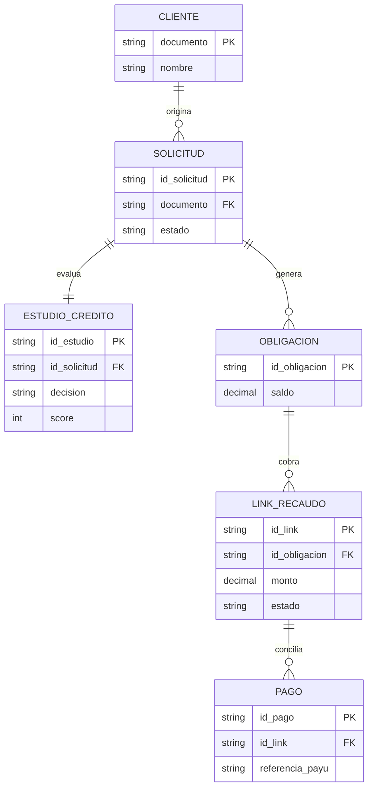
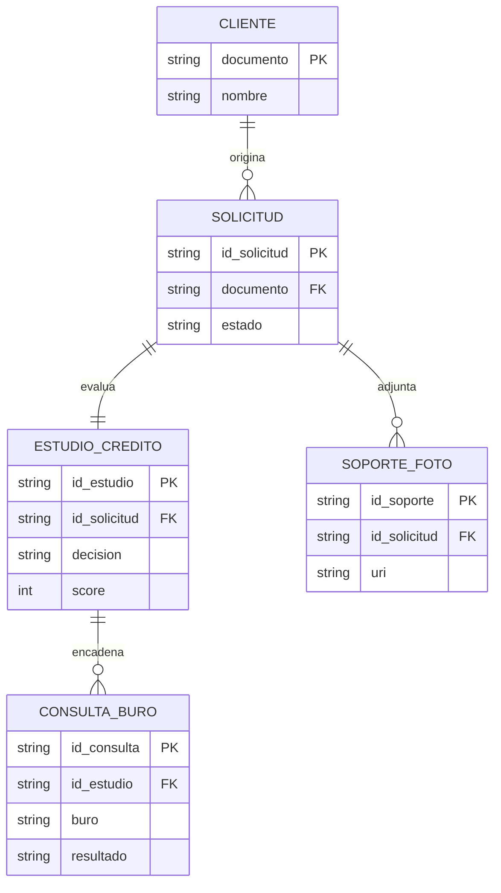
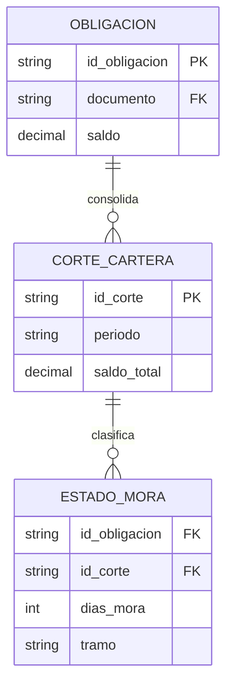
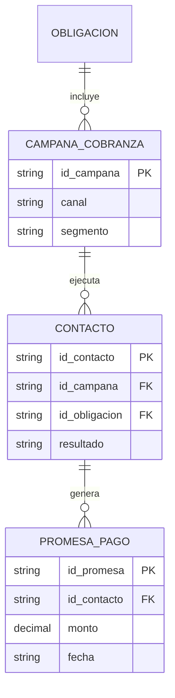

# Modelo de datos (ERD) y contratos de API/eventos

> Tema del **informe tecnico multinivel** de Credi10 2.0, dentro de **Fase 4 - Diseno TO-BE**. Vista narrativa que reorganiza y **enriquece** el informe plano de respaldo ([vista compacta de la fase](../../04-diseno-to-be.md)); aqui el foco es la **interpretacion** de los hallazgos y sus implicaciones para la **estimacion**, la **estrategia de implementacion** y los **riesgos**.

> **Etiquetas epistemicas:** **[VERIFIED-FACT]** evidencia explicita del corpus; **[DOC-ASSUMPTION]** supuesto razonable a validar; **[DOC-CONFLICT]** tension entre fuentes; **[EPISTEMIC-VOID]** sin base documental (no se fabrica evidencia).

> **Hilo Dorado:** la trazabilidad end-to-end encadena Driver (DRV) -> Capability (CAP) -> Benchmark (BMK) -> Gap (GAP) -> Reliever (REL) -> ABB -> SBB -> Ola (WAV) -> ROI/Outcome, de modo que cada decision tecnica de este informe es trazable hasta un indicador de retorno del RFP.

## Que estamos mirando y por que importa

El modelo de datos por bounded context (varios ERD) y los contratos OpenAPI/AsyncAPI son la **spec ejecutable** del TO-BE: definen las entidades, las operaciones sincronas y los eventos asincronos que el equipo construira. Son el nivel de detalle que convierte una estimacion gruesa en una estimacion por contrato, mucho mas precisa.

El hilo narrativo es que los contratos **formalizan el desacople**: exponer Siesa como Data Services con un contrato explicito (y prohibir el acceso directo a su BD) es lo que ejecuta ADR-002 en la practica.

## Modelo de datos por bounded context

### Recaudo / Pagos




### Originacion y Estudio de Credito




### Cartera y Cobranza







## Contratos de API y eventos

| Contrato | Tipo | Integracion | SBB |
| --- | --- | --- | --- |
| POST /estudio-credito | OpenAPI (REST) | CrossCore/Inspektor/Datacredito | SBB-001, SBB-004 |
| GET /siesa/obligaciones/{id} | OpenAPI (REST) | Data Services Siesa/UnoEE | SBB-002 |
| recaudo/pago-aplicado | AsyncAPI (eventos) | PayU -> recaudo | SBB-003 |
| cobranza/contacto-realizado | AsyncAPI (eventos) | Cobranza multicanal | SBB-003 |

### Contrato sincrono (OpenAPI)

```yaml
openapi: 3.0.3
info:
  title: Credi10 2.0 - Estudio de Credito
  version: 1.0.0
paths:
  /estudio-credito:
    post:
      summary: Inicia el estudio de credito (CrossCore -> Inspektor -> Datacredito)
      requestBody:
        required: true
        content:
          application/json:
            schema:
              type: object
              required: [documento, idSolicitud]
              properties:
                documento: { type: string }
                idSolicitud: { type: string }
      responses:
        '200':
          description: Decision del estudio
          content:
            application/json:
              schema:
                type: object
                properties:
                  idEstudio: { type: string }
                  decision: { type: string, enum: [APROBADO, RECHAZADO, REVISION] }
                  score: { type: integer }
        '424':
          description: Buro no disponible (CrossCore/Inspektor/Datacredito)
```


### Data Services sobre Siesa (OpenAPI)

```yaml
openapi: 3.0.3
info:
  title: Credi10 2.0 - Data Services sobre Siesa/UnoEE (SBB-002)
  version: 1.0.0
paths:
  /siesa/obligaciones/{idObligacion}:
    get:
      summary: Lee una obligacion via Data Service gobernado (NO acceso directo a BD)
      parameters:
        - name: idObligacion
          in: path
          required: true
          schema: { type: string }
      responses:
        '200':
          description: Obligacion
          content:
            application/json:
              schema:
                type: object
                properties:
                  idObligacion: { type: string }
                  saldo: { type: number }
        '503':
          description: Data Service de Siesa no disponible (reintentar via eventos)
```


### Eventos (AsyncAPI)

```yaml
asyncapi: 2.6.0
info:
  title: Credi10 2.0 - Eventos de integracion Siesa
  version: 1.0.0
channels:
  recaudo/pago-aplicado:
    subscribe:
      message:
        name: PagoAplicado
        payload:
          type: object
          properties:
            idPago: { type: string }
            idObligacion: { type: string }
            referenciaPayU: { type: string }
            monto: { type: number }
```


## Estrategia de migracion

| Elemento legado | Estrategia de migracion | SBB destino |
| --- | --- | --- |
| WS unico + archivos planos de Siesa | Strangler Fig: desviar por Data Services + eventos de forma incremental | SBB-002, SBB-003 |
| Lectura directa a la BD del ERP Siesa | Prohibir y reemplazar por Data Services; CDC donde aplique | SBB-002 |
| .NET Framework 4.8 / .NET Core 3.1 | Migracion por dominio a .NET 8 contenerizado | SBB-006, SBB-004 |
| Integraciones Windows/cronjobs | Reencaminar por API Gateway + bus de eventos | SBB-001, SBB-003 |
## Implicaciones para la estimacion

Contar entidades, endpoints y eventos da una base cuantitativa para la estimacion funcional (p. ej. puntos funcionales / CFP). Los contratos de integracion con Siesa son los de mayor incertidumbre porque su esquema real es [EPISTEMIC-VOID] en el corpus.

## Implicaciones para la estrategia de implementacion

La migracion sigue Strangler Fig: se desvia por Data Services y eventos de forma incremental, con CDC donde aplique, nunca un corte total. El orden de los contratos a construir sigue el de las olas.

## Riesgos e incertidumbre

El riesgo es que el contrato real de Siesa difiera del esbozado, disparando retrabajo. Por eso obtener la especificacion del WS/Data Services de Siesa es un prerrequisito duro (PRE-001). [EPISTEMIC-VOID]

