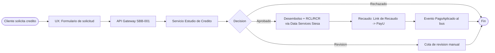

# UX, BPMN TO-BE, Dry-Run y seguridad

> Tema del **informe tecnico multinivel** de Credi10 2.0, dentro de **Fase 4 - Diseno TO-BE**. Vista narrativa que reorganiza y **enriquece** el informe plano de respaldo ([vista compacta de la fase](../../04-diseno-to-be.md)); aqui el foco es la **interpretacion** de los hallazgos y sus implicaciones para la **estimacion**, la **estrategia de implementacion** y los **riesgos**.

> **Etiquetas epistemicas:** **[VERIFIED-FACT]** evidencia explicita del corpus; **[DOC-ASSUMPTION]** supuesto razonable a validar; **[DOC-CONFLICT]** tension entre fuentes; **[EPISTEMIC-VOID]** sin base documental (no se fabrica evidencia).

> **Hilo Dorado:** la trazabilidad end-to-end encadena Driver (DRV) -> Capability (CAP) -> Benchmark (BMK) -> Gap (GAP) -> Reliever (REL) -> ABB -> SBB -> Ola (WAV) -> ROI/Outcome, de modo que cada decision tecnica de este informe es trazable hasta un indicador de retorno del RFP.

## Que estamos mirando y por que importa

La vista de UX (service blueprint), el BPMN TO-BE, el paquete spec-driven (Gherkin), el acta de Dry-Run y la matriz de threat modeling (STRIDE) cierran el diseño asegurando que **la experiencia, el proceso, las reglas, las pruebas y la seguridad estan alineadas** antes de construir. El Dry-Run es la validacion de mesa (tabletop) que recorre la cadena Evento -> UX -> Gherkin -> API -> C4 -> BD -> respuesta.

Para la estimacion, el Dry-Run es un seguro barato: validar la coherencia end-to-end en papel antes de codificar evita retrabajo caro. La seguridad por diseño (STRIDE) tambien se estima aqui en lugar de añadirse al final como un parche.

## BPMN TO-BE




## Service blueprint

| Capa del Service Blueprint | Actividad (flujo estudio -> recaudo) |
| --- | --- |
| Evidencia fisica | Formulario web, confirmacion de aprobacion, link de pago |
| Acciones del cliente | Enviar solicitud, aceptar oferta, pagar en PayU |
| Frontstage (UX) | Pantalla de solicitud, pantalla de decision, pantalla de pago |
| Backstage | Orquestacion de buros, motor de reglas, generacion de RCL/RCR |
| Procesos de soporte | Data Services Siesa, bus de eventos, observabilidad |

## Paquete spec-driven (Gherkin)

### Escenarios ejecutables

```gherkin
# language: es
Caracteristica: Estudio de credito en Credi10 2.0

  Escenario: Aprobacion con buros disponibles (happy path)
    Dado un cliente con documento "CC123" y una solicitud "SOL-1"
    Cuando se invoca POST /estudio-credito con el documento y la solicitud
    Y CrossCore, Inspektor y Datacredito responden correctamente
    Entonces la decision es "APROBADO"
    Y se publica el evento de estudio en el bus

  Escenario: Buro no disponible (caso borde EX-01)
    Dado un cliente con documento "CC124" y una solicitud "SOL-2"
    Cuando se invoca POST /estudio-credito
    Y CrossCore agota el tiempo de espera
    Entonces el servicio responde con estado 424
    Y la solicitud queda encolada sin perderse

  Escenario: Escritura a Siesa falla (caso borde EX-04)
    Dado una solicitud "SOL-3" aprobada
    Cuando falla la escritura al ERP Siesa
    Entonces nunca se escribe directo a la base de datos del ERP
    Y se publica un evento para reintentar via Data Services
```


## Acta de Dry-Run / Tabletop

### Cadena de validacion extremo a extremo

| Eslabon de la cadena de validacion | Artefacto concreto |
| --- | --- |
| Evento | Cliente envia solicitud de credito |
| Pantalla UX | Formulario de solicitud -> pantalla de decision |
| Regla Gherkin | Escenario "Aprobacion con buros disponibles" (Dado/Cuando/Entonces) |
| Contrato API (payload JSON) | `POST /estudio-credito` `{ "documento": "CC123", "idSolicitud": "SOL-1" }` |
| Componente C4 | Servicio Estudio de Credito (.NET 8, SBB-004) + API Gateway (SBB-001) |
| Tabla/Entidad BD | ESTUDIO_CREDITO (id_estudio, id_solicitud, decision, score) |
| Respuesta al usuario | Decision APROBADO/RECHAZADO/REVISION con score (umbral de score [DOC-ASSUMPTION], a confirmar con negocio) |

### Criterios de certificacion

| Criterio de Dry-Run / Tabletop (AM) | Resultado |
| --- | --- |
| Cada SBB mapea a un ABB trazable | OK |
| Cada historia Gherkin cubre happy path + casos borde | OK |
| Contratos API/eventos definidos (OpenAPI/AsyncAPI) | OK |
| Cadena Evento -> UX -> Gherkin -> API -> C4 -> BD -> respuesta completa | OK |
| Reglas de negocio preservadas (requisito RFP) | OK |

## Threat modeling (STRIDE)

### Amenazas y mitigaciones

| Amenaza (STRIDE) | Vector | Mitigacion | SBB |
| --- | --- | --- | --- |
| Spoofing | Suplantacion de cliente o asesor | Autenticacion fuerte en el API Gateway | SBB-001 |
| Tampering | Manipulacion directa de la BD del ERP Siesa | Prohibir acceso directo; solo Data Services | SBB-002 |
| Repudiation | Falta de trazabilidad de operaciones | Logging y auditoria centralizada | SBB-005 |
| Information disclosure | Fuga de datos de buros | Cifrado extremo a extremo y minimizacion | SBB-001 |
| Denial of service | Saturacion del WS unico de Siesa | Bus de eventos + rate limiting en el gateway | SBB-003, SBB-001 |
| Elevation of privilege | Escalamiento via integraciones dispersas | Zero-trust y segmentacion por dominio | SBB-004 |
## Implicaciones para la estimacion

Las historias Gherkin (happy + borde) son unidades de estimacion finas; el catalogo exhaustivo 04b cubre todos los modulos sin muestreo. La seguridad por diseño añade esfuerzo que se contabiliza aqui, no despues.

## Implicaciones para la estrategia de implementacion

La estrategia valida cada ola con un Dry-Run antes del build (gobierno AICV-E del AM) y aplica zero-trust de forma transversal. El BPMN TO-BE guia el orden de construccion por tramo de proceso.

## Riesgos e incertidumbre

El riesgo es descubrir incoherencias (UX sin contrato, regla sin componente) en construccion. El Dry-Run los detecta antes, y STRIDE anticipa los vectores de ataque. [DOC-ASSUMPTION]

