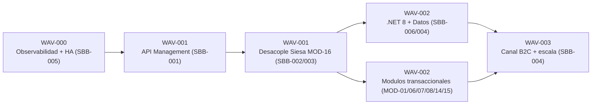
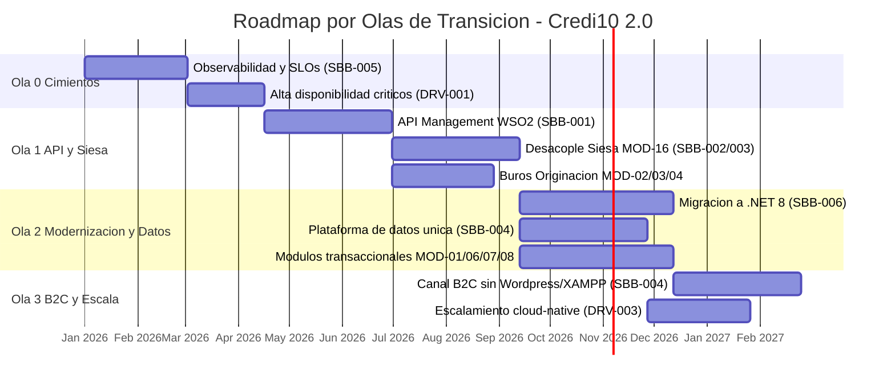

# Roadmap por olas, WSJF y ruta critica

> Tema del **informe tecnico multinivel** de Credi10 2.0, dentro de **Fase 5 - Roadmap, Estimacion y RAID**. Vista narrativa que reorganiza y **enriquece** el informe plano de respaldo ([vista compacta de la fase](../../05-roadmap-estimacion-raid.md)); aqui el foco es la **interpretacion** de los hallazgos y sus implicaciones para la **estimacion**, la **estrategia de implementacion** y los **riesgos**.

> **Etiquetas epistemicas:** **[VERIFIED-FACT]** evidencia explicita del corpus; **[DOC-ASSUMPTION]** supuesto razonable a validar; **[DOC-CONFLICT]** tension entre fuentes; **[EPISTEMIC-VOID]** sin base documental (no se fabrica evidencia).

> **Hilo Dorado:** la trazabilidad end-to-end encadena Driver (DRV) -> Capability (CAP) -> Benchmark (BMK) -> Gap (GAP) -> Reliever (REL) -> ABB -> SBB -> Ola (WAV) -> ROI/Outcome, de modo que cada decision tecnica de este informe es trazable hasta un indicador de retorno del RFP.

## Que estamos mirando y por que importa

El roadmap organiza el trabajo en **olas de transicion** (WAV-000..003) priorizadas por WSJF, con dependencias tecnicas explicitas y aciclicas y una ruta critica identificada. La narrativa es de secuencia: primero cimientos (observabilidad, alta disponibilidad), luego la capa de integracion gobernada y el desacople de Siesa, despues la modernizacion .NET y la plataforma de datos, y por ultimo el canal B2C y el escalamiento.

Importa porque un buen roadmap convierte una estimacion de esfuerzo en un **plan de entrega de valor**: las olas tempranas capturan valor y reducen riesgo, y la ruta critica avisa donde un retraso arrastra todo el proyecto.

## Priorizacion WSJF

### WSJF por iniciativa

| Iniciativa | Valor de negocio | Criticidad temporal | Reduccion de riesgo / habilitacion | Cost of Delay (CoD) | Job Size | WSJF | Orden |
| --- | --- | --- | --- | --- | --- | --- | --- |
| Observabilidad + alta disponibilidad de componentes criticos (SBB-005) | 8 | 9 | 10 | 27 | 5 | 5.4 | 1 |
| Centralizar / gobernar APIs - API Management WSO2 (SBB-001) | 10 | 8 | 9 | 27 | 8 | 3.4 | 2 |
| Desacoplar integracion con Siesa - Data Services + eventos (SBB-002, SBB-003) | 10 | 9 | 10 | 29 | 13 | 2.2 | 3 |
| Modernizar .NET 4.8 / Core 3.1 -> .NET 8 (SBB-006) | 7 | 6 | 8 | 21 | 13 | 1.6 | 4 |
| Modernizar canal B2C - salir de Wordpress/XAMPP (SBB-004) | 6 | 5 | 6 | 17 | 8 | 2.1 | 5 |

> Los pesos del Cost of Delay (escala relativa 1-10) y el Job Size son una priorizacion **relativa** [DOC-ASSUMPTION]; el corpus no fija unidades de esfuerzo absolutas. El orden respeta la logica de secuenciacion: primero **cimientos** (observabilidad y HA), luego la **capa de integracion gobernada** (prerequisito del desacople de Siesa), y por ultimo la **modernizacion** de runtime y canal.

### Orden WSJF por modulo

| Orden | Modulo | Nombre | WSJF | Ola sugerida |
| --- | --- | --- | ---: | --- |
| 1 | MOD-06 | Pagos / GenerarPagos | 6.33 | WAV-002 |
| 2 | MOD-13 | Llamada Predictiva | 5.67 | WAV-003 |
| 3 | MOD-10 | Boton E-commerce | 5.33 | WAV-003 |
| 4 | MOD-08 | Link de Recaudo / APIs de recaudo | 5.0 | WAV-002 |
| 5 | MOD-02 | Originacion - CrossCore | 4.8 | WAV-001 |
| 6 | MOD-04 | Originacion - Datacredito | 4.8 | WAV-001 |
| 7 | MOD-11 | Captura Foto | 4.67 | WAV-002 |
| 8 | MOD-17 | Fidelizacion / Pentaho (BI) | 4.33 | WAV-003 |
| 9 | MOD-03 | Originacion - Inspektor | 4.2 | WAV-001 |
| 10 | MOD-15 | Envio RCL y RCR | 4.2 | WAV-002 |
| 11 | MOD-07 | Corte de Cartera | 4.0 | WAV-002 |
| 12 | MOD-14 | Cobranza (SMS / WhatsApp / Email / Scheduler) | 4.0 | WAV-002 |
| 13 | MOD-12 | API Integrador Atencion al Cliente | 3.8 | WAV-002 |
| 14 | MOD-05 | Originacion - Aplicacion ADMIN | 3.4 | WAV-002 |
| 15 | MOD-01 | Plataforma Credi10 / Administracion de creditos | 2.88 | WAV-002 |
| 16 | MOD-09 | B2C / Portal de clientes | 2.38 | WAV-003 |
| 17 | MOD-16 | Integracion UnoEE / Siesa | 2.23 | WAV-001 |

## Dependencias y ruta critica

### Grafo de dependencias (aciclico)

> **Ruta critica (critical path).** La cadena mas larga sin holgura es: **WAV-000 Observabilidad/HA -> WAV-001 API Management (SBB-001) -> WAV-001 Data Services + eventos sobre Siesa (SBB-002/003, MOD-16) -> WAV-002 Migracion .NET 8 + plataforma de datos (SBB-006/004) -> WAV-003 Canal B2C (SBB-004)**. Los enablers fundacionales (observabilidad, API Management y el **desacople de Siesa - MOD-16**) estan al inicio porque habilitan a los modulos dependientes; cualquier retraso en ellos desplaza todo el roadmap. Los modulos de bajo acople (p. ej. Captura Foto, Boton e-commerce, Fidelizacion) corren en paralelo fuera de la ruta critica.

## Roadmap por olas (gantt)

| Hilo Dorado | Ola | Foco | SBB / Reliever origen | Drivers |
| --- | --- | --- | --- | --- |
| WAV-000 | Ola 0 - Cimientos, Observabilidad y Alta Disponibilidad | Instrumentar observabilidad (logging/metricas/SLOs) y alta disponibilidad de los componentes criticos del RFP antes de modernizar. | SBB-005 (REL-003) | DRV-001, DRV-002 |
| WAV-001 | Ola 1 - API Management y Desacople de Siesa | Centralizar y gobernar las APIs (WSO2 API + Integration Platform) y reemplazar archivos planos / WS unico / lectura directa a BD por Data Services + eventos. | SBB-001 (REL-003), SBB-002 (REL-002), SBB-003 (REL-001) | DRV-004, DRV-001, DRV-002 |
| WAV-002 | Ola 2 - Modernizacion .NET y Plataforma de Datos | Migrar el runtime .NET Framework 4.8 / .NET Core 3.1 a .NET 8 contenerizado y consolidar una plataforma de datos unica (fuente unica de verdad por dominio). | SBB-006 (REL-004), SBB-004 (REL-003) | DRV-005, DRV-004 |
| WAV-003 | Ola 3 - Canal B2C y Escalamiento | Modernizar el canal B2C (salir de Wordpress/XAMPP) y habilitar el escalamiento cloud-native de los dominios. | SBB-004 (REL-004), SBB-006 (REL-004) | DRV-004, DRV-003 |

### Agenda por modulo

| Modulo | Nombre | Ola | Depende de (enabler) |
| --- | --- | --- | --- |
| MOD-01 | Plataforma Credi10 / Administracion de creditos | WAV-002 | WAV-001 (desacople Siesa MOD-16, API Management) |
| MOD-02 | Originacion - CrossCore | WAV-001 | WAV-000 (observabilidad), API Management (SBB-001) |
| MOD-03 | Originacion - Inspektor | WAV-001 | WAV-000 (observabilidad), API Management (SBB-001) |
| MOD-04 | Originacion - Datacredito | WAV-001 | WAV-000 (observabilidad), API Management (SBB-001) |
| MOD-05 | Originacion - Aplicacion ADMIN | WAV-002 | WAV-001 (desacople Siesa MOD-16, API Management) |
| MOD-06 | Pagos / GenerarPagos | WAV-002 | WAV-001 (desacople Siesa MOD-16, API Management) |
| MOD-07 | Corte de Cartera | WAV-002 | WAV-001 (desacople Siesa MOD-16, API Management) |
| MOD-08 | Link de Recaudo / APIs de recaudo | WAV-002 | WAV-001 (desacople Siesa MOD-16, API Management) |
| MOD-09 | B2C / Portal de clientes | WAV-003 | WAV-002 (.NET 8 + plataforma de datos) |
| MOD-10 | Boton E-commerce | WAV-003 | WAV-002 (.NET 8 + plataforma de datos) |
| MOD-11 | Captura Foto | WAV-002 | WAV-001 (desacople Siesa MOD-16, API Management) |
| MOD-12 | API Integrador Atencion al Cliente | WAV-002 | WAV-001 (desacople Siesa MOD-16, API Management) |
| MOD-13 | Llamada Predictiva | WAV-003 | WAV-002 (.NET 8 + plataforma de datos) |
| MOD-14 | Cobranza (SMS / WhatsApp / Email / Scheduler) | WAV-002 | WAV-001 (desacople Siesa MOD-16, API Management) |
| MOD-15 | Envio RCL y RCR | WAV-002 | WAV-001 (desacople Siesa MOD-16, API Management) |
| MOD-16 | Integracion UnoEE / Siesa | WAV-001 | WAV-000 (observabilidad), WAV-001 (API Management) |
| MOD-17 | Fidelizacion / Pentaho (BI) | WAV-003 | WAV-002 (.NET 8 + plataforma de datos) |
## Implicaciones para la estimacion

El WSJF combina el valor de negocio (heredado de los drivers) con el job size (heredado de la estimacion), cerrando el circulo: la estimacion alimenta la priorizacion y la priorizacion ordena la entrega. El esfuerzo total agregado dimensiona el numero de olas y squads. [DOC-ASSUMPTION]

## Implicaciones para la estrategia de implementacion

La estrategia de implementacion ES este roadmap: enablers primero, Strangler Fig por ola, rollback por ola para preservar la continuidad operativa exigida por el RFP. La ruta critica fija el foco de atencion de la gestion.

## Riesgos e incertidumbre

El riesgo de cronograma se concentra en la ruta critica (observabilidad -> API Management -> desacople Siesa -> .NET 8 -> B2C). Un retraso en el desacople de Siesa (MOD-16) es el de mayor impacto sistemico.

