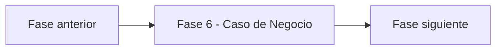

# Fase 6 - Caso de Negocio - Vista narrativa multinivel

> Nivel 1 del **informe tecnico multinivel** de Credi10 2.0. Esta fase se desagrega en **2 temas** (nivel 2), cada uno con jerarquia interna H1->H2->H3 (nivel 3) y narrativa de analisis sustancial, ademas de las tablas y diagramas reutilizados del motor.

> **Hilo narrativo de la fase.** Cerramos el Hilo Dorado con el valor: value driver tree, modelo financiero y defensa ejecutiva. Atamos el esfuerzo estimado a un retorno esperado, con honestidad sobre lo que aun falta costear.

> **Etiquetas epistemicas:** **[VERIFIED-FACT]** evidencia explicita del corpus; **[DOC-ASSUMPTION]** supuesto razonable a validar; **[DOC-CONFLICT]** tension entre fuentes; **[EPISTEMIC-VOID]** sin base documental (no se fabrica evidencia).

## Temas de esta fase

| # | Tema | Archivo |
| --- | --- | --- |
| 1 | Value driver tree y outcomes de negocio | [`value-driver-tree.md`](value-driver-tree.md) |
| 2 | Modelo financiero y defensa ejecutiva | [`modelo-financiero.md`](modelo-financiero.md) |

## Como se conecta con el resto del informe

Para la **vista compacta** de esta fase (un solo archivo, misma evidencia, gobernada por el gate de calidad) ver [el informe plano de la fase](../../06-caso-de-negocio.md). Para volver al indice maestro del informe tecnico, ver [`../README.md`](../README.md).

