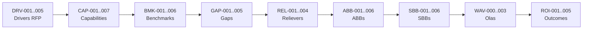

# Modelo financiero y defensa ejecutiva

> Tema del **informe tecnico multinivel** de Credi10 2.0, dentro de **Fase 6 - Caso de Negocio**. Vista narrativa que reorganiza y **enriquece** el informe plano de respaldo ([vista compacta de la fase](../../06-caso-de-negocio.md)); aqui el foco es la **interpretacion** de los hallazgos y sus implicaciones para la **estimacion**, la **estrategia de implementacion** y los **riesgos**.

> **Etiquetas epistemicas:** **[VERIFIED-FACT]** evidencia explicita del corpus; **[DOC-ASSUMPTION]** supuesto razonable a validar; **[DOC-CONFLICT]** tension entre fuentes; **[EPISTEMIC-VOID]** sin base documental (no se fabrica evidencia).

> **Hilo Dorado:** la trazabilidad end-to-end encadena Driver (DRV) -> Capability (CAP) -> Benchmark (BMK) -> Gap (GAP) -> Reliever (REL) -> ABB -> SBB -> Ola (WAV) -> ROI/Outcome, de modo que cada decision tecnica de este informe es trazable hasta un indicador de retorno del RFP.

## Que estamos mirando y por que importa

El modelo financiero (CAPEX/OPEX, TCO As-Is vs To-Be, unit economics FinOps y VAN/TIR/Payback en tres escenarios) ofrece la **estructura** del caso economico, y la presentacion ejecutiva mapea el Hilo Dorado completo F1->F6 contra los criterios de evaluacion de la oferta. La honestidad epistemica es total: el corpus NO tiene cifras reales de costo, asi que todo el modelo es ilustrativo [DOC-ASSUMPTION] y debe costearse con datos reales antes de cualquier decision de inversion.

Presentar la estructura financiera (aunque con cifras ilustrativas) tiene valor: muestra que variables mueven el retorno, que supuestos hay que validar y como se defenderia el caso ante el comite. Es el puente entre el informe tecnico y la decision de negocio.

> **[EPISTEMIC-VOID] Linea base de costos ausente.** El corpus (RFP, assessment WSO2/Studio F y diagramas) **no** contiene cifras reales de CAPEX/OPEX, licenciamiento, TCO ni volumenes economicos. Por lo tanto **todas** las cifras monetarias de esta seccion son **[DOC-ASSUMPTION] ilustrativas** (en unidades monetarias relativas, UM), sirven solo para mostrar la **estructura** del modelo financiero y **deben** reemplazarse por datos reales en un ejercicio de costeo antes de cualquier decision de inversion. No representan una oferta economica.

## Estructura de costos y retorno

### CAPEX / OPEX por ola

| Rubro | Tipo | Ola | Monto ilustrativo (UM) [DOC-ASSUMPTION] |
| --- | --- | --- | --- |
| Plataforma API Management + Integration (WSO2) | CAPEX | WAV-001 | 1.000 |
| Desacople Siesa (Data Services + bus de eventos) | CAPEX | WAV-001 | 1.200 |
| Observabilidad y alta disponibilidad | CAPEX | WAV-000 | 600 |
| Migracion a .NET 8 + plataforma de datos | CAPEX | WAV-002 | 1.400 |
| Modernizacion canal B2C | CAPEX | WAV-003 | 800 |
| Operacion cloud + soporte plataforma (anual) | OPEX | Transversal | 900 / anio |
| Licenciamiento regularizado (anual) | OPEX | Transversal | 500 / anio |

### TCO comparativo As-Is vs To-Be

| Concepto (horizonte 5 anios) | As-Is (UM) [DOC-ASSUMPTION] | To-Be (UM) [DOC-ASSUMPTION] | Delta |
| --- | --- | --- | --- |
| Infraestructura y operacion | 6.000 | 5.200 | -800 |
| Trabajo manual / reprocesos (Siesa, Excel) | 3.500 | 1.400 | -2.100 |
| Licenciamiento y soporte de stack EOL | 2.500 | 2.800 | +300 |
| Incidentes por indisponibilidad | 2.000 | 600 | -1.400 |
| **TCO total ilustrativo** | **14.000** | **10.000** | **-4.000** |

### Unit economics (FinOps)

| Metrica FinOps (Unit Economics) | As-Is [DOC-ASSUMPTION] | To-Be [DOC-ASSUMPTION] |
| --- | --- | --- |
| Costo por solicitud de credito procesada (UM) | 1,00 | 0,70 |
| Costo de infraestructura por transaccion (UM) | 0,40 | 0,34 |
| Costo de operacion manual por obligacion (UM) | 0,50 | 0,20 |

### Escenarios financieros

| Escenario | Inversion inicial (UM) [DOC-ASSUMPTION] | Beneficio anual (UM) [DOC-ASSUMPTION] | VAN/NPV (UM) [DOC-ASSUMPTION] | TIR/IRR [DOC-ASSUMPTION] | Payback [DOC-ASSUMPTION] |
| --- | --- | --- | --- | --- | --- |
| Conservador | 5.000 | 1.200 | +400 | ~12% | ~4,2 anios |
| Base | 5.000 | 1.800 | +2.100 | ~24% | ~2,8 anios |
| Optimista | 5.000 | 2.400 | +3.900 | ~35% | ~2,1 anios |

| ID supuesto | Variable | Valor ilustrativo [DOC-ASSUMPTION] | A confirmar con |
| --- | --- | --- | --- |
| S-F01 | Horizonte de analisis | 5 anios | FIN / ED |
| S-F02 | Tasa de descuento para VAN/NPV | 12% anual | FIN |
| S-F03 | Unidad monetaria | UM (relativa, sin moneda ni magnitud real) | FIN |
| S-F04 | Ahorro por reduccion de trabajo manual | derivado de DRV-002 (60% -> 80%) | ORG / FIN |
| S-F05 | Reduccion de incidentes | derivada de DRV-001 (90% -> 99%) | SA / FIN |
| S-F06 | Condicion comercial | facturacion por entregables, pago a 60 dias (RFP) | FIN |

## Defensa ejecutiva: Hilo Dorado completo

### Trazabilidad F1 -> F6

| Fase | Etapa Hilo Dorado | IDs | Ejemplo trazable |
| --- | --- | --- | --- |
| F1 | Driver (DRV) | DRV-001..005 | Disponibilidad 90% -> 99% (DRV-001) |
| F1 | Capability (CAP) | CAP-001..007 | Capacidad de estudio de credito |
| F2 | Benchmark (BMK) | BMK-001..006 | API Management / integracion gobernada |
| F3 | Pain/Gap (GAP) | GAP-001..005 | Integracion rigida con Siesa (GAP-001) |
| F3 | Reliever (REL) | REL-001..004 | Estandarizar integraciones (REL-001) |
| F3.5 | ABB | ABB-001..006 | API Gateway / Management (ABB-001) |
| F4 | SBB | SBB-001..006 | WSO2 API Platform (SBB-001) |
| F5 | Ola (WAV) | WAV-000..003 | Ola 1 API + desacople Siesa (WAV-001) |
| F6 | ROI/Outcome (ROI) | ROI-001..005 | Continuidad del negocio (ROI-001) |

### Alineacion con los criterios de la oferta

| Criterio de evaluacion de la oferta (RFP) | Puntaje | Evidencia en este advisory |
| --- | --- | --- |
| Experiencia | 15 | Framework Zero-Drift y 17 roles especializados |
| Economica | 30 | Modelo financiero estructurado (cifras a costear; hoy [DOC-ASSUMPTION]) |
| Metodologia | 10 | 7 fases con stage-gates QG-0..QG-6, RACI-V y AICV-E |
| Cumplimiento tecnico / funcional | 30 | Diseno TO-BE trazable (ABB/SBB) y preservacion de reglas de negocio |
| Tiempo de entrega | 15 | Roadmap por olas (WAV-000..003) con secuencia aciclica |
| **Total** | **100** | - |
## Implicaciones para la estimacion

El modelo financiero toma el esfuerzo estimado (CAPEX por ola) y lo contrasta con el TCO y el retorno esperado. Mientras las cifras sean [DOC-ASSUMPTION], el modelo sirve para sensibilidad y defensa, no para comprometer presupuesto.

## Implicaciones para la estrategia de implementacion

La estrategia de financiamiento sigue las olas: CAPEX concentrado en las olas de integracion y modernizacion, OPEX transversal. La facturacion por entregables (RFP) condiciona el tamanio de cada entrega.

## Riesgos e incertidumbre

El riesgo es tratar las cifras ilustrativas como una oferta. El [EPISTEMIC-VOID] de la linea base de costos obliga a un ejercicio de costeo como prerrequisito de cualquier compromiso economico.

