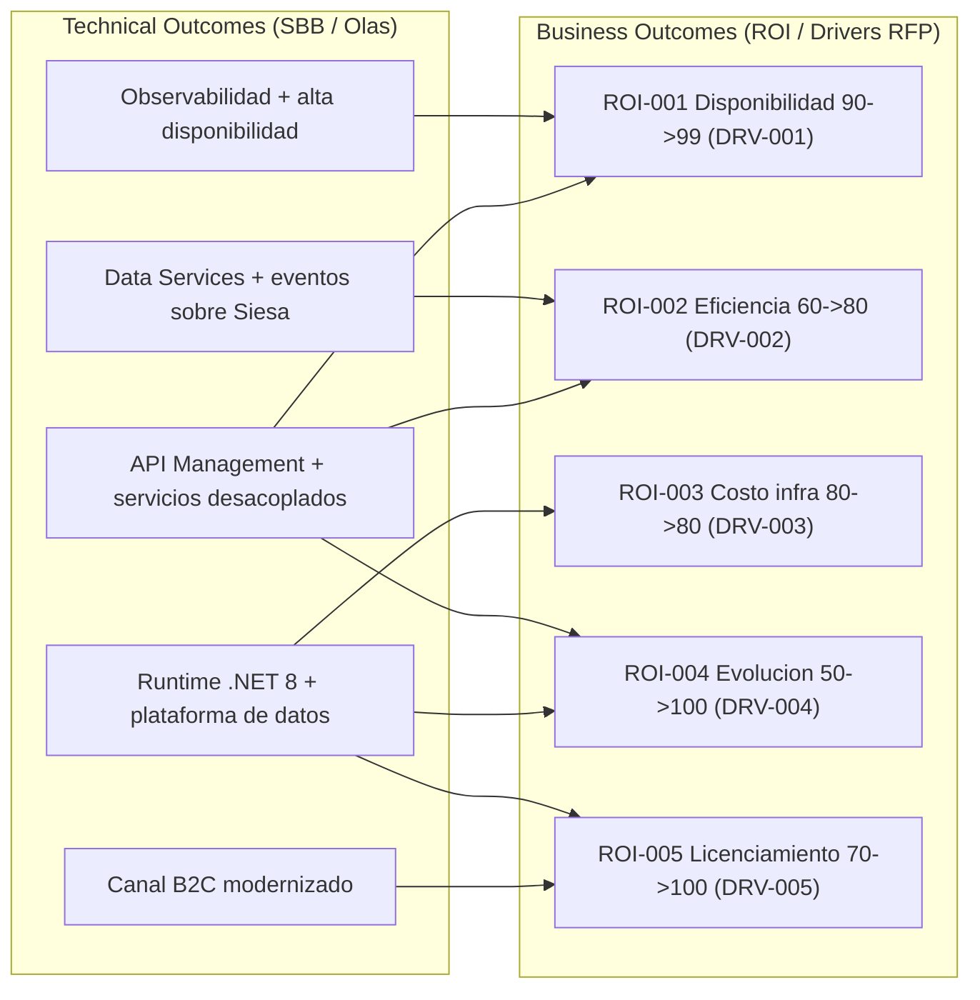

# Value driver tree y outcomes de negocio

> Tema del **informe tecnico multinivel** de Credi10 2.0, dentro de **Fase 6 - Caso de Negocio**. Vista narrativa que reorganiza y **enriquece** el informe plano de respaldo ([vista compacta de la fase](../../06-caso-de-negocio.md)); aqui el foco es la **interpretacion** de los hallazgos y sus implicaciones para la **estimacion**, la **estrategia de implementacion** y los **riesgos**.

> **Etiquetas epistemicas:** **[VERIFIED-FACT]** evidencia explicita del corpus; **[DOC-ASSUMPTION]** supuesto razonable a validar; **[DOC-CONFLICT]** tension entre fuentes; **[EPISTEMIC-VOID]** sin base documental (no se fabrica evidencia).

> **Hilo Dorado:** la trazabilidad end-to-end encadena Driver (DRV) -> Capability (CAP) -> Benchmark (BMK) -> Gap (GAP) -> Reliever (REL) -> ABB -> SBB -> Ola (WAV) -> ROI/Outcome, de modo que cada decision tecnica de este informe es trazable hasta un indicador de retorno del RFP.

## Que estamos mirando y por que importa

El caso de negocio cierra el Hilo Dorado conectando cada outcome tecnico con un **outcome de negocio** (ROI-001..005), uno por cada driver del RFP. El value driver tree es la narrativa de valor: muestra como la observabilidad y el API Management habilitan disponibilidad, como el desacople de Siesa habilita eficiencia, y asi sucesivamente. Es la respuesta a '¿para que todo este esfuerzo?'.

Para la estimacion, el value driver tree es el que justifica la inversion: ata el esfuerzo estimado a un retorno esperado, aunque ese retorno siga siendo [DOC-ASSUMPTION] mientras no haya linea base de costos.

## Value driver tree

| Hilo Dorado | Driver RFP | Indicador (As-Is -> To-Be) | Outcome de negocio | Olas que lo entregan |
| --- | --- | --- | --- | --- |
| ROI-001 | DRV-001 | Disponibilidad 90% -> 99% | Continuidad del negocio | WAV-000, WAV-001 |
| ROI-002 | DRV-002 | Eficiencia 60% -> 80% | Menos trabajo manual / reprocesos | WAV-001 |
| ROI-003 | DRV-003 | Costo infra 80% -> 80% | Costo controlado con FinOps | WAV-002, WAV-003 |
| ROI-004 | DRV-004 | Evolucion 50% -> 100% | Time-to-market de nuevas funciones | WAV-001, WAV-002 |
| ROI-005 | DRV-005 | Licenciamiento 70% -> 100% | Cumplimiento y retiro de stack EOL | WAV-002, WAV-003 |

### Lectura del arbol de valor

Cada outcome de negocio esta entregado por olas concretas, de modo que el valor no es abstracto: se puede rastrear hasta la WAV que lo produce. Esto permite al negocio ver que ola captura que retorno y decidir la secuencia con criterio economico.
## Implicaciones para la estimacion

El valor esperado por driver permite comparar inversion vs. retorno por ola y decidir el alcance financiable. Sin linea base real, el retorno se expresa como estructura [DOC-ASSUMPTION], no como promesa.

## Implicaciones para la estrategia de implementacion

La estrategia prioriza las olas que entregan los outcomes de mayor valor temprano (disponibilidad y eficiencia), alineando el orden de entrega con la captura de valor.

## Riesgos e incertidumbre

El riesgo es comprometer ROI sin datos. El value driver tree estructura el valor pero lo marca [DOC-ASSUMPTION] hasta el costeo. [EPISTEMIC-VOID] en la linea base economica.

