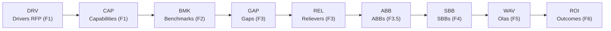
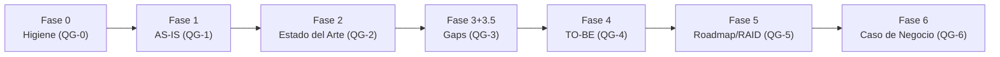

# Advisory Credi10 2.0 - Framework Zero-Drift

Este directorio contiene los **informes del advisory Credi10 2.0**, generados automaticamente por el motor `advisory-system/` a partir del corpus de evidencia (RFP, assessment WSO2/Studio F y diagramas de arquitectura). Cada informe corresponde a una fase del framework **Zero-Drift** y es 100% reproducible re-ejecutando el quickstart.

> **Regenerar todos los informes:**
>
> ```bash
> python3 advisory-system/quickstart.py --phase all
> ```

## El framework Zero-Drift

Zero-Drift organiza el advisory como un **Comite de Gobierno** mas **3 Celulas** de trabajo, con **17 roles** declarativos, **7 fases** con stage-gates **QG-0..QG-6**, separacion productor/verificador (**RACI-V**), gobierno de calidad **AICV-E** (a cargo del AM) y un **Hilo Dorado** de trazabilidad que conecta cada driver del RFP con un outcome de negocio.

- **Comite de Gobierno:** ED (Engagement Director), EM (Engagement Manager), AM (Advisory Manager).
- **Celula 1 - Discovery:** EA, BA, PIA, SME, TDA, DRE.
- **Celula 2 - Diseno:** SA, DA, PM, UX, AIA.
- **Celula 3 - Valor y Habilitacion:** FIN, SEC, ORG.
- **Roles totales:** 17 (catalogo declarativo en `advisory-system/roles/roles.json`).

## Corpus de evidencia

- Documentos PDF analizados: **15**
- Diagramas PNG (evidencia binaria transcrita): **3**

## Informes por fase

| Fase | Informe | Entregables | Lider(es) | Verificador | Gate |
| --- | --- | --- | --- | --- | --- |
| Fase 0 - Higiene Epistemica | [00-higiene-epistemica.md](00-higiene-epistemica.md) | E0.1, E0.2, E0.3 | AM, TDA, DRE | EM | QG-0 |
| Fase 1 - Contexto AS-IS | [01-contexto-as-is.md](01-contexto-as-is.md) | E1.1, E1.2, E1.3 | EA, BA, PIA, TDA | AM | QG-1 |
| Fase 2 - Estado del Arte | [02-estado-del-arte.md](02-estado-del-arte.md) | E2.1, E2.2 | EA, SME, BA | AM | QG-2 |
| Fase 3 + 3.5 - Gaps y Viabilizacion | [03-gaps-y-viabilizacion.md](03-gaps-y-viabilizacion.md) | E3.1, E3.2, E3.5 | EA, DRE, PIA | AM | QG-3 |
| Fase 4 - Diseno TO-BE | [04-diseno-to-be.md](04-diseno-to-be.md) | E4.1, E4.2, E4.3 | SA, DA, PM, UX | AM | QG-4 |
| Fase 5 - Roadmap, Estimacion y RAID | [05-roadmap-estimacion-raid.md](05-roadmap-estimacion-raid.md) | E5.1, E5.2, E5.3 | EM, SA, PM, ORG | AM | QG-5 |
| Fase 6 - Caso de Negocio | [06-caso-de-negocio.md](06-caso-de-negocio.md) | E6.1, E6.2, E6.3 | ED, FIN, EA | AM | QG-6 |

## Hilo Dorado (F1 -> F6)

La trazabilidad end-to-end encadena: Driver (F1) -> Capability (F1) -> Benchmark (F2) -> Gap (F3) -> Reliever (F3) -> ABB (F3.5) -> SBB (F4) -> Ola/WAV (F5) -> ROI/Outcome (F6).



## Flujo de fases y stage-gates



## Como regenerar

- Todo el pipeline (7 informes + este indice): `python3 advisory-system/quickstart.py --phase all`
- Una sola fase (ej. Fase 3): `python3 advisory-system/quickstart.py --phase 3`
- Opciones: `--corpus <ruta>` para otro corpus, `--out <ruta>` para otra carpeta de salida.

La documentacion del motor (estrategia, arquitectura y pruebas) esta en [`advisory-system/README.md`](../advisory-system/README.md).

