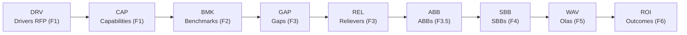
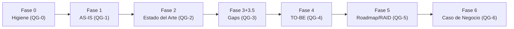

# Advisory Credi10 2.0 - Framework Zero-Drift

Este directorio contiene los **informes del advisory Credi10 2.0**, generados automaticamente por el motor `advisory-system/` a partir del corpus de evidencia (RFP, assessment WSO2/Studio F y diagramas de arquitectura). Cada informe corresponde a una fase del framework **Zero-Drift** y es 100% reproducible re-ejecutando el quickstart.

> **Regenerar todos los informes:**
>
> ```bash
> python3 advisory-system/quickstart.py --phase all
> ```

## El framework Zero-Drift

Zero-Drift organiza el advisory como un **Comite de Gobierno** mas **3 Celulas** de trabajo, con **17 roles** declarativos, **7 fases** con stage-gates **QG-0..QG-6**, separacion productor/verificador (**RACI-V**), gobierno de calidad **AICV-E** (a cargo del AM) y un **Hilo Dorado** de trazabilidad que conecta cada driver del RFP con un outcome de negocio.

- **Comite de Gobierno:** ED (Engagement Director), EM (Engagement Manager), AM (Advisory Manager).
- **Celula 1 - Discovery:** EA, BA, PIA, SME, TDA, DRE.
- **Celula 2 - Diseno:** SA, DA, PM, UX, AIA.
- **Celula 3 - Valor y Habilitacion:** FIN, SEC, ORG.
- **Roles totales:** 17 (catalogo declarativo en `advisory-system/roles/roles.json`).

## Corpus de evidencia

- Documentos PDF analizados: **15**
- Diagramas PNG (evidencia binaria transcrita): **3**
- Total ingerido (cobertura COMPLETA, sin muestreo): **18** documentos.

## Base de Conocimiento y capa de politicas (skills)

La ingesta del corpus es **completa y verificable** (nada de muestreo parcial) y esta gobernada por una **capa declarativa de politicas reutilizables** (skills), pensada como politica de la organizacion y aplicable a otros corpus/clientes:

- **Base de Conocimiento generada** en [`../knowledge-base/`](../knowledge-base/): indice por documento (sha256, tipo, rol primario/secundario, tamanio), resumenes jerarquicos, extraccion de hechos clave con trazabilidad a su documento fuente y una [`coverage-checklist.md`](../knowledge-base/coverage-checklist.md) que marca honestamente los documentos de baja cobertura / [EPISTEMIC-VOID] (sin fabricar evidencia). La consume el advisory para trazar cada decision a su fuente.
- **Cobertura recalibrada por texto util REAL.** La banda de cobertura de cada documento se calcula a partir del **texto util real** (caracteres en palabras reales de >= 3 letras / bytes de texto extraido), **no** por el tamanio crudo del texto: asi los PDF basados en imagen dejan de sobrestimarse como 'alta' y quedan 'baja'/'nula' con nota **OCR pendiente** y `[EPISTEMIC-VOID]`. Capacidad **OCR** lista (skill `ocr-image-extraction` + adaptador `engine/ocr.py`): si hay motor OCR disponible, el texto recuperado se marca `[OCR-EXTRACTED]`; en este entorno no hay motor, por lo que degrada de forma honesta sin fabricar texto.
- **Anexo A - Trazabilidad de requisitos** en el informe tecnico ([`3-informe-tecnico/anexo-a-trazabilidad-requisitos/README.md`](3-informe-tecnico/anexo-a-trazabilidad-requisitos/README.md)): responde **punto a punto** cada solicitud del cliente con **cita al documento fuente**, un checklist marcable y una tabla de trazabilidad. Es **dinamico y derivado del corpus** (skill `requirements-traceability`): con el corpus de otro cliente el anexo se regenera con sus solicitudes.
- **Capa de skills declarativos** en `.kiro/skills/` (politicas versionadas, agnosticas del cliente): `complete-corpus-ingestion` (ingesta y validacion COMPLETA del corpus), `token-budget-optimization` (optimizar tokens GARANTIZANDO procesamiento y entendimiento completos), `zero-drift-roles-policy` (politica permanente de tomar y validar TODO el contexto documental) y `ai-opportunities-catalog` (oportunidades de IA modeladas como skills, no hardcodeadas). El motor las carga via `advisory-system/engine/skills.py`.

## Informes por fase

| Fase | Informe | Entregables | Lider(es) | Verificador | Gate |
| --- | --- | --- | --- | --- | --- |
| Fase 0 - Higiene Epistemica | [00-higiene-epistemica.md](00-higiene-epistemica.md) | E0.1, E0.2, E0.3 | AM, TDA, DRE | EM | QG-0 |
| Fase 1 - Contexto AS-IS | [01-contexto-as-is.md](01-contexto-as-is.md) | E1.1, E1.2, E1.3 | EA, BA, PIA, TDA | AM | QG-1 |
| Fase 2 - Estado del Arte | [02-estado-del-arte.md](02-estado-del-arte.md) | E2.1, E2.2 | EA, SME, BA | AM | QG-2 |
| Fase 3 + 3.5 - Gaps y Viabilizacion | [03-gaps-y-viabilizacion.md](03-gaps-y-viabilizacion.md) | E3.1, E3.2, E3.5 | EA, DRE, PIA | AM | QG-3 |
| Fase 4 - Diseno TO-BE | [04-diseno-to-be.md](04-diseno-to-be.md) | E4.1, E4.2, E4.3 | SA, DA, PM, UX | AM | QG-4 |
| Fase 5 - Roadmap, Estimacion y RAID | [05-roadmap-estimacion-raid.md](05-roadmap-estimacion-raid.md) | E5.1, E5.2, E5.3 | EM, SA, PM, ORG | AM | QG-5 |
| Fase 6 - Caso de Negocio | [06-caso-de-negocio.md](06-caso-de-negocio.md) | E6.1, E6.2, E6.3 | ED, FIN, EA | AM | QG-6 |

## Informes del engagement (familia de 3)

El motor genera **tres informes separados**, orientados a distintas audiencias y enlazados desde este indice maestro. Cada uno tiene un proposito y un tono propios, pero comparten las mismas fuentes de verdad (corpus, Base de Conocimiento y builders por fase):

1. [`1-propuesta-comercial.md`](1-propuesta-comercial.md): **Propuesta comercial** emitida por Kulgops. Documento de **venta** con las 11 secciones a-k (quienes somos, alcance, contexto de negocio, metodologia, entregables, estrategia, equipo, cronograma, supuestos y restricciones, inversion y terminos). El perfil corporativo de Kulgops y la inversion se marcan [DOC-ASSUMPTION]. Proposito: ganar el engagement.
2. [`2-reporte-gerencial.md`](2-reporte-gerencial.md): **Reporte gerencial**, soporte ejecutivo de la propuesta (alcance, fases, diagnostico de alto nivel, estrategia, riesgos, consideraciones y prerrequisitos). Tono **gerencial**, no tecnico. Proposito: dar al comite la lectura de negocio para decidir.
3. [`3-informe-tecnico/README.md`](3-informe-tecnico/README.md): **Informe tecnico** en **estructura multinivel narrativa**. Es el **detalle** que sustenta los otros dos y habilita una estimacion lo mas acertada posible. Proposito: dar al equipo tecnico la profundidad para diseñar y estimar.

### Estructura multinivel del informe tecnico

El informe tecnico se desagrega a ~3 niveles para que sea facil de leer y navegar, con **narrativa de analisis** ademas de tablas y diagramas:

- **Nivel 1 = fase.** Una subcarpeta por cada una de las 7 fases Zero-Drift bajo [`3-informe-tecnico/`](3-informe-tecnico/README.md) (fase-0-higiene-epistemica/ ... fase-6-caso-de-negocio/), cada una con su README indice.
- **Nivel 2 = tema.** Varios archivos de tema dentro de cada fase (p. ej. en Fase 4: arquitectura C4, ADRs, modelo de datos y contratos, catalogo de IA, UX y pruebas).
- **Nivel 3 = subtema.** Jerarquia interna H1 -> H2 -> H3 en cada archivo, con interpretacion de hallazgos e implicaciones para la estimacion, la estrategia de implementacion y los riesgos.

El informe tecnico **integra el dossier TO-BE** (`to-be/`) por referencia como la **vista de ejecucion** del mismo diseño (ver su README). Los informes planos por fase (00..06 + 04b) siguen siendo la **vista compacta canonica** de cada fase (gobernada por los gates QG); el informe tecnico es la vista navegable que los reorganiza y enriquece con narrativa.

### Comercial / Oferta (analisis de oportunidad y correlacion)

Antes de la propuesta, el motor genera **dos outcomes comerciales SEPARADOS** (en archivos distintos) gobernados por el skill `commercial-opportunity-analysis` y producidos por el Comite de Gobierno (Engagement Director + Engagement Manager) como experto en **diseno de ofertas comerciales**. COMPLEMENTAN (no duplican) a `commercial-proposal-report` y `requirements-traceability`, y **reutilizan** `extract_requirements` como fuente dinamica de las solicitudes del cliente:

- [`0-analisis-oportunidad-comercial.md`](0-analisis-oportunidad-comercial.md): **Outcome 1** - analisis de la oportunidad, **checklist de la informacion que el cliente solicita** y **contenido desarrollado** de respuesta mapeado a las secciones a-k de la propuesta.
- [`0b-checklist-oferta-y-correlacion.md`](0b-checklist-oferta-y-correlacion.md): **Outcome 2** - checklist de items a desarrollar, consideraciones, supuestos y la **matriz de trazabilidad comercial** (Solicitud del cliente -> ¿La oferta la responde? -> Outcome del advisory que la sustenta -> Estado Cubierto/Parcial/Pendiente -> Consideracion/Supuesto), una fila por solicitud, con estado honesto (Pendiente -> [EPISTEMIC-VOID]).

Ambos outcomes son **deterministas y dinamicos** (se recalculan si cambia el corpus/RFP) y quedan **embebidos y navegables** en la pagina HTML descargable (`advisory-credi10-2.0.html`, nodo **Comercial / Oferta**).

### Politicas (skills) que gobiernan los 3 informes

Cada informe esta gobernado por un **skill-politica declarativo** (generico y reutilizable, en `.kiro/skills/`): `commercial-proposal-report` (propuesta comercial), `executive-management-report` (reporte gerencial) y `technical-narrative-multilevel` (informe tecnico multinivel). El dossier de ejecucion lo gobierna `sdlc-project-dossier`.

## Dossier de proyecto TO-BE (por etapa del SDLC)

Ademas de los informes por fase, el motor genera de forma **determinista** un **dossier de proyecto TO-BE** en [`to-be/`](to-be/README.md), organizado con **una subcarpeta por etapa/practica del SDLC** mas **registros transversales** del proyecto en todos los niveles arquitectonicos (negocio, aplicacion, datos, integracion, infraestructura, seguridad):

- [`to-be/01-requisitos/`](to-be/01-requisitos/requisitos.md): requisitos funcionales por modulo + NFR ISO 25010 + reglas de negocio.
- [`to-be/02-arquitectura/`](to-be/02-arquitectura/arquitectura.md): vistas TO-BE por nivel arquitectonico (reutiliza la Fase 4).
- [`to-be/03-specs/`](to-be/03-specs/specs.md): contratos API/eventos, esquemas de datos y specs por modulo (enlaza el catalogo 04b).
- [`to-be/04-ux/`](to-be/04-ux/ux.md): service blueprints, journeys y wireflows de originacion, pagos, B2C y cobranza.
- [`to-be/05-pruebas/`](to-be/05-pruebas/pruebas.md): estrategia, matriz de cobertura, Dry-Run/Tabletop y criterios de aceptacion.
- [`to-be/06-insumos-estimacion/`](to-be/06-insumos-estimacion/insumos-estimacion.md): descomposicion por modulo + tabla parametrica recalibrable (cifras [DOC-ASSUMPTION]).
- [`to-be/00-registros/`](to-be/README.md): ambiguedades, riesgos, consideraciones, restricciones y prerrequisitos, cada entrada con ID + nivel arquitectonico + severidad/impacto + estado + etiqueta epistemica.

> El dossier se regenera con `python3 advisory-system/quickstart.py --phase all` (es idempotente: una segunda corrida deja git limpio).

## Catalogo complementario

Ademas de los 7 informes por fase, el motor genera un catalogo **exhaustivo de Historias de Usuario + BDD/Gherkin** que cubre TODO el universo de modulos de Credi10 (sin muestreo), complemento de la Fase 4:

- [`04b-catalogo-historias.md`](04b-catalogo-historias.md): HU + criterios Gherkin (happy path + casos borde) por modulo, desde la fuente unica de verdad `advisory-system/phases/modules.py` (reutilizada por la estimacion por modulo de la Fase 5).

## Secciones profundizadas (iteracion de detalle)

Esta iteracion lleva el advisory al nivel de detalle necesario para **definir el alcance y estimar**:

- **Arquitectura de solucion (Fase 4):** vistas C4 N1-3 TO-BE, ADR-001..006, ERD por bounded context, contratos OpenAPI/AsyncAPI y BPMN.
- **Catalogo de HU/Gherkin exhaustivo (04b):** cobertura COMPLETA de todos los modulos declarados (sin muestreo).
- **Catalogo de oportunidades de IA (Fase 4):** IA-como-producto e IA-como-acelerador-de-construccion, renderizado desde el skill declarativo `ai-opportunities-catalog`.
- **Estimacion detallada por modulo (Fase 5):** T-Shirt + WSJF + story points / person-months con una **tabla parametrica recalibrable** y descomposicion por frente (Dev/Data/Integracion/QA/DevOps/gestion del cambio). Todas las cifras de esfuerzo son [DOC-ASSUMPTION].
- **Roadmap por olas (Fase 5):** gantt Mermaid con dependencias tecnicas explicitas (aciclicas) y ruta critica.
- **Evaluacion del dueno de negocio + riesgo de desfase (Fase 5):** scorecard de suficiencia para crear el proyecto y analisis de **schedule-slip** atado a la cobertura de la Base de Conocimiento, con veredicto Go/No-Go.

## Hilo Dorado (F1 -> F6)

La trazabilidad end-to-end encadena: Driver (F1) -> Capability (F1) -> Benchmark (F2) -> Gap (F3) -> Reliever (F3) -> ABB (F3.5) -> SBB (F4) -> Ola/WAV (F5) -> ROI/Outcome (F6).



## Flujo de fases y stage-gates



## Como regenerar

- Todo el pipeline (7 informes por fase + catalogo + dossier TO-BE + los 3 informes del engagement + este indice): `python3 advisory-system/quickstart.py --phase all`
- Una sola fase (ej. Fase 3): `python3 advisory-system/quickstart.py --phase 3`
- Opciones: `--corpus <ruta>` para otro corpus, `--out <ruta>` para otra carpeta de salida.
- La regeneracion es **determinista**: una segunda corrida de `--phase all` deja `git status --short` vacio (sin aleatoriedad ni timestamps).

## Reutilizar con otro cliente

Las politicas (skills) son **a nivel de organizacion**, no especificas de Credi10. Para aplicar el mismo advisory (y los 3 informes) a otro cliente: (1) coloca el nuevo corpus en una carpeta y apunta el motor con `--corpus /ruta/al/corpus` (y opcionalmente `--out /ruta/salida`); (2) las politicas genericas en `.kiro/skills/` se aplican tal cual (ingesta completa, propuesta comercial, reporte gerencial e informe tecnico multinivel) sin edicion por cliente; (3) lo unico especifico del cliente es el contenido fundamentado en su corpus y el universo de modulos (`advisory-system/phases/modules.py`).

La documentacion del motor (estrategia, arquitectura y pruebas) esta en [`advisory-system/README.md`](../advisory-system/README.md).

