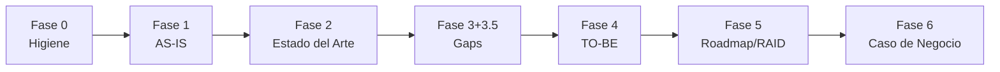

# Advisory Credi10 2.0 - Framework Zero-Drift

> *(Index placeholder generado por FEAT-001; se enriquece en features posteriores.)*

Este directorio contiene los informes del advisory ejecutado con el framework **Zero-Drift** (Comite de Gobierno + 3 Celulas, 17 roles, 7 fases con stage-gates QG-0..QG-6, RACI-V, AICV-E y Hilo Dorado).

## Corpus de evidencia

- Documentos PDF: **15**
- Diagramas PNG (evidencia binaria): **3**

## Informes por fase

| Fase | Informe | Lider(es) | Verificador | Gate |
| --- | --- | --- | --- | --- |
| Fase 0 - Higiene Epistemica | [00-higiene-epistemica.md](00-higiene-epistemica.md) | AM, TDA, DRE | EM | QG-0 |
| Fase 1 - Contexto AS-IS | [01-contexto-as-is.md](01-contexto-as-is.md) | EA, BA, PIA, TDA | AM | QG-1 |
| Fase 2 - Estado del Arte | [02-estado-del-arte.md](02-estado-del-arte.md) | EA, SME, BA | AM | QG-2 |
| Fase 3 + 3.5 - Gaps y Viabilizacion | [03-gaps-y-viabilizacion.md](03-gaps-y-viabilizacion.md) | EA, DRE, PIA | AM | QG-3 |
| Fase 4 - Diseno TO-BE | [04-diseno-to-be.md](04-diseno-to-be.md) | SA, DA, PM, UX | AM | QG-4 |
| Fase 5 - Roadmap, Estimacion y RAID | [05-roadmap-estimacion-raid.md](05-roadmap-estimacion-raid.md) | EM, SA, PM, ORG | AM | QG-5 |
| Fase 6 - Caso de Negocio | [06-caso-de-negocio.md](06-caso-de-negocio.md) | ED, FIN, EA | AM | QG-6 |

## Flujo de fases (Hilo Dorado)

