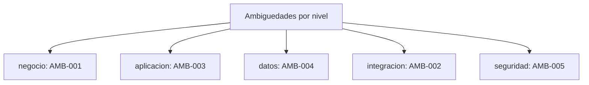

# Registro transversal: Ambiguedades (AMB-xxx)

> Ambiguedades del proyecto que requieren decision o aclaracion antes de comprometer alcance. Registro **transversal** del dossier TO-BE Credi10 2.0, con una entrada por fila, cada una con **ID**, **nivel arquitectonico**, **severidad/impacto**, **estado** y **etiqueta epistemica** donde aplique. Generado de forma determinista por el motor del advisory.

Niveles arquitectonicos cubiertos: **negocio**, **aplicacion**, **datos**, **integracion**, **infraestructura**, **seguridad**.

> Etiquetas epistemicas: **[VERIFIED-FACT]** evidencia explicita del corpus; **[DOC-ASSUMPTION]** supuesto a validar; **[DOC-CONFLICT]** contradiccion entre fuentes; **[EPISTEMIC-VOID]** sin base documental (no se fabrica evidencia).

## Mapa por nivel arquitectonico

## Tabla de ambiguedades

| ID | Nivel | Titulo | Descripcion | Severidad | Estado | Etiqueta | Fuente |
| --- | --- | --- | --- | --- | --- | --- | --- |
| AMB-001 | negocio | Alcance: universo Studio F vs. universo Credi10 | El assessment WSO2/Studio F describe +150 aplicaciones .NET y +200 bases de datos a nivel grupo Studio F, mientras el corpus de Credi10 evidencia ~20 componentes/modulos (MOD-01..MOD-17 + diagramas). No es claro cuanto del universo Studio F entra en el alcance de Credi10 2.0. | Alta | Abierto | [DOC-CONFLICT] | WSO2 y Studio F - Assessment Mayo2026-Final.pdf; RFP_CREDI10_2_0.pdf |
| AMB-002 | integracion | Contrato real del Web Service unico de Siesa | El corpus confirma un UNICO Web Service y archivos planos batch contra Siesa/UnoEE (GAP-001), pero no documenta sus operaciones, esquemas ni SLAs, por lo que el alcance exacto del desacople no es derivable del corpus. | Alta | Abierto | [EPISTEMIC-VOID] | WSO2 y Studio F - Assessment Mayo2026-Final.pdf; Envio_de_RCL_y_RCR.pdf |
| AMB-003 | aplicacion | Detalle funcional de PDFs solo-imagen | Varios documentos de proceso (Captura Foto, Llamada predictiva, Boton Ecommerce, entre otros) son PDFs mayormente de imagen sin capa de texto explotable; sus reglas finas no son verificables desde el corpus y se registran como vacio epistemico, no se fabrican. | Media | Abierto | [EPISTEMIC-VOID] | Base de Conocimiento (knowledge-base/): documentos de banda baja/nula |
| AMB-004 | datos | Umbrales de scoring y decision del estudio de credito | El flujo CrossCore -> Inspektor -> Datacredito/Dictum esta evidenciado, pero los umbrales de score para APROBADO/RECHAZADO/REVISION y la regla de no-hit (EX-03) no aparecen en el corpus; deben confirmarse con negocio. | Media | Abierto | [DOC-ASSUMPTION] | Originacion_CrossCore.pdf; Originacion_API_Datacredito.pdf |
| AMB-005 | seguridad | Requisitos de cumplimiento (habeas data / PCI) no explicitos | El manejo de datos de buros de credito y de pagos (PayU) sugiere obligaciones de proteccion de datos y PCI, pero el corpus no detalla requisitos de cumplimiento; se marca como supuesto a validar. | Media | Abierto | [DOC-ASSUMPTION] | Originacion_API_Datacredito.pdf; LinkDePagos.pdf |

## Resumen

| Metrica | Valor |
| --- | ---: |
| Entradas registradas | 5 |
| Niveles con al menos una entrada | 5 de 6 |
| Etiquetas epistemicas presentes | [DOC-ASSUMPTION], [DOC-CONFLICT], [EPISTEMIC-VOID] |

> **Veredicto de completitud:** registro AMB con 5 entradas, todas con ID + nivel + severidad + estado.

