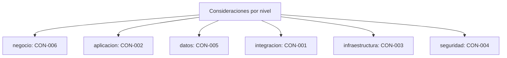

# Registro transversal: Consideraciones (CON-xxx)

> Consideraciones de diseno y gobierno que condicionan el TO-BE sin ser restricciones duras. Registro **transversal** del dossier TO-BE Credi10 2.0, con una entrada por fila, cada una con **ID**, **nivel arquitectonico**, **severidad/impacto**, **estado** y **etiqueta epistemica** donde aplique. Generado de forma determinista por el motor del advisory.

Niveles arquitectonicos cubiertos: **negocio**, **aplicacion**, **datos**, **integracion**, **infraestructura**, **seguridad**.

> Etiquetas epistemicas: **[VERIFIED-FACT]** evidencia explicita del corpus; **[DOC-ASSUMPTION]** supuesto a validar; **[DOC-CONFLICT]** contradiccion entre fuentes; **[EPISTEMIC-VOID]** sin base documental (no se fabrica evidencia).

## Mapa por nivel arquitectonico

## Tabla de consideraciones

| ID | Nivel | Titulo | Descripcion | Impacto | Estado | Etiqueta | Fuente |
| --- | --- | --- | --- | --- | --- | --- | --- |
| CON-001 | integracion | Desacople incremental de Siesa (patron Strangler Fig) | El desacople del WS unico/archivos planos debe ser incremental (Strangler Fig) desviando por Data Services + eventos sin interrumpir la operacion (SBB-002, SBB-003). | Alta | Vigente | [DOC-ASSUMPTION] | Fase 4 (ADR-002); Fase 3 (REL-001/REL-002) |
| CON-002 | aplicacion | Preservar reglas de negocio al modernizar | El RFP exige preservar las reglas de negocio existentes (RN-01..RN-04) al migrar a .NET 8 y a servicios de dominio; considerar pruebas de equivalencia funcional. | Alta | Vigente | [VERIFIED-FACT] | RFP_CREDI10_2_0.pdf; Fase 3 (reglas de negocio) |
| CON-003 | infraestructura | Estrategia cloud AWS con control de costo | El TO-BE despliega en AWS (VPC, ALB, WAF, contenedores) con escalamiento elastico; considerar IaC y disciplina FinOps para no degradar el costo (DRV-003, 80% -> 80%). | Media | Vigente | [DOC-ASSUMPTION] | Arquitectura_Infraestructura_AWS_Credi10.png; Fase 4 (ADR-006, SBB-008) |
| CON-004 | seguridad | Modelo zero-trust y cifrado de datos sensibles | El manejo de datos de buros y pagos obliga a considerar autenticacion fuerte en el API Gateway, cifrado extremo a extremo y minimizacion de datos (Threat Modeling STRIDE de la Fase 4). | Alta | Vigente | [DOC-ASSUMPTION] | Fase 4 (Threat Modeling); Originacion_API_Datacredito.pdf |
| CON-005 | datos | Gobierno de dominios de datos (fuente unica de verdad) | Consolidar las +200 BDs implica definir duenio por dominio y consumo via API/eventos en lugar de replicar bases; considerar migracion y CDC donde aplique (SBB-007). | Media | Vigente | [DOC-ASSUMPTION] | Fase 4 (ADR-005); Fase 3 (GAP-003) |
| CON-006 | negocio | Omnicanalidad de atencion y cobranza | Los canales Wolkvox/B2Chat (atencion) y SMS/WhatsApp/Email + llamada predictiva (cobranza) deben integrarse de forma consistente con el bus de eventos para evitar mensajes duplicados. | Media | Vigente | [DOC-ASSUMPTION] | Api_Integrador_Atencion_al_cliente.pdf; Llamada_predictiva.pdf |

## Resumen

| Metrica | Valor |
| --- | ---: |
| Entradas registradas | 6 |
| Niveles con al menos una entrada | 6 de 6 |
| Etiquetas epistemicas presentes | [DOC-ASSUMPTION], [VERIFIED-FACT] |

> **Veredicto de completitud:** registro CON con 6 entradas, todas con ID + nivel + severidad + estado.

