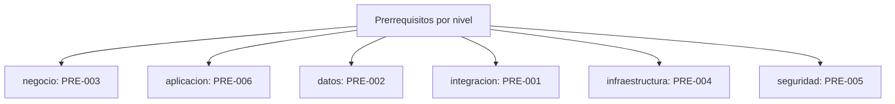

# Registro transversal: Prerrequisitos (PRE-xxx)

> Prerrequisitos que deben cumplirse antes de construir/desplegar cada frente. Registro **transversal** del dossier TO-BE Credi10 2.0, con una entrada por fila, cada una con **ID**, **nivel arquitectonico**, **severidad/impacto**, **estado** y **etiqueta epistemica** donde aplique. Generado de forma determinista por el motor del advisory.

Niveles arquitectonicos cubiertos: **negocio**, **aplicacion**, **datos**, **integracion**, **infraestructura**, **seguridad**.

> Etiquetas epistemicas: **[VERIFIED-FACT]** evidencia explicita del corpus; **[DOC-ASSUMPTION]** supuesto a validar; **[DOC-CONFLICT]** contradiccion entre fuentes; **[EPISTEMIC-VOID]** sin base documental (no se fabrica evidencia).

## Mapa por nivel arquitectonico

## Tabla de prerrequisitos

| ID | Nivel | Titulo | Descripcion | Prioridad | Estado | Etiqueta | Fuente |
| --- | --- | --- | --- | --- | --- | --- | --- |
| PRE-001 | integracion | Especificacion del contrato del WS/Data Services de Siesa | Antes de construir el desacople se requiere la especificacion real de las operaciones del ERP Siesa (hoy [EPISTEMIC-VOID]) para definir los Data Services (SBB-002). | Alta | Pendiente | [EPISTEMIC-VOID] | AMB-002; WSO2 y Studio F - Assessment Mayo2026-Final.pdf |
| PRE-002 | datos | Inventario y clasificacion de las +200 bases de datos | La consolidacion a fuente unica de verdad (SBB-007) requiere primero inventariar y clasificar las +200 BDs duplicadas por dominio. | Alta | Pendiente | [VERIFIED-FACT] | WSO2 y Studio F - Assessment Mayo2026-Final.pdf; Fase 3 (GAP-003) |
| PRE-003 | negocio | Confirmacion de umbrales de scoring y reglas de decision | El negocio debe confirmar los umbrales de APROBADO/RECHAZADO/REVISION y la regla de no-hit antes de automatizar el estudio de credito (AMB-004). | Alta | Pendiente | [DOC-ASSUMPTION] | AMB-004; Originacion_API_Datacredito.pdf |
| PRE-004 | infraestructura | Cuenta AWS, VPC y conectividad Telmex habilitadas | El despliegue TO-BE requiere la cuenta AWS, red (VPC/ALB/WAF) y el tunel VPN IPSec con Telmex operativos antes de la primera ola. | Media | Pendiente | [VERIFIED-FACT] | Arquitectura_Infraestructura_AWS_Credi10.png |
| PRE-005 | seguridad | Definicion de requisitos de cumplimiento (habeas data / PCI) | Antes del diseno de seguridad detallado se deben confirmar los requisitos de cumplimiento aplicables al tratamiento de datos de credito y pagos (AMB-005, RST-005). | Media | Pendiente | [DOC-ASSUMPTION] | AMB-005; RST-005 |
| PRE-006 | aplicacion | Base de pruebas de equivalencia de reglas de negocio | Para preservar RN-01..RN-04 (RST-001) al migrar a .NET 8 se requiere una base de casos de prueba de equivalencia funcional del legado. | Media | Pendiente | [DOC-ASSUMPTION] | RST-001; RFP_CREDI10_2_0.pdf |

## Resumen

| Metrica | Valor |
| --- | ---: |
| Entradas registradas | 6 |
| Niveles con al menos una entrada | 6 de 6 |
| Etiquetas epistemicas presentes | [DOC-ASSUMPTION], [EPISTEMIC-VOID], [VERIFIED-FACT] |

> **Veredicto de completitud:** registro PRE con 6 entradas, todas con ID + nivel + severidad + estado.

