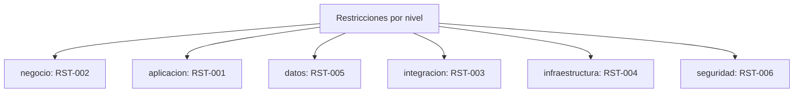

# Registro transversal: Restricciones (RST-xxx)

> Restricciones duras del proyecto (RFP, legado, cumplimiento) que acotan el diseno. Registro **transversal** del dossier TO-BE Credi10 2.0, con una entrada por fila, cada una con **ID**, **nivel arquitectonico**, **severidad/impacto**, **estado** y **etiqueta epistemica** donde aplique. Generado de forma determinista por el motor del advisory.

Niveles arquitectonicos cubiertos: **negocio**, **aplicacion**, **datos**, **integracion**, **infraestructura**, **seguridad**.

> Etiquetas epistemicas: **[VERIFIED-FACT]** evidencia explicita del corpus; **[DOC-ASSUMPTION]** supuesto a validar; **[DOC-CONFLICT]** contradiccion entre fuentes; **[EPISTEMIC-VOID]** sin base documental (no se fabrica evidencia).

## Mapa por nivel arquitectonico

## Tabla de restricciones

| ID | Nivel | Titulo | Descripcion | Severidad | Estado | Etiqueta | Fuente |
| --- | --- | --- | --- | --- | --- | --- | --- |
| RST-001 | aplicacion | Preservar las reglas de negocio existentes | Requisito del RFP: la modernizacion no puede alterar las reglas de negocio vigentes (RN-01..RN-04); es una restriccion dura del proyecto. | Alta | Activa | [VERIFIED-FACT] | RFP_CREDI10_2_0.pdf |
| RST-002 | negocio | Continuidad operativa durante la transformacion | La operacion de originacion, pagos, recaudo y cobranza no puede detenerse; la migracion debe ser incremental y reversible por ola. | Alta | Activa | [DOC-ASSUMPTION] | RFP_CREDI10_2_0.pdf; Fase 5 (olas de entrega) |
| RST-003 | integracion | Integracion obligatoria con el ERP Siesa/UnoEE | Siesa/UnoEE permanece como ERP; el TO-BE debe integrarse con el (via Data Services + eventos) y jamas escribir directo a su BD (ADR-002). | Alta | Activa | [VERIFIED-FACT] | WSO2 y Studio F - Assessment Mayo2026-Final.pdf; Envio_de_RCL_y_RCR.pdf |
| RST-004 | infraestructura | Ventanas de mantenimiento y conectividad Telmex | Los procesos batch (p. ej. corte de cartera) y la dependencia de la VPN IPSec con Telmex imponen ventanas y restricciones de conectividad para despliegues y cortes. | Media | Activa | [DOC-ASSUMPTION] | ProcesoCorteCartera.pdf; Arquitectura_Infraestructura_AWS_Credi10.png |
| RST-005 | datos | Cumplimiento en el tratamiento de datos de credito y pago | El tratamiento de datos de buros (Datacredito/Inspektor) y de pagos (PayU) restringe el diseno a practicas de proteccion de datos y trazabilidad; se asume habeas data/PCI a confirmar. | Alta | Activa | [DOC-ASSUMPTION] | Originacion_API_Datacredito.pdf; LinkDePagos.pdf |
| RST-006 | seguridad | Stack tecnologico objetivo acotado (.NET 8 + WSO2 + AWS) | Las decisiones de arquitectura (ADR-001..006) fijan el stack objetivo (.NET 8, WSO2 API/Integration Platform, AWS, SQL Server); cualquier alternativa es recalibrable pero restringe el diseno base. | Media | Activa | [DOC-ASSUMPTION] | Fase 4 (ADR-001, ADR-004, ADR-006) |

## Resumen

| Metrica | Valor |
| --- | ---: |
| Entradas registradas | 6 |
| Niveles con al menos una entrada | 6 de 6 |
| Etiquetas epistemicas presentes | [DOC-ASSUMPTION], [VERIFIED-FACT] |

> **Veredicto de completitud:** registro RST con 6 entradas, todas con ID + nivel + severidad + estado.

