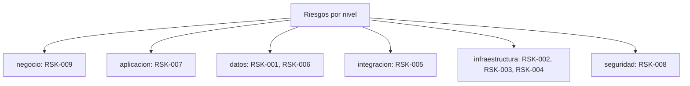

# Registro transversal: Riesgos (RSK-xxx)

> Riesgos del proyecto con su severidad, estado de mitigacion y trazabilidad al Hilo Dorado (GAP/SBB/ADR). Registro **transversal** del dossier TO-BE Credi10 2.0, con una entrada por fila, cada una con **ID**, **nivel arquitectonico**, **severidad/impacto**, **estado** y **etiqueta epistemica** donde aplique. Generado de forma determinista por el motor del advisory.

Niveles arquitectonicos cubiertos: **negocio**, **aplicacion**, **datos**, **integracion**, **infraestructura**, **seguridad**.

> Etiquetas epistemicas: **[VERIFIED-FACT]** evidencia explicita del corpus; **[DOC-ASSUMPTION]** supuesto a validar; **[DOC-CONFLICT]** contradiccion entre fuentes; **[EPISTEMIC-VOID]** sin base documental (no se fabrica evidencia).

## Mapa por nivel arquitectonico

## Tabla de riesgos

| ID | Nivel | Titulo | Descripcion | Severidad | Estado | Etiqueta | Fuente |
| --- | --- | --- | --- | --- | --- | --- | --- |
| RSK-001 | datos | Lectura/escritura directa a la BD del ERP Siesa | Practica de ALTO RIESGO evidenciada en el assessment: por la lentitud del WS unico se accede directo a la base de datos del ERP Siesa (GAP-002), con riesgo de corrupcion de datos e indisponibilidad. El TO-BE lo prohibe via Data Services (ADR-002, SBB-002). | Alta | Mitigando | [VERIFIED-FACT] | WSO2 y Studio F - Assessment Mayo2026-Final.pdf; Fase 3 (GAP-002) |
| RSK-002 | infraestructura | Obsolescencia de runtime .NET Framework 4.8 y .NET Core 3.1 | Componentes criticos corren sobre .NET Framework 4.8 y .NET Core 3.1, ambos fuera de soporte (GAP-005), con riesgo de seguridad y mantenibilidad. El TO-BE migra a .NET 8 (ADR-003, SBB-006). | Alta | Mitigando | [VERIFIED-FACT] | WSO2 y Studio F - Assessment Mayo2026-Final.pdf; Fase 3 (GAP-005) |
| RSK-003 | infraestructura | Dependencia de la VPN IPSec con Telmex | La conectividad hacia servicios/erp depende de un tunel VPN IPSec con Telmex; es un punto unico de dependencia operativa descrito en la arquitectura de infraestructura AWS. | Media | Abierto | [VERIFIED-FACT] | Arquitectura_Infraestructura_AWS_Credi10.png |
| RSK-004 | infraestructura | Licenciamiento de SQL Server Enterprise | El stack de datos usa SQL Server (edicion Enterprise), con riesgo de costo/cumplimiento de licenciamiento al escalar o consolidar las +200 BDs; debe gobernarse en el caso de negocio. | Media | Abierto | [DOC-ASSUMPTION] | Arquitectura_Infraestructura_AWS_Credi10.png; Assessment WSO2/Studio F |
| RSK-005 | integracion | Integracion fragmentada por batch y archivos planos | La integracion con Siesa es en su mayoria batch por archivos planos y un WS unico (GAP-001), con falta de sincronizacion y errores que requieren intervencion manual; riesgo de latencia e inconsistencia. | Alta | Mitigando | [VERIFIED-FACT] | WSO2 y Studio F - Assessment Mayo2026-Final.pdf; Fase 3 (GAP-001) |
| RSK-006 | datos | Inconsistencia por +200 bases de datos duplicadas | A nivel grupo existen +200 BDs duplicadas/inconsistentes con logica repetida y controles manuales en Excel (GAP-003); riesgo de datos poco confiables. El TO-BE define fuente unica de verdad (ADR-005, SBB-007). | Alta | Mitigando | [VERIFIED-FACT] | WSO2 y Studio F - Assessment Mayo2026-Final.pdf; Fase 3 (GAP-003) |
| RSK-007 | aplicacion | Portal B2C sobre Wordpress/XAMPP en produccion | El canal B2C corre parcialmente sobre Wordpress/XAMPP en produccion (GAP-005), ampliando la superficie de ataque y la fragilidad operativa; el TO-BE lo moderniza a .NET 8 (SBB-006). | Media | Mitigando | [VERIFIED-FACT] | B2C.pdf; Fase 3 (GAP-005) |
| RSK-008 | seguridad | Integraciones dispersas sin trazabilidad de errores | Las integraciones viven en servicios de Windows y cronjobs sin gestion centralizada ni observabilidad (GAP-004); riesgo de incidentes opacos y MTTR elevado. El TO-BE centraliza con API Management y observabilidad (SBB-001, SBB-005). | Media | Mitigando | [VERIFIED-FACT] | WSO2 y Studio F - Assessment Mayo2026-Final.pdf; Fase 3 (GAP-004) |
| RSK-009 | negocio | Riesgo de desfase por specs recuperadas aun sin ratificar | La capa de texto nativa del corpus de proceso fue recuperada (hoy banda 'alta' [VERIFIED-FACT]); el riesgo residual ya NO es de legibilidad sino de que las specs recuperadas (originacion, cartera, pagos, integracion WSO2) no se ratifiquen 1:1 con el negocio antes de construir, lo que puede derivar en retrabajo de alcance. | Media | Abierto | [DOC-ASSUMPTION] | Base de Conocimiento (knowledge-base/coverage-checklist.md) |

## Resumen

| Metrica | Valor |
| --- | ---: |
| Entradas registradas | 9 |
| Niveles con al menos una entrada | 6 de 6 |
| Etiquetas epistemicas presentes | [DOC-ASSUMPTION], [VERIFIED-FACT] |

> **Veredicto de completitud:** registro RSK con 9 entradas, todas con ID + nivel + severidad + estado.

