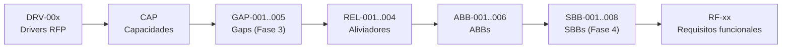

# 01 - Requisitos (TO-BE Credi10 2.0)

> Capitulo de **requisitos** del dossier TO-BE. Deriva los requisitos funcionales de la unica fuente de verdad de modulos (`advisory-system/phases/modules.py`, MOD-01..MOD-17), define los NFR ISO 25010 ligados a los indicadores del RFP, lista las reglas de negocio a preservar y traza todo al **Hilo Dorado** (DRV -> CAP -> GAP -> REL -> ABB -> SBB). La trazabilidad se apoya en la Base de Conocimiento (**18** documentos ingeridos sin muestreo).

> Etiquetas epistemicas: **[VERIFIED-FACT]** evidencia explicita del corpus; **[DOC-ASSUMPTION]** supuesto a validar; **[DOC-CONFLICT]** contradiccion entre fuentes; **[EPISTEMIC-VOID]** sin base documental (no se fabrica evidencia).

## Trazabilidad al Hilo Dorado

## Requisitos funcionales por modulo

Universo completo: **17** modulos (sin muestreo), **17** historias de usuario (ver `03-specs/` y el catalogo 04b).

| RF | Modulo | Bounded Context | Requisito funcional (desde HU) | ABBs | Fuente (KB) |
| --- | --- | --- | --- | --- | --- |
| RF-01 | MOD-01 | Plataforma / Core | parametrizar y administrar los productos de credito y sus obligaciones desde una plataforma central | ABB-004, ABB-005 | RFP_CREDI10_2_0.pdf |
| RF-02 | MOD-02 | Estudio de Credito | consultar CrossCore como primer eslabon del estudio de credito | ABB-001, ABB-004 | Originacion_CrossCore.pdf |
| RF-03 | MOD-03 | Estudio de Credito | consultar Inspektor tras CrossCore | ABB-001, ABB-004 | Originacion_API_Inspektor.pdf |
| RF-04 | MOD-04 | Estudio de Credito | consultar Datacredito/Dictum al cierre del estudio | ABB-001, ABB-004 | Originacion_API_Datacredito.pdf |
| RF-05 | MOD-05 | Originacion | revisar y resolver manualmente las solicitudes en cola de revision | ABB-004, ABB-005 | Originacion_Aplicacion_ADMIN.pdf |
| RF-06 | MOD-06 | Pagos | generar la orden de pago de una obligacion | ABB-001, ABB-003 | GenerarPagos.pdf |
| RF-07 | MOD-07 | Corte / Cartera | ejecutar el corte de cartera periodico | ABB-004, ABB-005 | ProcesoCorteCartera.pdf |
| RF-08 | MOD-08 | Recaudo | pagar mi obligacion mediante un link de recaudo | ABB-001, ABB-003 | LinkDePagos.pdf |
| RF-09 | MOD-09 | B2C / E-commerce | consultar mis obligaciones y pagar desde el portal B2C | ABB-001, ABB-006 | B2C.pdf |
| RF-10 | MOD-10 | B2C / E-commerce | ofrecer el boton de pago e-commerce de Credi10 | ABB-001, ABB-003 | BotonEcommerce.pdf |
| RF-11 | MOD-11 | Originacion | capturar la foto del documento del cliente | ABB-004 | Captura_Foto.pdf |
| RF-12 | MOD-12 | Atencion al Cliente | consultar el estado del cliente desde una API integradora omnicanal | ABB-001, ABB-004 | Api_Integrador_Atencion_al_cliente.pdf |
| RF-13 | MOD-13 | Cobranza | ejecutar campanas de llamada predictiva | ABB-001, ABB-004 | Llamada_predictiva.pdf |
| RF-14 | MOD-14 | Cobranza | programar envios de cobranza por SMS/WhatsApp/Email con un scheduler | ABB-003, ABB-004 | RFP_CREDI10_2_0.pdf |
| RF-15 | MOD-15 | Integracion ERP | generar y enviar los documentos RCL/RCR tras el desembolso | ABB-002, ABB-003 | Envio_de_RCL_y_RCR.pdf |
| RF-16 | MOD-16 | Integracion ERP | sincronizar con el ERP Siesa/UnoEE via Data Services y eventos | ABB-002, ABB-003 | WSO2 y Studio F - Assessment Mayo2026-Final.pdf |
| RF-17 | MOD-17 | Cartera | disponer de tableros de fidelizacion y BI (Pentaho) | ABB-004, ABB-005 | RFP_CREDI10_2_0.pdf |

## Requisitos no funcionales (ISO/IEC 25010)

| Caracteristica ISO 25010 | NFR TO-BE | Objetivo (indicador RFP) | SBB habilitador |
| --- | --- | --- | --- |
| Fiabilidad (disponibilidad) | Disponibilidad de servicios criticos | 90% -> 99% (DRV-001) | SBB-001, SBB-005 |
| Eficiencia de desempenio | Latencia de estudio/recaudo | 60% -> 80% (DRV-002); sin linea base instrumentada hoy [EPISTEMIC-VOID] | SBB-002, SBB-003 |
| Compatibilidad | Integracion estandarizada (APIs + eventos) | Retirar archivos planos y WS unico | SBB-001, SBB-003 |
| Mantenibilidad | Reglas centralizadas sin duplicar | 50% -> 100% (DRV-004) | SBB-004, SBB-007 |
| Seguridad | Zero-trust, cifrado y trazabilidad | Cerrar brechas de gobernanza | SBB-001, SBB-005 |
| Portabilidad | Runtime contenerizado .NET 8 | 70% -> 100% (DRV-005) | SBB-006, SBB-008 |

## Reglas de negocio a preservar

Un requisito del RFP es **preservar las reglas de negocio existentes**:

| Regla | Descripcion | Preservacion (requisito RFP) |
| --- | --- | --- |
| RN-01 | El estudio encadena CrossCore -> Inspektor -> Datacredito/Dictum antes de decidir | Preservar [VERIFIED-FACT] |
| RN-02 | Una solicitud rechazada en cualquier buro detiene el flujo | Preservar [VERIFIED-FACT] |
| RN-03 | El desembolso genera RCL/RCR en UnoEE y se timbra con Numrot | Preservar [VERIFIED-FACT] |
| RN-04 | El recaudo solo se marca aplicado tras confirmacion de PayU | Preservar [VERIFIED-FACT] |

> **Veredicto de cobertura:** requisitos funcionales para los 17 modulos declarados, NFR ISO 25010 ligados a DRV-001..DRV-005 y reglas RN-01..RN-04 preservadas.

